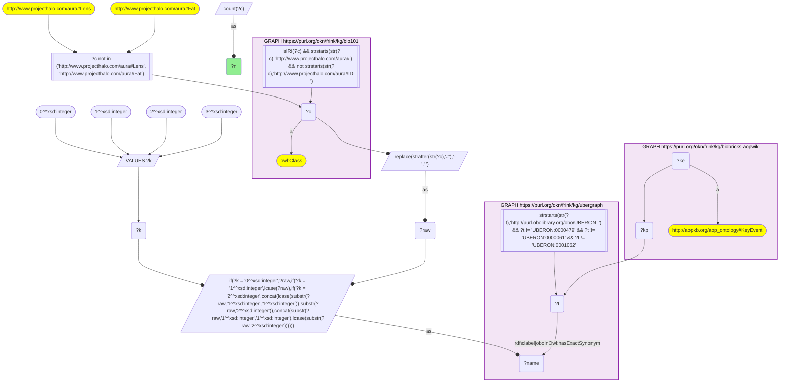
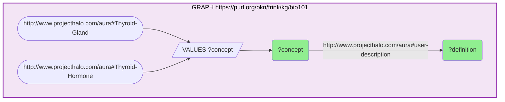
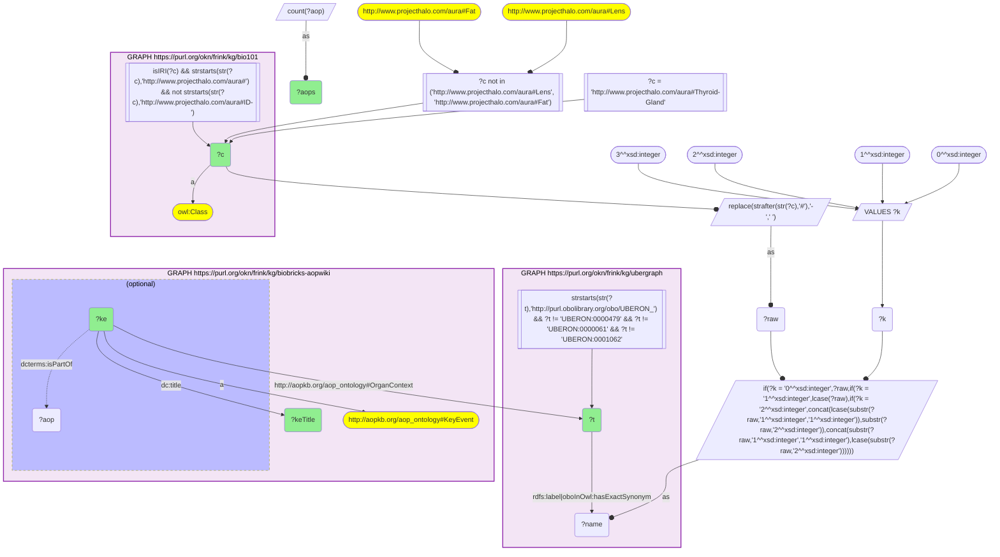
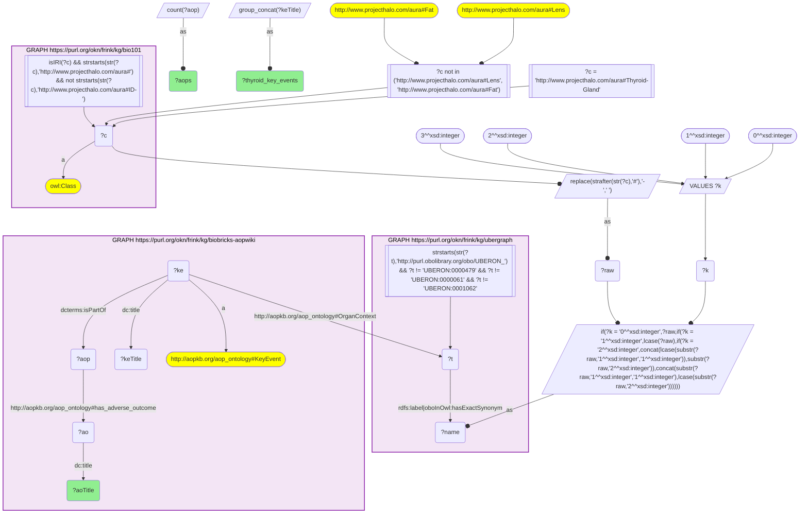

# AN12-Q2: The thyroid gland: KB Bio 101's description beside AOP-Wiki's thyroid key events

- **Date:** 2026-11-03
- **Model:** claude-opus-5-5
- **SPARQL endpoint:** https://apps.okn.us/federation/sparql
- **Generated by:** mcp-okn v0.3.0 (build 7687738)
- **Contents:** 4 queries · 4 query diagrams

## Knowledge graphs used

- `bio101` — <https://purl.org/okn/frink/kg/bio101>
- `ubergraph` — <https://purl.org/okn/frink/kg/ubergraph>
- `biobricks-aopwiki` — <https://purl.org/okn/frink/kg/biobricks-aopwiki>

## Conversation

👤 **User**

Crosswalk: `bio101` × `biobricks-aopwiki` on **UBERON (bio101 label), bridged through `ubergraph`** (crosswalk `KB8-uberon-label-bio101-aopwiki`, verified_count 48). KB Bio 101 is an OWL ontology of an introductory biology textbook: every concept is an `owl:Class` IRI `http://www.projecthalo.com/aura#{Name}` with no `rdfs:label` and no external id, so the concept NAME (local name, hyphens → spaces, four case forms: as-is, all lower-case, first letter lowered, sentence case) is matched as a bound literal against ubergraph `rdfs:label | oboInOwl:hasExactSynonym` on `obo/UBERON_` terms. AOP-Wiki (`biobricks-aopwiki`) mints each ontology term it uses as a node and attaches it to an `aopo:KeyEvent` through a role predicate — `aopo:OrganContext` (organ), `aopo:CellTypeContext` (cell type), `obo:GO_0008150` (the key event's biological process) or `obo:PATO_0001241` (the biological object the key event acts on); key events belong to adverse outcome pathways through `dcterms:isPartOf`, and an AOP names its outcome with `aopo:has_adverse_outcome`.

Research question: what does KB Bio 101 say the thyroid gland does, and which AOP-Wiki key events are set in the thyroid? Which adverse outcome pathways run through them, and what outcomes do those pathways end in?

Why the join is required: the textbook definition of the thyroid (it secretes thyroid hormone) lives only in bio101, the toxicological pathways only in AOP-Wiki, and they share no identifier — only the name → UBERON bridge connects them.

---

🧠 **Assistant**

**Bridge established (Query 1).** The crosswalk skeleton, run verbatim, returns **48** bio101 concepts matched to UBERON terms that AOP-Wiki key events use, matching the catalogued `verified_count`; Thyroid-Gland is one of them (→ UBERON_0002046, *thyroid gland*).

**What the textbook says (Query 2).** bio101's `aura:user-description` for **Thyroid-Gland** reads: "An endocrine gland located in the neck, below the thyroid cartilage. It secretes the hormones triiodothyronine (T3) and thyroxine (T2), which regulate the metabolic rate. It also secretes the hormone calcitonin, …" (the stored text has its spaces stripped after the first sentence, and says "T2" where thyroxine is T4). For **Thyroid-Hormone** it says: "A hormone produced by the thyroid gland. The thyroid hormones are thyroxine (T4) and triiodothyronine (T3)."

**AOP-Wiki's thyroid key events (Query 3).** Three key events are set in the thyroid organ context:

| Key event | Title | AOPs |
|---|---|---|
| aop.events/277 | Thyroid hormone synthesis, Decreased | 20 |
| aop.events/425 | Decrease of Thyroidal iodide | 4 |
| aop.events/741 | Increase, Adenomas/carcinomas (follicular cell) | 3 |

The first two describe exactly the function the textbook gives the gland — producing T3/T4 — being disrupted: less hormone made, and less iodide (the raw material of thyroid hormone) taken up. The third is a tumour outcome in the follicular cells that make the hormone.

**Where those pathways end (Query 4).** The AOPs through these key events end in 11 distinct adverse outcomes:

| Adverse outcome | AOPs | Thyroid key events on the path |
|---|---|---|
| Altered, Amphibian metamorphosis | 5 | hormone synthesis decreased; thyroidal iodide decreased |
| Cognitive function, decreased | 4 | thyroidal iodide decreased; hormone synthesis decreased |
| Decrease, Population growth rate | 4 | hormone synthesis decreased |
| Increased Mortality | 4 | hormone synthesis decreased |
| Increase, Adenomas/carcinomas (follicular cell) | 3 | hormone synthesis decreased; follicular adenomas/carcinomas |
| Impairment, Learning and memory | 1 | hormone synthesis decreased; thyroidal iodide decreased |
| Increase, seizure | 1 | hormone synthesis decreased |
| Insulin resistance, increased | 1 | hormone synthesis decreased |
| Occurrence, Kidney toxicity | 1 | hormone synthesis decreased |
| Periventricular heterotopia formation | 1 | hormone synthesis decreased |
| Reduction, Cumulative fecundity and spawning | 1 | hormone synthesis decreased |

**Answer.** The textbook defines the thyroid by one job — secreting T3/T4 (and calcitonin) to regulate metabolic rate — and AOP-Wiki's thyroid key events are almost all about losing that job. "Thyroid hormone synthesis, Decreased" alone sits in 20 pathways, whose outcomes run from the developmental (amphibian metamorphosis, cognitive function, learning and memory, periventricular heterotopia) to the population level (growth rate, fecundity and spawning, mortality). Calcitonin, the textbook's second thyroid hormone, appears in none of the thyroid key events.

## SPARQL queries executed

#### Query 1

_2026-11-03T22:10:39+00:00 · `bio101`, `ubergraph`, `biobricks-aopwiki`_

```sparql
SELECT (COUNT(DISTINCT ?c) AS ?n) WHERE {
  { SELECT DISTINCT ?c ?t WHERE {
  { SELECT DISTINCT ?c ?name WHERE {
      GRAPH <https://purl.org/okn/frink/kg/bio101> { ?c a <http://www.w3.org/2002/07/owl#Class> .
        FILTER(isIRI(?c) && STRSTARTS(STR(?c),'http://www.projecthalo.com/aura#') && !STRSTARTS(STR(?c),'http://www.projecthalo.com/aura#ID-')) }
      FILTER(?c NOT IN (<http://www.projecthalo.com/aura#Lens>, <http://www.projecthalo.com/aura#Fat>))  # homonyms (spot-checked 2026-11-03)
      BIND(REPLACE(STRAFTER(STR(?c),'#'),'-',' ') AS ?raw)
      VALUES ?k { 0 1 2 3 }  # as-is, all lower, first letter lowered, sentence case
      BIND(IF(?k = 0, ?raw, IF(?k = 1, LCASE(?raw), IF(?k = 2, CONCAT(LCASE(SUBSTR(?raw,1,1)),SUBSTR(?raw,2)),
                CONCAT(SUBSTR(?raw,1,1),LCASE(SUBSTR(?raw,2)))))) AS ?name)
  } }
    GRAPH <https://purl.org/okn/frink/kg/ubergraph> { ?t <http://www.w3.org/2000/01/rdf-schema#label>|<http://www.geneontology.org/formats/oboInOwl#hasExactSynonym> ?name .
      FILTER(STRSTARTS(STR(?t),'http://purl.obolibrary.org/obo/UBERON_') && ?t != <http://purl.obolibrary.org/obo/UBERON_0000479> && ?t != <http://purl.obolibrary.org/obo/UBERON_0000061> && ?t != <http://purl.obolibrary.org/obo/UBERON_0001062>) }
  } }
  GRAPH <https://purl.org/okn/frink/kg/biobricks-aopwiki> { ?ke a <http://aopkb.org/aop_ontology#KeyEvent> ; ?kp ?t . }
}
```



_1 row(s)_

| n |
| --- |
| 48 |

#### Query 2

_2026-11-03T22:10:40+00:00 · `bio101`_

```sparql
SELECT ?concept ?definition WHERE { GRAPH <https://purl.org/okn/frink/kg/bio101> {
  VALUES ?concept { <http://www.projecthalo.com/aura#Thyroid-Gland> <http://www.projecthalo.com/aura#Thyroid-Hormone> }
  ?concept <http://www.projecthalo.com/aura#user-description> ?definition } }
```



_2 row(s)_

| concept | definition |
| --- | --- |
| http://www.projecthalo.com/aura#Thyroid-Gland | An endocrine gland located in the neck, below the thyroid cartilage. Itsecretesthehormonestriidiothyronine(T3)andthyroxine(T2),whichregulatethemetabolicrate.Italsosecretesthehormonecalcitonin,whichisinvolvedintheregulationofcalciuminthebody. |
| http://www.projecthalo.com/aura#Thyroid-Hormone | A hormone produced by the thyroid gland. The thyroid hormones are thyroxine (T4)andtriiodothyronine(T3). |

#### Query 3

_2026-11-03T22:10:40+00:00 · `bio101`, `ubergraph`, `biobricks-aopwiki`_

```sparql
SELECT ?c ?t ?ke ?keTitle (COUNT(DISTINCT ?aop) AS ?aops) WHERE {
  { SELECT DISTINCT ?c ?t WHERE {
  { SELECT DISTINCT ?c ?name WHERE {
      GRAPH <https://purl.org/okn/frink/kg/bio101> { ?c a <http://www.w3.org/2002/07/owl#Class> .
        FILTER(isIRI(?c) && STRSTARTS(STR(?c),'http://www.projecthalo.com/aura#') && !STRSTARTS(STR(?c),'http://www.projecthalo.com/aura#ID-')) }
      FILTER(?c NOT IN (<http://www.projecthalo.com/aura#Lens>, <http://www.projecthalo.com/aura#Fat>))  # homonyms (spot-checked 2026-11-03)
      BIND(REPLACE(STRAFTER(STR(?c),'#'),'-',' ') AS ?raw)
      VALUES ?k { 0 1 2 3 }  # as-is, all lower, first letter lowered, sentence case
      BIND(IF(?k = 0, ?raw, IF(?k = 1, LCASE(?raw), IF(?k = 2, CONCAT(LCASE(SUBSTR(?raw,1,1)),SUBSTR(?raw,2)),
                CONCAT(SUBSTR(?raw,1,1),LCASE(SUBSTR(?raw,2)))))) AS ?name)
  } }
    GRAPH <https://purl.org/okn/frink/kg/ubergraph> { ?t <http://www.w3.org/2000/01/rdf-schema#label>|<http://www.geneontology.org/formats/oboInOwl#hasExactSynonym> ?name .
      FILTER(STRSTARTS(STR(?t),'http://purl.obolibrary.org/obo/UBERON_') && ?t != <http://purl.obolibrary.org/obo/UBERON_0000479> && ?t != <http://purl.obolibrary.org/obo/UBERON_0000061> && ?t != <http://purl.obolibrary.org/obo/UBERON_0001062>) }
  } }
  FILTER(?c = <http://www.projecthalo.com/aura#Thyroid-Gland>)
  GRAPH <https://purl.org/okn/frink/kg/biobricks-aopwiki> { ?ke a <http://aopkb.org/aop_ontology#KeyEvent> ; <http://aopkb.org/aop_ontology#OrganContext> ?t ; <http://purl.org/dc/elements/1.1/title> ?keTitle . OPTIONAL { ?ke <http://purl.org/dc/terms/isPartOf> ?aop } }
} GROUP BY ?c ?t ?ke ?keTitle ORDER BY DESC(?aops)
```



_3 row(s)_

| c | t | ke | keTitle | aops |
| --- | --- | --- | --- | --- |
| http://www.projecthalo.com/aura#Thyroid-Gland | http://purl.obolibrary.org/obo/UBERON_0002046 | https://identifiers.org/aop.events/277 | Thyroid hormone synthesis, Decreased | 20 |
| http://www.projecthalo.com/aura#Thyroid-Gland | http://purl.obolibrary.org/obo/UBERON_0002046 | https://identifiers.org/aop.events/425 | Decrease of Thyroidal iodide | 4 |
| http://www.projecthalo.com/aura#Thyroid-Gland | http://purl.obolibrary.org/obo/UBERON_0002046 | https://identifiers.org/aop.events/741 | Increase, Adenomas/carcinomas (follicular cell) | 3 |

#### Query 4

_2026-11-03T22:10:41+00:00 · `bio101`, `ubergraph`, `biobricks-aopwiki`_

```sparql
SELECT ?aoTitle (COUNT(DISTINCT ?aop) AS ?aops) (GROUP_CONCAT(DISTINCT ?keTitle; separator=" | ") AS ?thyroid_key_events) WHERE {
  { SELECT DISTINCT ?c ?t WHERE {
  { SELECT DISTINCT ?c ?name WHERE {
      GRAPH <https://purl.org/okn/frink/kg/bio101> { ?c a <http://www.w3.org/2002/07/owl#Class> .
        FILTER(isIRI(?c) && STRSTARTS(STR(?c),'http://www.projecthalo.com/aura#') && !STRSTARTS(STR(?c),'http://www.projecthalo.com/aura#ID-')) }
      FILTER(?c NOT IN (<http://www.projecthalo.com/aura#Lens>, <http://www.projecthalo.com/aura#Fat>))  # homonyms (spot-checked 2026-11-03)
      BIND(REPLACE(STRAFTER(STR(?c),'#'),'-',' ') AS ?raw)
      VALUES ?k { 0 1 2 3 }  # as-is, all lower, first letter lowered, sentence case
      BIND(IF(?k = 0, ?raw, IF(?k = 1, LCASE(?raw), IF(?k = 2, CONCAT(LCASE(SUBSTR(?raw,1,1)),SUBSTR(?raw,2)),
                CONCAT(SUBSTR(?raw,1,1),LCASE(SUBSTR(?raw,2)))))) AS ?name)
  } }
    GRAPH <https://purl.org/okn/frink/kg/ubergraph> { ?t <http://www.w3.org/2000/01/rdf-schema#label>|<http://www.geneontology.org/formats/oboInOwl#hasExactSynonym> ?name .
      FILTER(STRSTARTS(STR(?t),'http://purl.obolibrary.org/obo/UBERON_') && ?t != <http://purl.obolibrary.org/obo/UBERON_0000479> && ?t != <http://purl.obolibrary.org/obo/UBERON_0000061> && ?t != <http://purl.obolibrary.org/obo/UBERON_0001062>) }
  } }
  FILTER(?c = <http://www.projecthalo.com/aura#Thyroid-Gland>)
  GRAPH <https://purl.org/okn/frink/kg/biobricks-aopwiki> { ?ke a <http://aopkb.org/aop_ontology#KeyEvent> ; <http://aopkb.org/aop_ontology#OrganContext> ?t ; <http://purl.org/dc/elements/1.1/title> ?keTitle ; <http://purl.org/dc/terms/isPartOf> ?aop . ?aop <http://aopkb.org/aop_ontology#has_adverse_outcome> ?ao . ?ao <http://purl.org/dc/elements/1.1/title> ?aoTitle . }
} GROUP BY ?aoTitle ORDER BY DESC(?aops) ?aoTitle
```



_11 row(s) — showing first 5_

| aoTitle | aops | thyroid_key_events |
| --- | --- | --- |
| Altered, Amphibian metamorphosis | 5 | Thyroid hormone synthesis, Decreased \| Decrease of Thyroidal iodide |
| Cognitive function, decreased  | 4 | Decrease of Thyroidal iodide \| Thyroid hormone synthesis, Decreased |
| Decrease, Population growth rate | 4 | Thyroid hormone synthesis, Decreased |
| Increased Mortality | 4 | Thyroid hormone synthesis, Decreased |
| Increase, Adenomas/carcinomas (follicular cell) | 3 | Thyroid hormone synthesis, Decreased \| Increase, Adenomas/carcinomas (follicular cell) |
