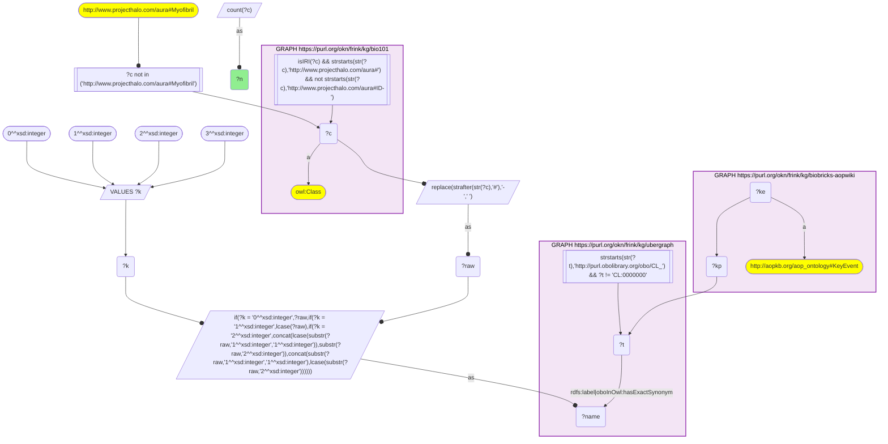
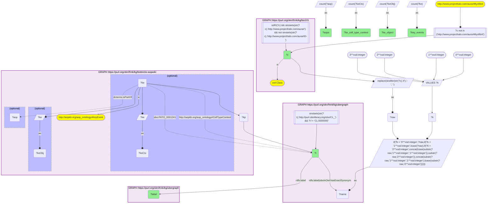

# AN13-Q1: KB Bio 101's textbook cell types ranked by AOP-Wiki key events

- **Date:** 2026-11-03
- **Model:** claude-opus-5-5
- **SPARQL endpoint:** https://apps.okn.us/federation/sparql
- **Generated by:** mcp-okn v0.3.0 (build 7687738)
- **Contents:** 2 queries · 2 query diagrams

## Knowledge graphs used

- `bio101` — <https://purl.org/okn/frink/kg/bio101>
- `ubergraph` — <https://purl.org/okn/frink/kg/ubergraph>
- `biobricks-aopwiki` — <https://purl.org/okn/frink/kg/biobricks-aopwiki>

## Conversation

👤 **User**

Crosswalk: `bio101` × `biobricks-aopwiki` on **CL (bio101 label), bridged through `ubergraph`** (crosswalk `KB10-cl-label-bio101-aopwiki`, verified_count 24). KB Bio 101 is an OWL ontology of an introductory biology textbook: every concept is an `owl:Class` IRI `http://www.projecthalo.com/aura#{Name}` with no `rdfs:label` and no external id, so the concept NAME (local name, hyphens → spaces, four case forms: as-is, all lower-case, first letter lowered, sentence case) is matched as a bound literal against ubergraph `rdfs:label | oboInOwl:hasExactSynonym` on `obo/CL_` terms. AOP-Wiki (`biobricks-aopwiki`) mints each ontology term it uses as a node and attaches it to an `aopo:KeyEvent` through a role predicate — `aopo:OrganContext` (organ), `aopo:CellTypeContext` (cell type), `obo:GO_0008150` (the key event's biological process) or `obo:PATO_0001241` (the biological object the key event acts on); key events belong to adverse outcome pathways through `dcterms:isPartOf`, and an AOP names its outcome with `aopo:has_adverse_outcome`.

Research question: for the cell types KB Bio 101 describes, how many AOP-Wiki key events are set in the matching Cell Ontology cell-type context, or act on that cell type as their biological object, and how many adverse outcome pathways do they belong to? Rank the bridged cell types.

Why the join is required: bio101 knows which cell types a curriculum teaches; AOP-Wiki knows which cell types its pathways act in. They share no identifier, so only the name → CL bridge through ubergraph joins them.

---

🧠 **Assistant**

**Bridge established (Query 1).** The crosswalk skeleton, run verbatim, returns **24** bio101 concepts whose name is an exact Cell Ontology label or exact synonym in ubergraph *and* whose CL term is used by at least one AOP-Wiki key event — matching the catalogued `verified_count`. They reach 23 CL terms: Egg-Cell and Ovum both land on CL_0000025 (*egg cell*).

**Ranking (Query 2).** 17 concepts are a cell-type context (`aopo:CellTypeContext`) of at least one key event and 17 are the biological object a key event acts on (`obo:PATO_0001241`); 7 appear only as an object (Bone-Cell, Gamete, Leukocyte, Lymphocyte, Platelet, Sperm-Cell, Spermatocyte).

| Rank | bio101 concept | CL (ubergraph label) | KEs, cell-type context | KEs, object | Key events | AOPs |
|---|---|---|---|---|---|---|
| 1 | Eukaryotic-Cell | CL_0000255 (eukaryotic cell) | 134 | 0 | 134 | 199 |
| 2 | Nerve-Cell | CL_0000540 (neuron) | 35 | 1 | 36 | 38 |
| 3 | Epithelial-Cell | CL_0000066 (epithelial cell) | 11 | 5 | 15 | 35 |
| 3 | Leydig-Cell | CL_0000178 (Leydig cell) | 13 | 3 | 15 | 10 |
| 5 | Oocyte | CL_0000023 (oocyte) | 6 | 0 | 6 | 12 |
| 6 | Macrophage | CL_0000235 (macrophage) | 1 | 3 | 4 | 12 |
| 6 | Sperm-Cell | CL_0000019 (sperm) | 0 | 4 | 4 | 9 |
| 8 | Dendritic-Cell | CL_0000451 (dendritic cell) | 3 | 0 | 3 | 4 |
| 8 | Erythrocyte | CL_0000232 (erythrocyte) | 1 | 2 | 3 | 1 |
| 8 | Motor-Neuron | CL_0000100 (motor neuron) | 2 | 1 | 3 | 6 |

Four more have 2 key events (Astrocyte, Lymphocyte, Mesenchyme-Cell, Smooth-Muscle-Cell) and the remaining ten have 1 (B-Cell, Bone-Cell, Egg-Cell, Fibroblast, Gamete, Leukocyte, Oligodendrocyte, Ovum, Platelet, Spermatocyte).

**Reading the ranking.**
- **Eukaryotic-Cell is a catch-all, not a finding.** AOP-Wiki uses CL's *eukaryotic cell* as the cell-type context of 134 key events — those with no more specific cell type — so it dwarfs everything else. The informative ranking starts at rank 2.
- Among specific cell types, **neurons** lead (36 key events), then epithelial cells and **Leydig cells** (15 each). The Leydig-cell weight reflects AOP-Wiki's many anti-androgen pathways that act on testosterone production.
- **Oocyte** and **sperm** are both present but reached differently: the oocyte mostly as a cell-type context (6), sperm only as the object of key events (4).
- AOPs per key event differ widely: Astrocyte has 2 key events but 11 AOPs, Bone-Cell 1 key event but 9 AOPs.

Caveats: exact-name lower bound; the CL root *cell* and one homonym (Myofibril) are excluded, as in KB4. Platelet is kept although bio101 files it as a cell structure (a fragment), because CL classes it as a cell.

## SPARQL queries executed

#### Query 1

_2026-11-03T22:10:42+00:00 · `bio101`, `ubergraph`, `biobricks-aopwiki`_

```sparql
SELECT (COUNT(DISTINCT ?c) AS ?n) WHERE {
  { SELECT DISTINCT ?c ?t WHERE {
  { SELECT DISTINCT ?c ?name WHERE {
      GRAPH <https://purl.org/okn/frink/kg/bio101> { ?c a <http://www.w3.org/2002/07/owl#Class> .
        FILTER(isIRI(?c) && STRSTARTS(STR(?c),'http://www.projecthalo.com/aura#') && !STRSTARTS(STR(?c),'http://www.projecthalo.com/aura#ID-')) }
      FILTER(?c NOT IN (<http://www.projecthalo.com/aura#Myofibril>))  # homonyms (spot-checked 2026-11-03)
      BIND(REPLACE(STRAFTER(STR(?c),'#'),'-',' ') AS ?raw)
      VALUES ?k { 0 1 2 3 }  # as-is, all lower, first letter lowered, sentence case
      BIND(IF(?k = 0, ?raw, IF(?k = 1, LCASE(?raw), IF(?k = 2, CONCAT(LCASE(SUBSTR(?raw,1,1)),SUBSTR(?raw,2)),
                CONCAT(SUBSTR(?raw,1,1),LCASE(SUBSTR(?raw,2)))))) AS ?name)
  } }
    GRAPH <https://purl.org/okn/frink/kg/ubergraph> { ?t <http://www.w3.org/2000/01/rdf-schema#label>|<http://www.geneontology.org/formats/oboInOwl#hasExactSynonym> ?name .
      FILTER(STRSTARTS(STR(?t),'http://purl.obolibrary.org/obo/CL_') && ?t != <http://purl.obolibrary.org/obo/CL_0000000>) }
  } }
  GRAPH <https://purl.org/okn/frink/kg/biobricks-aopwiki> { ?ke a <http://aopkb.org/aop_ontology#KeyEvent> ; ?kp ?t . }
}
```



_1 row(s)_

| n |
| --- |
| 24 |

#### Query 2

_2026-11-03T22:10:43+00:00 · `bio101`, `ubergraph`, `biobricks-aopwiki`_

```sparql
SELECT ?c ?t ?label (COUNT(DISTINCT ?keCtx) AS ?ke_cell_type_context) (COUNT(DISTINCT ?keObj) AS ?ke_object) (COUNT(DISTINCT ?ke) AS ?key_events) (COUNT(DISTINCT ?aop) AS ?aops) WHERE {
  { SELECT DISTINCT ?c ?t WHERE {
  { SELECT DISTINCT ?c ?name WHERE {
      GRAPH <https://purl.org/okn/frink/kg/bio101> { ?c a <http://www.w3.org/2002/07/owl#Class> .
        FILTER(isIRI(?c) && STRSTARTS(STR(?c),'http://www.projecthalo.com/aura#') && !STRSTARTS(STR(?c),'http://www.projecthalo.com/aura#ID-')) }
      FILTER(?c NOT IN (<http://www.projecthalo.com/aura#Myofibril>))  # homonyms (spot-checked 2026-11-03)
      BIND(REPLACE(STRAFTER(STR(?c),'#'),'-',' ') AS ?raw)
      VALUES ?k { 0 1 2 3 }  # as-is, all lower, first letter lowered, sentence case
      BIND(IF(?k = 0, ?raw, IF(?k = 1, LCASE(?raw), IF(?k = 2, CONCAT(LCASE(SUBSTR(?raw,1,1)),SUBSTR(?raw,2)),
                CONCAT(SUBSTR(?raw,1,1),LCASE(SUBSTR(?raw,2)))))) AS ?name)
  } }
    GRAPH <https://purl.org/okn/frink/kg/ubergraph> { ?t <http://www.w3.org/2000/01/rdf-schema#label>|<http://www.geneontology.org/formats/oboInOwl#hasExactSynonym> ?name .
      FILTER(STRSTARTS(STR(?t),'http://purl.obolibrary.org/obo/CL_') && ?t != <http://purl.obolibrary.org/obo/CL_0000000>) }
  } }
  GRAPH <https://purl.org/okn/frink/kg/biobricks-aopwiki> { ?ke a <http://aopkb.org/aop_ontology#KeyEvent> ; ?kp ?t .
    OPTIONAL { ?ke <http://aopkb.org/aop_ontology#CellTypeContext> ?t BIND(?ke AS ?keCtx) }
    OPTIONAL { ?ke <http://purl.obolibrary.org/obo/PATO_0001241> ?t BIND(?ke AS ?keObj) }
    OPTIONAL { ?ke <http://purl.org/dc/terms/isPartOf> ?aop } }
  GRAPH <https://purl.org/okn/frink/kg/ubergraph> { ?t <http://www.w3.org/2000/01/rdf-schema#label> ?label }
} GROUP BY ?c ?t ?label ORDER BY DESC(?key_events) ?c
```



_24 row(s) — showing first 5_

| c | t | label | ke_cell_type_context | ke_object | key_events | aops |
| --- | --- | --- | --- | --- | --- | --- |
| http://www.projecthalo.com/aura#Eukaryotic-Cell | http://purl.obolibrary.org/obo/CL_0000255 | eukaryotic cell | 134 | 0 | 134 | 199 |
| http://www.projecthalo.com/aura#Nerve-Cell | http://purl.obolibrary.org/obo/CL_0000540 | neuron | 35 | 1 | 36 | 38 |
| http://www.projecthalo.com/aura#Epithelial-Cell | http://purl.obolibrary.org/obo/CL_0000066 | epithelial cell | 11 | 5 | 15 | 35 |
| http://www.projecthalo.com/aura#Leydig-Cell | http://purl.obolibrary.org/obo/CL_0000178 | Leydig cell | 13 | 3 | 15 | 10 |
| http://www.projecthalo.com/aura#Oocyte | http://purl.obolibrary.org/obo/CL_0000023 | oocyte | 6 | 0 | 6 | 12 |
