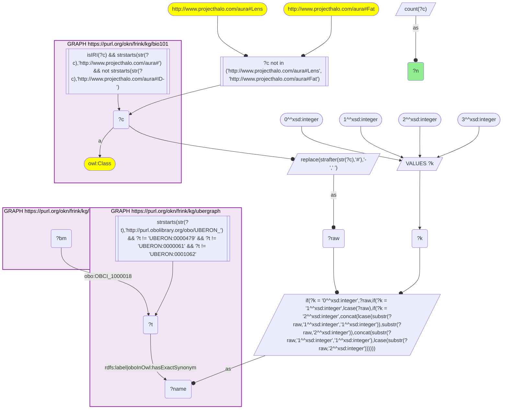

# AN14-Q1: KB Bio 101's body parts and fluids as BiomarkerKB specimens

- **Date:** 2026-11-03
- **Model:** claude-opus-5-5
- **SPARQL endpoint:** https://apps.okn.us/federation/sparql
- **Generated by:** mcp-okn v0.3.0 (build ca8a360)
- **Contents:** 2 queries · 2 query diagrams

## Knowledge graphs used

- `bio101` — <https://purl.org/okn/frink/kg/bio101>
- `ubergraph` — <https://purl.org/okn/frink/kg/ubergraph>
- `biomarkerkg` — <https://purl.org/okn/frink/kg/biomarkerkg>

## Conversation

👤 **User**

Crosswalk: `bio101` × `biomarkerkg` on **UBERON (bio101 label), bridged through `ubergraph`** (crosswalk `KB14-uberon-label-bio101-biomarkerkg`, verified_count 31). KB Bio 101 is an OWL ontology of an introductory biology textbook: every concept is an `owl:Class` IRI `http://www.projecthalo.com/aura#{Name}` with no `rdfs:label` and no external id, so the concept NAME (local name, hyphens → spaces, four case forms: as-is, all lower-case, first letter lowered, sentence case) is matched as a bound literal against ubergraph `rdfs:label | oboInOwl:hasExactSynonym` on `obo/UBERON_` terms. BiomarkerKB (`biomarkerkg`) models each biomarker assessment as a node typed with its BEST category (`obo:OBCI_0000002` diagnostic, `_0000003` monitoring, `_0000005` predictive, `_0000006` prognostic, `_0000008` susceptibility/risk); it names the condition with a role predicate (`obo:OBCI_1000002` diagnostic for, `_1000003` monitors status of, `_1000006` prognostic for, `_1000008` indicates risk of developing) whose object is a raw `obo/MONDO_` IRI, the specimen with `obo:OBCI_1000018` (determined using sample from, an `obo/UBERON_` IRI), its description with `rdfs:label`, and its upstream source with `dcterms:source`.

Research question: which of the organs, tissues and body fluids KB Bio 101 describes are used as the specimen (`obo:OBCI_1000018`) for BiomarkerKB biomarker assessments, how many assessments each, and of which kind? Rank the bridged anatomy.

Why the join is required: bio101 knows the anatomy a curriculum teaches, BiomarkerKB the specimen each biomarker is measured in; they share no identifier, so only the name → UBERON bridge through ubergraph joins them.

---

🧠 **Assistant**

**Bridge established (Query 1).** The crosswalk skeleton, run verbatim, returns **31** bio101 anatomical concepts. Each concept's name is an exact UBERON label or exact synonym in ubergraph, *and* its UBERON term is the specimen (`obo:OBCI_1000018`, "determined using sample from") of at least one BiomarkerKB assessment. This matches the catalogued `verified_count`. Each concept maps to one UBERON term (Query 2 returns 31 rows).

**Ranking (Query 2).**

| Rank | bio101 concept | UBERON | Assessments | Diagnostic | Risk | Prognostic | Monitoring | Predictive | Categorised |
|---|---|---|---|---|---|---|---|---|---|
| 1 | Urine | UBERON_0001088 | 740 | 729 | 1 | 7 | 1 | 2 | 740 |
| 2 | Blood | UBERON_0000178 | 734 | 158 | 323 | 135 | 90 | 16 | 723 |
| 3 | Amniotic-Fluid | UBERON_0000173 | 83 | 74 | 9 | 0 | 0 | 0 | 83 |
| 4 | Bodily-Fluid | UBERON_0006314 | 80 | 80 | 0 | 0 | 0 | 0 | 80 |
| 5 | Cerebrospinal-Fluid | UBERON_0001359 | 77 | 72 | 1 | 0 | 0 | 0 | 73 |
| 6 | Central-Nervous-System | UBERON_0001017 | 52 | 0 | 0 | 0 | 0 | 0 | 0 |
| 7 | Feces | UBERON_0001988 | 46 | 46 | 0 | 0 | 0 | 0 | 46 |
| 8 | Pancreas | UBERON_0001264 | 45 | 0 | 0 | 5 | 0 | 0 | 5 |
| 9 | Ovary | UBERON_0000992 | 36 | 4 | 0 | 20 | 0 | 1 | 25 |
| 10 | Semen | UBERON_0001968 | 35 | 35 | 0 | 0 | 0 | 0 | 35 |
| 11 | Kidney | UBERON_0002113 | 33 | 3 | 0 | 15 | 0 | 0 | 18 |
| 12 | Lung | UBERON_0002048 | 32 | 1 | 0 | 1 | 0 | 0 | 2 |
| 13 | Stomach | UBERON_0000945 | 26 | 9 | 0 | 16 | 0 | 1 | 26 |
| 14 | Cardiovascular-System | UBERON_0004535 | 25 | 0 | 0 | 0 | 0 | 0 | 0 |
| 14 | Prostate-Gland | UBERON_0002367 | 25 | 12 | 0 | 12 | 0 | 1 | 25 |

The remaining 16 concepts have 15 or fewer assessments each: Placenta and Thyroid-Gland 15; Saliva, Skeleton and Uterus 10; Liver and Urinary-Bladder 8; Adipose-Tissue 7; Oral-Cavity 6; Colon 5; Esophagus 4; Interstitial-Fluid 3; Vitreous-Humor 2; and Milk, Smooth-Muscle and Sweat 1 each.

**Answer.** Two body fluids dominate as biomarker specimens, with very different profiles:

- **Urine (740)** is almost purely diagnostic: 729 of its 740 assessments.
- **Blood (734)** is the only specimen that carries every BEST category in volume: 323 susceptibility/risk, 158 diagnostic, 135 prognostic, 90 monitoring and 16 predictive. It holds 90 of the 91 monitoring assessments and 16 of the 24 predictive ones across all 31 specimens.

After those two come the other fluids the textbook teaches: amniotic fluid 83, generic bodily fluid 80, cerebrospinal fluid 77, feces 46 and semen 35. All of them are overwhelmingly diagnostic. Solid organs appear mainly as prognostic specimens (ovary 20, stomach 16, kidney 15, prostate gland 12), which fits tissue-based cancer biomarkers.

Five specimens have no BEST category on any assessment: Central-Nervous-System 52, Cardiovascular-System 25, Placenta 15, Skeleton 10 and Adipose-Tissue 7. Lung (30 of 32) and Pancreas (40 of 45) are also mostly uncategorised. These are biomarkers whose type BiomarkerKB has not assigned.

Caveats: this is an exact-name lower bound, with the UBERON roots and the Lens/Fat homonyms excluded as in KB8. bio101's `Blood` matches only UBERON *blood*. Assessments measured in *blood plasma* or *blood serum*, which are separate UBERON terms and not bio101 concepts, are not counted here.

## SPARQL queries executed

#### Query 1

_2026-11-04T00:23:10+00:00 · `bio101`, `ubergraph`, `biomarkerkg`_

```sparql
SELECT (COUNT(DISTINCT ?c) AS ?n) WHERE {
  { SELECT DISTINCT ?c ?t WHERE {
  { SELECT DISTINCT ?c ?name WHERE {
      GRAPH <https://purl.org/okn/frink/kg/bio101> { ?c a <http://www.w3.org/2002/07/owl#Class> .
        FILTER(isIRI(?c) && STRSTARTS(STR(?c),'http://www.projecthalo.com/aura#') && !STRSTARTS(STR(?c),'http://www.projecthalo.com/aura#ID-')) }
      FILTER(?c NOT IN (<http://www.projecthalo.com/aura#Lens>, <http://www.projecthalo.com/aura#Fat>))  # homonyms (spot-checked 2026-11-03)
      BIND(REPLACE(STRAFTER(STR(?c),'#'),'-',' ') AS ?raw)
      VALUES ?k { 0 1 2 3 }  # as-is, all lower, first letter lowered, sentence case
      BIND(IF(?k = 0, ?raw, IF(?k = 1, LCASE(?raw), IF(?k = 2, CONCAT(LCASE(SUBSTR(?raw,1,1)),SUBSTR(?raw,2)),
                CONCAT(SUBSTR(?raw,1,1),LCASE(SUBSTR(?raw,2)))))) AS ?name)
  } }
    GRAPH <https://purl.org/okn/frink/kg/ubergraph> { ?t <http://www.w3.org/2000/01/rdf-schema#label>|<http://www.geneontology.org/formats/oboInOwl#hasExactSynonym> ?name .
      FILTER(STRSTARTS(STR(?t),'http://purl.obolibrary.org/obo/UBERON_') && ?t != <http://purl.obolibrary.org/obo/UBERON_0000479> && ?t != <http://purl.obolibrary.org/obo/UBERON_0000061> && ?t != <http://purl.obolibrary.org/obo/UBERON_0001062>) }
  } }
  GRAPH <https://purl.org/okn/frink/kg/biomarkerkg> { ?bm <http://purl.obolibrary.org/obo/OBCI_1000018> ?t . }
}
```



_1 row(s)_

| n |
| --- |
| 31 |

#### Query 2

_2026-11-04T00:23:11+00:00 · `bio101`, `ubergraph`, `biomarkerkg`_

```sparql
SELECT ?c ?t ?label (COUNT(DISTINCT ?bm) AS ?assessments) (COUNT(DISTINCT ?diagnostic_bm) AS ?diagnostic) (COUNT(DISTINCT ?risk_bm) AS ?risk) (COUNT(DISTINCT ?prognostic_bm) AS ?prognostic) (COUNT(DISTINCT ?monitoring_bm) AS ?monitoring) (COUNT(DISTINCT ?predictive_bm) AS ?predictive) (COUNT(DISTINCT ?typed_bm) AS ?categorised) WHERE {
  { SELECT DISTINCT ?c ?t WHERE {
  { SELECT DISTINCT ?c ?name WHERE {
      GRAPH <https://purl.org/okn/frink/kg/bio101> { ?c a <http://www.w3.org/2002/07/owl#Class> .
        FILTER(isIRI(?c) && STRSTARTS(STR(?c),'http://www.projecthalo.com/aura#') && !STRSTARTS(STR(?c),'http://www.projecthalo.com/aura#ID-')) }
      FILTER(?c NOT IN (<http://www.projecthalo.com/aura#Lens>, <http://www.projecthalo.com/aura#Fat>))  # homonyms (spot-checked 2026-11-03)
      BIND(REPLACE(STRAFTER(STR(?c),'#'),'-',' ') AS ?raw)
      VALUES ?k { 0 1 2 3 }  # as-is, all lower, first letter lowered, sentence case
      BIND(IF(?k = 0, ?raw, IF(?k = 1, LCASE(?raw), IF(?k = 2, CONCAT(LCASE(SUBSTR(?raw,1,1)),SUBSTR(?raw,2)),
                CONCAT(SUBSTR(?raw,1,1),LCASE(SUBSTR(?raw,2)))))) AS ?name)
  } }
    GRAPH <https://purl.org/okn/frink/kg/ubergraph> { ?t <http://www.w3.org/2000/01/rdf-schema#label>|<http://www.geneontology.org/formats/oboInOwl#hasExactSynonym> ?name .
      FILTER(STRSTARTS(STR(?t),'http://purl.obolibrary.org/obo/UBERON_') && ?t != <http://purl.obolibrary.org/obo/UBERON_0000479> && ?t != <http://purl.obolibrary.org/obo/UBERON_0000061> && ?t != <http://purl.obolibrary.org/obo/UBERON_0001062>) }
  } }
  GRAPH <https://purl.org/okn/frink/kg/biomarkerkg> { ?bm <http://purl.obolibrary.org/obo/OBCI_1000018> ?t .
    OPTIONAL { ?bm a <http://purl.obolibrary.org/obo/OBCI_0000002> BIND(?bm AS ?diagnostic_bm) }
    OPTIONAL { ?bm a <http://purl.obolibrary.org/obo/OBCI_0000008> BIND(?bm AS ?risk_bm) }
    OPTIONAL { ?bm a <http://purl.obolibrary.org/obo/OBCI_0000006> BIND(?bm AS ?prognostic_bm) }
    OPTIONAL { ?bm a <http://purl.obolibrary.org/obo/OBCI_0000003> BIND(?bm AS ?monitoring_bm) }
    OPTIONAL { ?bm a <http://purl.obolibrary.org/obo/OBCI_0000005> BIND(?bm AS ?predictive_bm) }
    OPTIONAL { ?bm a ?anyCat FILTER(STRSTARTS(STR(?anyCat), 'http://purl.obolibrary.org/obo/OBCI_')) BIND(?bm AS ?typed_bm) } }
  GRAPH <https://purl.org/okn/frink/kg/ubergraph> { ?t <http://www.w3.org/2000/01/rdf-schema#label> ?label }
} GROUP BY ?c ?t ?label ORDER BY DESC(?assessments) ?c
```



```mermaid
graph TD
classDef projected fill:lightgreen;
classDef literal fill:orange;
classDef iri fill:yellow;
  q1v31("?anyCat")
  q1v7("?assessments"):::projected 
  q1v24("?bm")
  q1v10("?c"):::projected 
  q1v1("?categorised"):::projected 
  q1v6("?diagnostic"):::projected 
  q1v25("?diagnostic_bm")
  q1v22("?k")
  q1v8("?label"):::projected 
  q1v3("?monitoring"):::projected 
  q1v28("?monitoring_bm")
  q1v21("?name")
  q1v2("?predictive"):::projected 
  q1v29("?predictive_bm")
  q1v4("?prognostic"):::projected 
  q1v27("?prognostic_bm")
  q1v23("?raw")
  q1v5("?risk"):::projected 
  q1v26("?risk_bm")
  q1v9("?t"):::projected 
  q1v30("?typed_bm")
  q1c2(["http://www.projecthalo.com/aura#Fat"]):::iri 
  q1c1(["http://www.projecthalo.com/aura#Lens"]):::iri 
  q1f0[["?c not in ('http://www.projecthalo.com/aura#Lens', 'http://www.projecthalo.com/aura#Fat')"]]
  q1c1 --o q1f0
  q1c2 --o q1f0
  q1f0 --> q1v10
  subgraph q1graph0["GRAPH https://purl.org/okn/frink/kg/bio101"]
    style q1graph0 fill:#f3e5f5,stroke:#8e24aa,stroke-width:2px,color:#000;
    q1graph0c2(["owl:Class"]):::iri 
    q1graph0f1[["isIRI(?c) && strstarts(str(?c),'http://www.projecthalo.com/aura#') && not strstarts(str(?c),'http://www.projecthalo.com/aura#ID-')"]]
    q1graph0f1 --> q1v10
    q1v10 --"a"--> q1graph0c2
  end
  q1bind0[/"replace(strafter(str(?c),'#'),'-',' ')"/]
  q1v10 --o q1bind0
  q1bind0 --as--o q1v23
  q1bind1[/"VALUES ?k"/]
  q1bind1-->q1v22
  q1bind10(["0^^xsd:integer"])
  q1bind10 --> q1bind1
  q1bind11(["1^^xsd:integer"])
  q1bind11 --> q1bind1
  q1bind12(["2^^xsd:integer"])
  q1bind12 --> q1bind1
  q1bind13(["3^^xsd:integer"])
  q1bind13 --> q1bind1
  q1bind2[/"if(?k = '0^^xsd:integer',?raw,if(?k = '1^^xsd:integer',lcase(?raw),if(?k = '2^^xsd:integer',concat(lcase(substr(?raw,'1^^xsd:integer','1^^xsd:integer')),substr(?raw,'2^^xsd:integer')),concat(substr(?raw,'1^^xsd:integer','1^^xsd:integer'),lcase(substr(?raw,'2^^xsd:integer'))))))"/]
  q1v22 --o q1bind2
  q1v23 --o q1bind2
  q1bind2 --as--o q1v21
  subgraph q1graph1["GRAPH https://purl.org/okn/frink/kg/ubergraph"]
    style q1graph1 fill:#f3e5f5,stroke:#8e24aa,stroke-width:2px,color:#000;
    q1graph1f2[["strstarts(str(?t),'http://purl.obolibrary.org/obo/UBERON_') && ?t != 'UBERON:0000479' && ?t != 'UBERON:0000061' && ?t != 'UBERON:0001062'"]]
    q1graph1f2 --> q1v9
    q1v9 --"rdfs:label|oboInOwl:hasExactSynonym"--> q1v21
  end
  subgraph q1graph2["GRAPH https://purl.org/okn/frink/kg/biomarkerkg"]
    style q1graph2 fill:#f3e5f5,stroke:#8e24aa,stroke-width:2px,color:#000;
    q1graph2c3(["obo:OBCI_0000002"]):::iri 
    q1graph2c6(["obo:OBCI_0000003"]):::iri 
    q1graph2c7(["obo:OBCI_0000005"]):::iri 
    q1graph2c5(["obo:OBCI_0000006"]):::iri 
    q1graph2c4(["obo:OBCI_0000008"]):::iri 
    q1v24 --"obo:OBCI_1000018"--> q1v9
    subgraph q1optionalgraph20["(optional)"]
    style q1optionalgraph20 fill:#bbf,stroke-dasharray: 5 5,color:#000;
      q1v24 -."a".-> q1graph2c3
      q1graph2bind3[/"?bm"/]
      q1v24 --o q1graph2bind3
      q1graph2bind3 --as--o q1v25
    end
    subgraph q1optionalgraph21["(optional)"]
    style q1optionalgraph21 fill:#bbf,stroke-dasharray: 5 5,color:#000;
      q1v24 -."a".-> q1graph2c4
      q1graph2bind4[/"?bm"/]
      q1v24 --o q1graph2bind4
      q1graph2bind4 --as--o q1v26
    end
    subgraph q1optionalgraph22["(optional)"]
    style q1optionalgraph22 fill:#bbf,stroke-dasharray: 5 5,color:#000;
      q1v24 -."a".-> q1graph2c5
      q1graph2bind5[/"?bm"/]
      q1v24 --o q1graph2bind5
      q1graph2bind5 --as--o q1v27
    end
    subgraph q1optionalgraph23["(optional)"]
    style q1optionalgraph23 fill:#bbf,stroke-dasharray: 5 5,color:#000;
      q1v24 -."a".-> q1graph2c6
      q1graph2bind6[/"?bm"/]
      q1v24 --o q1graph2bind6
      q1graph2bind6 --as--o q1v28
    end
    subgraph q1optionalgraph24["(optional)"]
    style q1optionalgraph24 fill:#bbf,stroke-dasharray: 5 5,color:#000;
      q1v24 -."a".-> q1graph2c7
      q1graph2bind7[/"?bm"/]
      q1v24 --o q1graph2bind7
      q1graph2bind7 --as--o q1v29
    end
    subgraph q1optionalgraph25["(optional)"]
    style q1optionalgraph25 fill:#bbf,stroke-dasharray: 5 5,color:#000;
      q1v24 -."a".-> q1v31
      q1graph2bind8[/"?bm"/]
      q1v24 --o q1graph2bind8
      q1graph2bind8 --as--o q1v30
    end
  end
  subgraph q1graph3["GRAPH https://purl.org/okn/frink/kg/ubergraph"]
    style q1graph3 fill:#f3e5f5,stroke:#8e24aa,stroke-width:2px,color:#000;
    q1v9 --"rdfs:label"--> q1v8
  end
  q1bind9[/"count(?bm)"/]
  q1bind9 --as--o q1v7
  q1bind10[/"count(?diagnostic_bm)"/]
  q1bind10 --as--o q1v6
  q1bind11[/"count(?risk_bm)"/]
  q1bind11 --as--o q1v5
  q1bind12[/"count(?prognostic_bm)"/]
  q1bind12 --as--o q1v4
  q1bind13[/"count(?monitoring_bm)"/]
  q1bind13 --as--o q1v3
  q1bind14[/"count(?predictive_bm)"/]
  q1bind14 --as--o q1v2
  q1bind15[/"count(?typed_bm)"/]
  q1bind15 --as--o q1v1
```

_31 row(s) — showing first 5_

| c | t | label | assessments | diagnostic | risk | prognostic | monitoring | predictive | categorised |
| --- | --- | --- | --- | --- | --- | --- | --- | --- | --- |
| http://www.projecthalo.com/aura#Urine | http://purl.obolibrary.org/obo/UBERON_0001088 | urine | 740 | 729 | 1 | 7 | 1 | 2 | 740 |
| http://www.projecthalo.com/aura#Blood | http://purl.obolibrary.org/obo/UBERON_0000178 | blood | 734 | 158 | 323 | 135 | 90 | 16 | 723 |
| http://www.projecthalo.com/aura#Amniotic-Fluid | http://purl.obolibrary.org/obo/UBERON_0000173 | amniotic fluid | 83 | 74 | 9 | 0 | 0 | 0 | 83 |
| http://www.projecthalo.com/aura#Bodily-Fluid | http://purl.obolibrary.org/obo/UBERON_0006314 | bodily fluid | 80 | 80 | 0 | 0 | 0 | 0 | 80 |
| http://www.projecthalo.com/aura#Cerebrospinal-Fluid | http://purl.obolibrary.org/obo/UBERON_0001359 | cerebrospinal fluid | 77 | 72 | 1 | 0 | 0 | 0 | 73 |
