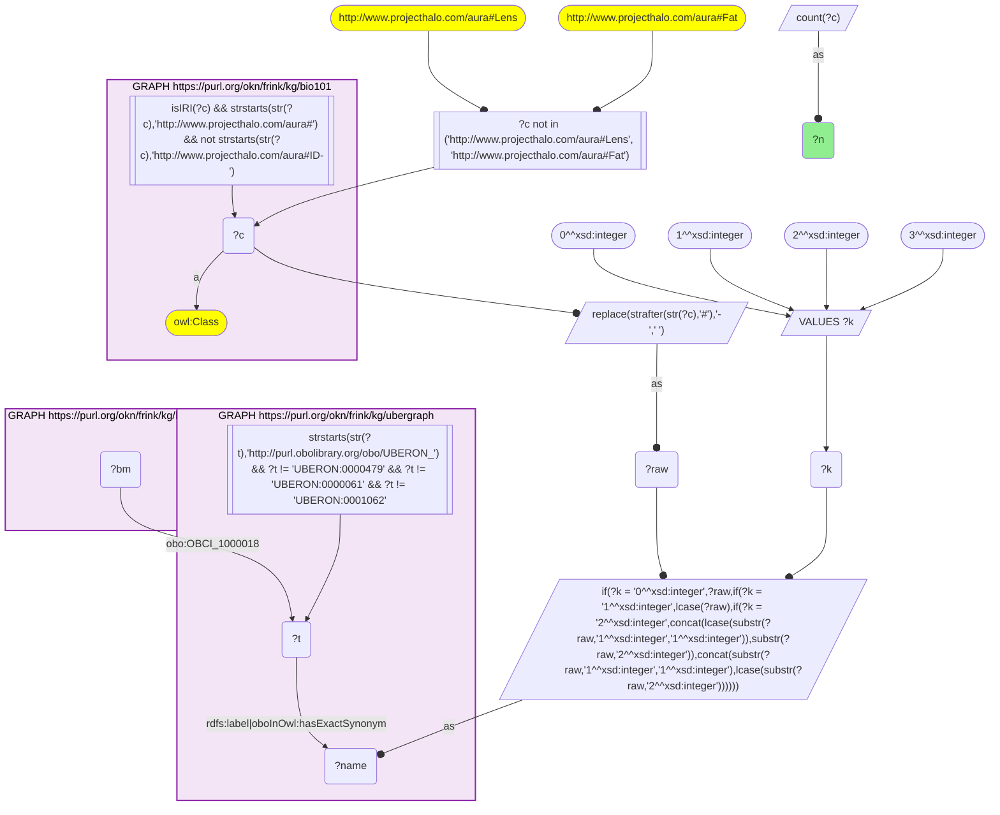
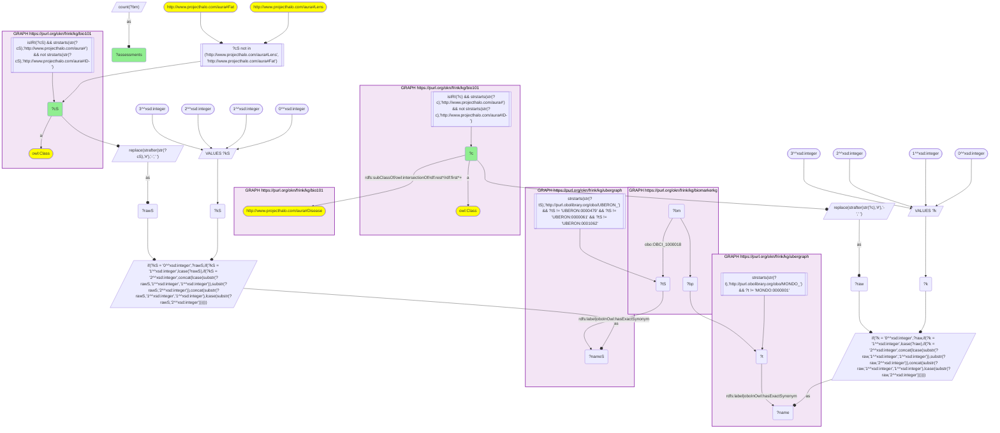

# AN14-Q2: Which textbook specimen measures which textbook disease

- **Date:** 2026-11-03
- **Model:** claude-opus-5-5
- **SPARQL endpoint:** https://apps.okn.us/federation/sparql
- **Generated by:** mcp-okn v0.3.0 (build ca8a360)
- **Contents:** 2 queries · 2 query diagrams

## Knowledge graphs used

- `bio101` — <https://purl.org/okn/frink/kg/bio101>
- `ubergraph` — <https://purl.org/okn/frink/kg/ubergraph>
- `biomarkerkg` — <https://purl.org/okn/frink/kg/biomarkerkg>

## Conversation

👤 **User**

Crosswalk: `bio101` × `biomarkerkg` on **UBERON (bio101 label), bridged through `ubergraph`** (crosswalk `KB14-uberon-label-bio101-biomarkerkg`, verified_count 31). KB Bio 101 is an OWL ontology of an introductory biology textbook: every concept is an `owl:Class` IRI `http://www.projecthalo.com/aura#{Name}` with no `rdfs:label` and no external id, so the concept NAME (local name, hyphens → spaces, four case forms: as-is, all lower-case, first letter lowered, sentence case) is matched as a bound literal against ubergraph `rdfs:label | oboInOwl:hasExactSynonym` on `obo/UBERON_` terms. BiomarkerKB (`biomarkerkg`) models each biomarker assessment as a node typed with its BEST category (`obo:OBCI_0000002` diagnostic, `_0000003` monitoring, `_0000005` predictive, `_0000006` prognostic, `_0000008` susceptibility/risk); it names the condition with a role predicate (`obo:OBCI_1000002` diagnostic for, `_1000003` monitors status of, `_1000006` prognostic for, `_1000008` indicates risk of developing) whose object is a raw `obo/MONDO_` IRI, the specimen with `obo:OBCI_1000018` (determined using sample from, an `obo/UBERON_` IRI), its description with `rdfs:label`, and its upstream source with `dcterms:source`. This question also uses the sibling crosswalk `KB13-mondo-label-bio101-biomarkerkg` (bio101 disease names → MONDO, scoped to bio101's `aura:Disease` subtree, verified_count 40) on the same assessments.

Research question: when a BiomarkerKB assessment both names a disease KB Bio 101 teaches and is measured in a body part or fluid KB Bio 101 teaches, which textbook disease–specimen pairs occur, and how often? What does that say about where each disease is diagnosed from?

Why the join is required: both ends of every pair are textbook concepts with no identifiers; only the two name bridges (→ MONDO and → UBERON, through ubergraph) can place them on the same BiomarkerKB assessment.

---

🧠 **Assistant**

**Bridge established (Query 1).** The crosswalk skeleton, run verbatim, returns **31** bio101 anatomical concepts used as BiomarkerKB specimens, matching the catalogued `verified_count`. Query 2 then joins both bridges on the same assessment: KB13's disease names → MONDO on the condition, and KB14's anatomy names → UBERON on the specimen.

**Disease–specimen pairs (Query 2).** **69 pairs** link **25 textbook diseases** to **11 textbook specimens**. The largest:

| Rank | bio101 disease | bio101 specimen | Assessments |
|---|---|---|---|
| 1 | Renal-Disease | Urine | 144 |
| 2 | Breast-Cancer | Blood | 53 |
| 3 | Diabetes-Mellitus | Blood | 28 |
| 4 | Cancer | Blood | 26 |
| 5 | Prostate-Cancer | Prostate-Gland | 24 |
| 6 | Prostate-Cancer | Urine | 11 |
| 7 | Leukemia | Blood | 10 |
| 8 | Diabetes-Mellitus | Urine | 8 |
| 9 | Multiple-Sclerosis | Cerebrospinal-Fluid | 7 |
| 9 | Multiple-Sclerosis | Urine | 7 |
| 11 | Prostate-Cancer | Blood | 6 |
| 12 | Renal-Disease | Cerebrospinal-Fluid | 5 |
| 12 | Type-2-Diabetes-Mellitus | Urine | 5 |

By specimen:

| bio101 specimen | Textbook diseases | Assessments |
|---|---|---|
| Urine | 22 | 213 |
| Blood | 12 | 133 |
| Cerebrospinal-Fluid | 10 | 21 |
| Bodily-Fluid | 8 | 13 |
| Amniotic-Fluid | 7 | 10 |
| Semen | 5 | 9 |
| Prostate-Gland | 1 | 24 |
| Sweat, Vitreous-Humor, Interstitial-Fluid, Urinary-Bladder | 1 each | 1 each |

**Answer.** Urine is the textbook specimen that measures the widest range of textbook diseases: 22 of the 25, from renal disease (144 assessments, the largest single pair) to the inborn errors of metabolism (Phenylketonuria 3, Alkaptonuria 2, Cystinuria 2, Lysosomal-Disorder 1). Blood is the main specimen for the cancers and diabetes: Breast-Cancer 53, Diabetes-Mellitus 28, Cancer 26, Leukemia 10. Two pairs are organ-specific: prostate cancer measured in the prostate gland (24), and multiple sclerosis in cerebrospinal fluid (7). Cystic fibrosis is the textbook's one-to-one case: its only assessment is measured in sweat, the sweat-chloride test.

Only assessments that name both a textbook disease and a textbook specimen can appear, so these counts are far smaller than the per-disease totals of the KB13 worked example (D52-Q1).

Caveats: both ends are exact-name lower bounds. Specimens that are not themselves bio101 concepts, notably *blood plasma*, *blood serum* and *tissue*, drop out. Turner syndrome's serum and plasma estrogen assays, for example, leave only its single urine pair here. Diseases are scoped to bio101's Disease subtree, as in KB13.

## SPARQL queries executed

#### Query 1

_2026-11-04T00:23:11+00:00 · `bio101`, `ubergraph`, `biomarkerkg`_

```sparql
SELECT (COUNT(DISTINCT ?c) AS ?n) WHERE {
  { SELECT DISTINCT ?c ?t WHERE {
  { SELECT DISTINCT ?c ?name WHERE {
      GRAPH <https://purl.org/okn/frink/kg/bio101> { ?c a <http://www.w3.org/2002/07/owl#Class> .
        FILTER(isIRI(?c) && STRSTARTS(STR(?c),'http://www.projecthalo.com/aura#') && !STRSTARTS(STR(?c),'http://www.projecthalo.com/aura#ID-')) }
      FILTER(?c NOT IN (<http://www.projecthalo.com/aura#Lens>, <http://www.projecthalo.com/aura#Fat>))  # homonyms (spot-checked 2026-11-03)
      BIND(REPLACE(STRAFTER(STR(?c),'#'),'-',' ') AS ?raw)
      VALUES ?k { 0 1 2 3 }  # as-is, all lower, first letter lowered, sentence case
      BIND(IF(?k = 0, ?raw, IF(?k = 1, LCASE(?raw), IF(?k = 2, CONCAT(LCASE(SUBSTR(?raw,1,1)),SUBSTR(?raw,2)),
                CONCAT(SUBSTR(?raw,1,1),LCASE(SUBSTR(?raw,2)))))) AS ?name)
  } }
    GRAPH <https://purl.org/okn/frink/kg/ubergraph> { ?t <http://www.w3.org/2000/01/rdf-schema#label>|<http://www.geneontology.org/formats/oboInOwl#hasExactSynonym> ?name .
      FILTER(STRSTARTS(STR(?t),'http://purl.obolibrary.org/obo/UBERON_') && ?t != <http://purl.obolibrary.org/obo/UBERON_0000479> && ?t != <http://purl.obolibrary.org/obo/UBERON_0000061> && ?t != <http://purl.obolibrary.org/obo/UBERON_0001062>) }
  } }
  GRAPH <https://purl.org/okn/frink/kg/biomarkerkg> { ?bm <http://purl.obolibrary.org/obo/OBCI_1000018> ?t . }
}
```



_1 row(s)_

| n |
| --- |
| 31 |

#### Query 2

_2026-11-04T00:23:13+00:00 · `bio101`, `ubergraph`, `biomarkerkg`_

```sparql
SELECT ?c ?cS (COUNT(DISTINCT ?bm) AS ?assessments) WHERE {
  { SELECT DISTINCT ?c ?t WHERE {
  { SELECT DISTINCT ?c ?name WHERE {
      GRAPH <https://purl.org/okn/frink/kg/bio101> { ?c a <http://www.w3.org/2002/07/owl#Class> .
        FILTER(isIRI(?c) && STRSTARTS(STR(?c),'http://www.projecthalo.com/aura#') && !STRSTARTS(STR(?c),'http://www.projecthalo.com/aura#ID-')) }
      GRAPH <https://purl.org/okn/frink/kg/bio101> { ?c (<http://www.w3.org/2000/01/rdf-schema#subClassOf>/(<http://www.w3.org/2002/07/owl#intersectionOf>/<http://www.w3.org/1999/02/22-rdf-syntax-ns#rest>*/<http://www.w3.org/1999/02/22-rdf-syntax-ns#first>)*)+ <http://www.projecthalo.com/aura#Disease> . }
      BIND(REPLACE(STRAFTER(STR(?c),'#'),'-',' ') AS ?raw)
      VALUES ?k { 0 1 2 3 }  # as-is, all lower, first letter lowered, sentence case
      BIND(IF(?k = 0, ?raw, IF(?k = 1, LCASE(?raw), IF(?k = 2, CONCAT(LCASE(SUBSTR(?raw,1,1)),SUBSTR(?raw,2)),
                CONCAT(SUBSTR(?raw,1,1),LCASE(SUBSTR(?raw,2)))))) AS ?name)
  } }
    GRAPH <https://purl.org/okn/frink/kg/ubergraph> { ?t <http://www.w3.org/2000/01/rdf-schema#label>|<http://www.geneontology.org/formats/oboInOwl#hasExactSynonym> ?name .
      FILTER(STRSTARTS(STR(?t),'http://purl.obolibrary.org/obo/MONDO_') && ?t != <http://purl.obolibrary.org/obo/MONDO_0000001>) }
  } }
  GRAPH <https://purl.org/okn/frink/kg/biomarkerkg> { ?bm ?bp ?t ; <http://purl.obolibrary.org/obo/OBCI_1000018> ?tS . }
  { SELECT DISTINCT ?cS ?tS WHERE {
  { SELECT DISTINCT ?cS ?nameS WHERE {
      GRAPH <https://purl.org/okn/frink/kg/bio101> { ?cS a <http://www.w3.org/2002/07/owl#Class> .
        FILTER(isIRI(?cS) && STRSTARTS(STR(?cS),'http://www.projecthalo.com/aura#') && !STRSTARTS(STR(?cS),'http://www.projecthalo.com/aura#ID-')) }
      FILTER(?cS NOT IN (<http://www.projecthalo.com/aura#Lens>, <http://www.projecthalo.com/aura#Fat>))  # homonyms (spot-checked 2026-11-03)
      BIND(REPLACE(STRAFTER(STR(?cS),'#'),'-',' ') AS ?rawS)
      VALUES ?kS { 0 1 2 3 }  # as-is, all lower, first letter lowered, sentence case
      BIND(IF(?kS = 0, ?rawS, IF(?kS = 1, LCASE(?rawS), IF(?kS = 2, CONCAT(LCASE(SUBSTR(?rawS,1,1)),SUBSTR(?rawS,2)),
                CONCAT(SUBSTR(?rawS,1,1),LCASE(SUBSTR(?rawS,2)))))) AS ?nameS)
  } }
    GRAPH <https://purl.org/okn/frink/kg/ubergraph> { ?tS <http://www.w3.org/2000/01/rdf-schema#label>|<http://www.geneontology.org/formats/oboInOwl#hasExactSynonym> ?nameS .
      FILTER(STRSTARTS(STR(?tS),'http://purl.obolibrary.org/obo/UBERON_') && ?tS != <http://purl.obolibrary.org/obo/UBERON_0000479> && ?tS != <http://purl.obolibrary.org/obo/UBERON_0000061> && ?tS != <http://purl.obolibrary.org/obo/UBERON_0001062>) }
  } }
} GROUP BY ?c ?cS ORDER BY DESC(?assessments) ?c ?cS
```



_69 row(s) — showing first 5_

| c | cS | assessments |
| --- | --- | --- |
| http://www.projecthalo.com/aura#Renal-Disease | http://www.projecthalo.com/aura#Urine | 144 |
| http://www.projecthalo.com/aura#Breast-Cancer | http://www.projecthalo.com/aura#Blood | 53 |
| http://www.projecthalo.com/aura#Diabetes-Mellitus | http://www.projecthalo.com/aura#Blood | 28 |
| http://www.projecthalo.com/aura#Cancer | http://www.projecthalo.com/aura#Blood | 26 |
| http://www.projecthalo.com/aura#Prostate-Cancer | http://www.projecthalo.com/aura#Prostate-Gland | 24 |
