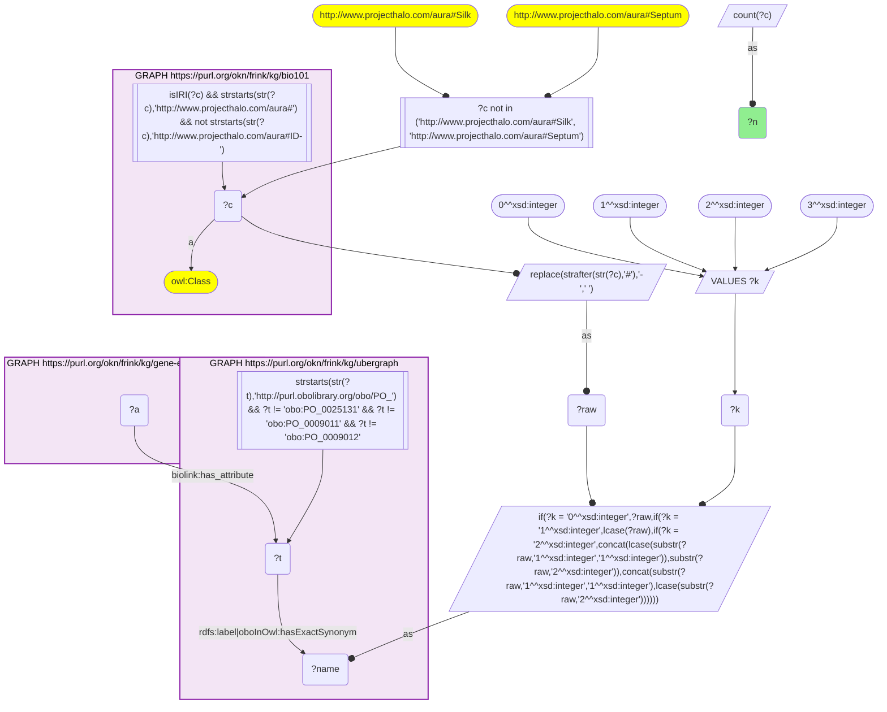
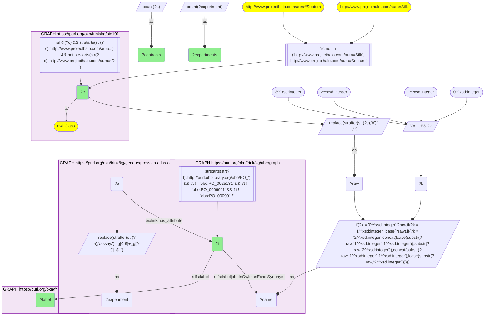

# AN15-Q1: KB Bio 101's plant parts in Expression Atlas plant experiments

- **Date:** 2026-11-03
- **Model:** claude-opus-5-5
- **SPARQL endpoint:** https://apps.okn.us/federation/sparql
- **Generated by:** mcp-okn v0.3.0 (build 5f97869)
- **Contents:** 2 queries · 2 query diagrams

## Knowledge graphs used

- `bio101` — <https://purl.org/okn/frink/kg/bio101>
- `ubergraph` — <https://purl.org/okn/frink/kg/ubergraph>
- `gene-expression-atlas-okn` — <https://purl.org/okn/frink/kg/gene-expression-atlas-okn>

## Conversation

👤 **User**

Crosswalk: `bio101` × `gene-expression-atlas-okn` on **PO (bio101 label), bridged through `ubergraph`** (crosswalk `KB19-po-label-bio101-gxa`, verified_count 30). KB Bio 101 is an OWL ontology of an introductory biology textbook: every concept is an `owl:Class` IRI `http://www.projecthalo.com/aura#{Name}` with no `rdfs:label` and no external id, so the concept NAME (local name, hyphens → spaces, four case forms: as-is, all lower-case, first letter lowered, sentence case) is matched as a bound literal against ubergraph `rdfs:label | oboInOwl:hasExactSynonym` on `obo/PO_` terms. Expression Atlas (`gene-expression-atlas-okn`) annotates each differential-expression contrast (`biolink:Assay`, named `'test' vs 'reference'` on `biolink:name`) with the anatomy sampled on `biolink:has_attribute`; for plant experiments that is a raw Plant Ontology `obo/PO_` IRI. The experiment accession is the assay IRI's prefix (`wobd/assay/E-GEOD-7631-g25_g24` → `E-GEOD-7631`). The PO roots are excluded, and two homonyms by name: `Silk` (a fibrous protein in bio101, the maize style in PO) and `Septum` (a cell-wall septum in bio101, a fruit septum in PO).

Research question: which plant organs and tissues KB Bio 101 teaches are sampled in Expression Atlas differential-expression contrasts, in how many contrasts and experiments? Rank them.

Why the join is required: bio101 knows the plant anatomy a curriculum teaches, Expression Atlas the tissue each plant contrast samples; they share no identifier, so only the name → PO bridge through ubergraph joins them.

---

🧠 **Assistant**

**Bridge established (Query 1).** The crosswalk skeleton, run verbatim, returns **30** bio101 concepts. Each concept's name is an exact Plant Ontology (PO) label or exact synonym in ubergraph, *and* its PO term is the `biolink:has_attribute` of at least one Expression Atlas assay. This matches the catalogued `verified_count`. Query 2 returns one row per concept (30 rows).

**Ranking (Query 2).** Contrasts (assay nodes) sampling each plant part, and experiments (accession prefix of the assay IRI):

| Rank | bio101 concept | PO | Contrasts | Experiments |
|---|---|---|---|---|
| 1 | Leaf | PO_0025034 | 739 | 176 |
| 2 | Root | PO_0009005 | 356 | 102 |
| 3 | Shoot-System | PO_0009006 | 160 | 42 |
| 4 | Seed | PO_0009010 | 71 | 22 |
| 5 | Stem | PO_0009047 | 33 | 10 |
| 6 | Plant-Embryo | PO_0009009 | 32 | 6 |
| 7 | Fruit | PO_0009001 | 27 | 11 |
| 8 | Inflorescence | PO_0009049 | 25 | 12 |
| 8 | Petiole | PO_0020038 | 25 | 4 |
| 10 | Endosperm | PO_0009089 | 21 | 9 |
| 11 | Hypocotyl | PO_0020100 | 20 | 4 |
| 12 | Carpel | PO_0009030 | 16 | 6 |
| 13 | Cotyledon | PO_0020030 | 14 | 1 |

The other 17 run from Anther (9 contrasts / 7 experiments) and Xylem (8/5) through Flower, Shoot-Apical-Meristem, Stamen and Tuber (7 each), Apical-Meristem (6) and Pericycle (5), down to Phloem, Receptacle and Root-Apical-Meristem (1 contrast each).

**Answer.** Expression Atlas samples the textbook's plant body very unevenly:

- Leaf dominates, with 739 contrasts in 176 experiments.
- Root follows with 356 contrasts in 102 experiments.
- The whole shoot system has 160 contrasts in 42 experiments.
- Seed, stem, embryo and fruit each have tens of contrasts.

The finer anatomy a textbook teaches appears only a handful of times: xylem, phloem, pericycle, stele, the meristems, the parts of the flower, and specialised organs such as the coleoptile, tuber and protonema.

Some counts concentrate in few experiments. Cotyledon has 14 contrasts from a single experiment, and petiole and hypocotyl each have 4 experiments. The experiment count is therefore the better measure of breadth.

Caveats:

- This is an exact-name lower bound. The PO roots and two homonyms are excluded (Silk, which is the corn style in PO but the insect fibre in bio101, and Septum).
- A sample annotated to a more specific part counts only under that part, because no `part_of` roll-up is applied.

## SPARQL queries executed

#### Query 1

_2026-11-04T01:00:50+00:00 · `bio101`, `ubergraph`, `gene-expression-atlas-okn`_

```sparql
SELECT (COUNT(DISTINCT ?c) AS ?n) WHERE {
  { SELECT DISTINCT ?c ?t WHERE {
  { SELECT DISTINCT ?c ?name WHERE {
      GRAPH <https://purl.org/okn/frink/kg/bio101> { ?c a <http://www.w3.org/2002/07/owl#Class> .
        FILTER(isIRI(?c) && STRSTARTS(STR(?c),'http://www.projecthalo.com/aura#') && !STRSTARTS(STR(?c),'http://www.projecthalo.com/aura#ID-')) }
      FILTER(?c NOT IN (<http://www.projecthalo.com/aura#Silk>, <http://www.projecthalo.com/aura#Septum>))  # homonyms (spot-checked 2026-11-03)
      BIND(REPLACE(STRAFTER(STR(?c),'#'),'-',' ') AS ?raw)
      VALUES ?k { 0 1 2 3 }  # as-is, all lower, first letter lowered, sentence case
      BIND(IF(?k = 0, ?raw, IF(?k = 1, LCASE(?raw), IF(?k = 2, CONCAT(LCASE(SUBSTR(?raw,1,1)),SUBSTR(?raw,2)),
                CONCAT(SUBSTR(?raw,1,1),LCASE(SUBSTR(?raw,2)))))) AS ?name)
  } }
    GRAPH <https://purl.org/okn/frink/kg/ubergraph> { ?t <http://www.w3.org/2000/01/rdf-schema#label>|<http://www.geneontology.org/formats/oboInOwl#hasExactSynonym> ?name .
      FILTER(STRSTARTS(STR(?t),'http://purl.obolibrary.org/obo/PO_') && ?t != <http://purl.obolibrary.org/obo/PO_0025131> && ?t != <http://purl.obolibrary.org/obo/PO_0009011> && ?t != <http://purl.obolibrary.org/obo/PO_0009012>) }
  } }
  GRAPH <https://purl.org/okn/frink/kg/gene-expression-atlas-okn> { ?a <https://w3id.org/biolink/vocab/has_attribute> ?t . }
}
```



_1 row(s)_

| n |
| --- |
| 30 |

#### Query 2

_2026-11-04T01:00:51+00:00 · `bio101`, `ubergraph`, `gene-expression-atlas-okn`_

```sparql
SELECT ?c ?t ?label (COUNT(DISTINCT ?a) AS ?contrasts) (COUNT(DISTINCT ?experiment) AS ?experiments) WHERE {
  { SELECT DISTINCT ?c ?t WHERE {
  { SELECT DISTINCT ?c ?name WHERE {
      GRAPH <https://purl.org/okn/frink/kg/bio101> { ?c a <http://www.w3.org/2002/07/owl#Class> .
        FILTER(isIRI(?c) && STRSTARTS(STR(?c),'http://www.projecthalo.com/aura#') && !STRSTARTS(STR(?c),'http://www.projecthalo.com/aura#ID-')) }
      FILTER(?c NOT IN (<http://www.projecthalo.com/aura#Silk>, <http://www.projecthalo.com/aura#Septum>))  # homonyms (spot-checked 2026-11-03)
      BIND(REPLACE(STRAFTER(STR(?c),'#'),'-',' ') AS ?raw)
      VALUES ?k { 0 1 2 3 }  # as-is, all lower, first letter lowered, sentence case
      BIND(IF(?k = 0, ?raw, IF(?k = 1, LCASE(?raw), IF(?k = 2, CONCAT(LCASE(SUBSTR(?raw,1,1)),SUBSTR(?raw,2)),
                CONCAT(SUBSTR(?raw,1,1),LCASE(SUBSTR(?raw,2)))))) AS ?name)
  } }
    GRAPH <https://purl.org/okn/frink/kg/ubergraph> { ?t <http://www.w3.org/2000/01/rdf-schema#label>|<http://www.geneontology.org/formats/oboInOwl#hasExactSynonym> ?name .
      FILTER(STRSTARTS(STR(?t),'http://purl.obolibrary.org/obo/PO_') && ?t != <http://purl.obolibrary.org/obo/PO_0025131> && ?t != <http://purl.obolibrary.org/obo/PO_0009011> && ?t != <http://purl.obolibrary.org/obo/PO_0009012>) }
  } }
  GRAPH <https://purl.org/okn/frink/kg/gene-expression-atlas-okn> { ?a <https://w3id.org/biolink/vocab/has_attribute> ?t . BIND(REPLACE(STRAFTER(STR(?a), '/assay/'), '-g[0-9]+_g[0-9]+$', '') AS ?experiment) }
  GRAPH <https://purl.org/okn/frink/kg/ubergraph> { ?t <http://www.w3.org/2000/01/rdf-schema#label> ?label }
} GROUP BY ?c ?t ?label ORDER BY DESC(?contrasts) ?c
```



_30 row(s) — showing first 5_

| c | t | label | contrasts | experiments |
| --- | --- | --- | --- | --- |
| http://www.projecthalo.com/aura#Leaf | http://purl.obolibrary.org/obo/PO_0025034 | leaf | 739 | 176 |
| http://www.projecthalo.com/aura#Root | http://purl.obolibrary.org/obo/PO_0009005 | root | 356 | 102 |
| http://www.projecthalo.com/aura#Shoot-System | http://purl.obolibrary.org/obo/PO_0009006 | shoot system | 160 | 42 |
| http://www.projecthalo.com/aura#Seed | http://purl.obolibrary.org/obo/PO_0009010 | seed | 71 | 22 |
| http://www.projecthalo.com/aura#Stem | http://purl.obolibrary.org/obo/PO_0009047 | stem | 33 | 10 |
