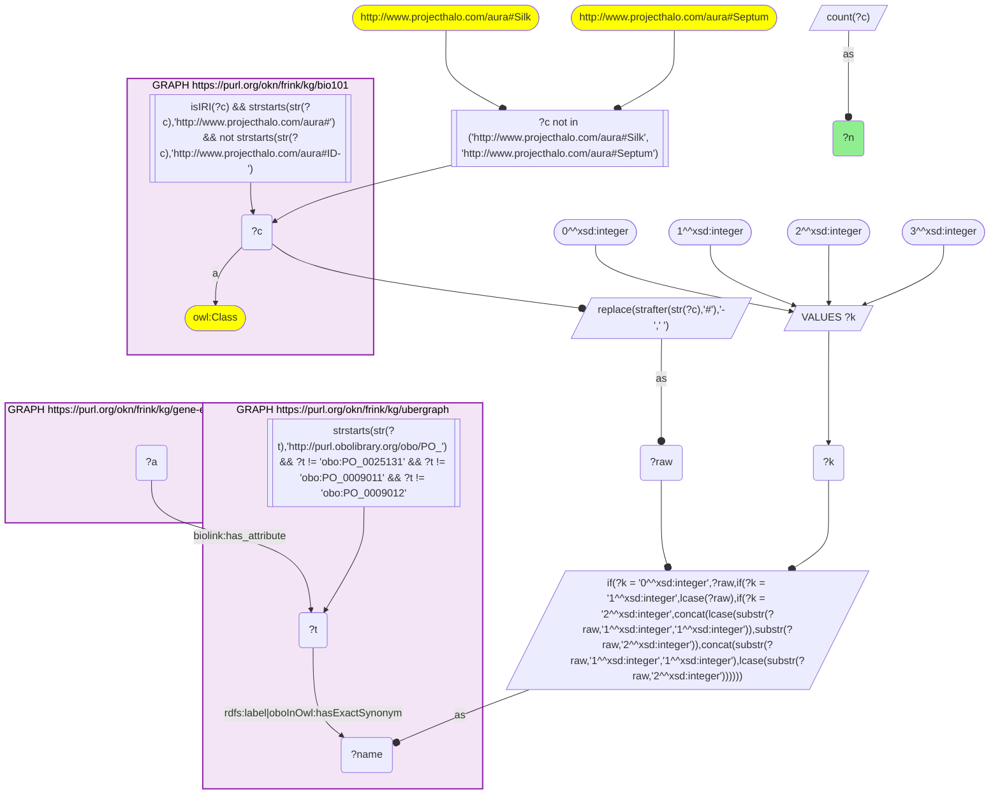
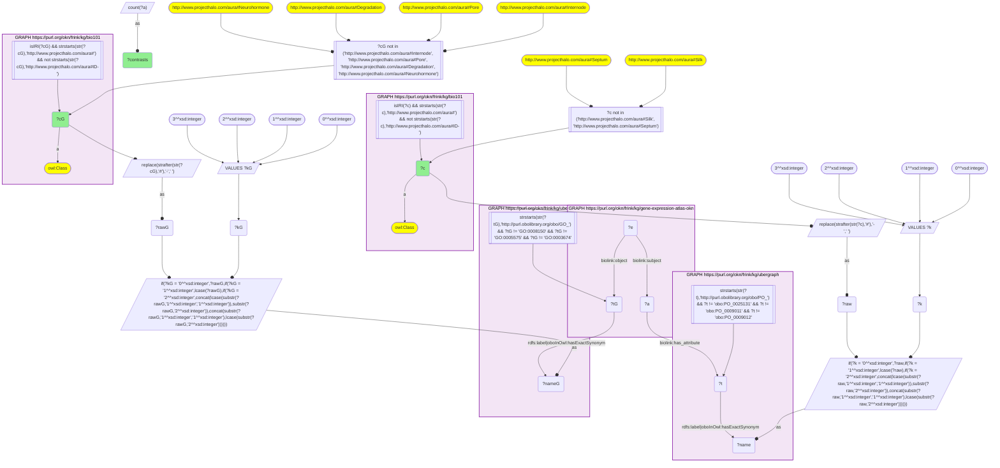

# AN15-Q2: Which textbook processes change in which textbook plant parts

- **Date:** 2026-11-03
- **Model:** claude-opus-5-5
- **SPARQL endpoint:** https://apps.okn.us/federation/sparql
- **Generated by:** mcp-okn v0.3.0 (build 5f97869)
- **Contents:** 2 queries · 2 query diagrams

## Knowledge graphs used

- `bio101` — <https://purl.org/okn/frink/kg/bio101>
- `ubergraph` — <https://purl.org/okn/frink/kg/ubergraph>
- `gene-expression-atlas-okn` — <https://purl.org/okn/frink/kg/gene-expression-atlas-okn>

## Conversation

👤 **User**

Crosswalk: `bio101` × `gene-expression-atlas-okn` on **PO (bio101 label), bridged through `ubergraph`** (crosswalk `KB19-po-label-bio101-gxa`, verified_count 30). KB Bio 101 is an OWL ontology of an introductory biology textbook: every concept is an `owl:Class` IRI `http://www.projecthalo.com/aura#{Name}` with no `rdfs:label` and no external id, so the concept NAME (local name, hyphens → spaces, four case forms: as-is, all lower-case, first letter lowered, sentence case) is matched as a bound literal against ubergraph `rdfs:label | oboInOwl:hasExactSynonym` on `obo/PO_` terms. Expression Atlas (`gene-expression-atlas-okn`) annotates each differential-expression contrast (`biolink:Assay`, named `'test' vs 'reference'` on `biolink:name`) with the anatomy sampled on `biolink:has_attribute`; for plant experiments that is a raw Plant Ontology `obo/PO_` IRI. The experiment accession is the assay IRI's prefix (`wobd/assay/E-GEOD-7631-g25_g24` → `E-GEOD-7631`). This question also uses the sibling crosswalk `KB18-go-label-bio101-gxa` (bio101 process and structure names → GO, verified_count 193) on the GO enrichments of the same contrasts.

Research question: when an Expression Atlas contrast samples a plant part KB Bio 101 teaches and is enriched for a process or structure KB Bio 101 teaches, which textbook plant part × textbook process pairs occur in the most contrasts?

Why the join is required: both ends are textbook concepts without identifiers; only the two name bridges (→ PO and → GO, through ubergraph) can place them on the same contrast.

---

🧠 **Assistant**

**Bridge established (Query 1).** The crosswalk skeleton, run verbatim, returns **30** bio101 plant parts that reach an Expression Atlas assay through the name → PO bridge, matching the catalogued `verified_count`. Query 2 adds a second name bridge, bio101 → GO through ubergraph (the KB18 recipe), on the enrichment records of the same assays. A contrast therefore counts when it samples a textbook plant part *and* is enriched for a textbook process or structure.

**Top plant part × process pairs (Query 2, top 40).**

| bio101 plant part | bio101 process / structure | Contrasts |
|---|---|---|
| Leaf | Photosystem-II | 120 |
| Leaf | Photosystem-I | 110 |
| Leaf | Photosynthesis | 69 |
| Leaf | Circadian-Rhythm | 46 |
| Leaf | Thylakoid | 31 |
| Root | Photosystem-I | 29 |
| Root | Photosystem-II | 29 |
| Leaf | Chloroplast-Membrane | 26 |
| Leaf | Large-Ribosomal-Subunit | 26 |
| Leaf | Proteasome | 26 |
| Leaf | Small-Ribosomal-Subunit | 24 |
| Leaf | Systemic-Acquired-Resistance | 24 |
| Root | Photosynthesis | 22 |
| Leaf | Nucleosome | 21 |
| Leaf | Citric-Acid-Cycle | 20 |
| Shoot-System | Photosystem-I | 18 |

Lower in the list:

- Shoot-System × Photosynthesis and × Photosystem-II (14 each);
- Leaf × Carbon-Fixation (14) and × Photorespiration (12);
- Leaf × Apoplast and × Amyloplast;
- Root × Nucleosome (15) and × Circadian-Rhythm (9);
- Cotyledon × Photomorphogenesis and Hypocotyl × Photomorphogenesis (7 each).

**Answer.** The pairs a textbook would predict come first. Leaf contrasts are enriched for the photosynthetic apparatus: photosystem II in 120, photosystem I in 110, photosynthesis in 69, plus thylakoid, chloroplast membrane, carbon fixation and photorespiration. Leaf is also where the circadian rhythm (46) and systemic acquired resistance (24) show up.

The cotyledon and hypocotyl pairs with photomorphogenesis (7 each) match the textbook account of de-etiolation, where the seedling's cotyledons open and the hypocotyl stops elongating in light.

The surprise is root contrasts enriched for photosystem I and II (29 each) and photosynthesis (22). Root tissue does not photosynthesise. Two plausible readings are that roots of light-grown seedlings express some photosynthetic genes, or that these gene sets respond to root-zone treatments. These rows cannot separate the two.

Caveats:

- Every enrichment carries `wobd:direction` "up", so induction cannot be told from repression.
- Both bridges are exact-name lower bounds with their own homonym exclusions. The PO side excludes Silk and Septum; the GO side excludes Internode, Pore, Degradation and Neurohormone.
- Pairs are counted per contrast, so one large experiment can contribute many contrasts.

## SPARQL queries executed

#### Query 1

_2026-11-04T01:00:51+00:00 · `bio101`, `ubergraph`, `gene-expression-atlas-okn`_

```sparql
SELECT (COUNT(DISTINCT ?c) AS ?n) WHERE {
  { SELECT DISTINCT ?c ?t WHERE {
  { SELECT DISTINCT ?c ?name WHERE {
      GRAPH <https://purl.org/okn/frink/kg/bio101> { ?c a <http://www.w3.org/2002/07/owl#Class> .
        FILTER(isIRI(?c) && STRSTARTS(STR(?c),'http://www.projecthalo.com/aura#') && !STRSTARTS(STR(?c),'http://www.projecthalo.com/aura#ID-')) }
      FILTER(?c NOT IN (<http://www.projecthalo.com/aura#Silk>, <http://www.projecthalo.com/aura#Septum>))  # homonyms (spot-checked 2026-11-03)
      BIND(REPLACE(STRAFTER(STR(?c),'#'),'-',' ') AS ?raw)
      VALUES ?k { 0 1 2 3 }  # as-is, all lower, first letter lowered, sentence case
      BIND(IF(?k = 0, ?raw, IF(?k = 1, LCASE(?raw), IF(?k = 2, CONCAT(LCASE(SUBSTR(?raw,1,1)),SUBSTR(?raw,2)),
                CONCAT(SUBSTR(?raw,1,1),LCASE(SUBSTR(?raw,2)))))) AS ?name)
  } }
    GRAPH <https://purl.org/okn/frink/kg/ubergraph> { ?t <http://www.w3.org/2000/01/rdf-schema#label>|<http://www.geneontology.org/formats/oboInOwl#hasExactSynonym> ?name .
      FILTER(STRSTARTS(STR(?t),'http://purl.obolibrary.org/obo/PO_') && ?t != <http://purl.obolibrary.org/obo/PO_0025131> && ?t != <http://purl.obolibrary.org/obo/PO_0009011> && ?t != <http://purl.obolibrary.org/obo/PO_0009012>) }
  } }
  GRAPH <https://purl.org/okn/frink/kg/gene-expression-atlas-okn> { ?a <https://w3id.org/biolink/vocab/has_attribute> ?t . }
}
```



_1 row(s)_

| n |
| --- |
| 30 |

#### Query 2

_2026-11-04T01:00:52+00:00 · `bio101`, `ubergraph`, `gene-expression-atlas-okn`_

```sparql
SELECT ?c ?cG (COUNT(DISTINCT ?a) AS ?contrasts) WHERE {
  { SELECT DISTINCT ?c ?t WHERE {
  { SELECT DISTINCT ?c ?name WHERE {
      GRAPH <https://purl.org/okn/frink/kg/bio101> { ?c a <http://www.w3.org/2002/07/owl#Class> .
        FILTER(isIRI(?c) && STRSTARTS(STR(?c),'http://www.projecthalo.com/aura#') && !STRSTARTS(STR(?c),'http://www.projecthalo.com/aura#ID-')) }
      FILTER(?c NOT IN (<http://www.projecthalo.com/aura#Silk>, <http://www.projecthalo.com/aura#Septum>))  # homonyms (spot-checked 2026-11-03)
      BIND(REPLACE(STRAFTER(STR(?c),'#'),'-',' ') AS ?raw)
      VALUES ?k { 0 1 2 3 }  # as-is, all lower, first letter lowered, sentence case
      BIND(IF(?k = 0, ?raw, IF(?k = 1, LCASE(?raw), IF(?k = 2, CONCAT(LCASE(SUBSTR(?raw,1,1)),SUBSTR(?raw,2)),
                CONCAT(SUBSTR(?raw,1,1),LCASE(SUBSTR(?raw,2)))))) AS ?name)
  } }
    GRAPH <https://purl.org/okn/frink/kg/ubergraph> { ?t <http://www.w3.org/2000/01/rdf-schema#label>|<http://www.geneontology.org/formats/oboInOwl#hasExactSynonym> ?name .
      FILTER(STRSTARTS(STR(?t),'http://purl.obolibrary.org/obo/PO_') && ?t != <http://purl.obolibrary.org/obo/PO_0025131> && ?t != <http://purl.obolibrary.org/obo/PO_0009011> && ?t != <http://purl.obolibrary.org/obo/PO_0009012>) }
  } }
  GRAPH <https://purl.org/okn/frink/kg/gene-expression-atlas-okn> { ?a <https://w3id.org/biolink/vocab/has_attribute> ?t . ?e <https://w3id.org/biolink/vocab/subject> ?a ; <https://w3id.org/biolink/vocab/object> ?tG . }
  { SELECT DISTINCT ?cG ?tG WHERE {
  { SELECT DISTINCT ?cG ?nameG WHERE {
      GRAPH <https://purl.org/okn/frink/kg/bio101> { ?cG a <http://www.w3.org/2002/07/owl#Class> .
        FILTER(isIRI(?cG) && STRSTARTS(STR(?cG),'http://www.projecthalo.com/aura#') && !STRSTARTS(STR(?cG),'http://www.projecthalo.com/aura#ID-')) }
      FILTER(?cG NOT IN (<http://www.projecthalo.com/aura#Internode>, <http://www.projecthalo.com/aura#Pore>, <http://www.projecthalo.com/aura#Degradation>, <http://www.projecthalo.com/aura#Neurohormone>))  # homonyms (spot-checked 2026-11-03)
      BIND(REPLACE(STRAFTER(STR(?cG),'#'),'-',' ') AS ?rawG)
      VALUES ?kG { 0 1 2 3 }  # as-is, all lower, first letter lowered, sentence case
      BIND(IF(?kG = 0, ?rawG, IF(?kG = 1, LCASE(?rawG), IF(?kG = 2, CONCAT(LCASE(SUBSTR(?rawG,1,1)),SUBSTR(?rawG,2)),
                CONCAT(SUBSTR(?rawG,1,1),LCASE(SUBSTR(?rawG,2)))))) AS ?nameG)
  } }
    GRAPH <https://purl.org/okn/frink/kg/ubergraph> { ?tG <http://www.w3.org/2000/01/rdf-schema#label>|<http://www.geneontology.org/formats/oboInOwl#hasExactSynonym> ?nameG .
      FILTER(STRSTARTS(STR(?tG),'http://purl.obolibrary.org/obo/GO_') && ?tG != <http://purl.obolibrary.org/obo/GO_0008150> && ?tG != <http://purl.obolibrary.org/obo/GO_0005575> && ?tG != <http://purl.obolibrary.org/obo/GO_0003674>) }
  } }
} GROUP BY ?c ?cG ORDER BY DESC(?contrasts) ?c ?cG LIMIT 40
```



_40 row(s) — showing first 5_

| c | cG | contrasts |
| --- | --- | --- |
| http://www.projecthalo.com/aura#Leaf | http://www.projecthalo.com/aura#Photosystem-II | 120 |
| http://www.projecthalo.com/aura#Leaf | http://www.projecthalo.com/aura#Photosystem-I | 110 |
| http://www.projecthalo.com/aura#Leaf | http://www.projecthalo.com/aura#Photosynthesis | 69 |
| http://www.projecthalo.com/aura#Leaf | http://www.projecthalo.com/aura#Circadian-Rhythm | 46 |
| http://www.projecthalo.com/aura#Leaf | http://www.projecthalo.com/aura#Thylakoid | 31 |
