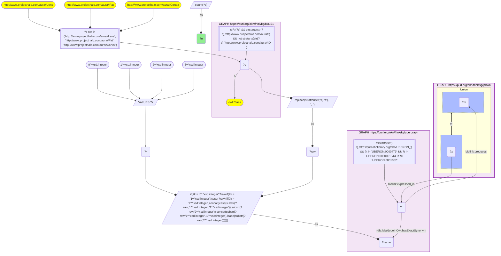
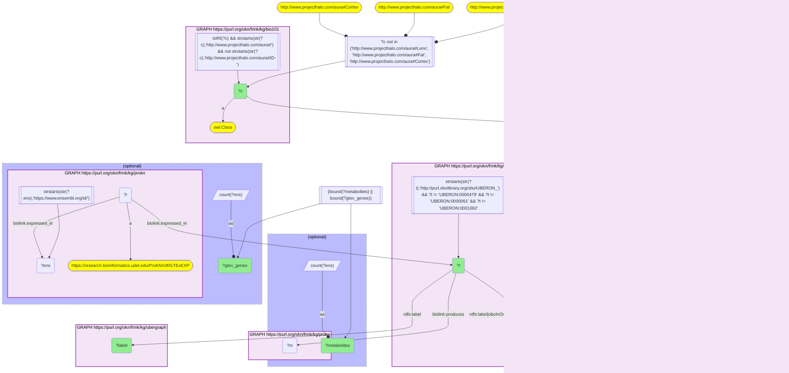

# AN16-Q1: KB Bio 101's tissues and fluids in ProKN: metabolites and expressed genes

- **Date:** 2026-11-03
- **Model:** claude-opus-5-5
- **SPARQL endpoint:** https://apps.okn.us/federation/sparql
- **Generated by:** mcp-okn v0.3.0 (build 5f97869)
- **Contents:** 2 queries · 2 query diagrams

## Knowledge graphs used

- `bio101` — <https://purl.org/okn/frink/kg/bio101>
- `ubergraph` — <https://purl.org/okn/frink/kg/ubergraph>
- `prokn` — <https://purl.org/okn/frink/kg/prokn>

## Conversation

👤 **User**

Crosswalk: `bio101` × `prokn` on **UBERON (bio101 label), bridged through `ubergraph`** (crosswalk `KB21-uberon-label-bio101-prokn`, verified_count 54). KB Bio 101 is an OWL ontology of an introductory biology textbook: every concept is an `owl:Class` IRI `http://www.projecthalo.com/aura#{Name}` with no `rdfs:label` and no external id, so the concept NAME (local name, hyphens → spaces, four case forms: as-is, all lower-case, first letter lowered, sentence case) is matched as a bound literal against ubergraph `rdfs:label | oboInOwl:hasExactSynonym` on `obo/UBERON_` terms. ProKN (`prokn`) uses UBERON terms in two ways: Metabolomics Workbench records that a tissue or fluid `biolink:produces` a PubChem compound (the UBERON term is the subject), and GTEx expression records (`GTExEXP` gene-by-tissue nodes, which point at both the tissue and the Ensembl gene) are `biolink:expressed_in` a tissue (the UBERON term is the object). The UBERON roots are excluded, and three homonyms by name: Lens, Fat (as KB3) and `Cortex` (plant ground tissue in bio101).

Research question: for the organs, tissues and fluids KB Bio 101 describes, how many metabolites does ProKN record each producing, and which of them carry GTEx expression records (and for how many Ensembl genes)? Rank them, and say which textbook anatomy is covered by both sources.

Why the join is required: bio101 knows the anatomy a curriculum teaches; ProKN knows metabolite and gene profiles per UBERON term. They share no identifier, so only the name → UBERON bridge through ubergraph joins them.

---

🧠 **Assistant**

**Bridge established (Query 1).** The crosswalk skeleton, run verbatim, returns **54** bio101 concepts. Each one's name is an exact UBERON label or exact synonym in ubergraph, *and* its UBERON term is the object of a ProKN `biolink:produces` (metabolite) or `biolink:expressed_in` edge. This matches the catalogued `verified_count`. Query 2 returns all 54.

**Ranking (Query 2).** Query 2 gives two counts for each concept:

- **Metabolites:** distinct compounds ProKN records the tissue producing (Metabolomics Workbench).
- **GTEx genes:** distinct Ensembl genes reached through ProKN's `GTExEXP` expression records for that tissue.

| Rank | bio101 concept | UBERON (label) | Metabolites | GTEx genes |
|---|---|---|---|---|
| 1 | Blood | UBERON_0000178 | 5,131 | – |
| 2 | Feces | UBERON_0001988 | 4,353 | – |
| 3 | Urine | UBERON_0001088 | 2,644 | – |
| 4 | Intestine | UBERON_0000160 | 1,944 | – |
| 5 | Brain | UBERON_0000955 | 1,461 | – |
| 6 | Cerebrospinal-Fluid | UBERON_0001359 | 1,453 | – |
| 7 | Muscle-Tissue | UBERON_0002385 | 1,332 | – |
| 8 | Eye | UBERON_0000970 | 1,269 | – |
| 9 | Cecum | UBERON_0001153 (caecum) | 1,022 | – |
| 10 | Adipose-Tissue | UBERON_0001013 | 928 | – |
| 13 | Ovary | UBERON_0000992 | 627 | 34,454 |
| 14 | Renal-Cortex | UBERON_0001225 (cortex of kidney) | 583 | 34,454 |
| 17 | Uterus | UBERON_0000995 | 435 | 34,454 |
| 21 | Thyroid-Gland | UBERON_0002046 | 383 | 34,454 |
| 25 | Prostate-Gland | UBERON_0002367 | 336 | 34,454 |
| 29 | Hypothalamus | UBERON_0001898 | 185 | 34,454 |
| 31 | Adrenal-Gland | UBERON_0002369 | 166 | 34,454 |
| 48 | Stomach | UBERON_0000945 | 15 | 34,454 |

**49** concepts have metabolite records:

- Below the top ten, they run through Epithelium (795), Colon (761), Bone-Marrow (572), Pancreas (523), Milk (432), Amniotic-Fluid (407), Saliva (391) and Placenta (361).
- They end at Interstitial-Fluid (20), Stomach (15) and Jejunum (3).
- They include non-human sample types such as Hemolymph, Tail and Shelled-Egg.

**13** concepts carry GTEx records. Five of them have expression records only: Amygdala, Cerebellum, Pituitary-Gland, Urinary-Bladder and Vagina.

**Answer.** By metabolite coverage, the textbook's body fluids and gut lead. Blood has 5,131 metabolites, feces 4,353 and urine 2,644, followed by intestine, brain and cerebrospinal fluid. This matches what metabolomics studies sample most.

**Eight** textbook anatomy terms are covered by both sources: ovary, renal cortex, uterus, thyroid gland, prostate gland, hypothalamus, adrenal gland and stomach.

The GTEx column measures coverage, not tissue specificity. Every GTEx tissue reaches exactly the same **34,454** Ensembl genes, which indicates that ProKN keeps a GTEx record for every gene in every tissue, with no expression threshold. "Has GTEx data" is the meaningful signal, and the gene count does not rank tissues.

Caveats:

- Raw `biolink:expressed_in` subjects are not genes one to one. The GTEx gene-by-tissue records are themselves the subjects, and each record points at its Ensembl gene with a second `expressed_in`. Query 2 therefore counts distinct Ensembl genes through the records.
- This is an exact-name lower bound. The UBERON roots and three homonyms are excluded (Lens, Fat, and Cortex, which bio101 uses for plant ground tissue).
- Counts sit on the exact UBERON term with no `part_of` roll-up.

## SPARQL queries executed

#### Query 1

_2026-11-04T01:00:58+00:00 · `bio101`, `ubergraph`, `prokn`_

```sparql
SELECT (COUNT(DISTINCT ?c) AS ?n) WHERE {
  { SELECT DISTINCT ?c ?t WHERE {
  { SELECT DISTINCT ?c ?name WHERE {
      GRAPH <https://purl.org/okn/frink/kg/bio101> { ?c a <http://www.w3.org/2002/07/owl#Class> .
        FILTER(isIRI(?c) && STRSTARTS(STR(?c),'http://www.projecthalo.com/aura#') && !STRSTARTS(STR(?c),'http://www.projecthalo.com/aura#ID-')) }
      FILTER(?c NOT IN (<http://www.projecthalo.com/aura#Lens>, <http://www.projecthalo.com/aura#Fat>, <http://www.projecthalo.com/aura#Cortex>))  # homonyms (spot-checked 2026-11-03)
      BIND(REPLACE(STRAFTER(STR(?c),'#'),'-',' ') AS ?raw)
      VALUES ?k { 0 1 2 3 }  # as-is, all lower, first letter lowered, sentence case
      BIND(IF(?k = 0, ?raw, IF(?k = 1, LCASE(?raw), IF(?k = 2, CONCAT(LCASE(SUBSTR(?raw,1,1)),SUBSTR(?raw,2)),
                CONCAT(SUBSTR(?raw,1,1),LCASE(SUBSTR(?raw,2)))))) AS ?name)
  } }
    GRAPH <https://purl.org/okn/frink/kg/ubergraph> { ?t <http://www.w3.org/2000/01/rdf-schema#label>|<http://www.geneontology.org/formats/oboInOwl#hasExactSynonym> ?name .
      FILTER(STRSTARTS(STR(?t),'http://purl.obolibrary.org/obo/UBERON_') && ?t != <http://purl.obolibrary.org/obo/UBERON_0000479> && ?t != <http://purl.obolibrary.org/obo/UBERON_0000061> && ?t != <http://purl.obolibrary.org/obo/UBERON_0001062>) }
  } }
  GRAPH <https://purl.org/okn/frink/kg/prokn> { { ?t <https://w3id.org/biolink/vocab/produces> ?m . } UNION { ?x <https://w3id.org/biolink/vocab/expressed_in> ?t . } }
}
```



_1 row(s)_

| n |
| --- |
| 54 |

#### Query 2

_2026-11-04T01:00:58+00:00 · `bio101`, `ubergraph`, `prokn`_

```sparql
SELECT ?c ?t ?label ?metabolites ?gtex_genes WHERE {
  { SELECT DISTINCT ?c ?t WHERE {
  { SELECT DISTINCT ?c ?name WHERE {
      GRAPH <https://purl.org/okn/frink/kg/bio101> { ?c a <http://www.w3.org/2002/07/owl#Class> .
        FILTER(isIRI(?c) && STRSTARTS(STR(?c),'http://www.projecthalo.com/aura#') && !STRSTARTS(STR(?c),'http://www.projecthalo.com/aura#ID-')) }
      FILTER(?c NOT IN (<http://www.projecthalo.com/aura#Lens>, <http://www.projecthalo.com/aura#Fat>, <http://www.projecthalo.com/aura#Cortex>))  # homonyms (spot-checked 2026-11-03)
      BIND(REPLACE(STRAFTER(STR(?c),'#'),'-',' ') AS ?raw)
      VALUES ?k { 0 1 2 3 }  # as-is, all lower, first letter lowered, sentence case
      BIND(IF(?k = 0, ?raw, IF(?k = 1, LCASE(?raw), IF(?k = 2, CONCAT(LCASE(SUBSTR(?raw,1,1)),SUBSTR(?raw,2)),
                CONCAT(SUBSTR(?raw,1,1),LCASE(SUBSTR(?raw,2)))))) AS ?name)
  } }
    GRAPH <https://purl.org/okn/frink/kg/ubergraph> { ?t <http://www.w3.org/2000/01/rdf-schema#label>|<http://www.geneontology.org/formats/oboInOwl#hasExactSynonym> ?name .
      FILTER(STRSTARTS(STR(?t),'http://purl.obolibrary.org/obo/UBERON_') && ?t != <http://purl.obolibrary.org/obo/UBERON_0000479> && ?t != <http://purl.obolibrary.org/obo/UBERON_0000061> && ?t != <http://purl.obolibrary.org/obo/UBERON_0001062>) }
  } }
  OPTIONAL { SELECT ?t (COUNT(DISTINCT ?m) AS ?metabolites) WHERE { GRAPH <https://purl.org/okn/frink/kg/prokn> { ?t <https://w3id.org/biolink/vocab/produces> ?m } } GROUP BY ?t }
  OPTIONAL { SELECT ?t (COUNT(DISTINCT ?ens) AS ?gtex_genes) WHERE { GRAPH <https://purl.org/okn/frink/kg/prokn> { ?r a <https://research.bioinformatics.udel.edu/ProKN/rdf/GTExEXP> ; <https://w3id.org/biolink/vocab/expressed_in> ?t , ?ens .
      FILTER(STRSTARTS(STR(?ens), 'https://www.ensembl.org/id/')) } } GROUP BY ?t }
  FILTER(BOUND(?metabolites) || BOUND(?gtex_genes))
  GRAPH <https://purl.org/okn/frink/kg/ubergraph> { ?t <http://www.w3.org/2000/01/rdf-schema#label> ?label }
} ORDER BY DESC(?metabolites) ?c
```



_54 row(s) — showing first 5_

| c | t | label | metabolites | gtex_genes |
| --- | --- | --- | --- | --- |
| http://www.projecthalo.com/aura#Blood | http://purl.obolibrary.org/obo/UBERON_0000178 | blood | 5131 |  |
| http://www.projecthalo.com/aura#Feces | http://purl.obolibrary.org/obo/UBERON_0001988 | feces | 4353 |  |
| http://www.projecthalo.com/aura#Urine | http://purl.obolibrary.org/obo/UBERON_0001088 | urine | 2644 |  |
| http://www.projecthalo.com/aura#Intestine | http://purl.obolibrary.org/obo/UBERON_0000160 | intestine | 1944 |  |
| http://www.projecthalo.com/aura#Brain | http://purl.obolibrary.org/obo/UBERON_0000955 | brain | 1461 |  |
