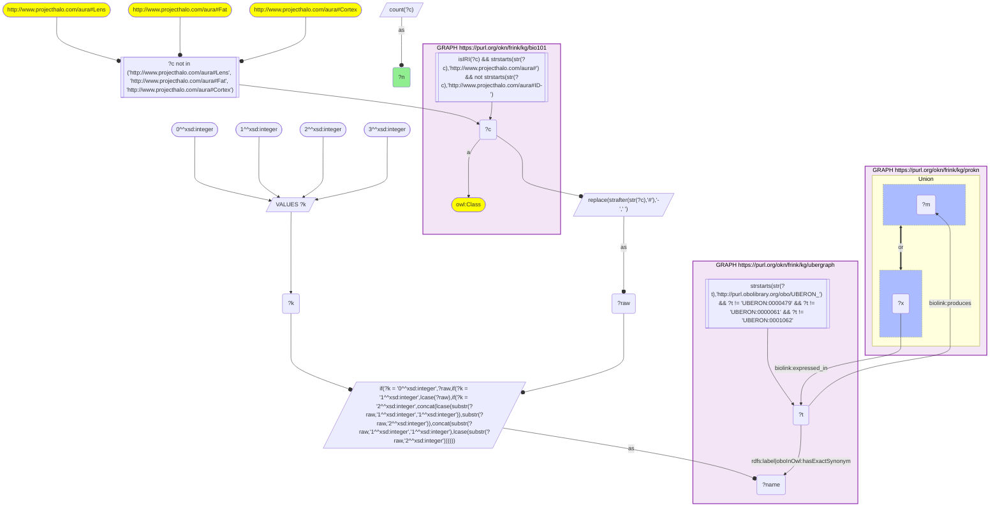
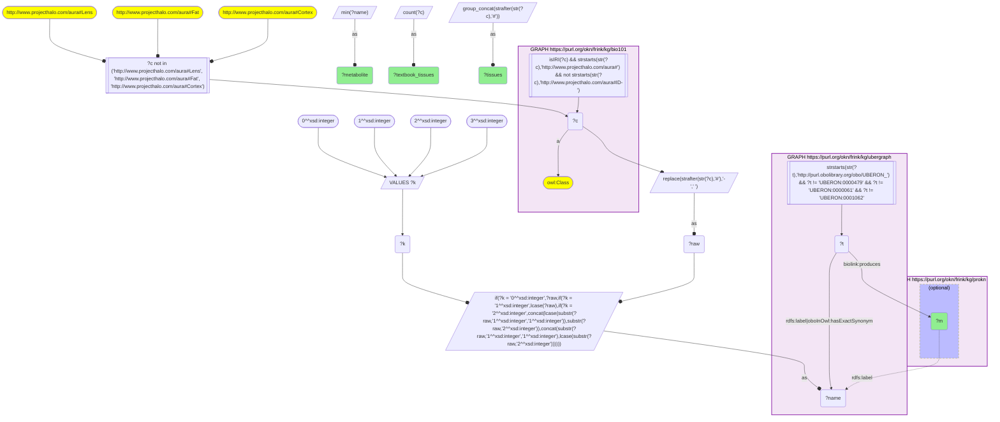

# AN16-Q2: Metabolites shared across KB Bio 101's tissues and fluids

- **Date:** 2026-11-03
- **Model:** claude-opus-5-5
- **SPARQL endpoint:** https://apps.okn.us/federation/sparql
- **Generated by:** mcp-okn v0.3.0 (build 5f97869)
- **Contents:** 2 queries · 2 query diagrams

## Knowledge graphs used

- `bio101` — <https://purl.org/okn/frink/kg/bio101>
- `ubergraph` — <https://purl.org/okn/frink/kg/ubergraph>
- `prokn` — <https://purl.org/okn/frink/kg/prokn>

## Conversation

👤 **User**

Crosswalk: `bio101` × `prokn` on **UBERON (bio101 label), bridged through `ubergraph`** (crosswalk `KB21-uberon-label-bio101-prokn`, verified_count 54). KB Bio 101 is an OWL ontology of an introductory biology textbook: every concept is an `owl:Class` IRI `http://www.projecthalo.com/aura#{Name}` with no `rdfs:label` and no external id, so the concept NAME (local name, hyphens → spaces, four case forms: as-is, all lower-case, first letter lowered, sentence case) is matched as a bound literal against ubergraph `rdfs:label | oboInOwl:hasExactSynonym` on `obo/UBERON_` terms. ProKN (`prokn`) uses UBERON terms in two ways: Metabolomics Workbench records that a tissue or fluid `biolink:produces` a PubChem compound (the UBERON term is the subject), and GTEx expression records (`GTExEXP` gene-by-tissue nodes, which point at both the tissue and the Ensembl gene) are `biolink:expressed_in` a tissue (the UBERON term is the object).

Research question: which metabolites does ProKN record as produced by the widest range of the tissues and fluids KB Bio 101 teaches? List the 30 most widely shared, with the textbook tissues they occur in.

Why the join is required: the tissues are textbook concepts without identifiers; only the name → UBERON bridge through ubergraph reaches ProKN's Metabolomics Workbench records for them.

---

🧠 **Assistant**

**Bridge established (Query 1).** The crosswalk skeleton, run verbatim, returns **54** bio101 concepts that reach a ProKN UBERON object through the name → UBERON bridge, matching the catalogued `verified_count`. Query 2 follows `biolink:produces` from those tissues to metabolites (PubChem compound IRIs). It groups by compound IRI, because ProKN gives some compounds two labels.

**Most widely shared metabolites (Query 2, top 30; the LIMIT cuts within the 34-tissue tie).**

| Metabolite (PubChem CID) | Textbook tissues |
|---|---|
| glutamate (33032) | 41 |
| aspartic acid (5960), glutamine (5961), L-phenylalanine (6140), L-tryptophan (6305), proline (145742), tyrosine (6057) | 40 each |
| asparagine (6267) | 39 |
| L-lysine (5962), L-threonine (6288), leucine (6106) | 38 each |
| alanine (5950), glycine (750), histidine (6274), methionine (6137), niacinamide (936), valine (6287) | 37 each |
| arginine (6322), carnitine (10917), citrulline (9750), hypoxanthine (135398638), L-ornithine (6262), L-serine (5951), N-acetylaspartic acid (65065), taurine (1123) | 36 each |
| arachidonic acid (444899), palmitic acid (985), uric acid (1175), xanthine (1188) | 35 each |
| adenosine (60961) | 34 |

The tissue lists include the familiar fluids and organs (blood, urine, intestine, brain, eye, retina, adipose tissue, ovary, uterus, placenta, milk). They also include non-human sample types such as Hemolymph.

**Answer.** The metabolites found across the most textbook tissues are the amino acids. Glutamate tops the list at 41 tissues. Aspartate, glutamine, phenylalanine, tryptophan, proline and tyrosine reach 40 each, and 18 of the 20 proteinogenic amino acids appear in the top 30.

The rest of the top 30 are the core intermediates a textbook teaches alongside them:

- urea-cycle amino acids (citrulline, ornithine, arginine);
- purine breakdown products (hypoxanthine, xanthine, uric acid) and adenosine;
- the fatty-acid carrier carnitine and the fatty acids palmitic and arachidonic acid;
- niacinamide (vitamin B3), taurine and the brain marker N-acetylaspartate.

These are the metabolites a central-metabolism chapter would predict to be everywhere.

Caveats:

- The counts measure how often a metabolite was *measured* in studies of each tissue, not tissue-specific production.
- The Metabolomics Workbench records pool species, so some textbook tissues (such as hemolymph) are from invertebrates.
- Labels carry ProKN's own forms, for example "(S)-glutamate_33032" and "glutamine_5961.0". Here they are cleaned to the compound name with its CID.
- This is an exact-name lower bound (the UBERON roots and Lens, Fat and Cortex are excluded).

## SPARQL queries executed

#### Query 1

_2026-11-04T01:00:58+00:00 · `bio101`, `ubergraph`, `prokn`_

```sparql
SELECT (COUNT(DISTINCT ?c) AS ?n) WHERE {
  { SELECT DISTINCT ?c ?t WHERE {
  { SELECT DISTINCT ?c ?name WHERE {
      GRAPH <https://purl.org/okn/frink/kg/bio101> { ?c a <http://www.w3.org/2002/07/owl#Class> .
        FILTER(isIRI(?c) && STRSTARTS(STR(?c),'http://www.projecthalo.com/aura#') && !STRSTARTS(STR(?c),'http://www.projecthalo.com/aura#ID-')) }
      FILTER(?c NOT IN (<http://www.projecthalo.com/aura#Lens>, <http://www.projecthalo.com/aura#Fat>, <http://www.projecthalo.com/aura#Cortex>))  # homonyms (spot-checked 2026-11-03)
      BIND(REPLACE(STRAFTER(STR(?c),'#'),'-',' ') AS ?raw)
      VALUES ?k { 0 1 2 3 }  # as-is, all lower, first letter lowered, sentence case
      BIND(IF(?k = 0, ?raw, IF(?k = 1, LCASE(?raw), IF(?k = 2, CONCAT(LCASE(SUBSTR(?raw,1,1)),SUBSTR(?raw,2)),
                CONCAT(SUBSTR(?raw,1,1),LCASE(SUBSTR(?raw,2)))))) AS ?name)
  } }
    GRAPH <https://purl.org/okn/frink/kg/ubergraph> { ?t <http://www.w3.org/2000/01/rdf-schema#label>|<http://www.geneontology.org/formats/oboInOwl#hasExactSynonym> ?name .
      FILTER(STRSTARTS(STR(?t),'http://purl.obolibrary.org/obo/UBERON_') && ?t != <http://purl.obolibrary.org/obo/UBERON_0000479> && ?t != <http://purl.obolibrary.org/obo/UBERON_0000061> && ?t != <http://purl.obolibrary.org/obo/UBERON_0001062>) }
  } }
  GRAPH <https://purl.org/okn/frink/kg/prokn> { { ?t <https://w3id.org/biolink/vocab/produces> ?m . } UNION { ?x <https://w3id.org/biolink/vocab/expressed_in> ?t . } }
}
```



_1 row(s)_

| n |
| --- |
| 54 |

#### Query 2

_2026-11-04T01:00:59+00:00 · `bio101`, `ubergraph`, `prokn`_

```sparql
SELECT ?m (MIN(?name) AS ?metabolite) (COUNT(DISTINCT ?c) AS ?textbook_tissues) (GROUP_CONCAT(DISTINCT STRAFTER(STR(?c), '#'); separator=", ") AS ?tissues) WHERE {
  { SELECT DISTINCT ?c ?t WHERE {
  { SELECT DISTINCT ?c ?name WHERE {
      GRAPH <https://purl.org/okn/frink/kg/bio101> { ?c a <http://www.w3.org/2002/07/owl#Class> .
        FILTER(isIRI(?c) && STRSTARTS(STR(?c),'http://www.projecthalo.com/aura#') && !STRSTARTS(STR(?c),'http://www.projecthalo.com/aura#ID-')) }
      FILTER(?c NOT IN (<http://www.projecthalo.com/aura#Lens>, <http://www.projecthalo.com/aura#Fat>, <http://www.projecthalo.com/aura#Cortex>))  # homonyms (spot-checked 2026-11-03)
      BIND(REPLACE(STRAFTER(STR(?c),'#'),'-',' ') AS ?raw)
      VALUES ?k { 0 1 2 3 }  # as-is, all lower, first letter lowered, sentence case
      BIND(IF(?k = 0, ?raw, IF(?k = 1, LCASE(?raw), IF(?k = 2, CONCAT(LCASE(SUBSTR(?raw,1,1)),SUBSTR(?raw,2)),
                CONCAT(SUBSTR(?raw,1,1),LCASE(SUBSTR(?raw,2)))))) AS ?name)
  } }
    GRAPH <https://purl.org/okn/frink/kg/ubergraph> { ?t <http://www.w3.org/2000/01/rdf-schema#label>|<http://www.geneontology.org/formats/oboInOwl#hasExactSynonym> ?name .
      FILTER(STRSTARTS(STR(?t),'http://purl.obolibrary.org/obo/UBERON_') && ?t != <http://purl.obolibrary.org/obo/UBERON_0000479> && ?t != <http://purl.obolibrary.org/obo/UBERON_0000061> && ?t != <http://purl.obolibrary.org/obo/UBERON_0001062>) }
  } }
  GRAPH <https://purl.org/okn/frink/kg/prokn> { ?t <https://w3id.org/biolink/vocab/produces> ?m . OPTIONAL { ?m <http://www.w3.org/2000/01/rdf-schema#label> ?name } }
} GROUP BY ?m ORDER BY DESC(?textbook_tissues) ?metabolite LIMIT 30
```



_30 row(s) — showing first 5_

| m | metabolite | textbook_tissues | tissues |
| --- | --- | --- | --- |
| https://pubchem.ncbi.nlm.nih.gov/compound/33032 | (S)-glutamate_33032 | 41 | Intestine, Blood, Amniotic-Fluid, Head, Adipose-Tissue, Cerebral-Cortex, Urine, Uterus, Interstitial-Fluid, Eye, Ovary, Epithelium, Rectum, Retina, Brain, Placenta, Cecum, Milk, Vitreous-Humor, Renal-Cortex, Hypothalamus, Cerebrospinal-Fluid, Saliva, Colon, Brown-Fat, Endothelium, Pancreas, Tail, Muscle-Tissue, Proximal-Tubule, Prostate-Gland, Adrenal-Gland, Small-Intestine, Shelled-Egg, Thyroid-Gland, Duodenum, Skeleton, Spinal-Cord, Bone-Marrow, Feces, Embryonic-Tissue |
| https://pubchem.ncbi.nlm.nih.gov/compound/5960 | Aspartic Acid | 40 | Amniotic-Fluid, Intestine, Blood, Head, Brain, Retina, Ovary, Interstitial-Fluid, Rectum, Adipose-Tissue, Eye, Urine, Uterus, Epithelium, Pancreas, Cecum, Renal-Cortex, Hypothalamus, Saliva, Endothelium, Milk, Brown-Fat, Cerebrospinal-Fluid, Vitreous-Humor, Colon, Placenta, Skeleton, Muscle-Tissue, Feces, Shelled-Egg, Bone-Marrow, Thyroid-Gland, Proximal-Tubule, Spinal-Cord, Tail, Prostate-Gland, Embryonic-Tissue, Adrenal-Gland, Duodenum, Small-Intestine |
| https://pubchem.ncbi.nlm.nih.gov/compound/5961 | glutamine_5961.0 | 40 | Head, Intestine, Amniotic-Fluid, Blood, Epithelium, Ovary, Hemolymph, Rectum, Eye, Urine, Uterus, Interstitial-Fluid, Adipose-Tissue, Cerebral-Cortex, Retina, Brain, Pancreas, Cecum, Saliva, Renal-Cortex, Hypothalamus, Brown-Fat, Placenta, Milk, Cerebrospinal-Fluid, Vitreous-Humor, Colon, Thyroid-Gland, Skeleton, Muscle-Tissue, Prostate-Gland, Shelled-Egg, Proximal-Tubule, Feces, Small-Intestine, Adrenal-Gland, Bone-Marrow, Duodenum, Embryonic-Tissue, Tail |
| https://pubchem.ncbi.nlm.nih.gov/compound/6140 | L-phenylalanine_6140 | 40 | Intestine, Head, Blood, Amniotic-Fluid, Interstitial-Fluid, Cerebral-Cortex, Uterus, Brain, Hemolymph, Urine, Ovary, Retina, Adipose-Tissue, Epithelium, Rectum, Eye, Saliva, Cerebrospinal-Fluid, Brown-Fat, Milk, Cecum, Colon, Renal-Cortex, Vitreous-Humor, Pancreas, Placenta, Hypothalamus, Adrenal-Gland, Skeleton, Prostate-Gland, Embryonic-Tissue, Small-Intestine, Muscle-Tissue, Feces, Thyroid-Gland, Tail, Bone-Marrow, Proximal-Tubule, Shelled-Egg, Duodenum |
| https://pubchem.ncbi.nlm.nih.gov/compound/6305 | L-tryptophan_6305 | 40 | Blood, Head, Amniotic-Fluid, Intestine, Cerebral-Cortex, Retina, Eye, Epithelium, Adipose-Tissue, Hemolymph, Brain, Uterus, Ovary, Interstitial-Fluid, Rectum, Pancreas, Vitreous-Humor, Colon, Placenta, Saliva, Renal-Cortex, Hypothalamus, Milk, Cecum, Urine, Cerebrospinal-Fluid, Brown-Fat, Prostate-Gland, Duodenum, Bone-Marrow, Muscle-Tissue, Proximal-Tubule, Adrenal-Gland, Skeleton, Tail, Embryonic-Tissue, Feces, Shelled-Egg, Thyroid-Gland, Small-Intestine |
