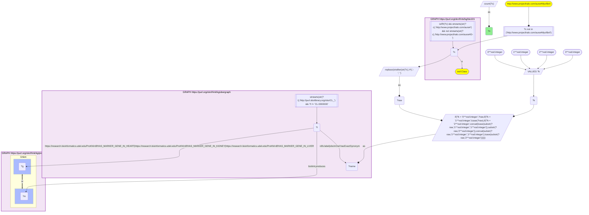

# AN17-Q1: KB Bio 101's cell types in ProKN: marker genes and metabolites

- **Date:** 2026-11-03
- **Model:** claude-opus-5-5
- **SPARQL endpoint:** https://apps.okn.us/federation/sparql
- **Generated by:** mcp-okn v0.3.0 (build d9c9ef9)
- **Contents:** 2 queries · 2 query diagrams

## Knowledge graphs used

- `bio101` — <https://purl.org/okn/frink/kg/bio101>
- `ubergraph` — <https://purl.org/okn/frink/kg/ubergraph>
- `prokn` — <https://purl.org/okn/frink/kg/prokn>

## Conversation

👤 **User**

Crosswalk: `bio101` × `prokn` on **CL (bio101 label), bridged through `ubergraph`** (crosswalk `KB24-cl-label-bio101-prokn`, verified_count 13). KB Bio 101 is an OWL ontology of an introductory biology textbook: every concept is an `owl:Class` IRI `http://www.projecthalo.com/aura#{Name}` with no `rdfs:label` and no external id, so the concept NAME (local name, hyphens → spaces, four case forms: as-is, all lower-case, first letter lowered, sentence case) is matched as a bound literal against ubergraph `rdfs:label | oboInOwl:hasExactSynonym` on `obo/CL_` terms. ProKN (`prokn`) mints CL cell types as nodes. HuBMAP Azimuth reference cell types carry their top marker genes per organ on `prokn:HAS_MARKER_GENE_IN_HEART`, `..._KIDNEY` and `..._LIVER` (object: an Ensembl gene node, symbol on `rdfs:label`) and `up:partOf` the organ; a few cell types are also the subject of Metabolomics Workbench `biolink:produces` records (object: a PubChem compound). The CL root is excluded, and the homonym `Myofibril` (an organelle in bio101, a myotube synonym in CL, as KB10).

Research question: for the cell types KB Bio 101 teaches, which does ProKN describe, with how many marker genes in heart, kidney and liver, and how many metabolites? Rank them.

Why the join is required: bio101 knows the cell types a curriculum teaches; ProKN knows their HuBMAP marker genes and metabolite records per CL term. They share no identifier, so only the name → CL bridge through ubergraph joins them.

---

🧠 **Assistant**

**Bridge established (Query 1).** The crosswalk skeleton, run verbatim, returns **13** bio101 cell types. Each one's name is an exact Cell Ontology (CL) label or exact synonym in ubergraph, *and* its CL node in ProKN carries HuBMAP marker genes or Metabolomics Workbench `biolink:produces` records. This matches the catalogued `verified_count`. Query 2 returns all 13.

**Cell types (Query 2).** Marker genes per organ, and distinct metabolites:

| bio101 cell type | CL (ubergraph label) | Heart markers | Kidney markers | Liver markers | Metabolites |
|---|---|---|---|---|---|
| Endospore | CL_0000563 | – | – | – | 1,996 |
| Fibroblast | CL_0000057 | 10 | 10 | – | 688 |
| Fungal-Cell | CL_0000521 | – | – | – | 673 |
| Adipose-Cell | CL_0000136 (adipocyte) | 10 | – | – | – |
| B-Cell | CL_0000236 | 10 | 9 | – | – |
| Erythrocyte | CL_0000232 | – | – | 10 | – |
| Macrophage | CL_0000235 | 10 | – | – | – |
| Mast-Cell | CL_0000097 | 10 | – | – | – |
| Natural-Killer-Cell | CL_0000623 | 10 | – | 10 | – |
| Neutrophil | CL_0000775 | – | 10 | – | – |
| Plasma-Cell | CL_0000786 | – | 10 | – | – |
| Schwann-Cell | CL_0002573 | 10 | – | – | – |
| Smooth-Muscle-Cell | CL_0000192 | 10 | – | – | – |

**Answer.** ProKN covers 13 of the textbook's cell types, through two unrelated sources:

- **HuBMAP marker genes (11 cell types).** The textbook's human cell types carry HuBMAP Azimuth marker lists, about 10 marker genes per cell type per reference organ:
  - in heart: adipocyte, B cell, fibroblast, macrophage, mast cell, NK cell, Schwann cell and smooth muscle cell;
  - in kidney: B cell, fibroblast, neutrophil and plasma cell;
  - in liver: erythrocyte and NK cell.
- **Metabolomics Workbench (3 cell types).** Endospore (1,996 metabolites), fibroblast (688) and fungal cell (673) are the subjects of `biolink:produces` records. The records come from Metabolomics Workbench studies of those cell or sample types.

Only the fibroblast appears in both sources.

Caveats:

- The marker lists are fixed-length top-N lists (10, or 9 for kidney B cells), so the counts show which organ references include the cell type, not how many genes it expresses.
- The CL root is excluded, and so is the homonym `Myofibril`, which bio101 uses for the muscle organelle and CL uses as a synonym of myotube (as KB10).
- This is an exact-name lower bound. Textbook cell types whose names are neither a CL label nor an exact synonym are missed.

## SPARQL queries executed

#### Query 1

_2026-11-04T01:41:29+00:00 · `bio101`, `ubergraph`, `prokn`_

```sparql
SELECT (COUNT(DISTINCT ?c) AS ?n) WHERE {
  { SELECT DISTINCT ?c ?t WHERE {
  { SELECT DISTINCT ?c ?name WHERE {
      GRAPH <https://purl.org/okn/frink/kg/bio101> { ?c a <http://www.w3.org/2002/07/owl#Class> .
        FILTER(isIRI(?c) && STRSTARTS(STR(?c),'http://www.projecthalo.com/aura#') && !STRSTARTS(STR(?c),'http://www.projecthalo.com/aura#ID-')) }
      FILTER(?c NOT IN (<http://www.projecthalo.com/aura#Myofibril>))  # homonyms (spot-checked 2026-11-03)
      BIND(REPLACE(STRAFTER(STR(?c),'#'),'-',' ') AS ?raw)
      VALUES ?k { 0 1 2 3 }  # as-is, all lower, first letter lowered, sentence case
      BIND(IF(?k = 0, ?raw, IF(?k = 1, LCASE(?raw), IF(?k = 2, CONCAT(LCASE(SUBSTR(?raw,1,1)),SUBSTR(?raw,2)),
                CONCAT(SUBSTR(?raw,1,1),LCASE(SUBSTR(?raw,2)))))) AS ?name)
  } }
    GRAPH <https://purl.org/okn/frink/kg/ubergraph> { ?t <http://www.w3.org/2000/01/rdf-schema#label>|<http://www.geneontology.org/formats/oboInOwl#hasExactSynonym> ?name .
      FILTER(STRSTARTS(STR(?t),'http://purl.obolibrary.org/obo/CL_') && ?t != <http://purl.obolibrary.org/obo/CL_0000000>) }
  } }
  GRAPH <https://purl.org/okn/frink/kg/prokn> { { ?t <https://research.bioinformatics.udel.edu/ProKN/rdf/HAS_MARKER_GENE_IN_HEART>|<https://research.bioinformatics.udel.edu/ProKN/rdf/HAS_MARKER_GENE_IN_KIDNEY>|<https://research.bioinformatics.udel.edu/ProKN/rdf/HAS_MARKER_GENE_IN_LIVER> ?g . } UNION { ?t <https://w3id.org/biolink/vocab/produces> ?m . } }
}
```



_1 row(s)_

| n |
| --- |
| 13 |

#### Query 2

_2026-11-04T01:41:30+00:00 · `bio101`, `ubergraph`, `prokn`_

```sparql
SELECT ?c ?t ?label ?heart_markers ?kidney_markers ?liver_markers ?metabolites WHERE {
  { SELECT DISTINCT ?c ?t WHERE {
  { SELECT DISTINCT ?c ?name WHERE {
      GRAPH <https://purl.org/okn/frink/kg/bio101> { ?c a <http://www.w3.org/2002/07/owl#Class> .
        FILTER(isIRI(?c) && STRSTARTS(STR(?c),'http://www.projecthalo.com/aura#') && !STRSTARTS(STR(?c),'http://www.projecthalo.com/aura#ID-')) }
      FILTER(?c NOT IN (<http://www.projecthalo.com/aura#Myofibril>))  # homonyms (spot-checked 2026-11-03)
      BIND(REPLACE(STRAFTER(STR(?c),'#'),'-',' ') AS ?raw)
      VALUES ?k { 0 1 2 3 }  # as-is, all lower, first letter lowered, sentence case
      BIND(IF(?k = 0, ?raw, IF(?k = 1, LCASE(?raw), IF(?k = 2, CONCAT(LCASE(SUBSTR(?raw,1,1)),SUBSTR(?raw,2)),
                CONCAT(SUBSTR(?raw,1,1),LCASE(SUBSTR(?raw,2)))))) AS ?name)
  } }
    GRAPH <https://purl.org/okn/frink/kg/ubergraph> { ?t <http://www.w3.org/2000/01/rdf-schema#label>|<http://www.geneontology.org/formats/oboInOwl#hasExactSynonym> ?name .
      FILTER(STRSTARTS(STR(?t),'http://purl.obolibrary.org/obo/CL_') && ?t != <http://purl.obolibrary.org/obo/CL_0000000>) }
  } }
  OPTIONAL { SELECT ?t (COUNT(DISTINCT ?g1) AS ?heart_markers) WHERE { GRAPH <https://purl.org/okn/frink/kg/prokn> { ?t <https://research.bioinformatics.udel.edu/ProKN/rdf/HAS_MARKER_GENE_IN_HEART> ?g1 } } GROUP BY ?t }
  OPTIONAL { SELECT ?t (COUNT(DISTINCT ?g2) AS ?kidney_markers) WHERE { GRAPH <https://purl.org/okn/frink/kg/prokn> { ?t <https://research.bioinformatics.udel.edu/ProKN/rdf/HAS_MARKER_GENE_IN_KIDNEY> ?g2 } } GROUP BY ?t }
  OPTIONAL { SELECT ?t (COUNT(DISTINCT ?g3) AS ?liver_markers) WHERE { GRAPH <https://purl.org/okn/frink/kg/prokn> { ?t <https://research.bioinformatics.udel.edu/ProKN/rdf/HAS_MARKER_GENE_IN_LIVER> ?g3 } } GROUP BY ?t }
  OPTIONAL { SELECT ?t (COUNT(DISTINCT ?m) AS ?metabolites) WHERE { GRAPH <https://purl.org/okn/frink/kg/prokn> { ?t <https://w3id.org/biolink/vocab/produces> ?m } } GROUP BY ?t }
  FILTER(BOUND(?heart_markers) || BOUND(?kidney_markers) || BOUND(?liver_markers) || BOUND(?metabolites))
  GRAPH <https://purl.org/okn/frink/kg/ubergraph> { ?t <http://www.w3.org/2000/01/rdf-schema#label> ?label }
} ORDER BY DESC(?metabolites) ?c
```



```mermaid
graph TD
classDef projected fill:lightgreen;
classDef literal fill:orange;
classDef iri fill:yellow;
  q1v5("?c"):::projected 
  q1v12("?g1")
  q1v13("?g2")
  q1v14("?g3")
  q1v1("?heart_markers"):::projected 
  q1v7("?k")
  q1v2("?kidney_markers"):::projected 
  q1v16("?label"):::projected 
  q1v3("?liver_markers"):::projected 
  q1v15("?m")
  q1v4("?metabolites"):::projected 
  q1v6("?name")
  q1v8("?raw")
  q1v9("?t"):::projected 
  q1c1(["http://www.projecthalo.com/aura#Myofibril"]):::iri 
  q1f0[["(bound(?heart_markers) || bound(?kidney_markers) || bound(?liver_markers) || bound(?metabolites))"]]
  q1f0 --> q1v1
  q1f0 --> q1v2
  q1f0 --> q1v3
  q1f0 --> q1v4
  q1f1[["?c not in ('http://www.projecthalo.com/aura#Myofibril')"]]
  q1c1 --o q1f1
  q1f1 --> q1v5
  subgraph q1graph0["GRAPH https://purl.org/okn/frink/kg/bio101"]
    style q1graph0 fill:#f3e5f5,stroke:#8e24aa,stroke-width:2px,color:#000;
    q1graph0c2(["owl:Class"]):::iri 
    q1graph0f2[["isIRI(?c) && strstarts(str(?c),'http://www.projecthalo.com/aura#') && not strstarts(str(?c),'http://www.projecthalo.com/aura#ID-')"]]
    q1graph0f2 --> q1v5
    q1v5 --"a"--> q1graph0c2
  end
  q1bind0[/"replace(strafter(str(?c),'#'),'-',' ')"/]
  q1v5 --o q1bind0
  q1bind0 --as--o q1v8
  q1bind1[/"VALUES ?k"/]
  q1bind1-->q1v7
  q1bind10(["0^^xsd:integer"])
  q1bind10 --> q1bind1
  q1bind11(["1^^xsd:integer"])
  q1bind11 --> q1bind1
  q1bind12(["2^^xsd:integer"])
  q1bind12 --> q1bind1
  q1bind13(["3^^xsd:integer"])
  q1bind13 --> q1bind1
  q1bind2[/"if(?k = '0^^xsd:integer',?raw,if(?k = '1^^xsd:integer',lcase(?raw),if(?k = '2^^xsd:integer',concat(lcase(substr(?raw,'1^^xsd:integer','1^^xsd:integer')),substr(?raw,'2^^xsd:integer')),concat(substr(?raw,'1^^xsd:integer','1^^xsd:integer'),lcase(substr(?raw,'2^^xsd:integer'))))))"/]
  q1v7 --o q1bind2
  q1v8 --o q1bind2
  q1bind2 --as--o q1v6
  subgraph q1graph1["GRAPH https://purl.org/okn/frink/kg/ubergraph"]
    style q1graph1 fill:#f3e5f5,stroke:#8e24aa,stroke-width:2px,color:#000;
    q1graph1f3[["strstarts(str(?t),'http://purl.obolibrary.org/obo/CL_') && ?t != 'CL:0000000'"]]
    q1graph1f3 --> q1v9
    q1v9 --"rdfs:label|oboInOwl:hasExactSynonym"--> q1v6
  end
  subgraph q1optional0["(optional)"]
  style q1optional0 fill:#bbf,stroke-dasharray: 5 5,color:#000;
    subgraph q1graph2["GRAPH https://purl.org/okn/frink/kg/prokn"]
      style q1graph2 fill:#f3e5f5,stroke:#8e24aa,stroke-width:2px,color:#000;
      q1v9 --"https://research.bioinformatics.udel.edu/ProKN/rdf/HAS_MARKER_GENE_IN_HEART"--> q1v12
    end
    q1bind3[/"count(?m)"/]
    q1bind3 --as--o q1v1
  end
  subgraph q1optional1["(optional)"]
  style q1optional1 fill:#bbf,stroke-dasharray: 5 5,color:#000;
    subgraph q1graph3["GRAPH https://purl.org/okn/frink/kg/prokn"]
      style q1graph3 fill:#f3e5f5,stroke:#8e24aa,stroke-width:2px,color:#000;
      q1v9 --"https://research.bioinformatics.udel.edu/ProKN/rdf/HAS_MARKER_GENE_IN_KIDNEY"--> q1v13
    end
    q1bind4[/"count(?m)"/]
    q1bind4 --as--o q1v2
  end
  subgraph q1optional2["(optional)"]
  style q1optional2 fill:#bbf,stroke-dasharray: 5 5,color:#000;
    subgraph q1graph4["GRAPH https://purl.org/okn/frink/kg/prokn"]
      style q1graph4 fill:#f3e5f5,stroke:#8e24aa,stroke-width:2px,color:#000;
      q1v9 --"https://research.bioinformatics.udel.edu/ProKN/rdf/HAS_MARKER_GENE_IN_LIVER"--> q1v14
    end
    q1bind5[/"count(?m)"/]
    q1bind5 --as--o q1v3
  end
  subgraph q1optional3["(optional)"]
  style q1optional3 fill:#bbf,stroke-dasharray: 5 5,color:#000;
    subgraph q1graph5["GRAPH https://purl.org/okn/frink/kg/prokn"]
      style q1graph5 fill:#f3e5f5,stroke:#8e24aa,stroke-width:2px,color:#000;
      q1v9 --"biolink:produces"--> q1v15
    end
    q1bind6[/"count(?m)"/]
    q1bind6 --as--o q1v4
  end
  subgraph q1graph6["GRAPH https://purl.org/okn/frink/kg/ubergraph"]
    style q1graph6 fill:#f3e5f5,stroke:#8e24aa,stroke-width:2px,color:#000;
    q1v9 --"rdfs:label"--> q1v16
  end
```

_13 row(s) — showing first 5_

| c | t | label | heart_markers | kidney_markers | liver_markers | metabolites |
| --- | --- | --- | --- | --- | --- | --- |
| http://www.projecthalo.com/aura#Endospore | http://purl.obolibrary.org/obo/CL_0000563 | endospore |  |  |  | 1996 |
| http://www.projecthalo.com/aura#Fibroblast | http://purl.obolibrary.org/obo/CL_0000057 | fibroblast | 10 | 10 |  | 688 |
| http://www.projecthalo.com/aura#Fungal-Cell | http://purl.obolibrary.org/obo/CL_0000521 | fungal cell |  |  |  | 673 |
| http://www.projecthalo.com/aura#Adipose-Cell | http://purl.obolibrary.org/obo/CL_0000136 | adipocyte | 10 |  |  |  |
| http://www.projecthalo.com/aura#B-Cell | http://purl.obolibrary.org/obo/CL_0000236 | B cell | 10 | 9 |  |  |
