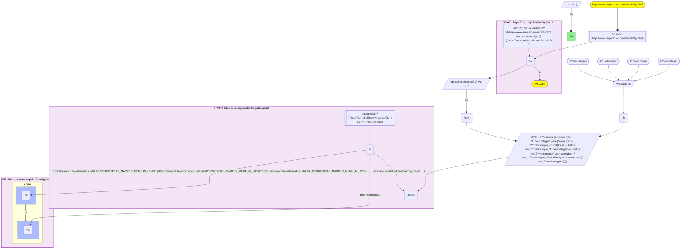
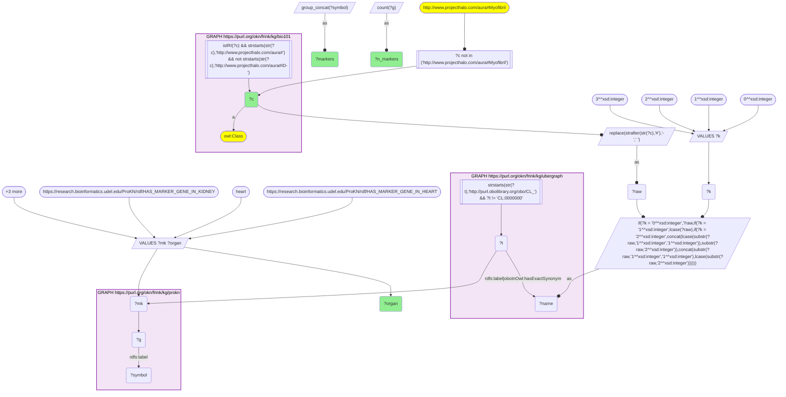

# AN17-Q2: HuBMAP marker genes for KB Bio 101's cell types

- **Date:** 2026-11-03
- **Model:** claude-opus-5-5
- **SPARQL endpoint:** https://apps.okn.us/federation/sparql
- **Generated by:** mcp-okn v0.3.0 (build d9c9ef9)
- **Contents:** 2 queries · 2 query diagrams

## Knowledge graphs used

- `bio101` — <https://purl.org/okn/frink/kg/bio101>
- `ubergraph` — <https://purl.org/okn/frink/kg/ubergraph>
- `prokn` — <https://purl.org/okn/frink/kg/prokn>

## Conversation

👤 **User**

Crosswalk: `bio101` × `prokn` on **CL (bio101 label), bridged through `ubergraph`** (crosswalk `KB24-cl-label-bio101-prokn`, verified_count 13). KB Bio 101 is an OWL ontology of an introductory biology textbook: every concept is an `owl:Class` IRI `http://www.projecthalo.com/aura#{Name}` with no `rdfs:label` and no external id, so the concept NAME (local name, hyphens → spaces, four case forms: as-is, all lower-case, first letter lowered, sentence case) is matched as a bound literal against ubergraph `rdfs:label | oboInOwl:hasExactSynonym` on `obo/CL_` terms. ProKN (`prokn`) mints CL cell types as nodes. HuBMAP Azimuth reference cell types carry their top marker genes per organ on `prokn:HAS_MARKER_GENE_IN_HEART`, `..._KIDNEY` and `..._LIVER` (object: an Ensembl gene node, symbol on `rdfs:label`) and `up:partOf` the organ; a few cell types are also the subject of Metabolomics Workbench `biolink:produces` records (object: a PubChem compound).

Research question: which marker genes does ProKN list for each textbook cell type in each organ, and do they include the markers a textbook would name (hemoglobin for red blood cells, immunoglobulin for plasma cells, CD163 / MRC1 for macrophages, KIT and tryptase for mast cells, myelin genes for Schwann cells)?

Why the join is required: the cell types are textbook concepts without identifiers; only the name → CL bridge through ubergraph reaches ProKN's HuBMAP marker-gene records.

---

🧠 **Assistant**

**Bridge established (Query 1).** The crosswalk skeleton, run verbatim, returns **13** bio101 cell types that reach a ProKN CL node through the name → CL bridge, matching the catalogued `verified_count`. Query 2 lists the HuBMAP marker genes (`prokn:HAS_MARKER_GENE_IN_HEART / _KIDNEY / _LIVER`, gene symbol on `rdfs:label`). The 11 cell types with marker records give 14 cell × organ lists.

**Marker genes (Query 2).**

| bio101 cell type | Organ | Markers |
|---|---|---|
| Adipose-Cell | heart | PLIN1, FASN, ACACB, GPAM, PDE3B, PRKAR2B, MGST1, SLC19A3, GHR, LINC00598 |
| B-Cell | heart | MS4A1, BANK1, IGHM, IGHA1, IGKC, MZB1, RALGPS2, AFF3, GNG7, IFNG-AS1 |
| B-Cell | kidney | MS4A1, PAX5, BANK1, IGHM, FCRL1, INPP5D, RALGPS2, ARHGAP24, ZCCHC7 |
| Erythrocyte | liver | HBB, HBA1, HBA2, HBD, HBM, AHSP, ALAS2, SLC25A37, CA1, SNCA |
| Fibroblast | heart | DCN, APOD, CFD, LAMA2, ABCA6, ABCA8, ABCA9, ACSM3, KAZN, NEGR1 |
| Fibroblast | kidney | CDH11, FBLN5, C7, NID1, SVEP1, ADAMTS12, ABCA6, CCBE1, ATRNL1, CLMP |
| Macrophage | heart | CD163, MRC1, F13A1, STAB1, COLEC12, MS4A6A, FRMD4B, RBPJ, RBM47, FMN1 |
| Mast-Cell | heart | KIT, CPA3, HPGDS, IL18R1, RAB27B, SLC38A11, CDK15, SLC8A3, SLC24A3, NTM |
| Natural-Killer-Cell | heart | NKG7, GNLY, PRF1, KLRD1, CD247, CCL5, CCL4, AOAH, TXK, PARP8 |
| Natural-Killer-Cell | liver | NKG7, GNLY, PRF1, GZMB, KLRD1, KLRF1, FGFBP2, CD7, CMC1, SPON2 |
| Neutrophil | kidney | S100A8, S100A9, FCGR3B, CSF3R, S100A6, MXD1, FTL, ITM2B, DHFR, ACTB |
| Plasma-Cell | kidney | IGHG1, IGHG3, IGHA1, IGKC, MZB1, POU2AF1, TENT5C, IGHGP, MEI1, IFNG-AS1 |
| Schwann-Cell | heart | CDH19, NRXN1, NRXN3, NCAM2, CHL1, CADM2, KIRREL3, SORCS1, XKR4, ADGRB3 |
| Smooth-Muscle-Cell | heart | MYH11, ACTA2, TAGLN, PRKG1, ITGA8, KCNAB1, RCAN2, ZFHX3, NTRK3, CARMN |

**Answer.** Most lists contain the markers a textbook would name:

- **Erythrocyte:** the haemoglobin chains HBB, HBA1, HBA2 and HBD, plus AHSP (the alpha-globin chaperone) and ALAS2 (the first enzyme of haem synthesis).
- **Plasma cell:** immunoglobulin heavy and light chains (IGHG1, IGHG3, IGHA1, IGKC).
- **B cell:** MS4A1 (CD20) and PAX5, with surface IgM (IGHM).
- **Macrophage:** CD163 and MRC1 (CD206).
- **Mast cell:** KIT and carboxypeptidase A3 (CPA3), but not tryptase.
- **NK cell:** the cytotoxic granule genes perforin (PRF1), granulysin (GNLY) and granzyme B (GZMB, liver list), plus the NK receptors KLRD1 and KLRF1.
- **Neutrophil:** calprotectin (S100A8 / S100A9), CD16b (FCGR3B) and the G-CSF receptor (CSF3R).
- **Smooth muscle cell:** smooth-muscle myosin (MYH11), α-smooth-muscle actin (ACTA2) and transgelin (TAGLN).
- **Adipocyte:** perilipin (PLIN1) and fatty-acid synthase (FASN).

The exception is the **Schwann cell**. Its heart list has no myelin gene (no MPZ, PMP22 or MBP). Instead it holds neuronal adhesion molecules (CDH19, the neurexins NRXN1 / NRXN3, NCAM2). That is consistent with the non-myelinating Schwann cells along cardiac autonomic nerves rather than the myelinating cell a textbook draws.

The same cell type can carry different lists in different organs: B cells in heart versus kidney, NK cells in heart versus liver, fibroblasts in heart versus kidney. A shared core (MS4A1 / BANK1; NKG7 / GNLY / PRF1) shows the identity, while the rest reflects the tissue.

Caveats:

- These are HuBMAP Azimuth top-ranked markers per reference organ. A textbook marker missing from a list (tryptase for mast cells, myelin genes for Schwann cells) is not evidence that the cell lacks it.
- Only heart, kidney and liver references are present.
- The CL root and the homonym `Myofibril` are excluded.

## SPARQL queries executed

#### Query 1

_2026-11-04T01:41:31+00:00 · `bio101`, `ubergraph`, `prokn`_

```sparql
SELECT (COUNT(DISTINCT ?c) AS ?n) WHERE {
  { SELECT DISTINCT ?c ?t WHERE {
  { SELECT DISTINCT ?c ?name WHERE {
      GRAPH <https://purl.org/okn/frink/kg/bio101> { ?c a <http://www.w3.org/2002/07/owl#Class> .
        FILTER(isIRI(?c) && STRSTARTS(STR(?c),'http://www.projecthalo.com/aura#') && !STRSTARTS(STR(?c),'http://www.projecthalo.com/aura#ID-')) }
      FILTER(?c NOT IN (<http://www.projecthalo.com/aura#Myofibril>))  # homonyms (spot-checked 2026-11-03)
      BIND(REPLACE(STRAFTER(STR(?c),'#'),'-',' ') AS ?raw)
      VALUES ?k { 0 1 2 3 }  # as-is, all lower, first letter lowered, sentence case
      BIND(IF(?k = 0, ?raw, IF(?k = 1, LCASE(?raw), IF(?k = 2, CONCAT(LCASE(SUBSTR(?raw,1,1)),SUBSTR(?raw,2)),
                CONCAT(SUBSTR(?raw,1,1),LCASE(SUBSTR(?raw,2)))))) AS ?name)
  } }
    GRAPH <https://purl.org/okn/frink/kg/ubergraph> { ?t <http://www.w3.org/2000/01/rdf-schema#label>|<http://www.geneontology.org/formats/oboInOwl#hasExactSynonym> ?name .
      FILTER(STRSTARTS(STR(?t),'http://purl.obolibrary.org/obo/CL_') && ?t != <http://purl.obolibrary.org/obo/CL_0000000>) }
  } }
  GRAPH <https://purl.org/okn/frink/kg/prokn> { { ?t <https://research.bioinformatics.udel.edu/ProKN/rdf/HAS_MARKER_GENE_IN_HEART>|<https://research.bioinformatics.udel.edu/ProKN/rdf/HAS_MARKER_GENE_IN_KIDNEY>|<https://research.bioinformatics.udel.edu/ProKN/rdf/HAS_MARKER_GENE_IN_LIVER> ?g . } UNION { ?t <https://w3id.org/biolink/vocab/produces> ?m . } }
}
```



_1 row(s)_

| n |
| --- |
| 13 |

#### Query 2

_2026-11-04T01:41:31+00:00 · `bio101`, `ubergraph`, `prokn`_

```sparql
SELECT ?c ?organ (COUNT(DISTINCT ?g) AS ?n_markers) (GROUP_CONCAT(DISTINCT ?symbol; separator=", ") AS ?markers) WHERE {
  { SELECT DISTINCT ?c ?t WHERE {
  { SELECT DISTINCT ?c ?name WHERE {
      GRAPH <https://purl.org/okn/frink/kg/bio101> { ?c a <http://www.w3.org/2002/07/owl#Class> .
        FILTER(isIRI(?c) && STRSTARTS(STR(?c),'http://www.projecthalo.com/aura#') && !STRSTARTS(STR(?c),'http://www.projecthalo.com/aura#ID-')) }
      FILTER(?c NOT IN (<http://www.projecthalo.com/aura#Myofibril>))  # homonyms (spot-checked 2026-11-03)
      BIND(REPLACE(STRAFTER(STR(?c),'#'),'-',' ') AS ?raw)
      VALUES ?k { 0 1 2 3 }  # as-is, all lower, first letter lowered, sentence case
      BIND(IF(?k = 0, ?raw, IF(?k = 1, LCASE(?raw), IF(?k = 2, CONCAT(LCASE(SUBSTR(?raw,1,1)),SUBSTR(?raw,2)),
                CONCAT(SUBSTR(?raw,1,1),LCASE(SUBSTR(?raw,2)))))) AS ?name)
  } }
    GRAPH <https://purl.org/okn/frink/kg/ubergraph> { ?t <http://www.w3.org/2000/01/rdf-schema#label>|<http://www.geneontology.org/formats/oboInOwl#hasExactSynonym> ?name .
      FILTER(STRSTARTS(STR(?t),'http://purl.obolibrary.org/obo/CL_') && ?t != <http://purl.obolibrary.org/obo/CL_0000000>) }
  } }
  GRAPH <https://purl.org/okn/frink/kg/prokn> { ?t ?mk ?g . ?g <http://www.w3.org/2000/01/rdf-schema#label> ?symbol . }
  VALUES (?mk ?organ) { (<https://research.bioinformatics.udel.edu/ProKN/rdf/HAS_MARKER_GENE_IN_HEART> "heart") (<https://research.bioinformatics.udel.edu/ProKN/rdf/HAS_MARKER_GENE_IN_KIDNEY> "kidney") (<https://research.bioinformatics.udel.edu/ProKN/rdf/HAS_MARKER_GENE_IN_LIVER> "liver") }
} GROUP BY ?c ?organ ORDER BY ?c ?organ
```



_14 row(s) — showing first 5_

| c | organ | n_markers | markers |
| --- | --- | --- | --- |
| http://www.projecthalo.com/aura#Adipose-Cell | heart | 10 | PRKAR2B, PLIN1, MGST1, SLC19A3, PDE3B, ACACB, FASN, LINC00598, GPAM, GHR |
| http://www.projecthalo.com/aura#B-Cell | heart | 10 | IFNG-AS1, IGHA1, BANK1, MS4A1, RALGPS2, MZB1, IGKC, GNG7, AFF3, IGHM |
| http://www.projecthalo.com/aura#B-Cell | kidney | 9 | BANK1, ARHGAP24, ZCCHC7, INPP5D, RALGPS2, IGHM, PAX5, MS4A1, FCRL1 |
| http://www.projecthalo.com/aura#Erythrocyte | liver | 10 | HBD, SLC25A37, HBB, AHSP, HBA2, HBA1, HBM, SNCA, ALAS2, CA1 |
| http://www.projecthalo.com/aura#Fibroblast | heart | 10 | ABCA8, ABCA6, ACSM3, APOD, KAZN, NEGR1, DCN, CFD, LAMA2, ABCA9 |
