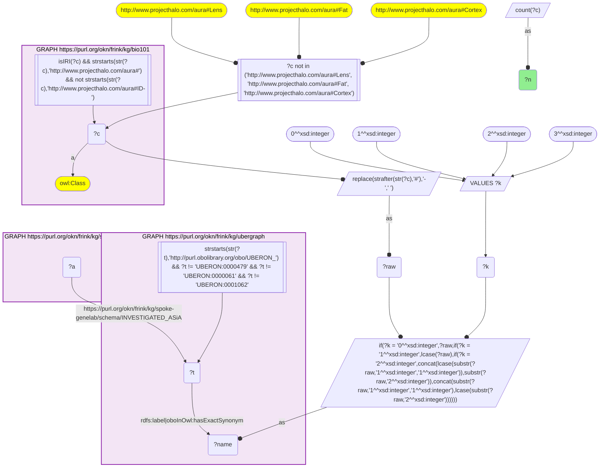
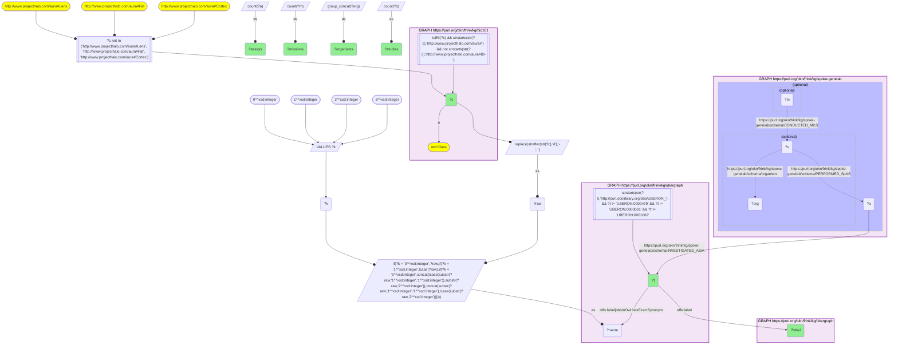

# AN18-Q1: KB Bio 101's organs and tissues in NASA spaceflight omics

- **Date:** 2026-11-03
- **Model:** claude-opus-5-5
- **SPARQL endpoint:** https://apps.okn.us/federation/sparql
- **Generated by:** mcp-okn v0.3.0 (build d056eb6)
- **Contents:** 2 queries · 2 query diagrams

## Knowledge graphs used

- `bio101` — <https://purl.org/okn/frink/kg/bio101>
- `ubergraph` — <https://purl.org/okn/frink/kg/ubergraph>
- `spoke-genelab` — <https://purl.org/okn/frink/kg/spoke-genelab>

## Conversation

👤 **User**

Crosswalk: `bio101` × `spoke-genelab` on **UBERON (bio101 label), bridged through `ubergraph`** (crosswalk `KB26-uberon-label-bio101-spokegenelab`, verified_count 17). KB Bio 101 is an OWL ontology of an introductory biology textbook: every concept is an `owl:Class` IRI `http://www.projecthalo.com/aura#{Name}` with no `rdfs:label` and no external id, so the concept NAME (local name, hyphens → spaces, four case forms: as-is, all lower-case, first letter lowered, sentence case) is matched as a bound literal against ubergraph `rdfs:label | oboInOwl:hasExactSynonym` on `obo/UBERON_` terms. spoke-genelab (`spoke-genelab`) holds NASA OSDR spaceflight omics: a study (`biolink:Study`, `rdfs:label`, `spoke-genelab:organism`) `PERFORMED_SpAS` assays, a mission (`spoke-genelab:Mission`, `space_program`) `CONDUCTED_MIcS` studies, and each assay (`obo:OBI_0000070`) `INVESTIGATED_ASiA` an anatomy term, a raw `obo/UBERON_` IRI. An assay compares two sample groups whose spaceflight status is on `factor_space_1` / `factor_space_2` ('Space Flight', 'Ground Control', 'Vivarium Control', 'Basal Control'). The UBERON roots are excluded, and three homonyms by name: Lens, Fat (as KB3) and `Cortex` (plant ground tissue in bio101).

Research question: which organs and tissues KB Bio 101 teaches have been assayed in NASA OSDR spaceflight omics, in how many assays, studies and missions, and in which organisms? Rank them.

Why the join is required: bio101 knows the anatomy a curriculum teaches; spoke-genelab knows which tissues were sampled in spaceflight experiments, keyed on UBERON. They share no identifier, so only the name → UBERON bridge through ubergraph joins them.

---

🧠 **Assistant**

**Bridge established (Query 1).** The crosswalk skeleton, run verbatim, returns **17** bio101 anatomical concepts. Each one's name is an exact UBERON label or exact synonym in ubergraph, *and* its UBERON term is `INVESTIGATED_ASiA` by at least one spoke-genelab assay. This matches the catalogued `verified_count`. Query 2 returns all 17.

**Ranking (Query 2).** Assays investigating the tissue, the studies that performed them, the missions that conducted those studies, and the studies' organisms:

| Rank | bio101 concept | UBERON (label) | Assays | Studies | Missions | Organisms |
|---|---|---|---|---|---|---|
| 1 | Multicellular-Organism | UBERON_0000468 | 1,242 | 10 | 4 | fruit fly, *C. elegans*, *Arabidopsis* |
| 2 | Blood | UBERON_0000178 | 1,216 | 7 | 1 | mouse, human |
| 3 | Liver | UBERON_0002107 | 494 | 11 | 5 | mouse |
| 4 | Larva | UBERON_0002548 | 228 | 1 | 1 | fruit fly |
| 5 | Retina | UBERON_0000966 | 162 | 5 | 4 | mouse |
| 6 | Head | UBERON_0000033 | 86 | 2 | 2 | fruit fly |
| 7 | Lung | UBERON_0002048 | 72 | 1 | 0 | mouse |
| 7 | Thymus | UBERON_0002370 | 72 | 6 | 5 | mouse, rat |
| 9 | Bone-Marrow | UBERON_0002371 | 68 | 2 | 1 | mouse |
| 10 | Brain | UBERON_0000955 | 58 | 2 | 1 | mouse |
| 11 | Colon | UBERON_0001155 | 56 | 1 | 1 | mouse |
| 12 | Adrenal-Gland | UBERON_0002369 | 26 | 4 | 3 | mouse |
| 13 | Heart | UBERON_0000948 | 16 | 3 | 3 | fruit fly, mouse |
| 14 | Embryo | UBERON_0000922 | 12 | 1 | 0 | zebrafish |
| 15 | Cerebellum | UBERON_0002037 | 6 | 1 | 1 | mouse |
| 15 | Eye | UBERON_0000970 | 6 | 1 | 2 | mouse |
| 17 | Cardiac-Muscle | UBERON_0001133 | 2 | 1 | 0 | mouse |

**Answer.** 17 textbook anatomy terms have been sampled in NASA's spaceflight omics:

- **Whole organisms:** "multicellular organism", the whole-organism term used for fly, worm and plant samples (1,242 assays), plus the Drosophila larva (228) and head (86).
- **Blood:** 1,216 assays in mouse and human. It is the only textbook tissue with human samples here.
- **Liver:** the most widely flown organ, with 494 assays from 11 studies across 5 missions.
- **Retina and thymus:** each spread over 4–5 missions.
- **Lung, colon, bone marrow and brain:** each come from one or two studies.
- **Organisms:** mouse dominates the organ-level data. Rat appears only for thymus, and zebrafish only for the embryo.

Caveats:

- Assay counts measure analyses (comparisons between sample groups), not animals or samples, so a single large study can contribute hundreds.
- A missing mission (Lung, Embryo, Cardiac-Muscle: 0) means no `CONDUCTED_MIcS` link is recorded for that study, not necessarily that it was not flown.
- "Multicellular organism" is UBERON's whole-body term and is kept as a match, as in KB8.
- This is an exact-name lower bound. The UBERON roots and the homonyms Lens, Fat and Cortex are excluded.

## SPARQL queries executed

#### Query 1

_2026-11-04T01:55:24+00:00 · `bio101`, `ubergraph`, `spoke-genelab`_

```sparql
SELECT (COUNT(DISTINCT ?c) AS ?n) WHERE {
  { SELECT DISTINCT ?c ?t WHERE {
  { SELECT DISTINCT ?c ?name WHERE {
      GRAPH <https://purl.org/okn/frink/kg/bio101> { ?c a <http://www.w3.org/2002/07/owl#Class> .
        FILTER(isIRI(?c) && STRSTARTS(STR(?c),'http://www.projecthalo.com/aura#') && !STRSTARTS(STR(?c),'http://www.projecthalo.com/aura#ID-')) }
      FILTER(?c NOT IN (<http://www.projecthalo.com/aura#Lens>, <http://www.projecthalo.com/aura#Fat>, <http://www.projecthalo.com/aura#Cortex>))  # homonyms (spot-checked 2026-11-03)
      BIND(REPLACE(STRAFTER(STR(?c),'#'),'-',' ') AS ?raw)
      VALUES ?k { 0 1 2 3 }  # as-is, all lower, first letter lowered, sentence case
      BIND(IF(?k = 0, ?raw, IF(?k = 1, LCASE(?raw), IF(?k = 2, CONCAT(LCASE(SUBSTR(?raw,1,1)),SUBSTR(?raw,2)),
                CONCAT(SUBSTR(?raw,1,1),LCASE(SUBSTR(?raw,2)))))) AS ?name)
  } }
    GRAPH <https://purl.org/okn/frink/kg/ubergraph> { ?t <http://www.w3.org/2000/01/rdf-schema#label>|<http://www.geneontology.org/formats/oboInOwl#hasExactSynonym> ?name .
      FILTER(STRSTARTS(STR(?t),'http://purl.obolibrary.org/obo/UBERON_') && ?t != <http://purl.obolibrary.org/obo/UBERON_0000479> && ?t != <http://purl.obolibrary.org/obo/UBERON_0000061> && ?t != <http://purl.obolibrary.org/obo/UBERON_0001062>) }
  } }
  GRAPH <https://purl.org/okn/frink/kg/spoke-genelab> { ?a <https://purl.org/okn/frink/kg/spoke-genelab/schema/INVESTIGATED_ASiA> ?t . }
}
```



_1 row(s)_

| n |
| --- |
| 17 |

#### Query 2

_2026-11-04T01:55:24+00:00 · `bio101`, `ubergraph`, `spoke-genelab`_

```sparql
SELECT ?c ?t ?label (COUNT(DISTINCT ?a) AS ?assays) (COUNT(DISTINCT ?s) AS ?studies) (COUNT(DISTINCT ?m) AS ?missions) (GROUP_CONCAT(DISTINCT ?org; separator=", ") AS ?organisms) WHERE {
  { SELECT DISTINCT ?c ?t WHERE {
  { SELECT DISTINCT ?c ?name WHERE {
      GRAPH <https://purl.org/okn/frink/kg/bio101> { ?c a <http://www.w3.org/2002/07/owl#Class> .
        FILTER(isIRI(?c) && STRSTARTS(STR(?c),'http://www.projecthalo.com/aura#') && !STRSTARTS(STR(?c),'http://www.projecthalo.com/aura#ID-')) }
      FILTER(?c NOT IN (<http://www.projecthalo.com/aura#Lens>, <http://www.projecthalo.com/aura#Fat>, <http://www.projecthalo.com/aura#Cortex>))  # homonyms (spot-checked 2026-11-03)
      BIND(REPLACE(STRAFTER(STR(?c),'#'),'-',' ') AS ?raw)
      VALUES ?k { 0 1 2 3 }  # as-is, all lower, first letter lowered, sentence case
      BIND(IF(?k = 0, ?raw, IF(?k = 1, LCASE(?raw), IF(?k = 2, CONCAT(LCASE(SUBSTR(?raw,1,1)),SUBSTR(?raw,2)),
                CONCAT(SUBSTR(?raw,1,1),LCASE(SUBSTR(?raw,2)))))) AS ?name)
  } }
    GRAPH <https://purl.org/okn/frink/kg/ubergraph> { ?t <http://www.w3.org/2000/01/rdf-schema#label>|<http://www.geneontology.org/formats/oboInOwl#hasExactSynonym> ?name .
      FILTER(STRSTARTS(STR(?t),'http://purl.obolibrary.org/obo/UBERON_') && ?t != <http://purl.obolibrary.org/obo/UBERON_0000479> && ?t != <http://purl.obolibrary.org/obo/UBERON_0000061> && ?t != <http://purl.obolibrary.org/obo/UBERON_0001062>) }
  } }
  GRAPH <https://purl.org/okn/frink/kg/spoke-genelab> { ?a <https://purl.org/okn/frink/kg/spoke-genelab/schema/INVESTIGATED_ASiA> ?t . OPTIONAL { ?s <https://purl.org/okn/frink/kg/spoke-genelab/schema/PERFORMED_SpAS> ?a . OPTIONAL { ?s <https://purl.org/okn/frink/kg/spoke-genelab/schema/organism> ?org } OPTIONAL { ?m <https://purl.org/okn/frink/kg/spoke-genelab/schema/CONDUCTED_MIcS> ?s } } }
  GRAPH <https://purl.org/okn/frink/kg/ubergraph> { ?t <http://www.w3.org/2000/01/rdf-schema#label> ?label }
} GROUP BY ?c ?t ?label ORDER BY DESC(?assays) ?c
```



_17 row(s) — showing first 5_

| c | t | label | assays | studies | missions | organisms |
| --- | --- | --- | --- | --- | --- | --- |
| http://www.projecthalo.com/aura#Multicellular-Organism | http://purl.obolibrary.org/obo/UBERON_0000468 | multicellular organism | 1242 | 10 | 4 | Drosophila melanogaster, Caenorhabditis elegans, Arabidopsis thaliana |
| http://www.projecthalo.com/aura#Blood | http://purl.obolibrary.org/obo/UBERON_0000178 | blood | 1216 | 7 | 1 | Mus musculus, Homo sapiens |
| http://www.projecthalo.com/aura#Liver | http://purl.obolibrary.org/obo/UBERON_0002107 | liver | 494 | 11 | 5 | Mus musculus |
| http://www.projecthalo.com/aura#Larva | http://purl.obolibrary.org/obo/UBERON_0002548 | larva | 228 | 1 | 1 | Drosophila melanogaster |
| http://www.projecthalo.com/aura#Retina | http://purl.obolibrary.org/obo/UBERON_0000966 | retina | 162 | 5 | 4 | Mus musculus |
