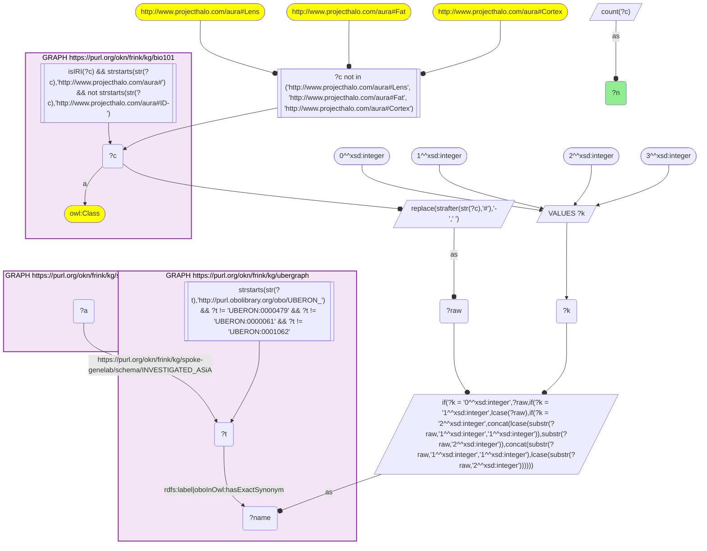
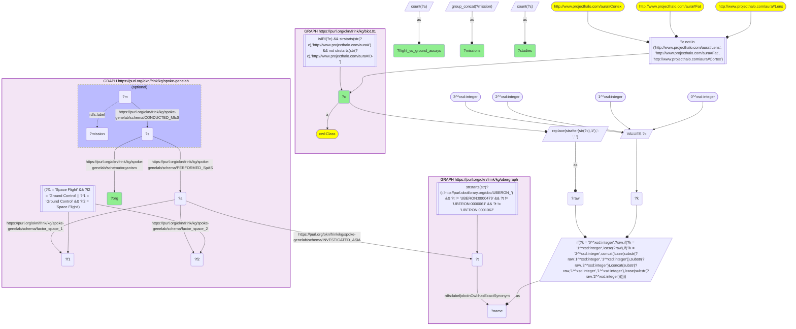

# AN18-Q2: Spaceflight-versus-ground comparisons for KB Bio 101's organs

- **Date:** 2026-11-03
- **Model:** claude-opus-5-5
- **SPARQL endpoint:** https://apps.okn.us/federation/sparql
- **Generated by:** mcp-okn v0.3.0 (build d056eb6)
- **Contents:** 2 queries · 2 query diagrams

## Knowledge graphs used

- `bio101` — <https://purl.org/okn/frink/kg/bio101>
- `ubergraph` — <https://purl.org/okn/frink/kg/ubergraph>
- `spoke-genelab` — <https://purl.org/okn/frink/kg/spoke-genelab>

## Conversation

👤 **User**

Crosswalk: `bio101` × `spoke-genelab` on **UBERON (bio101 label), bridged through `ubergraph`** (crosswalk `KB26-uberon-label-bio101-spokegenelab`, verified_count 17). KB Bio 101 is an OWL ontology of an introductory biology textbook: every concept is an `owl:Class` IRI `http://www.projecthalo.com/aura#{Name}` with no `rdfs:label` and no external id, so the concept NAME (local name, hyphens → spaces, four case forms: as-is, all lower-case, first letter lowered, sentence case) is matched as a bound literal against ubergraph `rdfs:label | oboInOwl:hasExactSynonym` on `obo/UBERON_` terms. spoke-genelab (`spoke-genelab`) holds NASA OSDR spaceflight omics: a study (`biolink:Study`, `rdfs:label`, `spoke-genelab:organism`) `PERFORMED_SpAS` assays, a mission (`spoke-genelab:Mission`, `space_program`) `CONDUCTED_MIcS` studies, and each assay (`obo:OBI_0000070`) `INVESTIGATED_ASiA` an anatomy term, a raw `obo/UBERON_` IRI. An assay compares two sample groups whose spaceflight status is on `factor_space_1` / `factor_space_2` ('Space Flight', 'Ground Control', 'Vivarium Control', 'Basal Control').

Research question: for the organs and tissues KB Bio 101 teaches, how many spoke-genelab assays directly compare spaceflight samples with ground-control samples, in which organisms, and on which missions? Rank them.

Why the join is required: the organs are textbook concepts without identifiers; only the name → UBERON bridge through ubergraph reaches spoke-genelab's assays of them.

---

🧠 **Assistant**

**Bridge established (Query 1).** The crosswalk skeleton, run verbatim, returns **17** bio101 anatomical concepts that reach a spoke-genelab assay through the name → UBERON bridge, matching the catalogued `verified_count`. Query 2 keeps the assays whose two sample groups are 'Space Flight' and 'Ground Control' (in either order), and groups them by organ and study organism.

**Flight-versus-ground assays (Query 2).** 16 organ × organism rows:

| bio101 concept | Organism | Assays | Studies | Missions |
|---|---|---|---|---|
| Larva | *Drosophila melanogaster* | 120 | 1 | SpaceX-14 |
| Liver | *Mus musculus* | 66 | 8 | SpaceX-4, -8, -12, -13, STS-135 |
| Head | *Drosophila melanogaster* | 48 | 2 | SpaceX-11, SpaceX-14 |
| Multicellular-Organism | *Drosophila melanogaster* | 24 | 2 | STS-121, SpaceX-5 |
| Thymus | *Mus musculus* | 22 | 5 | (none recorded) |
| Retina | *Mus musculus* | 14 | 4 | SpaceX-4, -8, -12, -27 |
| Bone-Marrow | *Mus musculus* | 8 | 1 | SpaceX-14 |
| Colon | *Mus musculus* | 8 | 1 | SpaceX-21 |
| Heart | *Drosophila melanogaster* | 8 | 1 | SpaceX-11 |
| Adrenal-Gland | *Mus musculus* | 6 | 3 | SpaceX-4, -8, -21 |
| Heart | *Mus musculus* | 4 | 2 | SpaceX-8, NG-11 |
| Multicellular-Organism | *Caenorhabditis elegans* | 4 | 1 | STS-129 |
| Brain | *Mus musculus* | 2 | 1 | SpaceX-8 |
| Cerebellum | *Mus musculus* | 2 | 1 | SpaceX-21 |
| Eye | *Mus musculus* | 2 | 1 | SpaceX-8, SpaceX-9 |
| Thymus | *Rattus norvegicus* | 2 | 1 | STS-58 |

**Answer.** **Liver** has the broadest spaceflight-versus-ground evidence among the textbook's organs: 66 mouse assays from 8 studies on 5 missions, from the Space Shuttle (STS-135) to several SpaceX resupply flights. Retina (14 assays, 4 studies, 4 missions) and mouse thymus (22 assays, 5 studies) follow.

The largest single block is the fruit-fly larva (120 assays), but it comes from one study on SpaceX-14. Heart has been compared in both flies and mice.

Some bridged textbook tissues, such as blood and lung, do not appear here at all: none of their assays compares spaceflight with ground control directly (AN18-Q1 gives their overall coverage). Their assays presumably compare other groupings, such as vivarium or basal controls.

Caveats:

- The filter accepts both orientations, so a comparison stored as flight-vs-ground and as ground-vs-flight counts twice.
- A flight-vs-ground assay can still be confounded: the two groups may also differ in genotype, age or material. For a clean comparison, use the `get_valid_contrasts` tool, which checks that the covariates match.
- Thymus mouse studies have no mission recorded (`CONDUCTED_MIcS`).
- This is an exact-name lower bound (UBERON roots, Lens, Fat and Cortex excluded).

## SPARQL queries executed

#### Query 1

_2026-11-04T01:55:42+00:00 · `bio101`, `ubergraph`, `spoke-genelab`_

```sparql
SELECT (COUNT(DISTINCT ?c) AS ?n) WHERE {
  { SELECT DISTINCT ?c ?t WHERE {
  { SELECT DISTINCT ?c ?name WHERE {
      GRAPH <https://purl.org/okn/frink/kg/bio101> { ?c a <http://www.w3.org/2002/07/owl#Class> .
        FILTER(isIRI(?c) && STRSTARTS(STR(?c),'http://www.projecthalo.com/aura#') && !STRSTARTS(STR(?c),'http://www.projecthalo.com/aura#ID-')) }
      FILTER(?c NOT IN (<http://www.projecthalo.com/aura#Lens>, <http://www.projecthalo.com/aura#Fat>, <http://www.projecthalo.com/aura#Cortex>))  # homonyms (spot-checked 2026-11-03)
      BIND(REPLACE(STRAFTER(STR(?c),'#'),'-',' ') AS ?raw)
      VALUES ?k { 0 1 2 3 }  # as-is, all lower, first letter lowered, sentence case
      BIND(IF(?k = 0, ?raw, IF(?k = 1, LCASE(?raw), IF(?k = 2, CONCAT(LCASE(SUBSTR(?raw,1,1)),SUBSTR(?raw,2)),
                CONCAT(SUBSTR(?raw,1,1),LCASE(SUBSTR(?raw,2)))))) AS ?name)
  } }
    GRAPH <https://purl.org/okn/frink/kg/ubergraph> { ?t <http://www.w3.org/2000/01/rdf-schema#label>|<http://www.geneontology.org/formats/oboInOwl#hasExactSynonym> ?name .
      FILTER(STRSTARTS(STR(?t),'http://purl.obolibrary.org/obo/UBERON_') && ?t != <http://purl.obolibrary.org/obo/UBERON_0000479> && ?t != <http://purl.obolibrary.org/obo/UBERON_0000061> && ?t != <http://purl.obolibrary.org/obo/UBERON_0001062>) }
  } }
  GRAPH <https://purl.org/okn/frink/kg/spoke-genelab> { ?a <https://purl.org/okn/frink/kg/spoke-genelab/schema/INVESTIGATED_ASiA> ?t . }
}
```



_1 row(s)_

| n |
| --- |
| 17 |

#### Query 2

_2026-11-04T01:55:43+00:00 · `bio101`, `ubergraph`, `spoke-genelab`_

```sparql
SELECT ?c ?org (COUNT(DISTINCT ?a) AS ?flight_vs_ground_assays) (COUNT(DISTINCT ?s) AS ?studies) (GROUP_CONCAT(DISTINCT ?mission; separator=", ") AS ?missions) WHERE {
  { SELECT DISTINCT ?c ?t WHERE {
  { SELECT DISTINCT ?c ?name WHERE {
      GRAPH <https://purl.org/okn/frink/kg/bio101> { ?c a <http://www.w3.org/2002/07/owl#Class> .
        FILTER(isIRI(?c) && STRSTARTS(STR(?c),'http://www.projecthalo.com/aura#') && !STRSTARTS(STR(?c),'http://www.projecthalo.com/aura#ID-')) }
      FILTER(?c NOT IN (<http://www.projecthalo.com/aura#Lens>, <http://www.projecthalo.com/aura#Fat>, <http://www.projecthalo.com/aura#Cortex>))  # homonyms (spot-checked 2026-11-03)
      BIND(REPLACE(STRAFTER(STR(?c),'#'),'-',' ') AS ?raw)
      VALUES ?k { 0 1 2 3 }  # as-is, all lower, first letter lowered, sentence case
      BIND(IF(?k = 0, ?raw, IF(?k = 1, LCASE(?raw), IF(?k = 2, CONCAT(LCASE(SUBSTR(?raw,1,1)),SUBSTR(?raw,2)),
                CONCAT(SUBSTR(?raw,1,1),LCASE(SUBSTR(?raw,2)))))) AS ?name)
  } }
    GRAPH <https://purl.org/okn/frink/kg/ubergraph> { ?t <http://www.w3.org/2000/01/rdf-schema#label>|<http://www.geneontology.org/formats/oboInOwl#hasExactSynonym> ?name .
      FILTER(STRSTARTS(STR(?t),'http://purl.obolibrary.org/obo/UBERON_') && ?t != <http://purl.obolibrary.org/obo/UBERON_0000479> && ?t != <http://purl.obolibrary.org/obo/UBERON_0000061> && ?t != <http://purl.obolibrary.org/obo/UBERON_0001062>) }
  } }
  GRAPH <https://purl.org/okn/frink/kg/spoke-genelab> { ?a <https://purl.org/okn/frink/kg/spoke-genelab/schema/INVESTIGATED_ASiA> ?t ; <https://purl.org/okn/frink/kg/spoke-genelab/schema/factor_space_1> ?f1 ; <https://purl.org/okn/frink/kg/spoke-genelab/schema/factor_space_2> ?f2 .
    FILTER((?f1 = 'Space Flight' && ?f2 = 'Ground Control') || (?f1 = 'Ground Control' && ?f2 = 'Space Flight'))
    ?s <https://purl.org/okn/frink/kg/spoke-genelab/schema/PERFORMED_SpAS> ?a ; <https://purl.org/okn/frink/kg/spoke-genelab/schema/organism> ?org .
    OPTIONAL { ?m <https://purl.org/okn/frink/kg/spoke-genelab/schema/CONDUCTED_MIcS> ?s ; <http://www.w3.org/2000/01/rdf-schema#label> ?mission } }
} GROUP BY ?c ?org ORDER BY DESC(?flight_vs_ground_assays) ?c ?org
```



_16 row(s) — showing first 5_

| c | org | flight_vs_ground_assays | studies | missions |
| --- | --- | --- | --- | --- |
| http://www.projecthalo.com/aura#Larva | Drosophila melanogaster | 120 | 1 | SpaceX-14 |
| http://www.projecthalo.com/aura#Liver | Mus musculus | 66 | 8 | SpaceX-8, SpaceX-4, SpaceX-12, SpaceX-13, STS-135 |
| http://www.projecthalo.com/aura#Head | Drosophila melanogaster | 48 | 2 | SpaceX-14, SpaceX-11 |
| http://www.projecthalo.com/aura#Multicellular-Organism | Drosophila melanogaster | 24 | 2 | STS-121, SpaceX-5 |
| http://www.projecthalo.com/aura#Thymus | Mus musculus | 22 | 5 |  |
