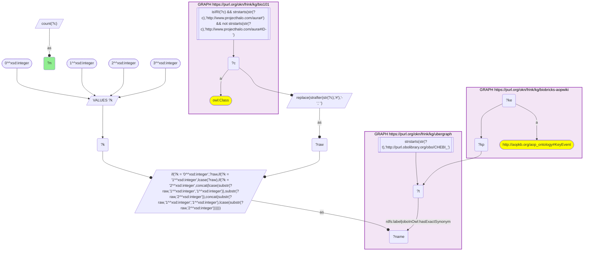
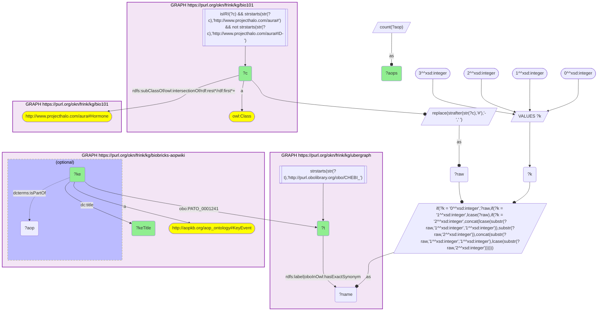
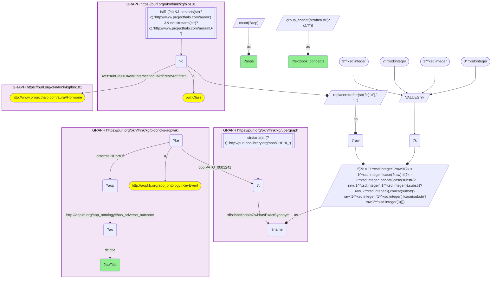

# C41-Q1: KB Bio 101's hormones as the object of AOP-Wiki key events

- **Date:** 2026-11-03
- **Model:** claude-opus-5-5
- **SPARQL endpoint:** https://apps.okn.us/federation/sparql
- **Generated by:** mcp-okn v0.3.0 (build 7687738)
- **Contents:** 3 queries · 3 query diagrams

## Knowledge graphs used

- `bio101` — <https://purl.org/okn/frink/kg/bio101>
- `ubergraph` — <https://purl.org/okn/frink/kg/ubergraph>
- `biobricks-aopwiki` — <https://purl.org/okn/frink/kg/biobricks-aopwiki>

## Conversation

👤 **User**

Crosswalk: `bio101` × `biobricks-aopwiki` on **CHEBI (bio101 label), bridged through `ubergraph`** (crosswalk `KB11-chebi-label-bio101-aopwiki`, verified_count 33). KB Bio 101 is an OWL ontology of an introductory biology textbook: every concept is an `owl:Class` IRI `http://www.projecthalo.com/aura#{Name}` with no `rdfs:label` and no external id, so the concept NAME (local name, hyphens → spaces, four case forms: as-is, all lower-case, first letter lowered, sentence case) is matched as a bound literal against ubergraph `rdfs:label | oboInOwl:hasExactSynonym` on `obo/CHEBI_` terms. AOP-Wiki (`biobricks-aopwiki`) mints each ontology term it uses as a node and attaches it to an `aopo:KeyEvent` through a role predicate — `aopo:OrganContext` (organ), `aopo:CellTypeContext` (cell type), `obo:GO_0008150` (the key event's biological process) or `obo:PATO_0001241` (the biological object the key event acts on); key events belong to adverse outcome pathways through `dcterms:isPartOf`, and an AOP names its outcome with `aopo:has_adverse_outcome`.

Research question: which of the hormones KB Bio 101 teaches (concepts under `aura:Hormone`) are the biological object of AOP-Wiki key events, what do those key events say happens to the hormone, and which adverse outcomes do the pathways end in?

Why the join is required: bio101 knows which molecules a curriculum classes as hormones; AOP-Wiki knows which key events act on a CHEBI molecule. They share no identifier, so only the name → CHEBI bridge through ubergraph connects them.

---

🧠 **Assistant**

**Bridge established (Query 1).** The crosswalk skeleton, run verbatim, returns **33** bio101 concepts whose name is an exact CHEBI label or exact synonym in ubergraph *and* whose CHEBI term is the biological object of at least one AOP-Wiki key event — matching the catalogued `verified_count`.

**Textbook hormones that key events act on (Query 2).** Scoped to bio101's own `aura:Hormone` subtree, **11 concepts** reach AOP-Wiki, on 21 distinct key events:

| bio101 hormone | CHEBI | Key event | AOPs |
|---|---|---|---|
| Thyroid-Hormone | CHEBI_60311 | Thyroid hormone synthesis, Decreased | 20 |
| Thyroid-Hormone | CHEBI_60311 | Increased, Hepatic thyroid hormone uptake/transport | 4 |
| Testosterone | CHEBI_17347 | Decrease, testosterone levels | 9 |
| Testosterone | CHEBI_17347 | Reduction, Testosterone synthesis in Leydig cells | 3 |
| Testosterone | CHEBI_17347 | Reduction, Testosterone synthesis by ovarian theca cells | 1 |
| Testosterone | CHEBI_17347 | Reduction, fetal/adult testosterone | 1 |
| Testosterone | CHEBI_17347 | Repressed expression of steroidogenic enzymes | 1 |
| Testosterone | CHEBI_17347 | Apoptosis of adult Leydig cells, Decreased testosterone by adult Leydig cells | 1 |
| Testosterone | CHEBI_17347 | Decreased Cholesterol, Decreased Testosterone Production by Adult Leydig Cells | 1 |
| Testosterone | CHEBI_17347 | Decreased, Testosterone binding to androgen receptor (hypothalamus) | 1 |
| Estrogen | CHEBI_50114 | Increased, circulating estrogen levels | 3 |
| Estrogen | CHEBI_50114 | Decreased positive estrogenic feedback on hypothalamus, Reduced estradiol in circulation … | 1 |
| Estradiol | CHEBI_23965 | Decreased, Ovarian E2 | 1 |
| Steroid-Hormone | CHEBI_26764 | Reduced, Maturation inducing steroid receptor signalling, oocyte | 2 |
| Steroid-Hormone | CHEBI_26764 | Reduced, Maturation inducing steroid, plasma | 2 |
| Progesterone | CHEBI_17026 | Decreased, Progesterone from corpus luteum | 1 |
| Prolactin | CHEBI_81580 | Decreased, Prolactin | 1 |
| Glucocorticoid | CHEBI_24261 | Stimulation of adult Leydig cells via the Adrenal Corticosterone, Increased Glucocorticoid | 1 |
| Juvenile-Hormone | CHEBI_24943 | Activation, Juvenile hormone receptor | 1 |
| Pheromone | CHEBI_26013 | Reduced, Pheromone release | 1 |
| Prostaglandin | CHEBI_26333 | Reduced, Prostaglandins, ovary | 1 |

Most of the key events are a *decrease* — less hormone made, released or bound — which is how endocrine disruption is modelled. Testosterone has the most key events (8), three of them about its production by Leydig cells; thyroid hormone has only 2, but one of them ("Thyroid hormone synthesis, Decreased") sits in 20 pathways. bio101 files Pheromone and Prostaglandin under Hormone, so they are included.

**Adverse outcomes (Query 3).** The pathways end in 33 distinct adverse outcomes. The most frequent:

| Adverse outcome | AOPs | Textbook hormones on the path |
|---|---|---|
| Decrease, Population growth rate | 9 | Thyroid-Hormone, Steroid-Hormone, Prostaglandin, Pheromone, Testosterone |
| Altered, Amphibian metamorphosis | 8 | Thyroid-Hormone |
| Cognitive function, decreased | 4 | Thyroid-Hormone |
| Increased Mortality | 4 | Thyroid-Hormone |
| Reduced, Reproductive Success | 4 | Steroid-Hormone, Prostaglandin, Pheromone |
| impaired, Fertility | 3 | Testosterone |

Testosterone pathways end in male reproductive outcomes (anogenital distance, cryptorchidism, Leydig-cell tumours, impaired spermatogenesis, male reproductive tract malformation); estrogen and estradiol in ovarian, mammary and pituitary tumours and reduced ovulation; progesterone and prolactin together in endometrial adenocarcinoma; juvenile hormone in population and food-web outcomes.

**Answer.** Eleven textbook hormones are the object of AOP-Wiki key events. The textbook's account of each hormone's job maps onto pathways that remove it: testosterone (8 key events) and thyroid hormone (the most widely reused single key event, 20 AOPs) dominate, and the outcomes split by hormone into developmental and population effects (thyroid hormone), male reproductive effects (testosterone) and hormone-dependent tumours (estrogen, progesterone, prolactin).

## SPARQL queries executed

#### Query 1

_2026-11-03T22:10:53+00:00 · `bio101`, `ubergraph`, `biobricks-aopwiki`_

```sparql
SELECT (COUNT(DISTINCT ?c) AS ?n) WHERE {
  { SELECT DISTINCT ?c ?t WHERE {
  { SELECT DISTINCT ?c ?name WHERE {
      GRAPH <https://purl.org/okn/frink/kg/bio101> { ?c a <http://www.w3.org/2002/07/owl#Class> .
        FILTER(isIRI(?c) && STRSTARTS(STR(?c),'http://www.projecthalo.com/aura#') && !STRSTARTS(STR(?c),'http://www.projecthalo.com/aura#ID-')) }
      BIND(REPLACE(STRAFTER(STR(?c),'#'),'-',' ') AS ?raw)
      VALUES ?k { 0 1 2 3 }  # as-is, all lower, first letter lowered, sentence case
      BIND(IF(?k = 0, ?raw, IF(?k = 1, LCASE(?raw), IF(?k = 2, CONCAT(LCASE(SUBSTR(?raw,1,1)),SUBSTR(?raw,2)),
                CONCAT(SUBSTR(?raw,1,1),LCASE(SUBSTR(?raw,2)))))) AS ?name)
  } }
    GRAPH <https://purl.org/okn/frink/kg/ubergraph> { ?t <http://www.w3.org/2000/01/rdf-schema#label>|<http://www.geneontology.org/formats/oboInOwl#hasExactSynonym> ?name .
      FILTER(STRSTARTS(STR(?t),'http://purl.obolibrary.org/obo/CHEBI_')) }
  } }
  GRAPH <https://purl.org/okn/frink/kg/biobricks-aopwiki> { ?ke a <http://aopkb.org/aop_ontology#KeyEvent> ; ?kp ?t . }
}
```



_1 row(s)_

| n |
| --- |
| 33 |

#### Query 2

_2026-11-03T22:10:54+00:00 · `bio101`, `ubergraph`, `biobricks-aopwiki`_

```sparql
SELECT ?c ?t ?ke ?keTitle (COUNT(DISTINCT ?aop) AS ?aops) WHERE {
  { SELECT DISTINCT ?c ?t WHERE {
  { SELECT DISTINCT ?c ?name WHERE {
      GRAPH <https://purl.org/okn/frink/kg/bio101> { ?c a <http://www.w3.org/2002/07/owl#Class> .
        FILTER(isIRI(?c) && STRSTARTS(STR(?c),'http://www.projecthalo.com/aura#') && !STRSTARTS(STR(?c),'http://www.projecthalo.com/aura#ID-')) }
      BIND(REPLACE(STRAFTER(STR(?c),'#'),'-',' ') AS ?raw)
      VALUES ?k { 0 1 2 3 }  # as-is, all lower, first letter lowered, sentence case
      BIND(IF(?k = 0, ?raw, IF(?k = 1, LCASE(?raw), IF(?k = 2, CONCAT(LCASE(SUBSTR(?raw,1,1)),SUBSTR(?raw,2)),
                CONCAT(SUBSTR(?raw,1,1),LCASE(SUBSTR(?raw,2)))))) AS ?name)
  } }
    GRAPH <https://purl.org/okn/frink/kg/ubergraph> { ?t <http://www.w3.org/2000/01/rdf-schema#label>|<http://www.geneontology.org/formats/oboInOwl#hasExactSynonym> ?name .
      FILTER(STRSTARTS(STR(?t),'http://purl.obolibrary.org/obo/CHEBI_')) }
  } }
  GRAPH <https://purl.org/okn/frink/kg/bio101> { ?c (<http://www.w3.org/2000/01/rdf-schema#subClassOf>/(<http://www.w3.org/2002/07/owl#intersectionOf>/<http://www.w3.org/1999/02/22-rdf-syntax-ns#rest>*/<http://www.w3.org/1999/02/22-rdf-syntax-ns#first>)*)+ <http://www.projecthalo.com/aura#Hormone> . }
  GRAPH <https://purl.org/okn/frink/kg/biobricks-aopwiki> { ?ke a <http://aopkb.org/aop_ontology#KeyEvent> ; <http://purl.obolibrary.org/obo/PATO_0001241> ?t ; <http://purl.org/dc/elements/1.1/title> ?keTitle . OPTIONAL { ?ke <http://purl.org/dc/terms/isPartOf> ?aop } }
} GROUP BY ?c ?t ?ke ?keTitle ORDER BY ?c DESC(?aops)
```



_21 row(s) — showing first 3_

| c | t | ke | keTitle | aops |
| --- | --- | --- | --- | --- |
| http://www.projecthalo.com/aura#Estradiol | http://purl.obolibrary.org/obo/CHEBI_23965 | https://identifiers.org/aop.events/1045 | Decreased, Ovarian E2 | 1 |
| http://www.projecthalo.com/aura#Estrogen | http://purl.obolibrary.org/obo/CHEBI_50114 | https://identifiers.org/aop.events/1076 | Increased, circulating estrogen levels | 3 |
| http://www.projecthalo.com/aura#Estrogen | http://purl.obolibrary.org/obo/CHEBI_50114 | https://identifiers.org/aop.events/967 | Decreased positive estrogenic feedback on hypothalamus, Reduced estradiol in circulation decreases estrogen concentration at hypothalamus | 1 |

#### Query 3

_2026-11-03T22:10:55+00:00 · `bio101`, `ubergraph`, `biobricks-aopwiki`_

```sparql
SELECT ?aoTitle (COUNT(DISTINCT ?aop) AS ?aops) (GROUP_CONCAT(DISTINCT STRAFTER(STR(?c),'#'); separator=", ") AS ?textbook_concepts) WHERE {
  { SELECT DISTINCT ?c ?t WHERE {
  { SELECT DISTINCT ?c ?name WHERE {
      GRAPH <https://purl.org/okn/frink/kg/bio101> { ?c a <http://www.w3.org/2002/07/owl#Class> .
        FILTER(isIRI(?c) && STRSTARTS(STR(?c),'http://www.projecthalo.com/aura#') && !STRSTARTS(STR(?c),'http://www.projecthalo.com/aura#ID-')) }
      BIND(REPLACE(STRAFTER(STR(?c),'#'),'-',' ') AS ?raw)
      VALUES ?k { 0 1 2 3 }  # as-is, all lower, first letter lowered, sentence case
      BIND(IF(?k = 0, ?raw, IF(?k = 1, LCASE(?raw), IF(?k = 2, CONCAT(LCASE(SUBSTR(?raw,1,1)),SUBSTR(?raw,2)),
                CONCAT(SUBSTR(?raw,1,1),LCASE(SUBSTR(?raw,2)))))) AS ?name)
  } }
    GRAPH <https://purl.org/okn/frink/kg/ubergraph> { ?t <http://www.w3.org/2000/01/rdf-schema#label>|<http://www.geneontology.org/formats/oboInOwl#hasExactSynonym> ?name .
      FILTER(STRSTARTS(STR(?t),'http://purl.obolibrary.org/obo/CHEBI_')) }
  } }
  GRAPH <https://purl.org/okn/frink/kg/bio101> { ?c (<http://www.w3.org/2000/01/rdf-schema#subClassOf>/(<http://www.w3.org/2002/07/owl#intersectionOf>/<http://www.w3.org/1999/02/22-rdf-syntax-ns#rest>*/<http://www.w3.org/1999/02/22-rdf-syntax-ns#first>)*)+ <http://www.projecthalo.com/aura#Hormone> . }
  GRAPH <https://purl.org/okn/frink/kg/biobricks-aopwiki> { ?ke a <http://aopkb.org/aop_ontology#KeyEvent> ; <http://purl.obolibrary.org/obo/PATO_0001241> ?t ; <http://purl.org/dc/terms/isPartOf> ?aop . ?aop <http://aopkb.org/aop_ontology#has_adverse_outcome> ?ao . ?ao <http://purl.org/dc/elements/1.1/title> ?aoTitle . }
} GROUP BY ?aoTitle ORDER BY DESC(?aops) ?aoTitle
```



_33 row(s) — showing first 5_

| aoTitle | aops | textbook_concepts |
| --- | --- | --- |
| Decrease, Population growth rate | 9 | Thyroid-Hormone, Steroid-Hormone, Prostaglandin, Pheromone, Testosterone |
| Altered, Amphibian metamorphosis | 8 | Thyroid-Hormone |
| Cognitive function, decreased  | 4 | Thyroid-Hormone |
| Increased Mortality | 4 | Thyroid-Hormone |
| Reduced, Reproductive Success | 4 | Steroid-Hormone, Prostaglandin, Pheromone |
