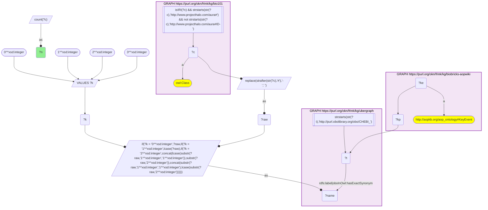
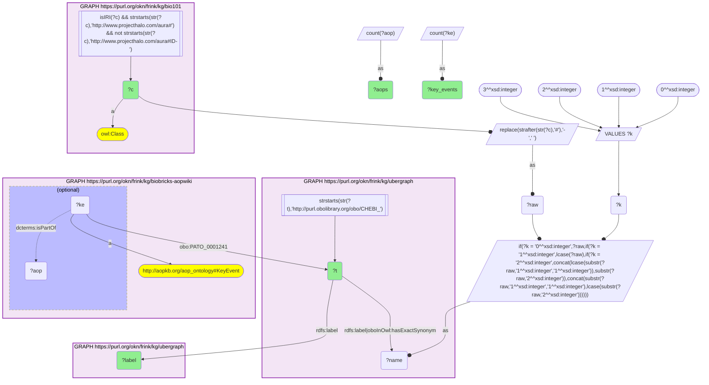
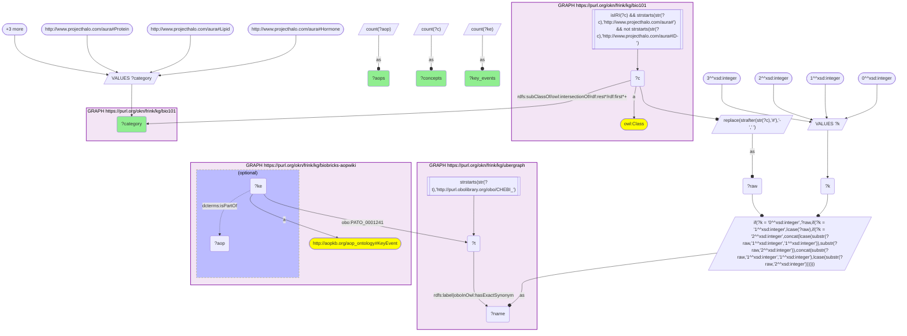

# C41-Q2: KB Bio 101's chemicals ranked by AOP-Wiki key events that act on them

- **Date:** 2026-11-03
- **Model:** claude-opus-5-5
- **SPARQL endpoint:** https://apps.okn.us/federation/sparql
- **Generated by:** mcp-okn v0.3.0 (build 7687738)
- **Contents:** 3 queries · 3 query diagrams

## Knowledge graphs used

- `bio101` — <https://purl.org/okn/frink/kg/bio101>
- `ubergraph` — <https://purl.org/okn/frink/kg/ubergraph>
- `biobricks-aopwiki` — <https://purl.org/okn/frink/kg/biobricks-aopwiki>

## Conversation

👤 **User**

Crosswalk: `bio101` × `biobricks-aopwiki` on **CHEBI (bio101 label), bridged through `ubergraph`** (crosswalk `KB11-chebi-label-bio101-aopwiki`, verified_count 33). KB Bio 101 is an OWL ontology of an introductory biology textbook: every concept is an `owl:Class` IRI `http://www.projecthalo.com/aura#{Name}` with no `rdfs:label` and no external id, so the concept NAME (local name, hyphens → spaces, four case forms: as-is, all lower-case, first letter lowered, sentence case) is matched as a bound literal against ubergraph `rdfs:label | oboInOwl:hasExactSynonym` on `obo/CHEBI_` terms. AOP-Wiki (`biobricks-aopwiki`) mints each ontology term it uses as a node and attaches it to an `aopo:KeyEvent` through a role predicate — `aopo:OrganContext` (organ), `aopo:CellTypeContext` (cell type), `obo:GO_0008150` (the key event's biological process) or `obo:PATO_0001241` (the biological object the key event acts on); key events belong to adverse outcome pathways through `dcterms:isPartOf`, and an AOP names its outcome with `aopo:has_adverse_outcome`.

Research question: rank the KB Bio 101 chemicals that reach AOP-Wiki by the number of key events that act on them and the adverse outcome pathways those key events belong to. How do the textbook's own chemical categories split the ranking?

Why the join is required: the chemical categories are bio101's, the key events AOP-Wiki's; only the name → CHEBI bridge joins them.

---

🧠 **Assistant**

**Bridge established (Query 1).** The crosswalk skeleton, run verbatim, returns **33** bio101 concepts matched to CHEBI terms that are the biological object of at least one AOP-Wiki key event, matching the catalogued `verified_count`. Each maps to one CHEBI term (Query 2 returns 33 rows), and AOP-Wiki uses CHEBI only in this object role (`obo:PATO_0001241`).

**Ranking (Query 2).**

| Rank | bio101 concept | CHEBI (ubergraph label) | Key events | AOPs |
|---|---|---|---|---|
| 1 | Testosterone | CHEBI_17347 (testosterone) | 8 | 14 |
| 1 | Fatty-Acid | CHEBI_35366 (fatty acid) | 8 | 11 |
| 3 | Calcium-Ion | CHEBI_39124 (calcium ion) | 6 | 14 |
| 4 | Cholesterol | CHEBI_16113 (cholesterol) | 5 | 6 |
| 5 | ATP | CHEBI_15422 (ATP) | 3 | 16 |
| 6 | Thyroid-Hormone | CHEBI_60311 (thyroid hormone) | 2 | 24 |
| 6 | Estrogen | CHEBI_50114 (estrogen) | 2 | 4 |
| 6 | Nitric-Oxide | CHEBI_16480 (nitric oxide) | 2 | 2 |
| 6 | Steroid-Hormone | CHEBI_26764 (steroid hormone) | 2 | 2 |
| 6 | Uric-Acid | CHEBI_27226 (uric acid) | 2 | 2 |

The other 23 chemicals have one key event each, among them Collagen (6 AOPs), Acetylcholine (5), Chitin, Fibrin, Neurotransmitter and Potassium (3 each).

By pathways the order changes: **thyroid hormone 24**, ATP 16, testosterone and calcium ion 14, fatty acid 11. Thyroid hormone and ATP have few key events, but those events are shared by many pathways.

**By textbook category (Query 3).** Using bio101's own chemical classes (a concept can sit in more than one):

| bio101 category | Concepts | Key events | AOPs |
|---|---|---|---|
| Hormone | 11 | 21 | 49 |
| Lipid | 7 | 20 | 24 |
| Ion | 1 | 6 | 14 |
| Protein | 6 | 6 | 14 |
| Neurotransmitter | 2 | 2 | 6 |
| Amino-Acid | 1 | 1 | 1 |

**Answer.** Hormones are the textbook chemicals AOP-Wiki acts on most: 11 of the 33 bridged concepts, with 21 key events in 49 pathways, the largest share of any textbook category. Lipids come next on key events (20, led by fatty acids and cholesterol), and single molecules such as ATP and the calcium ion reach many pathways through a few hub key events. A concept can be counted in more than one category, so the category rows do not add up to the 33 concepts.

## SPARQL queries executed

#### Query 1

_2026-11-03T22:10:56+00:00 · `bio101`, `ubergraph`, `biobricks-aopwiki`_

```sparql
SELECT (COUNT(DISTINCT ?c) AS ?n) WHERE {
  { SELECT DISTINCT ?c ?t WHERE {
  { SELECT DISTINCT ?c ?name WHERE {
      GRAPH <https://purl.org/okn/frink/kg/bio101> { ?c a <http://www.w3.org/2002/07/owl#Class> .
        FILTER(isIRI(?c) && STRSTARTS(STR(?c),'http://www.projecthalo.com/aura#') && !STRSTARTS(STR(?c),'http://www.projecthalo.com/aura#ID-')) }
      BIND(REPLACE(STRAFTER(STR(?c),'#'),'-',' ') AS ?raw)
      VALUES ?k { 0 1 2 3 }  # as-is, all lower, first letter lowered, sentence case
      BIND(IF(?k = 0, ?raw, IF(?k = 1, LCASE(?raw), IF(?k = 2, CONCAT(LCASE(SUBSTR(?raw,1,1)),SUBSTR(?raw,2)),
                CONCAT(SUBSTR(?raw,1,1),LCASE(SUBSTR(?raw,2)))))) AS ?name)
  } }
    GRAPH <https://purl.org/okn/frink/kg/ubergraph> { ?t <http://www.w3.org/2000/01/rdf-schema#label>|<http://www.geneontology.org/formats/oboInOwl#hasExactSynonym> ?name .
      FILTER(STRSTARTS(STR(?t),'http://purl.obolibrary.org/obo/CHEBI_')) }
  } }
  GRAPH <https://purl.org/okn/frink/kg/biobricks-aopwiki> { ?ke a <http://aopkb.org/aop_ontology#KeyEvent> ; ?kp ?t . }
}
```



_1 row(s)_

| n |
| --- |
| 33 |

#### Query 2

_2026-11-03T22:10:56+00:00 · `bio101`, `ubergraph`, `biobricks-aopwiki`_

```sparql
SELECT ?c ?t ?label (COUNT(DISTINCT ?ke) AS ?key_events) (COUNT(DISTINCT ?aop) AS ?aops) WHERE {
  { SELECT DISTINCT ?c ?t WHERE {
  { SELECT DISTINCT ?c ?name WHERE {
      GRAPH <https://purl.org/okn/frink/kg/bio101> { ?c a <http://www.w3.org/2002/07/owl#Class> .
        FILTER(isIRI(?c) && STRSTARTS(STR(?c),'http://www.projecthalo.com/aura#') && !STRSTARTS(STR(?c),'http://www.projecthalo.com/aura#ID-')) }
      BIND(REPLACE(STRAFTER(STR(?c),'#'),'-',' ') AS ?raw)
      VALUES ?k { 0 1 2 3 }  # as-is, all lower, first letter lowered, sentence case
      BIND(IF(?k = 0, ?raw, IF(?k = 1, LCASE(?raw), IF(?k = 2, CONCAT(LCASE(SUBSTR(?raw,1,1)),SUBSTR(?raw,2)),
                CONCAT(SUBSTR(?raw,1,1),LCASE(SUBSTR(?raw,2)))))) AS ?name)
  } }
    GRAPH <https://purl.org/okn/frink/kg/ubergraph> { ?t <http://www.w3.org/2000/01/rdf-schema#label>|<http://www.geneontology.org/formats/oboInOwl#hasExactSynonym> ?name .
      FILTER(STRSTARTS(STR(?t),'http://purl.obolibrary.org/obo/CHEBI_')) }
  } }
  GRAPH <https://purl.org/okn/frink/kg/biobricks-aopwiki> { ?ke a <http://aopkb.org/aop_ontology#KeyEvent> ; <http://purl.obolibrary.org/obo/PATO_0001241> ?t . OPTIONAL { ?ke <http://purl.org/dc/terms/isPartOf> ?aop } }
  GRAPH <https://purl.org/okn/frink/kg/ubergraph> { ?t <http://www.w3.org/2000/01/rdf-schema#label> ?label }
} GROUP BY ?c ?t ?label ORDER BY DESC(?key_events) DESC(?aops) ?c
```



_33 row(s) — showing first 3_

| c | t | label | key_events | aops |
| --- | --- | --- | --- | --- |
| http://www.projecthalo.com/aura#Testosterone | http://purl.obolibrary.org/obo/CHEBI_17347 | testosterone | 8 | 14 |
| http://www.projecthalo.com/aura#Fatty-Acid | http://purl.obolibrary.org/obo/CHEBI_35366 | fatty acid | 8 | 11 |
| http://www.projecthalo.com/aura#Calcium-Ion | http://purl.obolibrary.org/obo/CHEBI_39124 | calcium ion | 6 | 14 |

#### Query 3

_2026-11-03T22:10:57+00:00 · `bio101`, `ubergraph`, `biobricks-aopwiki`_

```sparql
SELECT ?category (COUNT(DISTINCT ?c) AS ?concepts) (COUNT(DISTINCT ?ke) AS ?key_events) (COUNT(DISTINCT ?aop) AS ?aops) WHERE {
  { SELECT DISTINCT ?c ?t WHERE {
  { SELECT DISTINCT ?c ?name WHERE {
      GRAPH <https://purl.org/okn/frink/kg/bio101> { ?c a <http://www.w3.org/2002/07/owl#Class> .
        FILTER(isIRI(?c) && STRSTARTS(STR(?c),'http://www.projecthalo.com/aura#') && !STRSTARTS(STR(?c),'http://www.projecthalo.com/aura#ID-')) }
      BIND(REPLACE(STRAFTER(STR(?c),'#'),'-',' ') AS ?raw)
      VALUES ?k { 0 1 2 3 }  # as-is, all lower, first letter lowered, sentence case
      BIND(IF(?k = 0, ?raw, IF(?k = 1, LCASE(?raw), IF(?k = 2, CONCAT(LCASE(SUBSTR(?raw,1,1)),SUBSTR(?raw,2)),
                CONCAT(SUBSTR(?raw,1,1),LCASE(SUBSTR(?raw,2)))))) AS ?name)
  } }
    GRAPH <https://purl.org/okn/frink/kg/ubergraph> { ?t <http://www.w3.org/2000/01/rdf-schema#label>|<http://www.geneontology.org/formats/oboInOwl#hasExactSynonym> ?name .
      FILTER(STRSTARTS(STR(?t),'http://purl.obolibrary.org/obo/CHEBI_')) }
  } }
  GRAPH <https://purl.org/okn/frink/kg/biobricks-aopwiki> { ?ke a <http://aopkb.org/aop_ontology#KeyEvent> ; <http://purl.obolibrary.org/obo/PATO_0001241> ?t . OPTIONAL { ?ke <http://purl.org/dc/terms/isPartOf> ?aop } }
  VALUES ?category { <http://www.projecthalo.com/aura#Hormone> <http://www.projecthalo.com/aura#Lipid> <http://www.projecthalo.com/aura#Protein> <http://www.projecthalo.com/aura#Ion> <http://www.projecthalo.com/aura#Neurotransmitter> <http://www.projecthalo.com/aura#Amino-Acid> }
  GRAPH <https://purl.org/okn/frink/kg/bio101> { ?c (<http://www.w3.org/2000/01/rdf-schema#subClassOf>/(<http://www.w3.org/2002/07/owl#intersectionOf>/<http://www.w3.org/1999/02/22-rdf-syntax-ns#rest>*/<http://www.w3.org/1999/02/22-rdf-syntax-ns#first>)*)+ ?category . }
} GROUP BY ?category ORDER BY DESC(?key_events)
```



_6 row(s) — showing first 5_

| category | concepts | key_events | aops |
| --- | --- | --- | --- |
| http://www.projecthalo.com/aura#Hormone | 11 | 21 | 49 |
| http://www.projecthalo.com/aura#Lipid | 7 | 20 | 24 |
| http://www.projecthalo.com/aura#Ion | 1 | 6 | 14 |
| http://www.projecthalo.com/aura#Protein | 6 | 6 | 14 |
| http://www.projecthalo.com/aura#Neurotransmitter | 2 | 2 | 6 |
