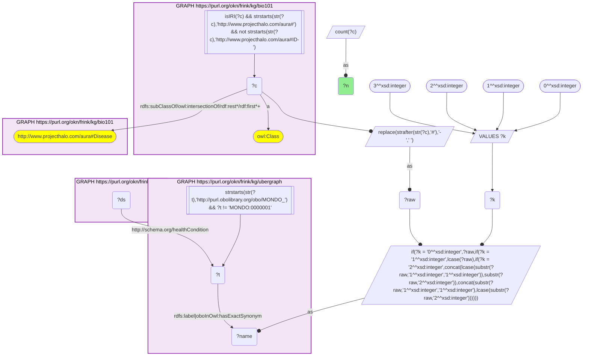
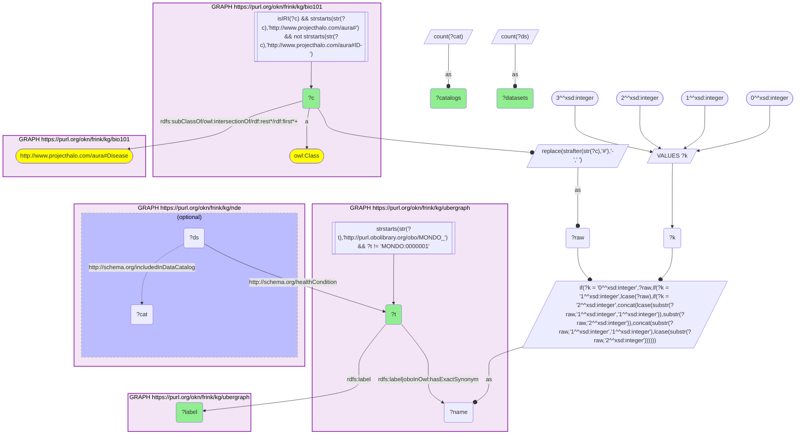
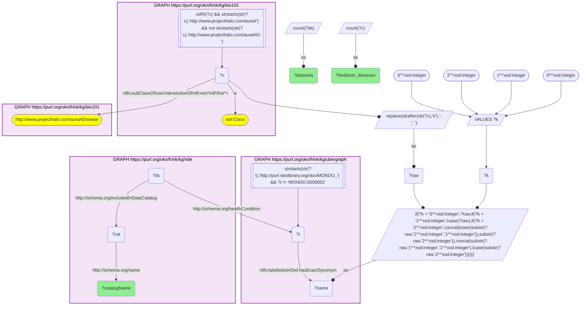

# D51-Q1: KB Bio 101's textbook diseases ranked by NIAID Data Ecosystem datasets

- **Date:** 2026-11-03
- **Model:** claude-opus-5-5
- **SPARQL endpoint:** https://apps.okn.us/federation/sparql
- **Generated by:** mcp-okn v0.3.0 (build 7687738)
- **Contents:** 3 queries · 3 query diagrams

## Knowledge graphs used

- `bio101` — <https://purl.org/okn/frink/kg/bio101>
- `ubergraph` — <https://purl.org/okn/frink/kg/ubergraph>
- `nde` — <https://purl.org/okn/frink/kg/nde>

## Conversation

👤 **User**

Crosswalk: `bio101` × `nde` on **MONDO (bio101 label), bridged through `ubergraph`** (crosswalk `KB12-mondo-label-bio101-nde`, verified_count 60). KB Bio 101 is an OWL ontology of an introductory biology textbook: every concept is an `owl:Class` IRI `http://www.projecthalo.com/aura#{Name}` with no `rdfs:label` and no external id, so the concept NAME (local name, hyphens → spaces, four case forms: as-is, all lower-case, first letter lowered, sentence case) is matched as a bound literal against ubergraph `rdfs:label | oboInOwl:hasExactSynonym` on `obo/MONDO_` terms. The NIAID Data Ecosystem (`nde`) tags each `schema:Dataset` with the condition it studies on `schema:healthCondition`, as a raw `obo/MONDO_` IRI, and names its repository with `schema:includedInDataCatalog`. The bridge is scoped to bio101's `aura:Disease` subtree, because bare MONDO name matches are homonym-prone.

Research question: for the diseases KB Bio 101 teaches, how many NDE datasets carry the matching MONDO health condition, and in how many repositories? Rank the bridged diseases.

Why the join is required: bio101 knows which diseases a curriculum covers, NDE which datasets exist for a MONDO condition; they share no identifier, so only the name → MONDO bridge through ubergraph joins them.

---

🧠 **Assistant**

**Bridge established (Query 1).** The crosswalk skeleton, run verbatim, returns **60** bio101 diseases — concepts under bio101's `aura:Disease` subtree whose name is an exact MONDO label or exact synonym in ubergraph *and* whose MONDO term is the `schema:healthCondition` of at least one NDE dataset — matching the catalogued `verified_count`. Each maps to one MONDO term (Query 2 returns 60 rows).

**Ranking (Query 2).**

| Rank | bio101 disease | MONDO (ubergraph label) | NDE datasets | Repositories |
|---|---|---|---|---|
| 1 | Cancer | MONDO_0004992 (cancer) | 17,374 | 5 |
| 2 | Infectious-Disease | MONDO_0005550 (infectious disease) | 5,423 | 4 |
| 3 | Leukemia | MONDO_0005059 (leukemia) | 3,954 | 3 |
| 4 | Prostate-Cancer | MONDO_0008315 (prostate cancer) | 2,974 | 2 |
| 5 | Diabetes-Mellitus | MONDO_0005015 (diabetes mellitus) | 2,487 | 5 |
| 6 | Alzheimers-Disease | MONDO_0004975 (Alzheimer disease) | 2,288 | 4 |
| 7 | Rheumatoid-Arthritis | MONDO_0008383 (rheumatoid arthritis) | 2,006 | 4 |
| 8 | Renal-Disease | MONDO_0005240 (kidney disorder) | 1,223 | 5 |
| 9 | Type-2-Diabetes-Mellitus | MONDO_0005148 (type 2 diabetes mellitus) | 1,149 | 5 |
| 10 | Metabolic-Disorder | MONDO_0005066 (metabolic disease) | 1,092 | 2 |
| 11 | Autoimmune-Disease | MONDO_0007179 (autoimmune disease) | 1,055 | 4 |
| 12 | Tuberculosis | MONDO_0018076 (tuberculosis) | 954 | 6 |
| 13 | Influenza | MONDO_0005812 (influenza) | 886 | 7 |
| 14 | Atherosclerosis | MONDO_0005311 (atherosclerosis) | 859 | 3 |
| 15 | Multiple-Sclerosis | MONDO_0005301 (multiple sclerosis) | 797 | 4 |

Eleven textbook diseases have 1,000 or more datasets; at the other end, six have 10 or fewer, and four have exactly one (Achondroplasia, Alkaptonuria, Cri-Du-Chat-Syndrome, Cystinuria).

**Repositories (Query 3).** The datasets come from eight NDE repositories:

| Repository | Datasets | Textbook diseases reached |
|---|---|---|
| NCBI GEO | 41,513 | 60 |
| Vivli | 1,419 | 38 |
| ImmPort | 391 | 21 |
| ImmuneSpace | 98 | 8 |
| RADx Data Hub | 40 | 8 |
| VDJServer | 32 | 11 |
| Project Tycho | 11 | 9 |
| Zenodo | 11 | 9 |

**Answer.** All 60 textbook diseases have datasets in NCBI GEO, which supplies almost all of the volume; Vivli's clinical-trial data reaches 38 of them. The top of the ranking is dominated by broad textbook categories (cancer, infectious disease, metabolic disorder, autoimmune disease) because they match general MONDO terms that very many datasets are tagged with, so these counts measure how a curriculum's vocabulary meets dataset tagging, not disease burden. The infectious diseases the textbook teaches reach the widest range of repositories — influenza 7, and tuberculosis, malaria, encephalitis and smallpox 6 each.

Caveats: the bridge is an exact-name lower bound scoped to bio101's Disease subtree, as in KB5 — textbook conditions filed outside that subtree are not counted, and the MONDO root *disease* is excluded.

## SPARQL queries executed

#### Query 1

_2026-11-03T22:10:58+00:00 · `bio101`, `ubergraph`, `nde`_

```sparql
SELECT (COUNT(DISTINCT ?c) AS ?n) WHERE {
  { SELECT DISTINCT ?c ?t WHERE {
  { SELECT DISTINCT ?c ?name WHERE {
      GRAPH <https://purl.org/okn/frink/kg/bio101> { ?c a <http://www.w3.org/2002/07/owl#Class> .
        FILTER(isIRI(?c) && STRSTARTS(STR(?c),'http://www.projecthalo.com/aura#') && !STRSTARTS(STR(?c),'http://www.projecthalo.com/aura#ID-')) }
      GRAPH <https://purl.org/okn/frink/kg/bio101> { ?c (<http://www.w3.org/2000/01/rdf-schema#subClassOf>/(<http://www.w3.org/2002/07/owl#intersectionOf>/<http://www.w3.org/1999/02/22-rdf-syntax-ns#rest>*/<http://www.w3.org/1999/02/22-rdf-syntax-ns#first>)*)+ <http://www.projecthalo.com/aura#Disease> . }
      BIND(REPLACE(STRAFTER(STR(?c),'#'),'-',' ') AS ?raw)
      VALUES ?k { 0 1 2 3 }  # as-is, all lower, first letter lowered, sentence case
      BIND(IF(?k = 0, ?raw, IF(?k = 1, LCASE(?raw), IF(?k = 2, CONCAT(LCASE(SUBSTR(?raw,1,1)),SUBSTR(?raw,2)),
                CONCAT(SUBSTR(?raw,1,1),LCASE(SUBSTR(?raw,2)))))) AS ?name)
  } }
    GRAPH <https://purl.org/okn/frink/kg/ubergraph> { ?t <http://www.w3.org/2000/01/rdf-schema#label>|<http://www.geneontology.org/formats/oboInOwl#hasExactSynonym> ?name .
      FILTER(STRSTARTS(STR(?t),'http://purl.obolibrary.org/obo/MONDO_') && ?t != <http://purl.obolibrary.org/obo/MONDO_0000001>) }
  } }
  GRAPH <https://purl.org/okn/frink/kg/nde> { ?ds <http://schema.org/healthCondition> ?t . }
}
```



_1 row(s)_

| n |
| --- |
| 60 |

#### Query 2

_2026-11-03T22:10:59+00:00 · `bio101`, `ubergraph`, `nde`_

```sparql
SELECT ?c ?t ?label (COUNT(DISTINCT ?ds) AS ?datasets) (COUNT(DISTINCT ?cat) AS ?catalogs) WHERE {
  { SELECT DISTINCT ?c ?t WHERE {
  { SELECT DISTINCT ?c ?name WHERE {
      GRAPH <https://purl.org/okn/frink/kg/bio101> { ?c a <http://www.w3.org/2002/07/owl#Class> .
        FILTER(isIRI(?c) && STRSTARTS(STR(?c),'http://www.projecthalo.com/aura#') && !STRSTARTS(STR(?c),'http://www.projecthalo.com/aura#ID-')) }
      GRAPH <https://purl.org/okn/frink/kg/bio101> { ?c (<http://www.w3.org/2000/01/rdf-schema#subClassOf>/(<http://www.w3.org/2002/07/owl#intersectionOf>/<http://www.w3.org/1999/02/22-rdf-syntax-ns#rest>*/<http://www.w3.org/1999/02/22-rdf-syntax-ns#first>)*)+ <http://www.projecthalo.com/aura#Disease> . }
      BIND(REPLACE(STRAFTER(STR(?c),'#'),'-',' ') AS ?raw)
      VALUES ?k { 0 1 2 3 }  # as-is, all lower, first letter lowered, sentence case
      BIND(IF(?k = 0, ?raw, IF(?k = 1, LCASE(?raw), IF(?k = 2, CONCAT(LCASE(SUBSTR(?raw,1,1)),SUBSTR(?raw,2)),
                CONCAT(SUBSTR(?raw,1,1),LCASE(SUBSTR(?raw,2)))))) AS ?name)
  } }
    GRAPH <https://purl.org/okn/frink/kg/ubergraph> { ?t <http://www.w3.org/2000/01/rdf-schema#label>|<http://www.geneontology.org/formats/oboInOwl#hasExactSynonym> ?name .
      FILTER(STRSTARTS(STR(?t),'http://purl.obolibrary.org/obo/MONDO_') && ?t != <http://purl.obolibrary.org/obo/MONDO_0000001>) }
  } }
  GRAPH <https://purl.org/okn/frink/kg/nde> { ?ds <http://schema.org/healthCondition> ?t . OPTIONAL { ?ds <http://schema.org/includedInDataCatalog> ?cat } }
  GRAPH <https://purl.org/okn/frink/kg/ubergraph> { ?t <http://www.w3.org/2000/01/rdf-schema#label> ?label }
} GROUP BY ?c ?t ?label ORDER BY DESC(?datasets) ?c
```



_60 row(s) — showing first 3_

| c | t | label | datasets | catalogs |
| --- | --- | --- | --- | --- |
| http://www.projecthalo.com/aura#Cancer | http://purl.obolibrary.org/obo/MONDO_0004992 | cancer | 17374 | 5 |
| http://www.projecthalo.com/aura#Infectious-Disease | http://purl.obolibrary.org/obo/MONDO_0005550 | infectious disease | 5423 | 4 |
| http://www.projecthalo.com/aura#Leukemia | http://purl.obolibrary.org/obo/MONDO_0005059 | leukemia | 3954 | 3 |

#### Query 3

_2026-11-03T22:11:00+00:00 · `bio101`, `ubergraph`, `nde`_

```sparql
SELECT ?catalogName (COUNT(DISTINCT ?ds) AS ?datasets) (COUNT(DISTINCT ?c) AS ?textbook_diseases) WHERE {
  { SELECT DISTINCT ?c ?t WHERE {
  { SELECT DISTINCT ?c ?name WHERE {
      GRAPH <https://purl.org/okn/frink/kg/bio101> { ?c a <http://www.w3.org/2002/07/owl#Class> .
        FILTER(isIRI(?c) && STRSTARTS(STR(?c),'http://www.projecthalo.com/aura#') && !STRSTARTS(STR(?c),'http://www.projecthalo.com/aura#ID-')) }
      GRAPH <https://purl.org/okn/frink/kg/bio101> { ?c (<http://www.w3.org/2000/01/rdf-schema#subClassOf>/(<http://www.w3.org/2002/07/owl#intersectionOf>/<http://www.w3.org/1999/02/22-rdf-syntax-ns#rest>*/<http://www.w3.org/1999/02/22-rdf-syntax-ns#first>)*)+ <http://www.projecthalo.com/aura#Disease> . }
      BIND(REPLACE(STRAFTER(STR(?c),'#'),'-',' ') AS ?raw)
      VALUES ?k { 0 1 2 3 }  # as-is, all lower, first letter lowered, sentence case
      BIND(IF(?k = 0, ?raw, IF(?k = 1, LCASE(?raw), IF(?k = 2, CONCAT(LCASE(SUBSTR(?raw,1,1)),SUBSTR(?raw,2)),
                CONCAT(SUBSTR(?raw,1,1),LCASE(SUBSTR(?raw,2)))))) AS ?name)
  } }
    GRAPH <https://purl.org/okn/frink/kg/ubergraph> { ?t <http://www.w3.org/2000/01/rdf-schema#label>|<http://www.geneontology.org/formats/oboInOwl#hasExactSynonym> ?name .
      FILTER(STRSTARTS(STR(?t),'http://purl.obolibrary.org/obo/MONDO_') && ?t != <http://purl.obolibrary.org/obo/MONDO_0000001>) }
  } }
  GRAPH <https://purl.org/okn/frink/kg/nde> { ?ds <http://schema.org/healthCondition> ?t ; <http://schema.org/includedInDataCatalog> ?cat . ?cat <http://schema.org/name> ?catalogName }
} GROUP BY ?catalogName ORDER BY DESC(?datasets)
```



_8 row(s) — showing first 5_

| catalogName | datasets | textbook_diseases |
| --- | --- | --- |
| NCBI GEO | 41513 | 60 |
| Vivli | 1419 | 38 |
| ImmPort | 391 | 21 |
| ImmuneSpace | 98 | 8 |
| RADx Data Hub | 40 | 8 |
