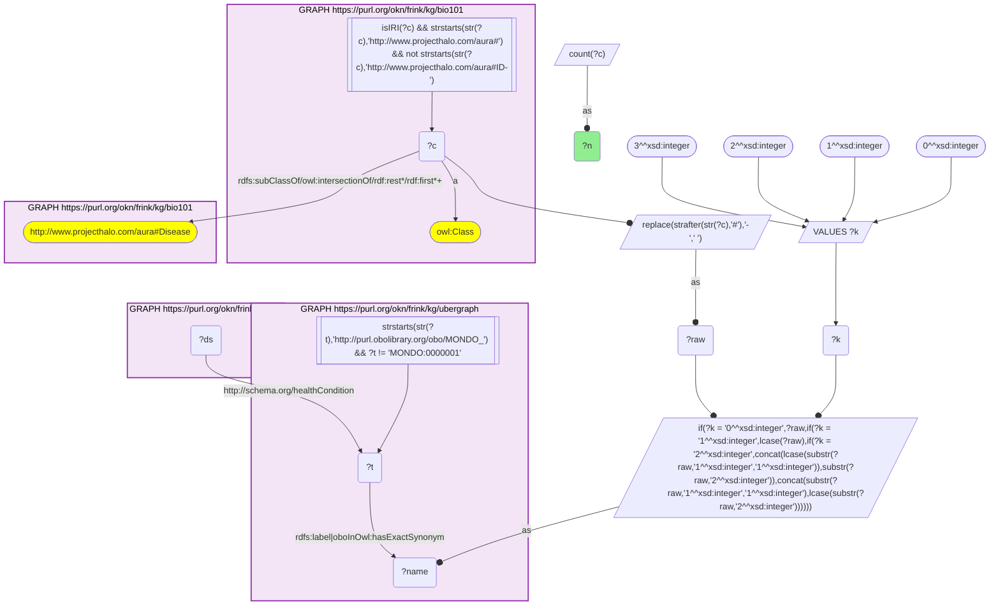
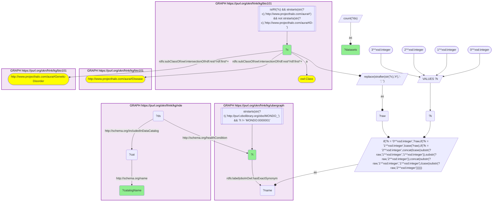
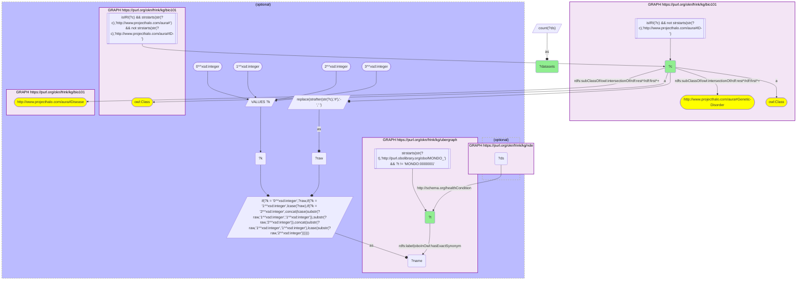
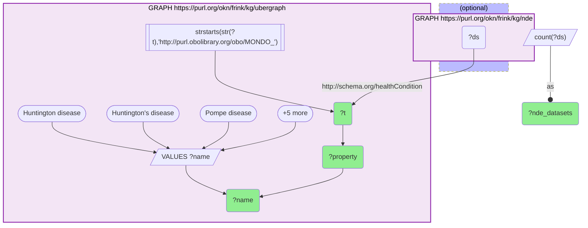

# D51-Q2: KB Bio 101's genetic disorders in the NIAID Data Ecosystem

- **Date:** 2026-11-03
- **Model:** claude-opus-5-5
- **SPARQL endpoint:** https://apps.okn.us/federation/sparql
- **Generated by:** mcp-okn v0.3.0 (build 7687738)
- **Contents:** 4 queries · 4 query diagrams

## Knowledge graphs used

- `bio101` — <https://purl.org/okn/frink/kg/bio101>
- `ubergraph` — <https://purl.org/okn/frink/kg/ubergraph>
- `nde` — <https://purl.org/okn/frink/kg/nde>

## Conversation

👤 **User**

Crosswalk: `bio101` × `nde` on **MONDO (bio101 label), bridged through `ubergraph`** (crosswalk `KB12-mondo-label-bio101-nde`, verified_count 60). KB Bio 101 is an OWL ontology of an introductory biology textbook: every concept is an `owl:Class` IRI `http://www.projecthalo.com/aura#{Name}` with no `rdfs:label` and no external id, so the concept NAME (local name, hyphens → spaces, four case forms: as-is, all lower-case, first letter lowered, sentence case) is matched as a bound literal against ubergraph `rdfs:label | oboInOwl:hasExactSynonym` on `obo/MONDO_` terms. The NIAID Data Ecosystem (`nde`) tags each `schema:Dataset` with the condition it studies on `schema:healthCondition`, as a raw `obo/MONDO_` IRI, and names its repository with `schema:includedInDataCatalog`. The bridge is scoped to bio101's `aura:Disease` subtree.

Research question: for the disorders KB Bio 101 itself classifies as genetic disorders (under `aura:Genetic-Disorder`), which have NDE datasets, how many, and in which repositories? Which textbook genetic disorders have none, and why?

Why the join is required: the textbook's genetic-disorder grouping exists only in bio101's class hierarchy, the dataset records only in NDE; only the name → MONDO bridge links them.

---

🧠 **Assistant**

**Bridge established (Query 1).** The crosswalk skeleton, run verbatim, returns **60** bio101 diseases matched to MONDO terms that NDE datasets carry as `schema:healthCondition`, matching the catalogued `verified_count`.

**Textbook genetic disorders with NDE datasets (Query 2).** Scoped to bio101's own `aura:Genetic-Disorder` subtree, **17 disorders** have NDE datasets, in four repositories:

| bio101 disorder | MONDO | NCBI GEO | Vivli | ImmPort |
|---|---|---|---|---|
| Cystic-Fibrosis | MONDO_0009061 | 283 | 7 | |
| Duchenne-Muscular-Dystrophy | MONDO_0010679 | 185 | 5 | |
| Down-Syndrome | MONDO_0008608 | 124 | | |
| Sickle-Cell-Anemia | MONDO_0011382 | 84 | 7 | 1 |
| Lysosomal-Disorder | MONDO_0002561 | 54 | | |
| Inborn-Error-Of-Metabolism | MONDO_0019052 | 31 | | |
| Phenylketonuria | MONDO_0009861 | 22 | | |
| Angelman-Syndrome | MONDO_0007113 | 19 | | |
| Chromosomal-Disorder | MONDO_0019040 | 19 | | |
| Turner-Syndrome | MONDO_0019499 | 18 | 3 | |
| Familial-Hypercholesterolemia | MONDO_0005439 | 15 | | |
| Hemophilia | MONDO_0018660 | 6 | 10 | |
| Polydactyly | MONDO_0021003 | 4 | | |
| Achondroplasia | MONDO_0007037 | 1 | | |
| Alkaptonuria | MONDO_0008753 | 1 | | |
| Cri-Du-Chat-Syndrome | MONDO_0007404 | 1 | | |
| Cystinuria | MONDO_0009067 | 1 | | |

Hemophilia is the one disorder where clinical-trial data (Vivli, 10) outnumbers GEO (6). Sickle-cell anemia is the only one with an ImmPort dataset.

**Which have none, and why (Query 3).** bio101 has 28 classes under `aura:Genetic-Disorder`. Query 3 lists every one with its MONDO match (if any) and its NDE dataset count, which sorts the 11 without datasets into three groups:

- **Matched to MONDO, but NDE has no dataset (2):** Color-Blindness (→ MONDO_0001703) and Klinefelter-Syndrome (→ MONDO_0006823).
- **Grouping classes, not diseases (4):** Human-Genetic-Disorder, Multifactorial-Genetic-Disorder, Sex-Linked-Human-Genetic-Disorder, and Gap-In-Segmentation. None matches a MONDO term.
- **Real disorders the exact-name bridge misses (5):** Huntingtons-Disease, Pompes-Disease, Prader-Willi-Syndrome, Tay-Sachs-disease and Triple-X.

**Why the five miss, and what NDE actually holds for them (Query 4).** Looking up their real MONDO names in ubergraph shows each failure has a different cause:

| bio101 concept | Name form the bridge tries | MONDO name that exists | MONDO | NDE datasets |
|---|---|---|---|---|
| Huntingtons-Disease | "Huntingtons Disease" (+ case forms) | "Huntington disease", "Huntington's disease" | MONDO_0007739 | 638 |
| Prader-Willi-Syndrome | "Prader Willi Syndrome", "Prader willi syndrome", … | "Prader Willi syndrome" (exact synonym), "Prader-Willi syndrome" | MONDO_0008300 | 39 |
| Tay-Sachs-disease | "Tay Sachs disease" (+ case forms) | "Tay-Sachs disease" | MONDO_0010100 | 6 |
| Pompes-Disease | "Pompes Disease" (+ case forms) | "Pompe disease" | MONDO_0009290 | 3 |
| Triple-X | "Triple X" (+ case forms) | "triple X syndrome", "trisomy X" | MONDO_0018066 | 3 |

Huntington and Pompe fail on bio101's dropped possessive; Tay-Sachs because the hyphen-to-space rewrite removes a hyphen MONDO keeps; Prader-Willi on letter case alone (MONDO's synonym needs a capital *W* with a lower-case *syndrome*, which none of the four case forms produces); and Triple-X because the textbook name lacks the word "syndrome". **All five have NDE datasets** under the correct MONDO term — 689 in all, Huntington's disease alone 638.

**Answer.** 17 of the textbook's genetic disorders reach NDE datasets through the bridge, almost all in NCBI GEO; cystic fibrosis (290 datasets in all), Duchenne muscular dystrophy (190) and Down syndrome (124) lead. Of the 11 that do not, only Color-Blindness and Klinefelter-Syndrome are a genuine gap in NDE, and four are grouping classes. The other five — Huntington's, Prader-Willi, Tay-Sachs, Pompe and triple X — are missed by the bridge's name form even though NDE holds 689 datasets for them, Huntington's disease more than any textbook genetic disorder the bridge does reach. That is the cost of an exact-name recipe: it is a lower bound, and its misses are not evidence of absence.

## SPARQL queries executed

#### Query 1

_2026-11-03T22:11:01+00:00 · `bio101`, `ubergraph`, `nde`_

```sparql
SELECT (COUNT(DISTINCT ?c) AS ?n) WHERE {
  { SELECT DISTINCT ?c ?t WHERE {
  { SELECT DISTINCT ?c ?name WHERE {
      GRAPH <https://purl.org/okn/frink/kg/bio101> { ?c a <http://www.w3.org/2002/07/owl#Class> .
        FILTER(isIRI(?c) && STRSTARTS(STR(?c),'http://www.projecthalo.com/aura#') && !STRSTARTS(STR(?c),'http://www.projecthalo.com/aura#ID-')) }
      GRAPH <https://purl.org/okn/frink/kg/bio101> { ?c (<http://www.w3.org/2000/01/rdf-schema#subClassOf>/(<http://www.w3.org/2002/07/owl#intersectionOf>/<http://www.w3.org/1999/02/22-rdf-syntax-ns#rest>*/<http://www.w3.org/1999/02/22-rdf-syntax-ns#first>)*)+ <http://www.projecthalo.com/aura#Disease> . }
      BIND(REPLACE(STRAFTER(STR(?c),'#'),'-',' ') AS ?raw)
      VALUES ?k { 0 1 2 3 }  # as-is, all lower, first letter lowered, sentence case
      BIND(IF(?k = 0, ?raw, IF(?k = 1, LCASE(?raw), IF(?k = 2, CONCAT(LCASE(SUBSTR(?raw,1,1)),SUBSTR(?raw,2)),
                CONCAT(SUBSTR(?raw,1,1),LCASE(SUBSTR(?raw,2)))))) AS ?name)
  } }
    GRAPH <https://purl.org/okn/frink/kg/ubergraph> { ?t <http://www.w3.org/2000/01/rdf-schema#label>|<http://www.geneontology.org/formats/oboInOwl#hasExactSynonym> ?name .
      FILTER(STRSTARTS(STR(?t),'http://purl.obolibrary.org/obo/MONDO_') && ?t != <http://purl.obolibrary.org/obo/MONDO_0000001>) }
  } }
  GRAPH <https://purl.org/okn/frink/kg/nde> { ?ds <http://schema.org/healthCondition> ?t . }
}
```



_1 row(s)_

| n |
| --- |
| 60 |

#### Query 2

_2026-11-03T22:11:03+00:00 · `bio101`, `ubergraph`, `nde`_

```sparql
SELECT ?c ?t ?catalogName (COUNT(DISTINCT ?ds) AS ?datasets) WHERE {
  { SELECT DISTINCT ?c ?t WHERE {
  { SELECT DISTINCT ?c ?name WHERE {
      GRAPH <https://purl.org/okn/frink/kg/bio101> { ?c a <http://www.w3.org/2002/07/owl#Class> .
        FILTER(isIRI(?c) && STRSTARTS(STR(?c),'http://www.projecthalo.com/aura#') && !STRSTARTS(STR(?c),'http://www.projecthalo.com/aura#ID-')) }
      GRAPH <https://purl.org/okn/frink/kg/bio101> { ?c (<http://www.w3.org/2000/01/rdf-schema#subClassOf>/(<http://www.w3.org/2002/07/owl#intersectionOf>/<http://www.w3.org/1999/02/22-rdf-syntax-ns#rest>*/<http://www.w3.org/1999/02/22-rdf-syntax-ns#first>)*)+ <http://www.projecthalo.com/aura#Disease> . }
      BIND(REPLACE(STRAFTER(STR(?c),'#'),'-',' ') AS ?raw)
      VALUES ?k { 0 1 2 3 }  # as-is, all lower, first letter lowered, sentence case
      BIND(IF(?k = 0, ?raw, IF(?k = 1, LCASE(?raw), IF(?k = 2, CONCAT(LCASE(SUBSTR(?raw,1,1)),SUBSTR(?raw,2)),
                CONCAT(SUBSTR(?raw,1,1),LCASE(SUBSTR(?raw,2)))))) AS ?name)
  } }
    GRAPH <https://purl.org/okn/frink/kg/ubergraph> { ?t <http://www.w3.org/2000/01/rdf-schema#label>|<http://www.geneontology.org/formats/oboInOwl#hasExactSynonym> ?name .
      FILTER(STRSTARTS(STR(?t),'http://purl.obolibrary.org/obo/MONDO_') && ?t != <http://purl.obolibrary.org/obo/MONDO_0000001>) }
  } }
  GRAPH <https://purl.org/okn/frink/kg/bio101> { ?c (<http://www.w3.org/2000/01/rdf-schema#subClassOf>/(<http://www.w3.org/2002/07/owl#intersectionOf>/<http://www.w3.org/1999/02/22-rdf-syntax-ns#rest>*/<http://www.w3.org/1999/02/22-rdf-syntax-ns#first>)*)+ <http://www.projecthalo.com/aura#Genetic-Disorder> . }
  GRAPH <https://purl.org/okn/frink/kg/nde> { ?ds <http://schema.org/healthCondition> ?t ; <http://schema.org/includedInDataCatalog> ?cat . ?cat <http://schema.org/name> ?catalogName }
} GROUP BY ?c ?t ?catalogName ORDER BY ?c DESC(?datasets)
```



_23 row(s) — showing first 3_

| c | t | catalogName | datasets |
| --- | --- | --- | --- |
| http://www.projecthalo.com/aura#Achondroplasia | http://purl.obolibrary.org/obo/MONDO_0007037 | NCBI GEO | 1 |
| http://www.projecthalo.com/aura#Alkaptonuria | http://purl.obolibrary.org/obo/MONDO_0008753 | NCBI GEO | 1 |
| http://www.projecthalo.com/aura#Angelman-Syndrome | http://purl.obolibrary.org/obo/MONDO_0007113 | NCBI GEO | 19 |

#### Query 3

_2026-11-03T22:11:04+00:00 · `bio101`, `ubergraph`, `nde`_

```sparql
SELECT ?c ?t (COUNT(DISTINCT ?ds) AS ?datasets) WHERE {
  { SELECT DISTINCT ?c WHERE { GRAPH <https://purl.org/okn/frink/kg/bio101> { ?c a <http://www.w3.org/2002/07/owl#Class> ; (<http://www.w3.org/2000/01/rdf-schema#subClassOf>/(<http://www.w3.org/2002/07/owl#intersectionOf>/<http://www.w3.org/1999/02/22-rdf-syntax-ns#rest>*/<http://www.w3.org/1999/02/22-rdf-syntax-ns#first>)*)+ <http://www.projecthalo.com/aura#Genetic-Disorder> . FILTER(isIRI(?c) && !STRSTARTS(STR(?c),'http://www.projecthalo.com/aura#ID-')) } } }
  OPTIONAL {
  { SELECT DISTINCT ?c ?t WHERE {
  { SELECT DISTINCT ?c ?name WHERE {
      GRAPH <https://purl.org/okn/frink/kg/bio101> { ?c a <http://www.w3.org/2002/07/owl#Class> .
        FILTER(isIRI(?c) && STRSTARTS(STR(?c),'http://www.projecthalo.com/aura#') && !STRSTARTS(STR(?c),'http://www.projecthalo.com/aura#ID-')) }
      GRAPH <https://purl.org/okn/frink/kg/bio101> { ?c (<http://www.w3.org/2000/01/rdf-schema#subClassOf>/(<http://www.w3.org/2002/07/owl#intersectionOf>/<http://www.w3.org/1999/02/22-rdf-syntax-ns#rest>*/<http://www.w3.org/1999/02/22-rdf-syntax-ns#first>)*)+ <http://www.projecthalo.com/aura#Disease> . }
      BIND(REPLACE(STRAFTER(STR(?c),'#'),'-',' ') AS ?raw)
      VALUES ?k { 0 1 2 3 }  # as-is, all lower, first letter lowered, sentence case
      BIND(IF(?k = 0, ?raw, IF(?k = 1, LCASE(?raw), IF(?k = 2, CONCAT(LCASE(SUBSTR(?raw,1,1)),SUBSTR(?raw,2)),
                CONCAT(SUBSTR(?raw,1,1),LCASE(SUBSTR(?raw,2)))))) AS ?name)
  } }
    GRAPH <https://purl.org/okn/frink/kg/ubergraph> { ?t <http://www.w3.org/2000/01/rdf-schema#label>|<http://www.geneontology.org/formats/oboInOwl#hasExactSynonym> ?name .
      FILTER(STRSTARTS(STR(?t),'http://purl.obolibrary.org/obo/MONDO_') && ?t != <http://purl.obolibrary.org/obo/MONDO_0000001>) }
  } }
    OPTIONAL { GRAPH <https://purl.org/okn/frink/kg/nde> { ?ds <http://schema.org/healthCondition> ?t } }
  }
} GROUP BY ?c ?t ORDER BY DESC(?datasets) ?c
```



_28 row(s) — showing first 3_

| c | t | datasets |
| --- | --- | --- |
| http://www.projecthalo.com/aura#Cystic-Fibrosis | http://purl.obolibrary.org/obo/MONDO_0009061 | 290 |
| http://www.projecthalo.com/aura#Duchenne-Muscular-Dystrophy | http://purl.obolibrary.org/obo/MONDO_0010679 | 190 |
| http://www.projecthalo.com/aura#Down-Syndrome | http://purl.obolibrary.org/obo/MONDO_0008608 | 124 |

#### Query 4

_2026-11-03T22:11:05+00:00 · `ubergraph`, `nde`_

```sparql
SELECT ?name ?t ?property (COUNT(DISTINCT ?ds) AS ?nde_datasets) WHERE {
  GRAPH <https://purl.org/okn/frink/kg/ubergraph> {
    VALUES ?name { "Huntington disease" "Huntington's disease" "Pompe disease" "Prader Willi syndrome" "Prader-Willi syndrome" "Tay-Sachs disease" "triple X syndrome" "trisomy X" }
    ?t ?property ?name . FILTER(STRSTARTS(STR(?t),'http://purl.obolibrary.org/obo/MONDO_')) }
  OPTIONAL { GRAPH <https://purl.org/okn/frink/kg/nde> { ?ds <http://schema.org/healthCondition> ?t } }
} GROUP BY ?name ?t ?property ORDER BY ?t ?name
```



_12 row(s) — showing first 5_

| name | t | property | nde_datasets |
| --- | --- | --- | --- |
| Huntington disease | http://purl.obolibrary.org/obo/MONDO_0007739 | http://www.geneontology.org/formats/oboInOwl#hasExactSynonym | 638 |
| Huntington disease | http://purl.obolibrary.org/obo/MONDO_0007739 | http://www.w3.org/2000/01/rdf-schema#label | 638 |
| Huntington's disease | http://purl.obolibrary.org/obo/MONDO_0007739 | http://www.geneontology.org/formats/oboInOwl#hasExactSynonym | 638 |
| Prader Willi syndrome | http://purl.obolibrary.org/obo/MONDO_0008300 | http://www.geneontology.org/formats/oboInOwl#hasExactSynonym | 39 |
| Prader-Willi syndrome | http://purl.obolibrary.org/obo/MONDO_0008300 | http://www.geneontology.org/formats/oboInOwl#hasExactSynonym | 39 |
