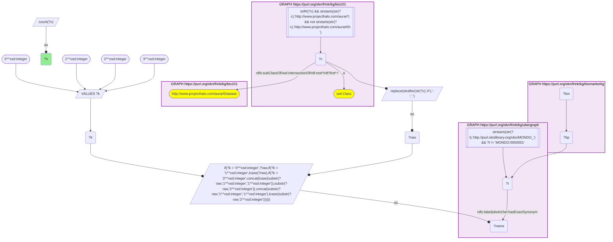
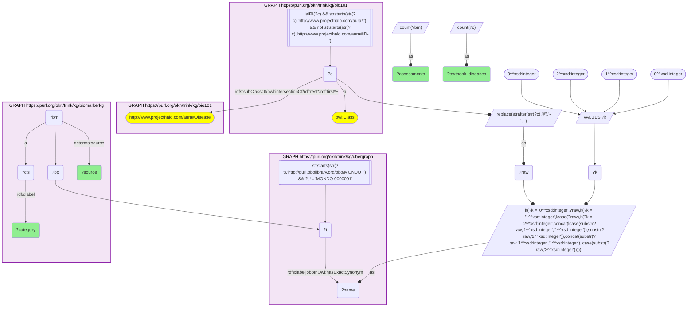

# D52-Q1: KB Bio 101's textbook diseases ranked by BiomarkerKB assessments

- **Date:** 2026-11-03
- **Model:** claude-opus-5-5
- **SPARQL endpoint:** https://apps.okn.us/federation/sparql
- **Generated by:** mcp-okn v0.3.0 (build ca8a360)
- **Contents:** 3 queries · 3 query diagrams

## Knowledge graphs used

- `bio101` — <https://purl.org/okn/frink/kg/bio101>
- `ubergraph` — <https://purl.org/okn/frink/kg/ubergraph>
- `biomarkerkg` — <https://purl.org/okn/frink/kg/biomarkerkg>

## Conversation

👤 **User**

Crosswalk: `bio101` × `biomarkerkg` on **MONDO (bio101 label), bridged through `ubergraph`** (crosswalk `KB13-mondo-label-bio101-biomarkerkg`, verified_count 40). KB Bio 101 is an OWL ontology of an introductory biology textbook: every concept is an `owl:Class` IRI `http://www.projecthalo.com/aura#{Name}` with no `rdfs:label` and no external id, so the concept NAME (local name, hyphens → spaces, four case forms: as-is, all lower-case, first letter lowered, sentence case) is matched as a bound literal against ubergraph `rdfs:label | oboInOwl:hasExactSynonym` on `obo/MONDO_` terms. BiomarkerKB (`biomarkerkg`) models each biomarker assessment as a node typed with its BEST category (`obo:OBCI_0000002` diagnostic, `_0000003` monitoring, `_0000005` predictive, `_0000006` prognostic, `_0000008` susceptibility/risk); it names the condition with a role predicate (`obo:OBCI_1000002` diagnostic for, `_1000003` monitors status of, `_1000006` prognostic for, `_1000008` indicates risk of developing) whose object is a raw `obo/MONDO_` IRI, the specimen with `obo:OBCI_1000018` (determined using sample from, an `obo/UBERON_` IRI), its description with `rdfs:label`, and its upstream source with `dcterms:source`. The bridge is scoped to bio101's `aura:Disease` subtree, because bare MONDO name matches are homonym-prone.

Research question: for the diseases KB Bio 101 teaches, how many BiomarkerKB biomarker assessments name the matching MONDO condition, and of which kind (diagnostic, susceptibility/risk, prognostic, monitoring, predictive)? Rank the bridged diseases, and say where the volume comes from.

Why the join is required: bio101 knows which diseases a curriculum covers but holds no biomarkers; BiomarkerKB knows biomarkers per MONDO condition but has no notion of a curriculum. They share no identifier, so only the name → MONDO bridge through ubergraph joins them.

---

🧠 **Assistant**

**Bridge established (Query 1).** The crosswalk skeleton, run verbatim, returns **40** bio101 diseases. Each is a concept under bio101's `aura:Disease` subtree whose name is an exact MONDO label or exact synonym in ubergraph, *and* whose MONDO term is named by at least one BiomarkerKB assessment. This matches the catalogued `verified_count`. Query 2 returns 41 rows, because bio101's `Lupus` matches two MONDO terms (*lupus erythematosus* and *systemic lupus erythematosus*).

**Ranking (Query 2)**, by BEST category:

| Rank | bio101 disease | MONDO (ubergraph label) | Assessments | Risk | Diagnostic | Prognostic | Monitoring |
|---|---|---|---|---|---|---|---|
| 1 | Cancer | MONDO_0004992 (cancer) | 95,569 | 95,556 | 7 | 3 | 1 |
| 2 | Breast-Cancer | MONDO_0007254 (breast cancer) | 14,419 | 14,317 | 38 | 54 | 6 |
| 3 | Prostate-Cancer | MONDO_0008315 (prostate cancer) | 2,499 | 2,442 | 29 | 26 | 2 |
| 4 | Type-2-Diabetes-Mellitus | MONDO_0005148 | 2,345 | 2,318 | 27 | 0 | 0 |
| 5 | Alzheimers-Disease | MONDO_0004975 (Alzheimer disease) | 1,420 | 1,399 | 12 | 9 | 0 |
| 6 | Schizophrenia | MONDO_0005090 | 1,071 | 1,069 | 2 | 0 | 0 |
| 7 | Leukemia | MONDO_0005059 | 895 | 895 | 0 | 0 | 0 |
| 8 | Rheumatoid-Arthritis | MONDO_0008383 | 854 | 852 | 0 | 2 | 0 |
| 9 | Lupus | MONDO_0007915 (systemic lupus erythematosus) | 527 | 520 | 7 | 0 | 0 |
| 10 | Bipolar-Disorder | MONDO_0004985 | 374 | 373 | 1 | 0 | 0 |
| 11 | Multiple-Sclerosis | MONDO_0005301 | 373 | 344 | 29 | 0 | 0 |
| 12 | Colon-Cancer | MONDO_0021063 (malignant colon neoplasm) | 336 | 336 | 0 | 0 | 0 |
| 13 | Major-Depression | MONDO_0002009 (major depressive disorder) | 296 | 296 | 0 | 0 | 0 |
| 14 | Renal-Disease | MONDO_0005240 (kidney disorder) | 198 | 4 | 194 | 0 | 0 |
| 15 | Endometriosis | MONDO_0005133 | 159 | 159 | 0 | 0 | 0 |

Of the 41 MONDO terms, 29 have susceptibility/risk assessments, 29 diagnostic, 8 prognostic and 4 monitoring. None has a predictive assessment. Almost every assessment carries a BEST category; the exceptions are 2 for Cancer, 4 for Breast-Cancer and 1 for Diabetes-Mellitus. Six textbook diseases have exactly one assessment each: Autoimmune-Disease, Cystic-Fibrosis, Down-Syndrome, Encephalitis, Influenza and Lysosomal-Disorder.

**Where the volume comes from (Query 3).**

| Category | Source | Assessments | Textbook diseases reached |
|---|---|---|---|
| susceptibility/risk | clinvar | 111,693 | 6 |
| susceptibility/risk | gwas | 9,017 | 28 |
| diagnostic | mw | 384 | 28 |
| susceptibility/risk | civic | 333 | 6 |
| susceptibility/risk | opentargets | 73 | 3 |
| prognostic | oncomx | 56 | 3 |
| diagnostic | oncomx | 44 | 3 |
| prognostic | civic | 37 | 4 |

**Answer.** The ranking is a ranking of genetic-variant risk records, not of biomarker diversity. ClinVar alone contributes 111,693 susceptibility/risk assessments, but they reach only 6 textbook diseases. Cancer (95,556 risk) and Breast-Cancer (14,317) hold 109,873 risk assessments between them, while every non-ClinVar risk source together contributes fewer than 9,500. So most of those two diseases' risk assessments must be ClinVar records, and that is why they dwarf everything else. GWAS adds 9,017 risk assessments spread across 28 diseases.

Diagnostic biomarkers tell a different story. They come mostly from the `mw` source (384 assessments, 28 diseases). By that measure Renal-Disease leads with 194, ahead of Breast-Cancer (38), Diabetes-Mellitus (31), Prostate-Cancer and Multiple-Sclerosis (29 each) and Type-2-Diabetes-Mellitus (27). The cancers are the only textbook diseases with substantial prognostic and monitoring biomarkers, from OncoMX and CIViC. For a textbook audience, the diagnostic and prognostic columns are the useful ones; the risk column mostly counts variants.

Caveats: this is an exact-name lower bound scoped to bio101's Disease subtree, as in KB5 and KB12. Textbook conditions filed outside that subtree (for example Heart-Attack and Obesity) are not counted, and the MONDO root *disease* is excluded. The broad textbook term "Cancer" matches the general MONDO term, which BiomarkerKB uses for pan-cancer variant records.

## SPARQL queries executed

#### Query 1

_2026-11-04T00:23:02+00:00 · `bio101`, `ubergraph`, `biomarkerkg`_

```sparql
SELECT (COUNT(DISTINCT ?c) AS ?n) WHERE {
  { SELECT DISTINCT ?c ?t WHERE {
  { SELECT DISTINCT ?c ?name WHERE {
      GRAPH <https://purl.org/okn/frink/kg/bio101> { ?c a <http://www.w3.org/2002/07/owl#Class> .
        FILTER(isIRI(?c) && STRSTARTS(STR(?c),'http://www.projecthalo.com/aura#') && !STRSTARTS(STR(?c),'http://www.projecthalo.com/aura#ID-')) }
      GRAPH <https://purl.org/okn/frink/kg/bio101> { ?c (<http://www.w3.org/2000/01/rdf-schema#subClassOf>/(<http://www.w3.org/2002/07/owl#intersectionOf>/<http://www.w3.org/1999/02/22-rdf-syntax-ns#rest>*/<http://www.w3.org/1999/02/22-rdf-syntax-ns#first>)*)+ <http://www.projecthalo.com/aura#Disease> . }
      BIND(REPLACE(STRAFTER(STR(?c),'#'),'-',' ') AS ?raw)
      VALUES ?k { 0 1 2 3 }  # as-is, all lower, first letter lowered, sentence case
      BIND(IF(?k = 0, ?raw, IF(?k = 1, LCASE(?raw), IF(?k = 2, CONCAT(LCASE(SUBSTR(?raw,1,1)),SUBSTR(?raw,2)),
                CONCAT(SUBSTR(?raw,1,1),LCASE(SUBSTR(?raw,2)))))) AS ?name)
  } }
    GRAPH <https://purl.org/okn/frink/kg/ubergraph> { ?t <http://www.w3.org/2000/01/rdf-schema#label>|<http://www.geneontology.org/formats/oboInOwl#hasExactSynonym> ?name .
      FILTER(STRSTARTS(STR(?t),'http://purl.obolibrary.org/obo/MONDO_') && ?t != <http://purl.obolibrary.org/obo/MONDO_0000001>) }
  } }
  GRAPH <https://purl.org/okn/frink/kg/biomarkerkg> { ?bm ?bp ?t . }
}
```



_1 row(s)_

| n |
| --- |
| 40 |

#### Query 2

_2026-11-04T00:23:04+00:00 · `bio101`, `ubergraph`, `biomarkerkg`_

```sparql
SELECT ?c ?t ?label (COUNT(DISTINCT ?bm) AS ?assessments) (COUNT(DISTINCT ?diagnostic_bm) AS ?diagnostic) (COUNT(DISTINCT ?risk_bm) AS ?risk) (COUNT(DISTINCT ?prognostic_bm) AS ?prognostic) (COUNT(DISTINCT ?monitoring_bm) AS ?monitoring) (COUNT(DISTINCT ?predictive_bm) AS ?predictive) (COUNT(DISTINCT ?typed_bm) AS ?categorised) WHERE {
  { SELECT DISTINCT ?c ?t WHERE {
  { SELECT DISTINCT ?c ?name WHERE {
      GRAPH <https://purl.org/okn/frink/kg/bio101> { ?c a <http://www.w3.org/2002/07/owl#Class> .
        FILTER(isIRI(?c) && STRSTARTS(STR(?c),'http://www.projecthalo.com/aura#') && !STRSTARTS(STR(?c),'http://www.projecthalo.com/aura#ID-')) }
      GRAPH <https://purl.org/okn/frink/kg/bio101> { ?c (<http://www.w3.org/2000/01/rdf-schema#subClassOf>/(<http://www.w3.org/2002/07/owl#intersectionOf>/<http://www.w3.org/1999/02/22-rdf-syntax-ns#rest>*/<http://www.w3.org/1999/02/22-rdf-syntax-ns#first>)*)+ <http://www.projecthalo.com/aura#Disease> . }
      BIND(REPLACE(STRAFTER(STR(?c),'#'),'-',' ') AS ?raw)
      VALUES ?k { 0 1 2 3 }  # as-is, all lower, first letter lowered, sentence case
      BIND(IF(?k = 0, ?raw, IF(?k = 1, LCASE(?raw), IF(?k = 2, CONCAT(LCASE(SUBSTR(?raw,1,1)),SUBSTR(?raw,2)),
                CONCAT(SUBSTR(?raw,1,1),LCASE(SUBSTR(?raw,2)))))) AS ?name)
  } }
    GRAPH <https://purl.org/okn/frink/kg/ubergraph> { ?t <http://www.w3.org/2000/01/rdf-schema#label>|<http://www.geneontology.org/formats/oboInOwl#hasExactSynonym> ?name .
      FILTER(STRSTARTS(STR(?t),'http://purl.obolibrary.org/obo/MONDO_') && ?t != <http://purl.obolibrary.org/obo/MONDO_0000001>) }
  } }
  GRAPH <https://purl.org/okn/frink/kg/biomarkerkg> { ?bm ?bp ?t .
    OPTIONAL { ?bm a <http://purl.obolibrary.org/obo/OBCI_0000002> BIND(?bm AS ?diagnostic_bm) }
    OPTIONAL { ?bm a <http://purl.obolibrary.org/obo/OBCI_0000008> BIND(?bm AS ?risk_bm) }
    OPTIONAL { ?bm a <http://purl.obolibrary.org/obo/OBCI_0000006> BIND(?bm AS ?prognostic_bm) }
    OPTIONAL { ?bm a <http://purl.obolibrary.org/obo/OBCI_0000003> BIND(?bm AS ?monitoring_bm) }
    OPTIONAL { ?bm a <http://purl.obolibrary.org/obo/OBCI_0000005> BIND(?bm AS ?predictive_bm) }
    OPTIONAL { ?bm a ?anyCat FILTER(STRSTARTS(STR(?anyCat), 'http://purl.obolibrary.org/obo/OBCI_')) BIND(?bm AS ?typed_bm) } }
  GRAPH <https://purl.org/okn/frink/kg/ubergraph> { ?t <http://www.w3.org/2000/01/rdf-schema#label> ?label }
} GROUP BY ?c ?t ?label ORDER BY DESC(?assessments) ?c
```



```mermaid
graph TD
classDef projected fill:lightgreen;
classDef literal fill:orange;
classDef iri fill:yellow;
  q1v32("?anyCat")
  q1v7("?assessments"):::projected 
  q1v24("?bm")
  q1v25("?bp")
  q1v10("?c"):::projected 
  q1v1("?categorised"):::projected 
  q1v6("?diagnostic"):::projected 
  q1v26("?diagnostic_bm")
  q1v22("?k")
  q1v8("?label"):::projected 
  q1v3("?monitoring"):::projected 
  q1v29("?monitoring_bm")
  q1v21("?name")
  q1v2("?predictive"):::projected 
  q1v30("?predictive_bm")
  q1v4("?prognostic"):::projected 
  q1v28("?prognostic_bm")
  q1v23("?raw")
  q1v5("?risk"):::projected 
  q1v27("?risk_bm")
  q1v9("?t"):::projected 
  q1v31("?typed_bm")
  subgraph q1graph0["GRAPH https://purl.org/okn/frink/kg/bio101"]
    style q1graph0 fill:#f3e5f5,stroke:#8e24aa,stroke-width:2px,color:#000;
    q1graph0c2(["owl:Class"]):::iri 
    q1graph0f0[["isIRI(?c) && strstarts(str(?c),'http://www.projecthalo.com/aura#') && not strstarts(str(?c),'http://www.projecthalo.com/aura#ID-')"]]
    q1graph0f0 --> q1v10
    q1v10 --"a"--> q1graph0c2
  end
  subgraph q1graph1["GRAPH https://purl.org/okn/frink/kg/bio101"]
    style q1graph1 fill:#f3e5f5,stroke:#8e24aa,stroke-width:2px,color:#000;
    q1graph1c1(["http://www.projecthalo.com/aura#Disease"]):::iri 
    q1v10 --"rdfs:subClassOf/owl:intersectionOf/rdf:rest*/rdf:first*+"--> q1graph1c1
  end
  q1bind0[/"replace(strafter(str(?c),'#'),'-',' ')"/]
  q1v10 --o q1bind0
  q1bind0 --as--o q1v23
  q1bind1[/"VALUES ?k"/]
  q1bind1-->q1v22
  q1bind10(["0^^xsd:integer"])
  q1bind10 --> q1bind1
  q1bind11(["1^^xsd:integer"])
  q1bind11 --> q1bind1
  q1bind12(["2^^xsd:integer"])
  q1bind12 --> q1bind1
  q1bind13(["3^^xsd:integer"])
  q1bind13 --> q1bind1
  q1bind2[/"if(?k = '0^^xsd:integer',?raw,if(?k = '1^^xsd:integer',lcase(?raw),if(?k = '2^^xsd:integer',concat(lcase(substr(?raw,'1^^xsd:integer','1^^xsd:integer')),substr(?raw,'2^^xsd:integer')),concat(substr(?raw,'1^^xsd:integer','1^^xsd:integer'),lcase(substr(?raw,'2^^xsd:integer'))))))"/]
  q1v22 --o q1bind2
  q1v23 --o q1bind2
  q1bind2 --as--o q1v21
  subgraph q1graph2["GRAPH https://purl.org/okn/frink/kg/ubergraph"]
    style q1graph2 fill:#f3e5f5,stroke:#8e24aa,stroke-width:2px,color:#000;
    q1graph2f1[["strstarts(str(?t),'http://purl.obolibrary.org/obo/MONDO_') && ?t != 'MONDO:0000001'"]]
    q1graph2f1 --> q1v9
    q1v9 --"rdfs:label|oboInOwl:hasExactSynonym"--> q1v21
  end
  subgraph q1graph3["GRAPH https://purl.org/okn/frink/kg/biomarkerkg"]
    style q1graph3 fill:#f3e5f5,stroke:#8e24aa,stroke-width:2px,color:#000;
    q1graph3c2(["obo:OBCI_0000002"]):::iri 
    q1graph3c5(["obo:OBCI_0000003"]):::iri 
    q1graph3c6(["obo:OBCI_0000005"]):::iri 
    q1graph3c4(["obo:OBCI_0000006"]):::iri 
    q1graph3c3(["obo:OBCI_0000008"]):::iri 
    q1v24 -->q1v25--> q1v9
    subgraph q1optionalgraph30["(optional)"]
    style q1optionalgraph30 fill:#bbf,stroke-dasharray: 5 5,color:#000;
      q1v24 -."a".-> q1graph3c2
      q1graph3bind3[/"?bm"/]
      q1v24 --o q1graph3bind3
      q1graph3bind3 --as--o q1v26
    end
    subgraph q1optionalgraph31["(optional)"]
    style q1optionalgraph31 fill:#bbf,stroke-dasharray: 5 5,color:#000;
      q1v24 -."a".-> q1graph3c3
      q1graph3bind4[/"?bm"/]
      q1v24 --o q1graph3bind4
      q1graph3bind4 --as--o q1v27
    end
    subgraph q1optionalgraph32["(optional)"]
    style q1optionalgraph32 fill:#bbf,stroke-dasharray: 5 5,color:#000;
      q1v24 -."a".-> q1graph3c4
      q1graph3bind5[/"?bm"/]
      q1v24 --o q1graph3bind5
      q1graph3bind5 --as--o q1v28
    end
    subgraph q1optionalgraph33["(optional)"]
    style q1optionalgraph33 fill:#bbf,stroke-dasharray: 5 5,color:#000;
      q1v24 -."a".-> q1graph3c5
      q1graph3bind6[/"?bm"/]
      q1v24 --o q1graph3bind6
      q1graph3bind6 --as--o q1v29
    end
    subgraph q1optionalgraph34["(optional)"]
    style q1optionalgraph34 fill:#bbf,stroke-dasharray: 5 5,color:#000;
      q1v24 -."a".-> q1graph3c6
      q1graph3bind7[/"?bm"/]
      q1v24 --o q1graph3bind7
      q1graph3bind7 --as--o q1v30
    end
    subgraph q1optionalgraph35["(optional)"]
    style q1optionalgraph35 fill:#bbf,stroke-dasharray: 5 5,color:#000;
      q1v24 -."a".-> q1v32
      q1graph3bind8[/"?bm"/]
      q1v24 --o q1graph3bind8
      q1graph3bind8 --as--o q1v31
    end
  end
  subgraph q1graph4["GRAPH https://purl.org/okn/frink/kg/ubergraph"]
    style q1graph4 fill:#f3e5f5,stroke:#8e24aa,stroke-width:2px,color:#000;
    q1v9 --"rdfs:label"--> q1v8
  end
  q1bind9[/"count(?bm)"/]
  q1bind9 --as--o q1v7
  q1bind10[/"count(?diagnostic_bm)"/]
  q1bind10 --as--o q1v6
  q1bind11[/"count(?risk_bm)"/]
  q1bind11 --as--o q1v5
  q1bind12[/"count(?prognostic_bm)"/]
  q1bind12 --as--o q1v4
  q1bind13[/"count(?monitoring_bm)"/]
  q1bind13 --as--o q1v3
  q1bind14[/"count(?predictive_bm)"/]
  q1bind14 --as--o q1v2
  q1bind15[/"count(?typed_bm)"/]
  q1bind15 --as--o q1v1
```

_41 row(s) — showing first 3_

| c | t | label | assessments | diagnostic | risk | prognostic | monitoring | predictive | categorised |
| --- | --- | --- | --- | --- | --- | --- | --- | --- | --- |
| http://www.projecthalo.com/aura#Cancer | http://purl.obolibrary.org/obo/MONDO_0004992 | cancer | 95569 | 7 | 95556 | 3 | 1 | 0 | 95567 |
| http://www.projecthalo.com/aura#Breast-Cancer | http://purl.obolibrary.org/obo/MONDO_0007254 | breast cancer | 14419 | 38 | 14317 | 54 | 6 | 0 | 14415 |
| http://www.projecthalo.com/aura#Prostate-Cancer | http://purl.obolibrary.org/obo/MONDO_0008315 | prostate cancer | 2499 | 29 | 2442 | 26 | 2 | 0 | 2499 |

#### Query 3

_2026-11-04T00:23:05+00:00 · `bio101`, `ubergraph`, `biomarkerkg`_

```sparql
SELECT ?category ?source (COUNT(DISTINCT ?bm) AS ?assessments) (COUNT(DISTINCT ?c) AS ?textbook_diseases) WHERE {
  { SELECT DISTINCT ?c ?t WHERE {
  { SELECT DISTINCT ?c ?name WHERE {
      GRAPH <https://purl.org/okn/frink/kg/bio101> { ?c a <http://www.w3.org/2002/07/owl#Class> .
        FILTER(isIRI(?c) && STRSTARTS(STR(?c),'http://www.projecthalo.com/aura#') && !STRSTARTS(STR(?c),'http://www.projecthalo.com/aura#ID-')) }
      GRAPH <https://purl.org/okn/frink/kg/bio101> { ?c (<http://www.w3.org/2000/01/rdf-schema#subClassOf>/(<http://www.w3.org/2002/07/owl#intersectionOf>/<http://www.w3.org/1999/02/22-rdf-syntax-ns#rest>*/<http://www.w3.org/1999/02/22-rdf-syntax-ns#first>)*)+ <http://www.projecthalo.com/aura#Disease> . }
      BIND(REPLACE(STRAFTER(STR(?c),'#'),'-',' ') AS ?raw)
      VALUES ?k { 0 1 2 3 }  # as-is, all lower, first letter lowered, sentence case
      BIND(IF(?k = 0, ?raw, IF(?k = 1, LCASE(?raw), IF(?k = 2, CONCAT(LCASE(SUBSTR(?raw,1,1)),SUBSTR(?raw,2)),
                CONCAT(SUBSTR(?raw,1,1),LCASE(SUBSTR(?raw,2)))))) AS ?name)
  } }
    GRAPH <https://purl.org/okn/frink/kg/ubergraph> { ?t <http://www.w3.org/2000/01/rdf-schema#label>|<http://www.geneontology.org/formats/oboInOwl#hasExactSynonym> ?name .
      FILTER(STRSTARTS(STR(?t),'http://purl.obolibrary.org/obo/MONDO_') && ?t != <http://purl.obolibrary.org/obo/MONDO_0000001>) }
  } }
  GRAPH <https://purl.org/okn/frink/kg/biomarkerkg> { ?bm ?bp ?t ; a ?cls ; <http://purl.org/dc/terms/source> ?source . ?cls <http://www.w3.org/2000/01/rdf-schema#label> ?category . }
} GROUP BY ?category ?source ORDER BY DESC(?assessments)
```



_20 row(s) — showing first 5_

| category | source | assessments | textbook_diseases |
| --- | --- | --- | --- |
| susceptibility/risk biomarker | clinvar | 111693 | 6 |
| susceptibility/risk biomarker | gwas | 9017 | 28 |
| diagnostic biomarker | mw | 384 | 28 |
| susceptibility/risk biomarker | civic | 333 | 6 |
| susceptibility/risk biomarker | opentargets | 73 | 3 |
