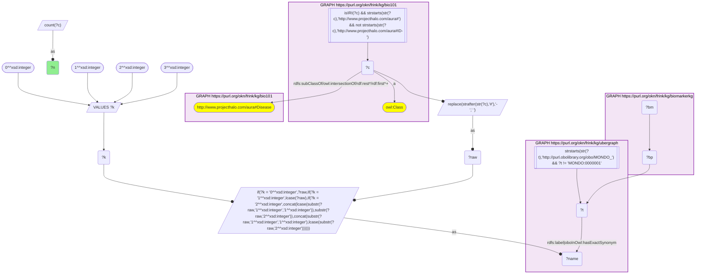
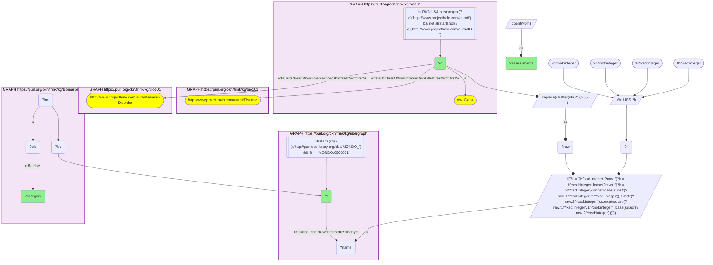
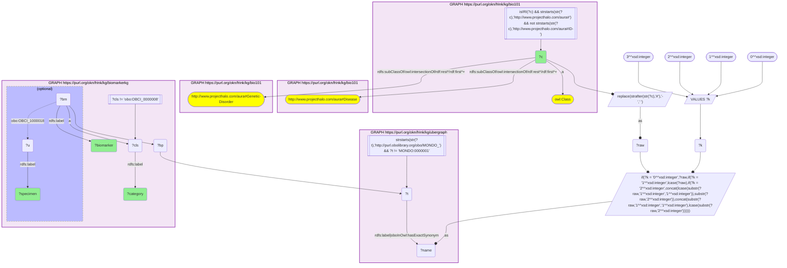

# D52-Q2: Biomarkers for KB Bio 101's genetic disorders

- **Date:** 2026-11-03
- **Model:** claude-opus-5-5
- **SPARQL endpoint:** https://apps.okn.us/federation/sparql
- **Generated by:** mcp-okn v0.3.0 (build ca8a360)
- **Contents:** 3 queries · 3 query diagrams

## Knowledge graphs used

- `bio101` — <https://purl.org/okn/frink/kg/bio101>
- `ubergraph` — <https://purl.org/okn/frink/kg/ubergraph>
- `biomarkerkg` — <https://purl.org/okn/frink/kg/biomarkerkg>

## Conversation

👤 **User**

Crosswalk: `bio101` × `biomarkerkg` on **MONDO (bio101 label), bridged through `ubergraph`** (crosswalk `KB13-mondo-label-bio101-biomarkerkg`, verified_count 40). KB Bio 101 is an OWL ontology of an introductory biology textbook: every concept is an `owl:Class` IRI `http://www.projecthalo.com/aura#{Name}` with no `rdfs:label` and no external id, so the concept NAME (local name, hyphens → spaces, four case forms: as-is, all lower-case, first letter lowered, sentence case) is matched as a bound literal against ubergraph `rdfs:label | oboInOwl:hasExactSynonym` on `obo/MONDO_` terms. BiomarkerKB (`biomarkerkg`) models each biomarker assessment as a node typed with its BEST category (`obo:OBCI_0000002` diagnostic, `_0000003` monitoring, `_0000005` predictive, `_0000006` prognostic, `_0000008` susceptibility/risk); it names the condition with a role predicate (`obo:OBCI_1000002` diagnostic for, `_1000003` monitors status of, `_1000006` prognostic for, `_1000008` indicates risk of developing) whose object is a raw `obo/MONDO_` IRI, the specimen with `obo:OBCI_1000018` (determined using sample from, an `obo/UBERON_` IRI), its description with `rdfs:label`, and its upstream source with `dcterms:source`. The bridge is scoped to bio101's `aura:Disease` subtree.

Research question: for the disorders KB Bio 101 itself classifies as genetic disorders (under `aura:Genetic-Disorder`), which BiomarkerKB biomarkers are recorded — and, leaving aside the GWAS susceptibility variants, what are the diagnostic, prognostic and monitoring biomarkers, and from which specimen are they measured?

Why the join is required: the textbook's genetic-disorder grouping exists only in bio101's class hierarchy and the biomarker records only in BiomarkerKB; only the name → MONDO bridge links them.

---

🧠 **Assistant**

**Bridge established (Query 1).** The crosswalk skeleton, run verbatim, returns **40** bio101 diseases that reach a BiomarkerKB assessment through the name → MONDO bridge, matching the catalogued `verified_count`.

**Genetic disorders with biomarkers (Query 2).** Restricting to concepts under bio101's own `aura:Genetic-Disorder` class leaves **9 textbook genetic disorders**:

| bio101 genetic disorder | MONDO | Diagnostic | Susceptibility/risk |
|---|---|---|---|
| Cystinuria | MONDO_0009067 | 6 | — |
| Alkaptonuria | MONDO_0008753 | 5 | — |
| Sickle-Cell-Anemia | MONDO_0011382 | 4 | 2 |
| Turner-Syndrome | MONDO_0019499 | 4 | — |
| Phenylketonuria | MONDO_0009861 | 3 | — |
| Duchenne-Muscular-Dystrophy | MONDO_0010679 | 2 | — |
| Cystic-Fibrosis | MONDO_0009061 | 1 | — |
| Down-Syndrome | MONDO_0008608 | 1 | — |
| Lysosomal-Disorder | MONDO_0002561 | 1 | — |

Only Sickle-Cell-Anemia has risk assessments (2), so the 31 non-risk rows of Query 3 are all diagnostic. None is prognostic or monitoring.

**The diagnostic biomarkers and their specimens (Query 3).** An assessment measured in two specimens gives two rows:

| bio101 genetic disorder | Biomarker (BiomarkerKB label) | Specimen(s) |
|---|---|---|
| Cystic-Fibrosis | Increased sweat chloride | sweat |
| Phenylketonuria | Increased phenylacetic acid; increased phenyllactate; increased phenylpyruvate | blood plasma, urine; urine; urine |
| Alkaptonuria | Increased tyrosine (5 LOINC codes) | blood plasma, cerebrospinal fluid, amniotic fluid, urine (×2) |
| Cystinuria | Increased cystine (6 LOINC codes) | cerebrospinal fluid, amniotic fluid, urine (×2); two with no specimen |
| Sickle-Cell-Anemia | Increased urobilinogen (2 codes); increased valine (2 codes) | urine (×2); amniotic fluid, urine |
| Turner-Syndrome | Decreased estrogens (4 LOINC codes) | blood serum, urine, blood plasma |
| Duchenne-Muscular-Dystrophy | Increased creatine kinase BB; increased dihydroxyacetone phosphate (both flagged `biomarker_term_in_review`) | blood plasma, blood serum; none |
| Down-Syndrome | Increased h-hCG | tissue |
| Lysosomal-Disorder | Increased oligosaccharides | urine, blood plasma |

**Answer.** Nine of the textbook's genetic disorders have BiomarkerKB biomarkers, and every non-variant biomarker among them is diagnostic. Several are the classic tests an introductory course describes:

- the sweat-chloride test for cystic fibrosis;
- phenylalanine breakdown products (phenylpyruvate, phenyllactate, phenylacetic acid) in urine for phenylketonuria;
- cystine in urine for cystinuria;
- hCG for Down syndrome screening;
- creatine kinase for Duchenne muscular dystrophy.

Two entries do not follow the textbook story. For alkaptonuria, BiomarkerKB records increased tyrosine; the disorder's hallmark, homogentisic acid, is not among the rows. For sickle-cell anemia, the diagnostic biomarkers are urobilinogen and valine levels, not a hemoglobin test.

Most of these biomarkers are measured in fluids (urine, plasma, serum, amniotic fluid, CSF, sweat). Prenatal amniotic-fluid assays appear for alkaptonuria, cystinuria and sickle cell.

Caveats: this is an exact-name lower bound. Textbook genetic disorders whose names miss MONDO (for example the possessive forms found in KB12) are not reached. Specimens such as blood plasma, blood serum and tissue are not themselves bio101 concepts, so they are reported here from BiomarkerKB's own UBERON labels.

## SPARQL queries executed

#### Query 1

_2026-11-04T00:23:06+00:00 · `bio101`, `ubergraph`, `biomarkerkg`_

```sparql
SELECT (COUNT(DISTINCT ?c) AS ?n) WHERE {
  { SELECT DISTINCT ?c ?t WHERE {
  { SELECT DISTINCT ?c ?name WHERE {
      GRAPH <https://purl.org/okn/frink/kg/bio101> { ?c a <http://www.w3.org/2002/07/owl#Class> .
        FILTER(isIRI(?c) && STRSTARTS(STR(?c),'http://www.projecthalo.com/aura#') && !STRSTARTS(STR(?c),'http://www.projecthalo.com/aura#ID-')) }
      GRAPH <https://purl.org/okn/frink/kg/bio101> { ?c (<http://www.w3.org/2000/01/rdf-schema#subClassOf>/(<http://www.w3.org/2002/07/owl#intersectionOf>/<http://www.w3.org/1999/02/22-rdf-syntax-ns#rest>*/<http://www.w3.org/1999/02/22-rdf-syntax-ns#first>)*)+ <http://www.projecthalo.com/aura#Disease> . }
      BIND(REPLACE(STRAFTER(STR(?c),'#'),'-',' ') AS ?raw)
      VALUES ?k { 0 1 2 3 }  # as-is, all lower, first letter lowered, sentence case
      BIND(IF(?k = 0, ?raw, IF(?k = 1, LCASE(?raw), IF(?k = 2, CONCAT(LCASE(SUBSTR(?raw,1,1)),SUBSTR(?raw,2)),
                CONCAT(SUBSTR(?raw,1,1),LCASE(SUBSTR(?raw,2)))))) AS ?name)
  } }
    GRAPH <https://purl.org/okn/frink/kg/ubergraph> { ?t <http://www.w3.org/2000/01/rdf-schema#label>|<http://www.geneontology.org/formats/oboInOwl#hasExactSynonym> ?name .
      FILTER(STRSTARTS(STR(?t),'http://purl.obolibrary.org/obo/MONDO_') && ?t != <http://purl.obolibrary.org/obo/MONDO_0000001>) }
  } }
  GRAPH <https://purl.org/okn/frink/kg/biomarkerkg> { ?bm ?bp ?t . }
}
```



_1 row(s)_

| n |
| --- |
| 40 |

#### Query 2

_2026-11-04T00:23:08+00:00 · `bio101`, `ubergraph`, `biomarkerkg`_

```sparql
SELECT ?c ?t ?category (COUNT(DISTINCT ?bm) AS ?assessments) WHERE {
  { SELECT DISTINCT ?c ?t WHERE {
  { SELECT DISTINCT ?c ?name WHERE {
      GRAPH <https://purl.org/okn/frink/kg/bio101> { ?c a <http://www.w3.org/2002/07/owl#Class> .
        FILTER(isIRI(?c) && STRSTARTS(STR(?c),'http://www.projecthalo.com/aura#') && !STRSTARTS(STR(?c),'http://www.projecthalo.com/aura#ID-')) }
      GRAPH <https://purl.org/okn/frink/kg/bio101> { ?c (<http://www.w3.org/2000/01/rdf-schema#subClassOf>/(<http://www.w3.org/2002/07/owl#intersectionOf>/<http://www.w3.org/1999/02/22-rdf-syntax-ns#rest>*/<http://www.w3.org/1999/02/22-rdf-syntax-ns#first>)*)+ <http://www.projecthalo.com/aura#Disease> . }
      BIND(REPLACE(STRAFTER(STR(?c),'#'),'-',' ') AS ?raw)
      VALUES ?k { 0 1 2 3 }  # as-is, all lower, first letter lowered, sentence case
      BIND(IF(?k = 0, ?raw, IF(?k = 1, LCASE(?raw), IF(?k = 2, CONCAT(LCASE(SUBSTR(?raw,1,1)),SUBSTR(?raw,2)),
                CONCAT(SUBSTR(?raw,1,1),LCASE(SUBSTR(?raw,2)))))) AS ?name)
  } }
    GRAPH <https://purl.org/okn/frink/kg/ubergraph> { ?t <http://www.w3.org/2000/01/rdf-schema#label>|<http://www.geneontology.org/formats/oboInOwl#hasExactSynonym> ?name .
      FILTER(STRSTARTS(STR(?t),'http://purl.obolibrary.org/obo/MONDO_') && ?t != <http://purl.obolibrary.org/obo/MONDO_0000001>) }
  } }
  GRAPH <https://purl.org/okn/frink/kg/bio101> { ?c (<http://www.w3.org/2000/01/rdf-schema#subClassOf>/(<http://www.w3.org/2002/07/owl#intersectionOf>/<http://www.w3.org/1999/02/22-rdf-syntax-ns#rest>*/<http://www.w3.org/1999/02/22-rdf-syntax-ns#first>)*)+ <http://www.projecthalo.com/aura#Genetic-Disorder> . }
  GRAPH <https://purl.org/okn/frink/kg/biomarkerkg> { ?bm ?bp ?t ; a ?cls . ?cls <http://www.w3.org/2000/01/rdf-schema#label> ?category . }
} GROUP BY ?c ?t ?category ORDER BY ?c DESC(?assessments)
```



_10 row(s) — showing first 3_

| c | t | category | assessments |
| --- | --- | --- | --- |
| http://www.projecthalo.com/aura#Alkaptonuria | http://purl.obolibrary.org/obo/MONDO_0008753 | diagnostic biomarker | 5 |
| http://www.projecthalo.com/aura#Cystic-Fibrosis | http://purl.obolibrary.org/obo/MONDO_0009061 | diagnostic biomarker | 1 |
| http://www.projecthalo.com/aura#Cystinuria | http://purl.obolibrary.org/obo/MONDO_0009067 | diagnostic biomarker | 6 |

#### Query 3

_2026-11-04T00:23:10+00:00 · `bio101`, `ubergraph`, `biomarkerkg`_

```sparql
SELECT ?c ?category ?biomarker ?specimen WHERE {
  { SELECT DISTINCT ?c ?t WHERE {
  { SELECT DISTINCT ?c ?name WHERE {
      GRAPH <https://purl.org/okn/frink/kg/bio101> { ?c a <http://www.w3.org/2002/07/owl#Class> .
        FILTER(isIRI(?c) && STRSTARTS(STR(?c),'http://www.projecthalo.com/aura#') && !STRSTARTS(STR(?c),'http://www.projecthalo.com/aura#ID-')) }
      GRAPH <https://purl.org/okn/frink/kg/bio101> { ?c (<http://www.w3.org/2000/01/rdf-schema#subClassOf>/(<http://www.w3.org/2002/07/owl#intersectionOf>/<http://www.w3.org/1999/02/22-rdf-syntax-ns#rest>*/<http://www.w3.org/1999/02/22-rdf-syntax-ns#first>)*)+ <http://www.projecthalo.com/aura#Disease> . }
      BIND(REPLACE(STRAFTER(STR(?c),'#'),'-',' ') AS ?raw)
      VALUES ?k { 0 1 2 3 }  # as-is, all lower, first letter lowered, sentence case
      BIND(IF(?k = 0, ?raw, IF(?k = 1, LCASE(?raw), IF(?k = 2, CONCAT(LCASE(SUBSTR(?raw,1,1)),SUBSTR(?raw,2)),
                CONCAT(SUBSTR(?raw,1,1),LCASE(SUBSTR(?raw,2)))))) AS ?name)
  } }
    GRAPH <https://purl.org/okn/frink/kg/ubergraph> { ?t <http://www.w3.org/2000/01/rdf-schema#label>|<http://www.geneontology.org/formats/oboInOwl#hasExactSynonym> ?name .
      FILTER(STRSTARTS(STR(?t),'http://purl.obolibrary.org/obo/MONDO_') && ?t != <http://purl.obolibrary.org/obo/MONDO_0000001>) }
  } }
  GRAPH <https://purl.org/okn/frink/kg/bio101> { ?c (<http://www.w3.org/2000/01/rdf-schema#subClassOf>/(<http://www.w3.org/2002/07/owl#intersectionOf>/<http://www.w3.org/1999/02/22-rdf-syntax-ns#rest>*/<http://www.w3.org/1999/02/22-rdf-syntax-ns#first>)*)+ <http://www.projecthalo.com/aura#Genetic-Disorder> . }
  GRAPH <https://purl.org/okn/frink/kg/biomarkerkg> { ?bm ?bp ?t ; a ?cls ; <http://www.w3.org/2000/01/rdf-schema#label> ?biomarker . ?cls <http://www.w3.org/2000/01/rdf-schema#label> ?category . FILTER(?cls != <http://purl.obolibrary.org/obo/OBCI_0000008>)
    OPTIONAL { ?bm <http://purl.obolibrary.org/obo/OBCI_1000018> ?u . ?u <http://www.w3.org/2000/01/rdf-schema#label> ?specimen } }
} ORDER BY ?c ?category ?biomarker
```



_31 row(s) — showing first 5_

| c | category | biomarker | specimen |
| --- | --- | --- | --- |
| http://www.projecthalo.com/aura#Alkaptonuria | diagnostic biomarker | Increased level of metabolite tyrosine/LOINC:101539-5 | blood plasma |
| http://www.projecthalo.com/aura#Alkaptonuria | diagnostic biomarker | Increased level of metabolite tyrosine/LOINC:13381-9 | cerebrospinal fluid |
| http://www.projecthalo.com/aura#Alkaptonuria | diagnostic biomarker | Increased level of metabolite tyrosine/LOINC:13417-1 | amniotic fluid |
| http://www.projecthalo.com/aura#Alkaptonuria | diagnostic biomarker | Increased level of metabolite tyrosine/LOINC:13818-0 | urine |
| http://www.projecthalo.com/aura#Alkaptonuria | diagnostic biomarker | Increased level of metabolite tyrosine/LOINC:13901-4 | urine |
