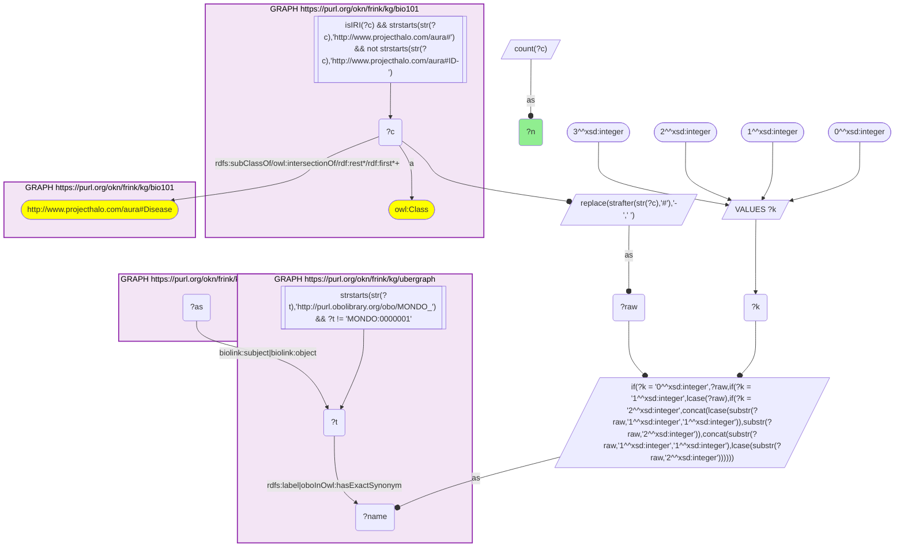
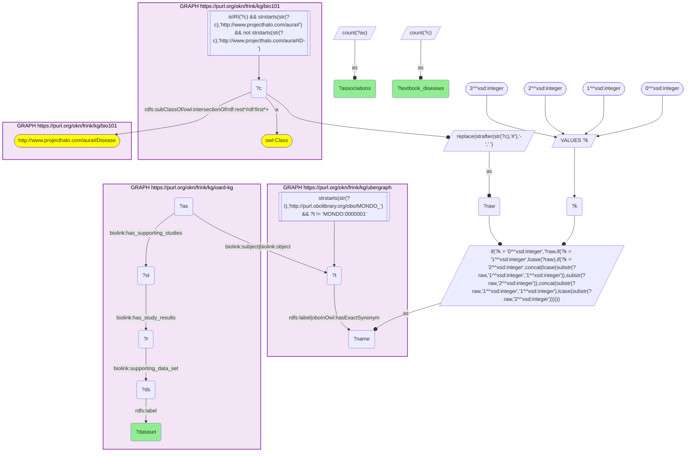

# D53-Q1: KB Bio 101's textbook diseases ranked by OARD EHR associations

- **Date:** 2026-11-03
- **Model:** claude-opus-5-5
- **SPARQL endpoint:** https://apps.okn.us/federation/sparql
- **Generated by:** mcp-okn v0.3.0 (build ca8a360)
- **Contents:** 3 queries · 3 query diagrams

## Knowledge graphs used

- `bio101` — <https://purl.org/okn/frink/kg/bio101>
- `ubergraph` — <https://purl.org/okn/frink/kg/ubergraph>
- `oard-kg` — <https://purl.org/okn/frink/kg/oard-kg>

## Conversation

👤 **User**

Crosswalk: `bio101` × `oard-kg` on **MONDO (bio101 label), bridged through `ubergraph`** (crosswalk `KB15-mondo-label-bio101-oard`, verified_count 25). KB Bio 101 is an OWL ontology of an introductory biology textbook: every concept is an `owl:Class` IRI `http://www.projecthalo.com/aura#{Name}` with no `rdfs:label` and no external id, so the concept NAME (local name, hyphens → spaces, four case forms: as-is, all lower-case, first letter lowered, sentence case) is matched as a bound literal against ubergraph `rdfs:label | oboInOwl:hasExactSynonym` on `obo/MONDO_` terms. OARD (`oard-kg`, the Open Annotation for Rare Diseases) records EHR co-occurrence as biolink associations with `biolink:subject` / `biolink:object` set to raw `obo/MONDO_` or `obo/HP_` IRIs (`biolink:DiseaseToPhenotypicFeatureAssociation` has the disease as subject); each association has one study per dataset (`biolink:has_supporting_studies`) whose results (`biolink:has_study_results`) give `biolink:concept_pair_count` with its `biolink:supporting_data_set`, and a `biolink:log_odds_ratio` with its two 95% confidence bounds on `biolink:log_odds_ratio_95_ci`. The bridge is scoped to bio101's `aura:Disease` subtree, because bare MONDO name matches are homonym-prone.

Research question: for the diseases KB Bio 101 teaches, how many OARD co-occurrence associations involve the matching MONDO term, in which role, and with how many distinct partner concepts? Rank the bridged diseases, and say which EHR datasets the evidence comes from.

Why the join is required: bio101 knows which diseases a curriculum covers; OARD knows which phenotypes and diseases co-occur with a MONDO term in patient records. They share no identifier, so only the name → MONDO bridge through ubergraph joins them.

---

🧠 **Assistant**

**Bridge established (Query 1).** The crosswalk skeleton, run verbatim, returns **25** bio101 diseases. Each is a concept under bio101's `aura:Disease` subtree whose name is an exact MONDO label or exact synonym in ubergraph, *and* whose MONDO term is the `biolink:subject` or `biolink:object` of at least one OARD association. This matches the catalogued `verified_count`. Each disease maps to one MONDO term (Query 2 returns 25 rows).

**Ranking (Query 2).**

| Rank | bio101 disease | MONDO (ubergraph label) | Associations | As subject | As object | Disease→phenotype | Partners |
|---|---|---|---|---|---|---|---|
| 1 | Hypopituitarism | MONDO_0005152 | 1,994 | 1,963 | 31 | 1,794 | 1,994 |
| 2 | Encephalitis | MONDO_0019956 | 1,960 | 1,757 | 203 | 1,731 | 1,960 |
| 3 | Prostate-Cancer | MONDO_0008315 | 1,415 | 1,350 | 65 | 1,218 | 1,415 |
| 4 | Mitochondrial-Myopathy | MONDO_0009637 (inborn mitochondrial myopathy) | 1,362 | 1,307 | 55 | 1,213 | 1,362 |
| 5 | CML | MONDO_0011996 | 1,034 | 965 | 69 | 891 | 1,034 |
| 6 | Lupus | MONDO_0007915 (systemic lupus erythematosus) | 1,010 | 942 | 68 | 766 | 1,010 |
| 7 | Lyme-Disease | MONDO_0019632 | 986 | 800 | 186 | 769 | 986 |
| 8 | Tuberculosis | MONDO_0018076 | 883 | 796 | 87 | 755 | 883 |
| 9 | Sickle-Cell-Anemia | MONDO_0011382 (sickle cell disease) | 628 | 540 | 88 | 455 | 628 |
| 10 | Cystic-Fibrosis | MONDO_0009061 | 624 | 575 | 49 | 445 | 623 |
| 11 | Cholera | MONDO_0015766 | 577 | 559 | 18 | 546 | 577 |
| 12 | Chromosomal-Disorder | MONDO_0019040 | 526 | 378 | 148 | 340 | 526 |
| 13 | Inborn-Error-Of-Metabolism | MONDO_0019052 | 296 | 259 | 37 | 257 | 296 |
| 14 | Turner-Syndrome | MONDO_0019499 | 247 | 179 | 68 | 171 | 247 |
| 15 | Color-Blindness | MONDO_0001703 (color vision disorder) | 186 | 186 | 0 | 175 | 186 |

Further down: Lysosomal-Disorder 160, Duchenne-Muscular-Dystrophy 136, Cystinuria 113, Achondroplasia 58 and Phenylketonuria 41. At the bottom are Malaria and Tetanus with 5 each, Smallpox 4, and Alkaptonuria and Hemophilia with 1 each. Hemophilia's single association has it as the object, with no disease→phenotype record. Five diseases (Color-Blindness, Achondroplasia, Tetanus, Smallpox, Alkaptonuria) never appear as the object.

**Datasets (Query 3).**

| OARD dataset | Associations | Textbook diseases reached |
|---|---|---|
| Dataset 2: CUIMC clinical notes | 7,509 | 20 |
| Dataset 3: CHOP clinical notes | 6,923 | 7 |
| Dataset 1: CUIMC structured OMOP | 1,225 | 21 |

**Answer.** The textbook diseases with the richest EHR co-occurrence profiles in OARD are a mix of endocrine, infectious, neoplastic and inherited conditions: hypopituitarism, encephalitis, prostate cancer, inborn mitochondrial myopathy, CML and lupus, each with more than 1,000 associations. Most associations are disease→phenotype records with the textbook disease as subject (1,794 of hypopituitarism's 1,994). Nearly every association joins a distinct partner concept; the one exception is Cystic-Fibrosis, with 623 partners across 624 associations.

The classic infectious diseases of the textbook split sharply:

- tuberculosis, Lyme disease and cholera each have hundreds of associations;
- malaria, tetanus and smallpox have five or fewer. These are diseases rarely seen in a New York or Philadelphia hospital record.

Most of the evidence comes from clinical notes. The CHOP pediatric notes contribute 6,923 associations, concentrated on just 7 of the textbook diseases. The structured OMOP data reaches the most diseases (21) but with far fewer associations (1,225).

Caveats: this is an exact-name lower bound scoped to bio101's Disease subtree. OARD is built from two hospital systems' records, so a low count says more about local case mix and documentation than about disease importance. Association counts are summed across datasets, and an association can be backed by more than one dataset's study.

## SPARQL queries executed

#### Query 1

_2026-11-04T00:23:14+00:00 · `bio101`, `ubergraph`, `oard-kg`_

```sparql
SELECT (COUNT(DISTINCT ?c) AS ?n) WHERE {
  { SELECT DISTINCT ?c ?t WHERE {
  { SELECT DISTINCT ?c ?name WHERE {
      GRAPH <https://purl.org/okn/frink/kg/bio101> { ?c a <http://www.w3.org/2002/07/owl#Class> .
        FILTER(isIRI(?c) && STRSTARTS(STR(?c),'http://www.projecthalo.com/aura#') && !STRSTARTS(STR(?c),'http://www.projecthalo.com/aura#ID-')) }
      GRAPH <https://purl.org/okn/frink/kg/bio101> { ?c (<http://www.w3.org/2000/01/rdf-schema#subClassOf>/(<http://www.w3.org/2002/07/owl#intersectionOf>/<http://www.w3.org/1999/02/22-rdf-syntax-ns#rest>*/<http://www.w3.org/1999/02/22-rdf-syntax-ns#first>)*)+ <http://www.projecthalo.com/aura#Disease> . }
      BIND(REPLACE(STRAFTER(STR(?c),'#'),'-',' ') AS ?raw)
      VALUES ?k { 0 1 2 3 }  # as-is, all lower, first letter lowered, sentence case
      BIND(IF(?k = 0, ?raw, IF(?k = 1, LCASE(?raw), IF(?k = 2, CONCAT(LCASE(SUBSTR(?raw,1,1)),SUBSTR(?raw,2)),
                CONCAT(SUBSTR(?raw,1,1),LCASE(SUBSTR(?raw,2)))))) AS ?name)
  } }
    GRAPH <https://purl.org/okn/frink/kg/ubergraph> { ?t <http://www.w3.org/2000/01/rdf-schema#label>|<http://www.geneontology.org/formats/oboInOwl#hasExactSynonym> ?name .
      FILTER(STRSTARTS(STR(?t),'http://purl.obolibrary.org/obo/MONDO_') && ?t != <http://purl.obolibrary.org/obo/MONDO_0000001>) }
  } }
  GRAPH <https://purl.org/okn/frink/kg/oard-kg> { ?as <https://w3id.org/biolink/vocab/subject>|<https://w3id.org/biolink/vocab/object> ?t . }
}
```



_1 row(s)_

| n |
| --- |
| 25 |

#### Query 2

_2026-11-04T00:23:15+00:00 · `bio101`, `ubergraph`, `oard-kg`_

```sparql
SELECT ?c ?t ?label (COUNT(DISTINCT ?as) AS ?associations) (COUNT(DISTINCT ?asS) AS ?as_subject) (COUNT(DISTINCT ?asO) AS ?as_object) (COUNT(DISTINCT ?d2p) AS ?disease_phenotype) (COUNT(DISTINCT ?partner) AS ?partners) WHERE {
  { SELECT DISTINCT ?c ?t WHERE {
  { SELECT DISTINCT ?c ?name WHERE {
      GRAPH <https://purl.org/okn/frink/kg/bio101> { ?c a <http://www.w3.org/2002/07/owl#Class> .
        FILTER(isIRI(?c) && STRSTARTS(STR(?c),'http://www.projecthalo.com/aura#') && !STRSTARTS(STR(?c),'http://www.projecthalo.com/aura#ID-')) }
      GRAPH <https://purl.org/okn/frink/kg/bio101> { ?c (<http://www.w3.org/2000/01/rdf-schema#subClassOf>/(<http://www.w3.org/2002/07/owl#intersectionOf>/<http://www.w3.org/1999/02/22-rdf-syntax-ns#rest>*/<http://www.w3.org/1999/02/22-rdf-syntax-ns#first>)*)+ <http://www.projecthalo.com/aura#Disease> . }
      BIND(REPLACE(STRAFTER(STR(?c),'#'),'-',' ') AS ?raw)
      VALUES ?k { 0 1 2 3 }  # as-is, all lower, first letter lowered, sentence case
      BIND(IF(?k = 0, ?raw, IF(?k = 1, LCASE(?raw), IF(?k = 2, CONCAT(LCASE(SUBSTR(?raw,1,1)),SUBSTR(?raw,2)),
                CONCAT(SUBSTR(?raw,1,1),LCASE(SUBSTR(?raw,2)))))) AS ?name)
  } }
    GRAPH <https://purl.org/okn/frink/kg/ubergraph> { ?t <http://www.w3.org/2000/01/rdf-schema#label>|<http://www.geneontology.org/formats/oboInOwl#hasExactSynonym> ?name .
      FILTER(STRSTARTS(STR(?t),'http://purl.obolibrary.org/obo/MONDO_') && ?t != <http://purl.obolibrary.org/obo/MONDO_0000001>) }
  } }
  GRAPH <https://purl.org/okn/frink/kg/oard-kg> { ?as <https://w3id.org/biolink/vocab/subject>|<https://w3id.org/biolink/vocab/object> ?t .
    OPTIONAL { ?as <https://w3id.org/biolink/vocab/subject> ?t ; <https://w3id.org/biolink/vocab/object> ?pO BIND(?as AS ?asS) }
    OPTIONAL { ?as <https://w3id.org/biolink/vocab/object> ?t ; <https://w3id.org/biolink/vocab/subject> ?pS BIND(?as AS ?asO) }
    OPTIONAL { ?as a <https://w3id.org/biolink/vocab/DiseaseToPhenotypicFeatureAssociation> BIND(?as AS ?d2p) }
    BIND(COALESCE(?pO, ?pS) AS ?partner) }
  GRAPH <https://purl.org/okn/frink/kg/ubergraph> { ?t <http://www.w3.org/2000/01/rdf-schema#label> ?label }
} GROUP BY ?c ?t ?label ORDER BY DESC(?associations) ?c
```



```mermaid
graph TD
classDef projected fill:lightgreen;
classDef literal fill:orange;
classDef iri fill:yellow;
  q1v23("?as")
  q1v25("?asO")
  q1v24("?asS")
  q1v3("?as_object"):::projected 
  q1v4("?as_subject"):::projected 
  q1v5("?associations"):::projected 
  q1v8("?c"):::projected 
  q1v26("?d2p")
  q1v2("?disease_phenotype"):::projected 
  q1v18("?k")
  q1v6("?label"):::projected 
  q1v17("?name")
  q1v21("?pO")
  q1v22("?pS")
  q1v20("?partner")
  q1v1("?partners"):::projected 
  q1v19("?raw")
  q1v7("?t"):::projected 
  subgraph q1graph0["GRAPH https://purl.org/okn/frink/kg/bio101"]
    style q1graph0 fill:#f3e5f5,stroke:#8e24aa,stroke-width:2px,color:#000;
    q1graph0c2(["owl:Class"]):::iri 
    q1graph0f0[["isIRI(?c) && strstarts(str(?c),'http://www.projecthalo.com/aura#') && not strstarts(str(?c),'http://www.projecthalo.com/aura#ID-')"]]
    q1graph0f0 --> q1v8
    q1v8 --"a"--> q1graph0c2
  end
  subgraph q1graph1["GRAPH https://purl.org/okn/frink/kg/bio101"]
    style q1graph1 fill:#f3e5f5,stroke:#8e24aa,stroke-width:2px,color:#000;
    q1graph1c1(["http://www.projecthalo.com/aura#Disease"]):::iri 
    q1v8 --"rdfs:subClassOf/owl:intersectionOf/rdf:rest*/rdf:first*+"--> q1graph1c1
  end
  q1bind0[/"replace(strafter(str(?c),'#'),'-',' ')"/]
  q1v8 --o q1bind0
  q1bind0 --as--o q1v19
  q1bind1[/"VALUES ?k"/]
  q1bind1-->q1v18
  q1bind10(["0^^xsd:integer"])
  q1bind10 --> q1bind1
  q1bind11(["1^^xsd:integer"])
  q1bind11 --> q1bind1
  q1bind12(["2^^xsd:integer"])
  q1bind12 --> q1bind1
  q1bind13(["3^^xsd:integer"])
  q1bind13 --> q1bind1
  q1bind2[/"if(?k = '0^^xsd:integer',?raw,if(?k = '1^^xsd:integer',lcase(?raw),if(?k = '2^^xsd:integer',concat(lcase(substr(?raw,'1^^xsd:integer','1^^xsd:integer')),substr(?raw,'2^^xsd:integer')),concat(substr(?raw,'1^^xsd:integer','1^^xsd:integer'),lcase(substr(?raw,'2^^xsd:integer'))))))"/]
  q1v18 --o q1bind2
  q1v19 --o q1bind2
  q1bind2 --as--o q1v17
  subgraph q1graph2["GRAPH https://purl.org/okn/frink/kg/ubergraph"]
    style q1graph2 fill:#f3e5f5,stroke:#8e24aa,stroke-width:2px,color:#000;
    q1graph2f1[["strstarts(str(?t),'http://purl.obolibrary.org/obo/MONDO_') && ?t != 'MONDO:0000001'"]]
    q1graph2f1 --> q1v7
    q1v7 --"rdfs:label|oboInOwl:hasExactSynonym"--> q1v17
  end
  subgraph q1graph3["GRAPH https://purl.org/okn/frink/kg/oard-kg"]
    style q1graph3 fill:#f3e5f5,stroke:#8e24aa,stroke-width:2px,color:#000;
    q1graph3c4(["biolink:DiseaseToPhenotypicFeatureAssociation"]):::iri 
    q1v23 --"biolink:subject|biolink:object"--> q1v7
    subgraph q1optionalgraph30["(optional)"]
    style q1optionalgraph30 fill:#bbf,stroke-dasharray: 5 5,color:#000;
      q1v23 -."biolink:object".-> q1v21
      q1v23 --"biolink:subject"--> q1v7
      q1graph3bind3[/"?as"/]
      q1v23 --o q1graph3bind3
      q1graph3bind3 --as--o q1v24
    end
    subgraph q1optionalgraph31["(optional)"]
    style q1optionalgraph31 fill:#bbf,stroke-dasharray: 5 5,color:#000;
      q1v23 -."biolink:object".-> q1v7
      q1v23 --"biolink:subject"--> q1v22
      q1graph3bind4[/"?as"/]
      q1v23 --o q1graph3bind4
      q1graph3bind4 --as--o q1v25
    end
    subgraph q1optionalgraph32["(optional)"]
    style q1optionalgraph32 fill:#bbf,stroke-dasharray: 5 5,color:#000;
      q1v23 -."a".-> q1graph3c4
      q1graph3bind5[/"?as"/]
      q1v23 --o q1graph3bind5
      q1graph3bind5 --as--o q1v26
    end
    q1graph3bind6[/"coalesce(?pO,?pS)"/]
    q1v21 --o q1graph3bind6
    q1v22 --o q1graph3bind6
    q1graph3bind6 --as--o q1v20
  end
  subgraph q1graph4["GRAPH https://purl.org/okn/frink/kg/ubergraph"]
    style q1graph4 fill:#f3e5f5,stroke:#8e24aa,stroke-width:2px,color:#000;
    q1v7 --"rdfs:label"--> q1v6
  end
  q1bind7[/"count(?as)"/]
  q1bind7 --as--o q1v5
  q1bind8[/"count(?asS)"/]
  q1bind8 --as--o q1v4
  q1bind9[/"count(?asO)"/]
  q1bind9 --as--o q1v3
  q1bind10[/"count(?d2p)"/]
  q1bind10 --as--o q1v2
  q1bind11[/"count(?partner)"/]
  q1bind11 --as--o q1v1
```

_25 row(s) — showing first 3_

| c | t | label | associations | as_subject | as_object | disease_phenotype | partners |
| --- | --- | --- | --- | --- | --- | --- | --- |
| http://www.projecthalo.com/aura#Hypopituitarism | http://purl.obolibrary.org/obo/MONDO_0005152 | hypopituitarism | 1994 | 1963 | 31 | 1794 | 1994 |
| http://www.projecthalo.com/aura#Encephalitis | http://purl.obolibrary.org/obo/MONDO_0019956 | encephalitis | 1960 | 1757 | 203 | 1731 | 1960 |
| http://www.projecthalo.com/aura#Prostate-Cancer | http://purl.obolibrary.org/obo/MONDO_0008315 | prostate cancer | 1415 | 1350 | 65 | 1218 | 1415 |

#### Query 3

_2026-11-04T00:23:16+00:00 · `bio101`, `ubergraph`, `oard-kg`_

```sparql
SELECT ?dataset (COUNT(DISTINCT ?as) AS ?associations) (COUNT(DISTINCT ?c) AS ?textbook_diseases) WHERE {
  { SELECT DISTINCT ?c ?t WHERE {
  { SELECT DISTINCT ?c ?name WHERE {
      GRAPH <https://purl.org/okn/frink/kg/bio101> { ?c a <http://www.w3.org/2002/07/owl#Class> .
        FILTER(isIRI(?c) && STRSTARTS(STR(?c),'http://www.projecthalo.com/aura#') && !STRSTARTS(STR(?c),'http://www.projecthalo.com/aura#ID-')) }
      GRAPH <https://purl.org/okn/frink/kg/bio101> { ?c (<http://www.w3.org/2000/01/rdf-schema#subClassOf>/(<http://www.w3.org/2002/07/owl#intersectionOf>/<http://www.w3.org/1999/02/22-rdf-syntax-ns#rest>*/<http://www.w3.org/1999/02/22-rdf-syntax-ns#first>)*)+ <http://www.projecthalo.com/aura#Disease> . }
      BIND(REPLACE(STRAFTER(STR(?c),'#'),'-',' ') AS ?raw)
      VALUES ?k { 0 1 2 3 }  # as-is, all lower, first letter lowered, sentence case
      BIND(IF(?k = 0, ?raw, IF(?k = 1, LCASE(?raw), IF(?k = 2, CONCAT(LCASE(SUBSTR(?raw,1,1)),SUBSTR(?raw,2)),
                CONCAT(SUBSTR(?raw,1,1),LCASE(SUBSTR(?raw,2)))))) AS ?name)
  } }
    GRAPH <https://purl.org/okn/frink/kg/ubergraph> { ?t <http://www.w3.org/2000/01/rdf-schema#label>|<http://www.geneontology.org/formats/oboInOwl#hasExactSynonym> ?name .
      FILTER(STRSTARTS(STR(?t),'http://purl.obolibrary.org/obo/MONDO_') && ?t != <http://purl.obolibrary.org/obo/MONDO_0000001>) }
  } }
  GRAPH <https://purl.org/okn/frink/kg/oard-kg> { ?as <https://w3id.org/biolink/vocab/subject>|<https://w3id.org/biolink/vocab/object> ?t ; <https://w3id.org/biolink/vocab/has_supporting_studies> ?st .
    ?st <https://w3id.org/biolink/vocab/has_study_results> ?r . ?r <https://w3id.org/biolink/vocab/supporting_data_set> ?ds . ?ds <http://www.w3.org/2000/01/rdf-schema#label> ?dataset . }
} GROUP BY ?dataset ORDER BY DESC(?associations)
```



_3 row(s)_

| dataset | associations | textbook_diseases |
| --- | --- | --- |
| OARD Dataset 2: CUIMC clinical notes | 7509 | 20 |
| OARD Dataset 3: CHOP clinical notes | 6923 | 7 |
| OARD Dataset 1: CUIMC structured OMOP | 1225 | 21 |
