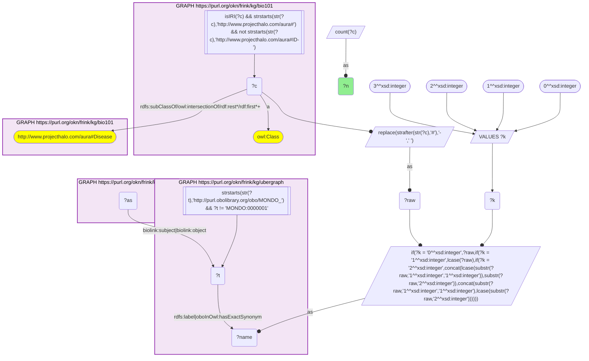
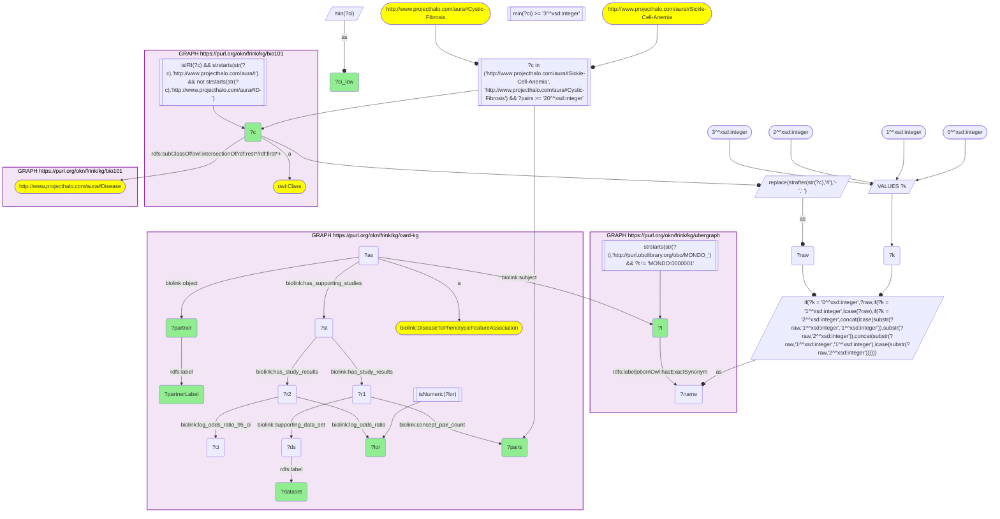

# D53-Q2: EHR phenotypes most associated with two textbook genetic disorders

- **Date:** 2026-11-03
- **Model:** claude-opus-5-5
- **SPARQL endpoint:** https://apps.okn.us/federation/sparql
- **Generated by:** mcp-okn v0.3.0 (build ca8a360)
- **Contents:** 2 queries · 2 query diagrams

## Knowledge graphs used

- `bio101` — <https://purl.org/okn/frink/kg/bio101>
- `ubergraph` — <https://purl.org/okn/frink/kg/ubergraph>
- `oard-kg` — <https://purl.org/okn/frink/kg/oard-kg>

## Conversation

👤 **User**

Crosswalk: `bio101` × `oard-kg` on **MONDO (bio101 label), bridged through `ubergraph`** (crosswalk `KB15-mondo-label-bio101-oard`, verified_count 25). KB Bio 101 is an OWL ontology of an introductory biology textbook: every concept is an `owl:Class` IRI `http://www.projecthalo.com/aura#{Name}` with no `rdfs:label` and no external id, so the concept NAME (local name, hyphens → spaces, four case forms: as-is, all lower-case, first letter lowered, sentence case) is matched as a bound literal against ubergraph `rdfs:label | oboInOwl:hasExactSynonym` on `obo/MONDO_` terms. OARD (`oard-kg`, the Open Annotation for Rare Diseases) records EHR co-occurrence as biolink associations with `biolink:subject` / `biolink:object` set to raw `obo/MONDO_` or `obo/HP_` IRIs (`biolink:DiseaseToPhenotypicFeatureAssociation` has the disease as subject); each association has one study per dataset (`biolink:has_supporting_studies`) whose results (`biolink:has_study_results`) give `biolink:concept_pair_count` with its `biolink:supporting_data_set`, and a `biolink:log_odds_ratio` with its two 95% confidence bounds on `biolink:log_odds_ratio_95_ci`. The bridge is scoped to bio101's `aura:Disease` subtree.

Research question: for two genetic disorders every introductory biology course teaches — KB Bio 101's `Sickle-Cell-Anemia` and `Cystic-Fibrosis` — which phenotypes are most strongly associated with them in OARD's EHR data, and does the answer depend on which dataset (structured OMOP records or clinical notes) the evidence comes from? Rank by the lower bound of the 95% confidence interval of the log-odds ratio (robust to small counts), keeping pairs seen in at least 20 patients and a lower bound of at least 3.

Why the join is required: the two disorders are textbook concepts with no identifiers; only the name → MONDO bridge through ubergraph reaches OARD's association records for them.

---

🧠 **Assistant**

**Bridge established (Query 1).** The crosswalk skeleton, run verbatim, returns **25** bio101 diseases that reach an OARD association through the name → MONDO bridge, matching the catalogued `verified_count`. Both target disorders are among them: `Sickle-Cell-Anemia` → MONDO_0011382 (sickle cell disease) and `Cystic-Fibrosis` → MONDO_0009061.

**Strongest associations (Query 2).** Query 2 keeps disease→phenotype associations seen in at least 20 patients, with the lower 95% bound of the log-odds ratio at least 3. That leaves **67** association–dataset rows:

| | CUIMC structured OMOP | CUIMC clinical notes | CHOP clinical notes |
|---|---|---|---|
| Cystic-Fibrosis | 6 | 27 | 0 |
| Sickle-Cell-Anemia | 2 | 32 | 0 |

*Cystic fibrosis, structured OMOP:* all six are respiratory.

| Phenotype | Patients | log-odds | lower 95% |
|---|---|---|---|
| Abnormal sputum | 158 | 4.11 | 3.94 |
| Abnormality on pulmonary function testing | 216 | 3.94 | 3.80 |
| MRSA infection | 172 | 3.61 | 3.45 |
| Hemoptysis | 303 | 3.34 | 3.22 |
| Pneumomediastinum | 41 | 3.51 | 3.20 |
| Hemothorax | 26 | 3.50 | 3.11 |

*Cystic fibrosis, CUIMC clinical notes*, top of 27:

| Phenotype | Patients | log-odds | lower 95% |
|---|---|---|---|
| Spinal muscular atrophy | 5,608 | 5.95 | 5.88 |
| Abnormal maternal serum screening | 140 | 5.70 | 5.23 |
| Meconium ileus | 176 | 5.29 | 4.94 |
| Premature ovarian insufficiency | 5,102 | 4.83 | 4.78 |
| Neural tube defect | 1,030 | 4.89 | 4.76 |
| Intellectual disability | 8,856 | 4.04 | 4.01 |

Further down the notes list are pancreatic fibrosis (3.70) and abnormal sputum (3.53), then a long run of obstetric terms: shoulder dystocia, chronic villitis, cervical insufficiency, vasa previa, preeclampsia, intrauterine growth retardation and echogenic fetal bowel.

*Sickle cell disease, structured OMOP:* HbS hemoglobin (146 patients, lower bound 3.59) and post-transfusion thrombocytopenia (139, 3.47).

*Sickle cell disease, CUIMC clinical notes*, top of 32:

| Phenotype | Patients | log-odds | lower 95% |
|---|---|---|---|
| Sickled erythrocytes | 67 | 8.83 | 7.68 |
| Persistence of hemoglobin F | 21 | 6.97 | 6.06 |
| Pappenheimer bodies | 36 | 6.47 | 5.89 |
| Howell-Jolly bodies | 223 | 5.98 | 5.78 |
| Abnormality of the lymphatic system | 58 | 4.89 | 4.58 |
| Elliptocytosis | 140 | 4.53 | 4.34 |
| HbC hemoglobin | 234 | 4.46 | 4.31 |

Further down the notes list are reticulocytosis, poikilocytosis, hypersplenism, asplenia, conjunctival icterus, chronic hemolytic anemia, avascular necrosis and priapism. Neural tube defect (3.78) and intellectual disability (3.17) appear here too.

**Answer.** For sickle cell disease, OARD's strongest associations read like the textbook chapter. The top hit is the sickled red cell itself (lower bound 7.68), followed by fetal-hemoglobin persistence, HbS and HbC hemoglobin, and the blood-smear signs of a lost spleen (Howell-Jolly and Pappenheimer bodies, asplenia). Below those come hemolysis (reticulocytosis, icterus, chronic hemolytic anemia) and the vaso-occlusive complications (avascular necrosis, priapism).

For cystic fibrosis, **the answer depends on the dataset.** Structured OMOP records give a purely respiratory profile: abnormal sputum, abnormal lung function, MRSA infection, hemoptysis. Clinical notes are led by spinal muscular atrophy, abnormal maternal serum screening, neural tube defects, premature ovarian insufficiency and intellectual disability, followed by many pregnancy complications. Of the top six notes associations, only meconium ileus is a hallmark of cystic fibrosis itself. This pattern is consistent with cystic fibrosis being named in prenatal and carrier-screening notes, alongside the other conditions such panels and counselling notes cover, rather than with these being features of the disease. The same screening co-mentions (neural tube defect, intellectual disability) surface for sickle cell in the notes.

Neither disorder has an association from the CHOP clinical notes that passes the filter. A textbook-to-EHR comparison should therefore read structured and notes-derived associations separately.

Caveats: OARD associations are co-occurrence statistics, not causal or diagnostic claims. The ranking uses the lower 95% bound with a 20-patient floor and a bound of at least 3. Associations whose log-odds ratio is stored as the string `INF` are excluded by the numeric filter.

## SPARQL queries executed

#### Query 1

_2026-11-04T00:23:18+00:00 · `bio101`, `ubergraph`, `oard-kg`_

```sparql
SELECT (COUNT(DISTINCT ?c) AS ?n) WHERE {
  { SELECT DISTINCT ?c ?t WHERE {
  { SELECT DISTINCT ?c ?name WHERE {
      GRAPH <https://purl.org/okn/frink/kg/bio101> { ?c a <http://www.w3.org/2002/07/owl#Class> .
        FILTER(isIRI(?c) && STRSTARTS(STR(?c),'http://www.projecthalo.com/aura#') && !STRSTARTS(STR(?c),'http://www.projecthalo.com/aura#ID-')) }
      GRAPH <https://purl.org/okn/frink/kg/bio101> { ?c (<http://www.w3.org/2000/01/rdf-schema#subClassOf>/(<http://www.w3.org/2002/07/owl#intersectionOf>/<http://www.w3.org/1999/02/22-rdf-syntax-ns#rest>*/<http://www.w3.org/1999/02/22-rdf-syntax-ns#first>)*)+ <http://www.projecthalo.com/aura#Disease> . }
      BIND(REPLACE(STRAFTER(STR(?c),'#'),'-',' ') AS ?raw)
      VALUES ?k { 0 1 2 3 }  # as-is, all lower, first letter lowered, sentence case
      BIND(IF(?k = 0, ?raw, IF(?k = 1, LCASE(?raw), IF(?k = 2, CONCAT(LCASE(SUBSTR(?raw,1,1)),SUBSTR(?raw,2)),
                CONCAT(SUBSTR(?raw,1,1),LCASE(SUBSTR(?raw,2)))))) AS ?name)
  } }
    GRAPH <https://purl.org/okn/frink/kg/ubergraph> { ?t <http://www.w3.org/2000/01/rdf-schema#label>|<http://www.geneontology.org/formats/oboInOwl#hasExactSynonym> ?name .
      FILTER(STRSTARTS(STR(?t),'http://purl.obolibrary.org/obo/MONDO_') && ?t != <http://purl.obolibrary.org/obo/MONDO_0000001>) }
  } }
  GRAPH <https://purl.org/okn/frink/kg/oard-kg> { ?as <https://w3id.org/biolink/vocab/subject>|<https://w3id.org/biolink/vocab/object> ?t . }
}
```



_1 row(s)_

| n |
| --- |
| 25 |

#### Query 2

_2026-11-04T00:23:22+00:00 · `bio101`, `ubergraph`, `oard-kg`_

```sparql
SELECT ?c ?t ?dataset ?partner ?partnerLabel ?pairs ?lor (MIN(?ci) AS ?ci_low) WHERE {
  { SELECT DISTINCT ?c ?t WHERE {
  { SELECT DISTINCT ?c ?name WHERE {
      GRAPH <https://purl.org/okn/frink/kg/bio101> { ?c a <http://www.w3.org/2002/07/owl#Class> .
        FILTER(isIRI(?c) && STRSTARTS(STR(?c),'http://www.projecthalo.com/aura#') && !STRSTARTS(STR(?c),'http://www.projecthalo.com/aura#ID-')) }
      GRAPH <https://purl.org/okn/frink/kg/bio101> { ?c (<http://www.w3.org/2000/01/rdf-schema#subClassOf>/(<http://www.w3.org/2002/07/owl#intersectionOf>/<http://www.w3.org/1999/02/22-rdf-syntax-ns#rest>*/<http://www.w3.org/1999/02/22-rdf-syntax-ns#first>)*)+ <http://www.projecthalo.com/aura#Disease> . }
      BIND(REPLACE(STRAFTER(STR(?c),'#'),'-',' ') AS ?raw)
      VALUES ?k { 0 1 2 3 }  # as-is, all lower, first letter lowered, sentence case
      BIND(IF(?k = 0, ?raw, IF(?k = 1, LCASE(?raw), IF(?k = 2, CONCAT(LCASE(SUBSTR(?raw,1,1)),SUBSTR(?raw,2)),
                CONCAT(SUBSTR(?raw,1,1),LCASE(SUBSTR(?raw,2)))))) AS ?name)
  } }
    GRAPH <https://purl.org/okn/frink/kg/ubergraph> { ?t <http://www.w3.org/2000/01/rdf-schema#label>|<http://www.geneontology.org/formats/oboInOwl#hasExactSynonym> ?name .
      FILTER(STRSTARTS(STR(?t),'http://purl.obolibrary.org/obo/MONDO_') && ?t != <http://purl.obolibrary.org/obo/MONDO_0000001>) }
  } }
  FILTER(?c IN (<http://www.projecthalo.com/aura#Sickle-Cell-Anemia>, <http://www.projecthalo.com/aura#Cystic-Fibrosis>))
  GRAPH <https://purl.org/okn/frink/kg/oard-kg> { ?as a <https://w3id.org/biolink/vocab/DiseaseToPhenotypicFeatureAssociation> ; <https://w3id.org/biolink/vocab/subject> ?t ; <https://w3id.org/biolink/vocab/object> ?partner ; <https://w3id.org/biolink/vocab/has_supporting_studies> ?st .
    ?partner <http://www.w3.org/2000/01/rdf-schema#label> ?partnerLabel .
    ?st <https://w3id.org/biolink/vocab/has_study_results> ?r1 . ?r1 <https://w3id.org/biolink/vocab/concept_pair_count> ?pairs ; <https://w3id.org/biolink/vocab/supporting_data_set> ?ds . ?ds <http://www.w3.org/2000/01/rdf-schema#label> ?dataset .
    ?st <https://w3id.org/biolink/vocab/has_study_results> ?r2 . ?r2 <https://w3id.org/biolink/vocab/log_odds_ratio> ?lor ; <https://w3id.org/biolink/vocab/log_odds_ratio_95_ci> ?ci .
    FILTER(isNumeric(?lor)) }
  FILTER(?pairs >= 20)
} GROUP BY ?c ?t ?dataset ?partner ?partnerLabel ?pairs ?lor HAVING(MIN(?ci) >= 3) ORDER BY ?c ?dataset DESC(?ci_low)
```



_67 row(s) — showing first 5_

| c | t | dataset | partner | partnerLabel | pairs | lor | ci_low |
| --- | --- | --- | --- | --- | --- | --- | --- |
| http://www.projecthalo.com/aura#Cystic-Fibrosis | http://purl.obolibrary.org/obo/MONDO_0009061 | OARD Dataset 1: CUIMC structured OMOP | http://purl.obolibrary.org/obo/HP_0032016 | Abnormal sputum | 158 | 4.10586 | 3.94023 |
| http://www.projecthalo.com/aura#Cystic-Fibrosis | http://purl.obolibrary.org/obo/MONDO_0009061 | OARD Dataset 1: CUIMC structured OMOP | http://purl.obolibrary.org/obo/HP_0030878 | Abnormality on pulmonary function testing | 216 | 3.94281 | 3.79973 |
| http://www.projecthalo.com/aura#Cystic-Fibrosis | http://purl.obolibrary.org/obo/MONDO_0009061 | OARD Dataset 1: CUIMC structured OMOP | http://purl.obolibrary.org/obo/HP_0032326 | Methicillin-resistant Staphylococcus aureus infection | 172 | 3.61203 | 3.45417 |
| http://www.projecthalo.com/aura#Cystic-Fibrosis | http://purl.obolibrary.org/obo/MONDO_0009061 | OARD Dataset 1: CUIMC structured OMOP | http://purl.obolibrary.org/obo/HP_0002105 | Hemoptysis | 303 | 3.33953 | 3.21712 |
| http://www.projecthalo.com/aura#Cystic-Fibrosis | http://purl.obolibrary.org/obo/MONDO_0009061 | OARD Dataset 1: CUIMC structured OMOP | http://purl.obolibrary.org/obo/HP_0025421 | Pneumomediastinum | 41 | 3.50875 | 3.1953 |
