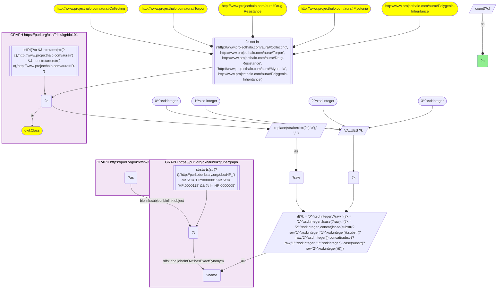

# D54-Q1: KB Bio 101's textbook conditions as HP phenotypes in OARD

- **Date:** 2026-11-03
- **Model:** claude-opus-5-5
- **SPARQL endpoint:** https://apps.okn.us/federation/sparql
- **Generated by:** mcp-okn v0.3.0 (build ca8a360)
- **Contents:** 3 queries · 3 query diagrams

## Knowledge graphs used

- `bio101` — <https://purl.org/okn/frink/kg/bio101>
- `ubergraph` — <https://purl.org/okn/frink/kg/ubergraph>
- `oard-kg` — <https://purl.org/okn/frink/kg/oard-kg>

## Conversation

👤 **User**

Crosswalk: `bio101` × `oard-kg` on **HP (bio101 label), bridged through `ubergraph`** (crosswalk `KB16-hp-label-bio101-oard`, verified_count 33). KB Bio 101 is an OWL ontology of an introductory biology textbook: every concept is an `owl:Class` IRI `http://www.projecthalo.com/aura#{Name}` with no `rdfs:label` and no external id, so the concept NAME (local name, hyphens → spaces, four case forms: as-is, all lower-case, first letter lowered, sentence case) is matched as a bound literal against ubergraph `rdfs:label | oboInOwl:hasExactSynonym` on `obo/HP_` terms. OARD (`oard-kg`, the Open Annotation for Rare Diseases) records EHR co-occurrence as biolink associations with `biolink:subject` / `biolink:object` set to raw `obo/MONDO_` or `obo/HP_` IRIs (`biolink:DiseaseToPhenotypicFeatureAssociation` has the disease as subject); each association has one study per dataset (`biolink:has_supporting_studies`) whose results (`biolink:has_study_results`) give `biolink:concept_pair_count` with its `biolink:supporting_data_set`, and a `biolink:log_odds_ratio` with its two 95% confidence bounds on `biolink:log_odds_ratio_95_ci`. The HP roots are excluded, and five homonyms are excluded by name (`Collecting`, `Torpor`, `Drug-Resistance`, `Myotonia`, `Polygenic-Inheritance`).

Research question: which concepts KB Bio 101 teaches match an HP phenotype term, and how many OARD co-occurrence associations involve each — in which role, how many with a disease, and with how many distinct partner concepts? Rank them, and say which concepts also reach OARD as a MONDO disease through the sibling bridge KB15.

Why the join is required: bio101 knows which signs, symptoms and conditions a curriculum names; OARD knows how often an HP phenotype co-occurs with others in patient records. They share no identifier, so only the name → HP bridge through ubergraph joins them.

---

🧠 **Assistant**

**Bridge established (Query 1).** The crosswalk skeleton, run verbatim, returns **33** bio101 concepts. Each concept's name is an exact HP label or exact synonym in ubergraph, *and* its HP term is the `biolink:subject` or `biolink:object` of at least one OARD association. This matches the catalogued `verified_count`. The HP roots and five named homonyms are excluded. Each concept maps to one HP term (Query 2 returns 33 rows).

**Ranking (Query 2).**

| Rank | bio101 concept | HP (ubergraph label) | Associations | As subject | As object | Disease→phenotype | Partners |
|---|---|---|---|---|---|---|---|
| 1 | Tumor | HP_0002664 (Neoplasm) | 5,670 | 3,310 | 2,360 | 896 | 5,655 |
| 2 | Hypertension | HP_0000822 | 4,596 | 3,636 | 960 | 543 | 4,593 |
| 3 | Pain | HP_0012531 | 4,284 | 1,068 | 3,216 | 708 | 4,269 |
| 4 | Fever | HP_0001945 | 4,188 | 2,544 | 1,644 | 913 | 4,186 |
| 5 | Acid-Reflux | HP_0002020 (Gastroesophageal reflux) | 4,009 | 2,646 | 1,363 | 463 | 4,008 |
| 6 | Stroke | HP_0001297 | 3,722 | 2,786 | 936 | 385 | 3,721 |
| 7 | Rheumatoid-Arthritis | HP_0001370 | 3,476 | 2,377 | 1,099 | 776 | 3,476 |
| 8 | Endometriosis | HP_0030127 | 3,417 | 360 | 3,057 | 306 | 3,414 |
| 9 | Immunodeficiency | HP_0002721 | 3,077 | 1,630 | 1,447 | 343 | 3,077 |
| 10 | Diabetes-Mellitus | HP_0000819 | 2,935 | 2,311 | 624 | 332 | 2,935 |
| 11 | Heart-Murmur | HP_0030148 | 2,395 | 278 | 2,117 | 220 | 2,394 |
| 12 | Autoimmune-Disease | HP_0002960 (Autoimmunity) | 2,359 | 1,184 | 1,175 | 383 | 2,359 |
| 13 | Gastric-Ulcer | HP_0002592 | 2,266 | 1,207 | 1,059 | 242 | 2,265 |
| 14 | Obesity | HP_0001513 | 2,155 | 1,568 | 587 | 216 | 2,155 |
| 15 | Leukemia | HP_0001909 | 2,125 | 1,381 | 744 | 380 | 2,125 |

The rest run from Hyperthyroidism (2,072) and Hypopituitarism (1,932) down to Shivering (493), Color-Blindness → Dyschromatopsia (471) and Cystinuria (113; 6 disease→phenotype). Every one of the 33 concepts appears in both roles.

**Answer.** The textbook concepts that reach OARD as HP phenotypes are mostly common signs and conditions: neoplasm, hypertension, pain, fever, reflux, stroke, rheumatoid arthritis. Most of their associations are phenotype–phenotype co-occurrences. Only 896 of Neoplasm's 5,670 associations, and 913 of Fever's 4,188, link the phenotype to a disease. Fever is the concept with the most disease→phenotype associations (913), just ahead of Neoplasm (896), Rheumatoid arthritis (776) and Pain (708).

The role split is lopsided for some concepts: Endometriosis appears 3,057 times as object and 360 times as subject, Schizophrenia 847 and 15, Hypopituitarism 1,816 and 116, Anaphylactic-Shock 1,287 and 46. So a query for these phenotypes must match both `biolink:subject` and `biolink:object`, as the skeleton does.

**Both bridges (Query 3).** Five textbook concepts reach OARD through **both** bio101 bridges, as an HP phenotype here and as a MONDO disease through KB15, on different OARD nodes:

| bio101 concept | Associations via HP | Associations via MONDO |
|---|---|---|
| Hypopituitarism | 1,932 | 1,994 |
| Prostate-Cancer | 1,417 | 1,415 |
| Mitochondrial-Myopathy | 1,358 | 1,362 |
| Color-Blindness | 471 | 186 |
| Cystinuria | 113 | 113 |

A complete OARD profile of such a concept needs both bridges.

Caveats: this is an exact-name lower bound. It is not scoped to a bio101 subtree, because the HP matches are spread across bio101's diseases, symptoms and conditions. Five homonyms are excluded by name (Collecting, Torpor, Drug-Resistance, Myotonia, Polygenic-Inheritance). Several bio101 diseases match an HP *phenotype* term (Breast-Cancer → Breast carcinoma, Schizophrenia, Leukemia), which OARD treats as a phenotype node distinct from the MONDO disease.

## SPARQL queries executed

#### Query 1

_2026-11-04T00:23:22+00:00 · `bio101`, `ubergraph`, `oard-kg`_

```sparql
SELECT (COUNT(DISTINCT ?c) AS ?n) WHERE {
  { SELECT DISTINCT ?c ?t WHERE {
  { SELECT DISTINCT ?c ?name WHERE {
      GRAPH <https://purl.org/okn/frink/kg/bio101> { ?c a <http://www.w3.org/2002/07/owl#Class> .
        FILTER(isIRI(?c) && STRSTARTS(STR(?c),'http://www.projecthalo.com/aura#') && !STRSTARTS(STR(?c),'http://www.projecthalo.com/aura#ID-')) }
      FILTER(?c NOT IN (<http://www.projecthalo.com/aura#Collecting>, <http://www.projecthalo.com/aura#Torpor>, <http://www.projecthalo.com/aura#Drug-Resistance>, <http://www.projecthalo.com/aura#Myotonia>, <http://www.projecthalo.com/aura#Polygenic-Inheritance>))  # homonyms (spot-checked 2026-11-03)
      BIND(REPLACE(STRAFTER(STR(?c),'#'),'-',' ') AS ?raw)
      VALUES ?k { 0 1 2 3 }  # as-is, all lower, first letter lowered, sentence case
      BIND(IF(?k = 0, ?raw, IF(?k = 1, LCASE(?raw), IF(?k = 2, CONCAT(LCASE(SUBSTR(?raw,1,1)),SUBSTR(?raw,2)),
                CONCAT(SUBSTR(?raw,1,1),LCASE(SUBSTR(?raw,2)))))) AS ?name)
  } }
    GRAPH <https://purl.org/okn/frink/kg/ubergraph> { ?t <http://www.w3.org/2000/01/rdf-schema#label>|<http://www.geneontology.org/formats/oboInOwl#hasExactSynonym> ?name .
      FILTER(STRSTARTS(STR(?t),'http://purl.obolibrary.org/obo/HP_') && ?t != <http://purl.obolibrary.org/obo/HP_0000001> && ?t != <http://purl.obolibrary.org/obo/HP_0000118> && ?t != <http://purl.obolibrary.org/obo/HP_0000005>) }
  } }
  GRAPH <https://purl.org/okn/frink/kg/oard-kg> { ?as <https://w3id.org/biolink/vocab/subject>|<https://w3id.org/biolink/vocab/object> ?t . }
}
```



_1 row(s)_

| n |
| --- |
| 33 |

#### Query 2

_2026-11-04T00:23:24+00:00 · `bio101`, `ubergraph`, `oard-kg`_

```sparql
SELECT ?c ?t ?label (COUNT(DISTINCT ?as) AS ?associations) (COUNT(DISTINCT ?asS) AS ?as_subject) (COUNT(DISTINCT ?asO) AS ?as_object) (COUNT(DISTINCT ?d2p) AS ?disease_phenotype) (COUNT(DISTINCT ?partner) AS ?partners) WHERE {
  { SELECT DISTINCT ?c ?t WHERE {
  { SELECT DISTINCT ?c ?name WHERE {
      GRAPH <https://purl.org/okn/frink/kg/bio101> { ?c a <http://www.w3.org/2002/07/owl#Class> .
        FILTER(isIRI(?c) && STRSTARTS(STR(?c),'http://www.projecthalo.com/aura#') && !STRSTARTS(STR(?c),'http://www.projecthalo.com/aura#ID-')) }
      FILTER(?c NOT IN (<http://www.projecthalo.com/aura#Collecting>, <http://www.projecthalo.com/aura#Torpor>, <http://www.projecthalo.com/aura#Drug-Resistance>, <http://www.projecthalo.com/aura#Myotonia>, <http://www.projecthalo.com/aura#Polygenic-Inheritance>))  # homonyms (spot-checked 2026-11-03)
      BIND(REPLACE(STRAFTER(STR(?c),'#'),'-',' ') AS ?raw)
      VALUES ?k { 0 1 2 3 }  # as-is, all lower, first letter lowered, sentence case
      BIND(IF(?k = 0, ?raw, IF(?k = 1, LCASE(?raw), IF(?k = 2, CONCAT(LCASE(SUBSTR(?raw,1,1)),SUBSTR(?raw,2)),
                CONCAT(SUBSTR(?raw,1,1),LCASE(SUBSTR(?raw,2)))))) AS ?name)
  } }
    GRAPH <https://purl.org/okn/frink/kg/ubergraph> { ?t <http://www.w3.org/2000/01/rdf-schema#label>|<http://www.geneontology.org/formats/oboInOwl#hasExactSynonym> ?name .
      FILTER(STRSTARTS(STR(?t),'http://purl.obolibrary.org/obo/HP_') && ?t != <http://purl.obolibrary.org/obo/HP_0000001> && ?t != <http://purl.obolibrary.org/obo/HP_0000118> && ?t != <http://purl.obolibrary.org/obo/HP_0000005>) }
  } }
  GRAPH <https://purl.org/okn/frink/kg/oard-kg> { ?as <https://w3id.org/biolink/vocab/subject>|<https://w3id.org/biolink/vocab/object> ?t .
    OPTIONAL { ?as <https://w3id.org/biolink/vocab/subject> ?t ; <https://w3id.org/biolink/vocab/object> ?pO BIND(?as AS ?asS) }
    OPTIONAL { ?as <https://w3id.org/biolink/vocab/object> ?t ; <https://w3id.org/biolink/vocab/subject> ?pS BIND(?as AS ?asO) }
    OPTIONAL { ?as a <https://w3id.org/biolink/vocab/DiseaseToPhenotypicFeatureAssociation> BIND(?as AS ?d2p) }
    BIND(COALESCE(?pO, ?pS) AS ?partner) }
  GRAPH <https://purl.org/okn/frink/kg/ubergraph> { ?t <http://www.w3.org/2000/01/rdf-schema#label> ?label }
} GROUP BY ?c ?t ?label ORDER BY DESC(?associations) ?c
```



```mermaid
graph TD
classDef projected fill:lightgreen;
classDef literal fill:orange;
classDef iri fill:yellow;
  q1v23("?as")
  q1v25("?asO")
  q1v24("?asS")
  q1v3("?as_object"):::projected 
  q1v4("?as_subject"):::projected 
  q1v5("?associations"):::projected 
  q1v8("?c"):::projected 
  q1v26("?d2p")
  q1v2("?disease_phenotype"):::projected 
  q1v18("?k")
  q1v6("?label"):::projected 
  q1v17("?name")
  q1v21("?pO")
  q1v22("?pS")
  q1v20("?partner")
  q1v1("?partners"):::projected 
  q1v19("?raw")
  q1v7("?t"):::projected 
  q1c1(["http://www.projecthalo.com/aura#Collecting"]):::iri 
  q1c3(["http://www.projecthalo.com/aura#Drug-Resistance"]):::iri 
  q1c4(["http://www.projecthalo.com/aura#Myotonia"]):::iri 
  q1c5(["http://www.projecthalo.com/aura#Polygenic-Inheritance"]):::iri 
  q1c2(["http://www.projecthalo.com/aura#Torpor"]):::iri 
  q1f0[["?c not in ('http://www.projecthalo.com/aura#Collecting', 'http://www.projecthalo.com/aura#Torpor', 'http://www.projecthalo.com/aura#Drug-Resistance', 'http://www.projecthalo.com/aura#Myotonia', 'http://www.projecthalo.com/aura#Polygenic-Inheritance')"]]
  q1c1 --o q1f0
  q1c2 --o q1f0
  q1c3 --o q1f0
  q1c4 --o q1f0
  q1c5 --o q1f0
  q1f0 --> q1v8
  subgraph q1graph0["GRAPH https://purl.org/okn/frink/kg/bio101"]
    style q1graph0 fill:#f3e5f5,stroke:#8e24aa,stroke-width:2px,color:#000;
    q1graph0c2(["owl:Class"]):::iri 
    q1graph0f1[["isIRI(?c) && strstarts(str(?c),'http://www.projecthalo.com/aura#') && not strstarts(str(?c),'http://www.projecthalo.com/aura#ID-')"]]
    q1graph0f1 --> q1v8
    q1v8 --"a"--> q1graph0c2
  end
  q1bind0[/"replace(strafter(str(?c),'#'),'-',' ')"/]
  q1v8 --o q1bind0
  q1bind0 --as--o q1v19
  q1bind1[/"VALUES ?k"/]
  q1bind1-->q1v18
  q1bind10(["0^^xsd:integer"])
  q1bind10 --> q1bind1
  q1bind11(["1^^xsd:integer"])
  q1bind11 --> q1bind1
  q1bind12(["2^^xsd:integer"])
  q1bind12 --> q1bind1
  q1bind13(["3^^xsd:integer"])
  q1bind13 --> q1bind1
  q1bind2[/"if(?k = '0^^xsd:integer',?raw,if(?k = '1^^xsd:integer',lcase(?raw),if(?k = '2^^xsd:integer',concat(lcase(substr(?raw,'1^^xsd:integer','1^^xsd:integer')),substr(?raw,'2^^xsd:integer')),concat(substr(?raw,'1^^xsd:integer','1^^xsd:integer'),lcase(substr(?raw,'2^^xsd:integer'))))))"/]
  q1v18 --o q1bind2
  q1v19 --o q1bind2
  q1bind2 --as--o q1v17
  subgraph q1graph1["GRAPH https://purl.org/okn/frink/kg/ubergraph"]
    style q1graph1 fill:#f3e5f5,stroke:#8e24aa,stroke-width:2px,color:#000;
    q1graph1f2[["strstarts(str(?t),'http://purl.obolibrary.org/obo/HP_') && ?t != 'HP:0000001' && ?t != 'HP:0000118' && ?t != 'HP:0000005'"]]
    q1graph1f2 --> q1v7
    q1v7 --"rdfs:label|oboInOwl:hasExactSynonym"--> q1v17
  end
  subgraph q1graph2["GRAPH https://purl.org/okn/frink/kg/oard-kg"]
    style q1graph2 fill:#f3e5f5,stroke:#8e24aa,stroke-width:2px,color:#000;
    q1graph2c4(["biolink:DiseaseToPhenotypicFeatureAssociation"]):::iri 
    q1v23 --"biolink:subject|biolink:object"--> q1v7
    subgraph q1optionalgraph20["(optional)"]
    style q1optionalgraph20 fill:#bbf,stroke-dasharray: 5 5,color:#000;
      q1v23 -."biolink:object".-> q1v21
      q1v23 --"biolink:subject"--> q1v7
      q1graph2bind3[/"?as"/]
      q1v23 --o q1graph2bind3
      q1graph2bind3 --as--o q1v24
    end
    subgraph q1optionalgraph21["(optional)"]
    style q1optionalgraph21 fill:#bbf,stroke-dasharray: 5 5,color:#000;
      q1v23 -."biolink:object".-> q1v7
      q1v23 --"biolink:subject"--> q1v22
      q1graph2bind4[/"?as"/]
      q1v23 --o q1graph2bind4
      q1graph2bind4 --as--o q1v25
    end
    subgraph q1optionalgraph22["(optional)"]
    style q1optionalgraph22 fill:#bbf,stroke-dasharray: 5 5,color:#000;
      q1v23 -."a".-> q1graph2c4
      q1graph2bind5[/"?as"/]
      q1v23 --o q1graph2bind5
      q1graph2bind5 --as--o q1v26
    end
    q1graph2bind6[/"coalesce(?pO,?pS)"/]
    q1v21 --o q1graph2bind6
    q1v22 --o q1graph2bind6
    q1graph2bind6 --as--o q1v20
  end
  subgraph q1graph3["GRAPH https://purl.org/okn/frink/kg/ubergraph"]
    style q1graph3 fill:#f3e5f5,stroke:#8e24aa,stroke-width:2px,color:#000;
    q1v7 --"rdfs:label"--> q1v6
  end
  q1bind7[/"count(?as)"/]
  q1bind7 --as--o q1v5
  q1bind8[/"count(?asS)"/]
  q1bind8 --as--o q1v4
  q1bind9[/"count(?asO)"/]
  q1bind9 --as--o q1v3
  q1bind10[/"count(?d2p)"/]
  q1bind10 --as--o q1v2
  q1bind11[/"count(?partner)"/]
  q1bind11 --as--o q1v1
```

_33 row(s) — showing first 3_

| c | t | label | associations | as_subject | as_object | disease_phenotype | partners |
| --- | --- | --- | --- | --- | --- | --- | --- |
| http://www.projecthalo.com/aura#Tumor | http://purl.obolibrary.org/obo/HP_0002664 | Neoplasm | 5670 | 3310 | 2360 | 896 | 5655 |
| http://www.projecthalo.com/aura#Hypertension | http://purl.obolibrary.org/obo/HP_0000822 | Hypertension | 4596 | 3636 | 960 | 543 | 4593 |
| http://www.projecthalo.com/aura#Pain | http://purl.obolibrary.org/obo/HP_0012531 | Pain | 4284 | 1068 | 3216 | 708 | 4269 |

#### Query 3

_2026-11-04T00:23:25+00:00 · `bio101`, `ubergraph`, `oard-kg`_

```sparql
SELECT ?c ?hp_associations ?mondo_associations WHERE {
  { SELECT ?c (COUNT(DISTINCT ?as) AS ?hp_associations) WHERE {
  { SELECT DISTINCT ?c ?t WHERE {
  { SELECT DISTINCT ?c ?name WHERE {
      GRAPH <https://purl.org/okn/frink/kg/bio101> { ?c a <http://www.w3.org/2002/07/owl#Class> .
        FILTER(isIRI(?c) && STRSTARTS(STR(?c),'http://www.projecthalo.com/aura#') && !STRSTARTS(STR(?c),'http://www.projecthalo.com/aura#ID-')) }
      FILTER(?c NOT IN (<http://www.projecthalo.com/aura#Collecting>, <http://www.projecthalo.com/aura#Torpor>, <http://www.projecthalo.com/aura#Drug-Resistance>, <http://www.projecthalo.com/aura#Myotonia>, <http://www.projecthalo.com/aura#Polygenic-Inheritance>))  # homonyms (spot-checked 2026-11-03)
      BIND(REPLACE(STRAFTER(STR(?c),'#'),'-',' ') AS ?raw)
      VALUES ?k { 0 1 2 3 }  # as-is, all lower, first letter lowered, sentence case
      BIND(IF(?k = 0, ?raw, IF(?k = 1, LCASE(?raw), IF(?k = 2, CONCAT(LCASE(SUBSTR(?raw,1,1)),SUBSTR(?raw,2)),
                CONCAT(SUBSTR(?raw,1,1),LCASE(SUBSTR(?raw,2)))))) AS ?name)
  } }
    GRAPH <https://purl.org/okn/frink/kg/ubergraph> { ?t <http://www.w3.org/2000/01/rdf-schema#label>|<http://www.geneontology.org/formats/oboInOwl#hasExactSynonym> ?name .
      FILTER(STRSTARTS(STR(?t),'http://purl.obolibrary.org/obo/HP_') && ?t != <http://purl.obolibrary.org/obo/HP_0000001> && ?t != <http://purl.obolibrary.org/obo/HP_0000118> && ?t != <http://purl.obolibrary.org/obo/HP_0000005>) }
  } }
    GRAPH <https://purl.org/okn/frink/kg/oard-kg> { ?as <https://w3id.org/biolink/vocab/subject>|<https://w3id.org/biolink/vocab/object> ?t . }
  } GROUP BY ?c }
  { SELECT ?c (COUNT(DISTINCT ?as) AS ?mondo_associations) WHERE {
  { SELECT DISTINCT ?c ?t WHERE {
  { SELECT DISTINCT ?c ?name WHERE {
      GRAPH <https://purl.org/okn/frink/kg/bio101> { ?c a <http://www.w3.org/2002/07/owl#Class> .
        FILTER(isIRI(?c) && STRSTARTS(STR(?c),'http://www.projecthalo.com/aura#') && !STRSTARTS(STR(?c),'http://www.projecthalo.com/aura#ID-')) }
      GRAPH <https://purl.org/okn/frink/kg/bio101> { ?c (<http://www.w3.org/2000/01/rdf-schema#subClassOf>/(<http://www.w3.org/2002/07/owl#intersectionOf>/<http://www.w3.org/1999/02/22-rdf-syntax-ns#rest>*/<http://www.w3.org/1999/02/22-rdf-syntax-ns#first>)*)+ <http://www.projecthalo.com/aura#Disease> . }
      BIND(REPLACE(STRAFTER(STR(?c),'#'),'-',' ') AS ?raw)
      VALUES ?k { 0 1 2 3 }  # as-is, all lower, first letter lowered, sentence case
      BIND(IF(?k = 0, ?raw, IF(?k = 1, LCASE(?raw), IF(?k = 2, CONCAT(LCASE(SUBSTR(?raw,1,1)),SUBSTR(?raw,2)),
                CONCAT(SUBSTR(?raw,1,1),LCASE(SUBSTR(?raw,2)))))) AS ?name)
  } }
    GRAPH <https://purl.org/okn/frink/kg/ubergraph> { ?t <http://www.w3.org/2000/01/rdf-schema#label>|<http://www.geneontology.org/formats/oboInOwl#hasExactSynonym> ?name .
      FILTER(STRSTARTS(STR(?t),'http://purl.obolibrary.org/obo/MONDO_') && ?t != <http://purl.obolibrary.org/obo/MONDO_0000001>) }
  } }
    GRAPH <https://purl.org/okn/frink/kg/oard-kg> { ?as <https://w3id.org/biolink/vocab/subject>|<https://w3id.org/biolink/vocab/object> ?t . }
  } GROUP BY ?c }
} ORDER BY DESC(?hp_associations)
```



```mermaid
graph TD
classDef projected fill:lightgreen;
classDef literal fill:orange;
classDef iri fill:yellow;
  q2v9("?as")
  q2v2("?c"):::projected 
  q2v1("?hp_associations"):::projected 
  q2v6("?k")
  q2v10("?mondo_associations"):::projected 
  q2v5("?name")
  q2v7("?raw")
  q2v8("?t")
  q2c1(["http://www.projecthalo.com/aura#Collecting"]):::iri 
  q2c3(["http://www.projecthalo.com/aura#Drug-Resistance"]):::iri 
  q2c4(["http://www.projecthalo.com/aura#Myotonia"]):::iri 
  q2c5(["http://www.projecthalo.com/aura#Polygenic-Inheritance"]):::iri 
  q2c2(["http://www.projecthalo.com/aura#Torpor"]):::iri 
  q2f0[["?c not in ('http://www.projecthalo.com/aura#Collecting', 'http://www.projecthalo.com/aura#Torpor', 'http://www.projecthalo.com/aura#Drug-Resistance', 'http://www.projecthalo.com/aura#Myotonia', 'http://www.projecthalo.com/aura#Polygenic-Inheritance')"]]
  q2c1 --o q2f0
  q2c2 --o q2f0
  q2c3 --o q2f0
  q2c4 --o q2f0
  q2c5 --o q2f0
  q2f0 --> q2v2
  subgraph q2graph0["GRAPH https://purl.org/okn/frink/kg/bio101"]
    style q2graph0 fill:#f3e5f5,stroke:#8e24aa,stroke-width:2px,color:#000;
    q2graph0c2(["owl:Class"]):::iri 
    q2graph0f1[["isIRI(?c) && strstarts(str(?c),'http://www.projecthalo.com/aura#') && not strstarts(str(?c),'http://www.projecthalo.com/aura#ID-')"]]
    q2graph0f1 --> q2v2
    q2v2 --"a"--> q2graph0c2
  end
  q2bind0[/"replace(strafter(str(?c),'#'),'-',' ')"/]
  q2v2 --o q2bind0
  q2bind0 --as--o q2v7
  q2bind1[/"VALUES ?k"/]
  q2bind1-->q2v6
  q2bind10(["0^^xsd:integer"])
  q2bind10 --> q2bind1
  q2bind11(["1^^xsd:integer"])
  q2bind11 --> q2bind1
  q2bind12(["2^^xsd:integer"])
  q2bind12 --> q2bind1
  q2bind13(["3^^xsd:integer"])
  q2bind13 --> q2bind1
  q2bind2[/"if(?k = '0^^xsd:integer',?raw,if(?k = '1^^xsd:integer',lcase(?raw),if(?k = '2^^xsd:integer',concat(lcase(substr(?raw,'1^^xsd:integer','1^^xsd:integer')),substr(?raw,'2^^xsd:integer')),concat(substr(?raw,'1^^xsd:integer','1^^xsd:integer'),lcase(substr(?raw,'2^^xsd:integer'))))))"/]
  q2v6 --o q2bind2
  q2v7 --o q2bind2
  q2bind2 --as--o q2v5
  subgraph q2graph1["GRAPH https://purl.org/okn/frink/kg/ubergraph"]
    style q2graph1 fill:#f3e5f5,stroke:#8e24aa,stroke-width:2px,color:#000;
    q2graph1f2[["strstarts(str(?t),'http://purl.obolibrary.org/obo/HP_') && ?t != 'HP:0000001' && ?t != 'HP:0000118' && ?t != 'HP:0000005'"]]
    q2graph1f2 --> q2v8
    q2v8 --"rdfs:label|oboInOwl:hasExactSynonym"--> q2v5
  end
  subgraph q2graph2["GRAPH https://purl.org/okn/frink/kg/oard-kg"]
    style q2graph2 fill:#f3e5f5,stroke:#8e24aa,stroke-width:2px,color:#000;
    q2v9 --"biolink:subject|biolink:object"--> q2v8
  end
  q2bind3[/"count(?as)"/]
  q2bind3 --as--o q2v1
  subgraph q2graph3["GRAPH https://purl.org/okn/frink/kg/bio101"]
    style q2graph3 fill:#f3e5f5,stroke:#8e24aa,stroke-width:2px,color:#000;
    q2graph3c2(["owl:Class"]):::iri 
    q2graph3f3[["isIRI(?c) && strstarts(str(?c),'http://www.projecthalo.com/aura#') && not strstarts(str(?c),'http://www.projecthalo.com/aura#ID-')"]]
    q2graph3f3 --> q2v2
    q2v2 --"a"--> q2graph3c2
  end
  subgraph q2graph4["GRAPH https://purl.org/okn/frink/kg/bio101"]
    style q2graph4 fill:#f3e5f5,stroke:#8e24aa,stroke-width:2px,color:#000;
    q2graph4c1(["http://www.projecthalo.com/aura#Disease"]):::iri 
    q2v2 --"rdfs:subClassOf/owl:intersectionOf/rdf:rest*/rdf:first*+"--> q2graph4c1
  end
  q2bind4[/"replace(strafter(str(?c),'#'),'-',' ')"/]
  q2v2 --o q2bind4
  q2bind4 --as--o q2v7
  q2bind5[/"VALUES ?k"/]
  q2bind5-->q2v6
  q2bind50(["0^^xsd:integer"])
  q2bind50 --> q2bind5
  q2bind51(["1^^xsd:integer"])
  q2bind51 --> q2bind5
  q2bind52(["2^^xsd:integer"])
  q2bind52 --> q2bind5
  q2bind53(["3^^xsd:integer"])
  q2bind53 --> q2bind5
  q2bind6[/"if(?k = '0^^xsd:integer',?raw,if(?k = '1^^xsd:integer',lcase(?raw),if(?k = '2^^xsd:integer',concat(lcase(substr(?raw,'1^^xsd:integer','1^^xsd:integer')),substr(?raw,'2^^xsd:integer')),concat(substr(?raw,'1^^xsd:integer','1^^xsd:integer'),lcase(substr(?raw,'2^^xsd:integer'))))))"/]
  q2v6 --o q2bind6
  q2v7 --o q2bind6
  q2bind6 --as--o q2v5
  subgraph q2graph5["GRAPH https://purl.org/okn/frink/kg/ubergraph"]
    style q2graph5 fill:#f3e5f5,stroke:#8e24aa,stroke-width:2px,color:#000;
    q2graph5f4[["strstarts(str(?t),'http://purl.obolibrary.org/obo/MONDO_') && ?t != 'MONDO:0000001'"]]
    q2graph5f4 --> q2v8
    q2v8 --"rdfs:label|oboInOwl:hasExactSynonym"--> q2v5
  end
  subgraph q2graph6["GRAPH https://purl.org/okn/frink/kg/oard-kg"]
    style q2graph6 fill:#f3e5f5,stroke:#8e24aa,stroke-width:2px,color:#000;
    q2v9 --"biolink:subject|biolink:object"--> q2v8
  end
  q2bind7[/"count(?as)"/]
  q2bind7 --as--o q2v10
```

_5 row(s)_

| c | hp_associations | mondo_associations |
| --- | --- | --- |
| http://www.projecthalo.com/aura#Hypopituitarism | 1932 | 1994 |
| http://www.projecthalo.com/aura#Prostate-Cancer | 1417 | 1415 |
| http://www.projecthalo.com/aura#Mitochondrial-Myopathy | 1358 | 1362 |
| http://www.projecthalo.com/aura#Color-Blindness | 471 | 186 |
| http://www.projecthalo.com/aura#Cystinuria | 113 | 113 |
