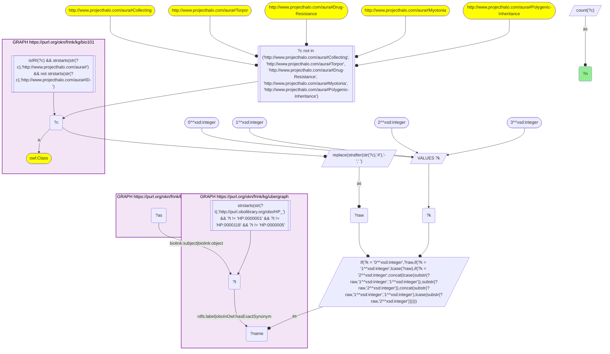

# D54-Q2: Which textbook diseases co-occur with fever in EHR data

- **Date:** 2026-11-03
- **Model:** claude-opus-5-5
- **SPARQL endpoint:** https://apps.okn.us/federation/sparql
- **Generated by:** mcp-okn v0.3.0 (build ca8a360)
- **Contents:** 2 queries · 2 query diagrams

## Knowledge graphs used

- `bio101` — <https://purl.org/okn/frink/kg/bio101>
- `ubergraph` — <https://purl.org/okn/frink/kg/ubergraph>
- `oard-kg` — <https://purl.org/okn/frink/kg/oard-kg>

## Conversation

👤 **User**

Crosswalk: `bio101` × `oard-kg` on **HP (bio101 label), bridged through `ubergraph`** (crosswalk `KB16-hp-label-bio101-oard`, verified_count 33). KB Bio 101 is an OWL ontology of an introductory biology textbook: every concept is an `owl:Class` IRI `http://www.projecthalo.com/aura#{Name}` with no `rdfs:label` and no external id, so the concept NAME (local name, hyphens → spaces, four case forms: as-is, all lower-case, first letter lowered, sentence case) is matched as a bound literal against ubergraph `rdfs:label | oboInOwl:hasExactSynonym` on `obo/HP_` terms. OARD (`oard-kg`, the Open Annotation for Rare Diseases) records EHR co-occurrence as biolink associations with `biolink:subject` / `biolink:object` set to raw `obo/MONDO_` or `obo/HP_` IRIs (`biolink:DiseaseToPhenotypicFeatureAssociation` has the disease as subject); each association has one study per dataset (`biolink:has_supporting_studies`) whose results (`biolink:has_study_results`) give `biolink:concept_pair_count` with its `biolink:supporting_data_set`, and a `biolink:log_odds_ratio` with its two 95% confidence bounds on `biolink:log_odds_ratio_95_ci`. This question also uses the sibling crosswalk `KB15-mondo-label-bio101-oard` (bio101 disease names → MONDO, scoped to bio101's `aura:Disease` subtree, verified_count 25) on the subject side of the same associations.

Research question: KB Bio 101 teaches `Fever` as a concept and teaches many infectious and genetic diseases. Which of the textbook's own diseases are associated with fever in OARD's EHR data, with what log-odds ratio and 95% lower bound, in which dataset — and do the textbook's infectious diseases stand out?

Why the join is required: both the phenotype and the diseases are textbook concepts with no identifiers; only the name → HP and name → MONDO bridges through ubergraph place them on the same OARD association.

---

🧠 **Assistant**

**Bridge established (Query 1).** The crosswalk skeleton, run verbatim, returns **33** bio101 concepts that reach an OARD association through the name → HP bridge, matching the catalogued `verified_count`. Among them, bio101's `Fever` maps to HP_0001945 (*Fever*). Query 2 adds the sibling bridge KB15 (bio101 disease names → MONDO, Disease subtree) on the subject side of the same disease→phenotype associations.

**Textbook diseases associated with fever (Query 2).** **20** association–dataset rows link fever to **16** of the 25 KB15 textbook diseases: 11 rows from CUIMC clinical notes, 5 from CUIMC structured OMOP and 4 from CHOP clinical notes. Ranked by the lower 95% bound of the log-odds ratio:

| Rank | bio101 disease | OARD dataset | Patients | log-odds | lower 95% |
|---|---|---|---|---|---|
| 1 | Encephalitis | CHOP clinical notes | 8,751 | 2.32 | 2.23 |
| 2 | Encephalitis | CUIMC structured OMOP | 209 | 2.11 | 1.93 |
| 3 | Color-Blindness | CUIMC clinical notes | 57 | 2.25 | 1.89 |
| 4 | Cholera | CUIMC clinical notes | 348 | 1.98 | 1.84 |
| 5 | Sickle-Cell-Anemia | CUIMC clinical notes | 1,480 | 1.64 | 1.58 |
| 6 | Lysosomal-Disorder | CUIMC clinical notes | 82 | 1.84 | 1.57 |
| 7 | Lupus | CUIMC clinical notes | 1,844 | 1.56 | 1.50 |
| 8 | Encephalitis | CUIMC clinical notes | 637 | 1.53 | 1.44 |
| 9 | CML | CUIMC clinical notes | 275 | 1.57 | 1.43 |
| 10 | Inborn-Error-Of-Metabolism | CUIMC clinical notes | 206 | 1.57 | 1.40 |
| 11 | Tuberculosis | CUIMC clinical notes | 1,792 | 1.42 | 1.36 |
| 12 | Sickle-Cell-Anemia | CUIMC structured OMOP | 1,722 | 1.34 | 1.28 |
| 13 | Chromosomal-Disorder | CUIMC structured OMOP | 799 | 1.33 | 1.25 |
| 14 | Cystic-Fibrosis | CUIMC structured OMOP | 525 | 1.29 | 1.20 |
| 15 | Malaria | CUIMC structured OMOP | 103 | 1.41 | 1.19 |
| 16 | Prostate-Cancer | CHOP clinical notes | 7,951 | 1.24 | 1.18 |
| 17 | Lyme-Disease | CUIMC clinical notes | 3,977 | 1.09 | 1.05 |
| 18 | CML | CHOP clinical notes | 457 | 1.26 | 1.02 |
| 19 | Mitochondrial-Myopathy | CHOP clinical notes | 756 | 1.21 | 1.02 |
| 20 | Hypopituitarism | CUIMC clinical notes | 238 | 1.16 | 1.02 |

**Answer.** Yes, the textbook's infectious diseases stand out. Encephalitis is the strongest fever association and the only textbook disease associated with fever in all three datasets (lower bounds 2.23, 1.93 and 1.44). Cholera (1.84), tuberculosis (1.36), malaria (1.19) and Lyme disease (1.05) follow, so five of the textbook's infectious diseases are linked to fever. Tetanus and smallpox, the textbook's other bridged infectious diseases, are absent from the list.

Fever is not exclusive to infection. Sickle-cell anemia (1.58 in notes, 1.28 in OMOP), lupus (1.50), CML (1.43) and the inborn errors of metabolism (1.40) rank among the infectious diseases. That fits clinical teaching: fever is an emergency in sickle cell disease, and a common feature of lupus flares and leukemia.

Every textbook-disease association with fever is positive; the weakest lower bound is 1.02. Two rows should be read with care:

- Color-Blindness × fever (lower bound 1.89, only 57 patients) has no obvious clinical basis.
- Prostate cancer in the pediatric CHOP notes (7,951 patients) is more plausibly a family-history or text-mining co-mention than a diagnosis in a child.

Caveats: both bridges are exact-name lower bounds, and the MONDO side is scoped to bio101's Disease subtree. OARD associations are co-occurrence statistics, not causal claims. Rows are per dataset, so a disease can appear more than once.

## SPARQL queries executed

#### Query 1

_2026-11-04T00:23:26+00:00 · `bio101`, `ubergraph`, `oard-kg`_

```sparql
SELECT (COUNT(DISTINCT ?c) AS ?n) WHERE {
  { SELECT DISTINCT ?c ?t WHERE {
  { SELECT DISTINCT ?c ?name WHERE {
      GRAPH <https://purl.org/okn/frink/kg/bio101> { ?c a <http://www.w3.org/2002/07/owl#Class> .
        FILTER(isIRI(?c) && STRSTARTS(STR(?c),'http://www.projecthalo.com/aura#') && !STRSTARTS(STR(?c),'http://www.projecthalo.com/aura#ID-')) }
      FILTER(?c NOT IN (<http://www.projecthalo.com/aura#Collecting>, <http://www.projecthalo.com/aura#Torpor>, <http://www.projecthalo.com/aura#Drug-Resistance>, <http://www.projecthalo.com/aura#Myotonia>, <http://www.projecthalo.com/aura#Polygenic-Inheritance>))  # homonyms (spot-checked 2026-11-03)
      BIND(REPLACE(STRAFTER(STR(?c),'#'),'-',' ') AS ?raw)
      VALUES ?k { 0 1 2 3 }  # as-is, all lower, first letter lowered, sentence case
      BIND(IF(?k = 0, ?raw, IF(?k = 1, LCASE(?raw), IF(?k = 2, CONCAT(LCASE(SUBSTR(?raw,1,1)),SUBSTR(?raw,2)),
                CONCAT(SUBSTR(?raw,1,1),LCASE(SUBSTR(?raw,2)))))) AS ?name)
  } }
    GRAPH <https://purl.org/okn/frink/kg/ubergraph> { ?t <http://www.w3.org/2000/01/rdf-schema#label>|<http://www.geneontology.org/formats/oboInOwl#hasExactSynonym> ?name .
      FILTER(STRSTARTS(STR(?t),'http://purl.obolibrary.org/obo/HP_') && ?t != <http://purl.obolibrary.org/obo/HP_0000001> && ?t != <http://purl.obolibrary.org/obo/HP_0000118> && ?t != <http://purl.obolibrary.org/obo/HP_0000005>) }
  } }
  GRAPH <https://purl.org/okn/frink/kg/oard-kg> { ?as <https://w3id.org/biolink/vocab/subject>|<https://w3id.org/biolink/vocab/object> ?t . }
}
```



_1 row(s)_

| n |
| --- |
| 33 |

#### Query 2

_2026-11-04T00:23:29+00:00 · `bio101`, `ubergraph`, `oard-kg`_

```sparql
SELECT ?cD ?partnerLabel ?dataset ?pairs ?lor (MIN(?ci) AS ?ci_low) WHERE {
  { SELECT DISTINCT ?c ?t WHERE {
  { SELECT DISTINCT ?c ?name WHERE {
      GRAPH <https://purl.org/okn/frink/kg/bio101> { ?c a <http://www.w3.org/2002/07/owl#Class> .
        FILTER(isIRI(?c) && STRSTARTS(STR(?c),'http://www.projecthalo.com/aura#') && !STRSTARTS(STR(?c),'http://www.projecthalo.com/aura#ID-')) }
      FILTER(?c NOT IN (<http://www.projecthalo.com/aura#Collecting>, <http://www.projecthalo.com/aura#Torpor>, <http://www.projecthalo.com/aura#Drug-Resistance>, <http://www.projecthalo.com/aura#Myotonia>, <http://www.projecthalo.com/aura#Polygenic-Inheritance>))  # homonyms (spot-checked 2026-11-03)
      BIND(REPLACE(STRAFTER(STR(?c),'#'),'-',' ') AS ?raw)
      VALUES ?k { 0 1 2 3 }  # as-is, all lower, first letter lowered, sentence case
      BIND(IF(?k = 0, ?raw, IF(?k = 1, LCASE(?raw), IF(?k = 2, CONCAT(LCASE(SUBSTR(?raw,1,1)),SUBSTR(?raw,2)),
                CONCAT(SUBSTR(?raw,1,1),LCASE(SUBSTR(?raw,2)))))) AS ?name)
  } }
    GRAPH <https://purl.org/okn/frink/kg/ubergraph> { ?t <http://www.w3.org/2000/01/rdf-schema#label>|<http://www.geneontology.org/formats/oboInOwl#hasExactSynonym> ?name .
      FILTER(STRSTARTS(STR(?t),'http://purl.obolibrary.org/obo/HP_') && ?t != <http://purl.obolibrary.org/obo/HP_0000001> && ?t != <http://purl.obolibrary.org/obo/HP_0000118> && ?t != <http://purl.obolibrary.org/obo/HP_0000005>) }
  } }
  FILTER(?c = <http://www.projecthalo.com/aura#Fever>)
  { SELECT DISTINCT ?cD ?tD WHERE {
  { SELECT DISTINCT ?cD ?nameD WHERE {
      GRAPH <https://purl.org/okn/frink/kg/bio101> { ?cD a <http://www.w3.org/2002/07/owl#Class> .
        FILTER(isIRI(?cD) && STRSTARTS(STR(?cD),'http://www.projecthalo.com/aura#') && !STRSTARTS(STR(?cD),'http://www.projecthalo.com/aura#ID-')) }
      GRAPH <https://purl.org/okn/frink/kg/bio101> { ?cD (<http://www.w3.org/2000/01/rdf-schema#subClassOf>/(<http://www.w3.org/2002/07/owl#intersectionOf>/<http://www.w3.org/1999/02/22-rdf-syntax-ns#rest>*/<http://www.w3.org/1999/02/22-rdf-syntax-ns#first>)*)+ <http://www.projecthalo.com/aura#Disease> . }
      BIND(REPLACE(STRAFTER(STR(?cD),'#'),'-',' ') AS ?rawD)
      VALUES ?kD { 0 1 2 3 }  # as-is, all lower, first letter lowered, sentence case
      BIND(IF(?kD = 0, ?rawD, IF(?kD = 1, LCASE(?rawD), IF(?kD = 2, CONCAT(LCASE(SUBSTR(?rawD,1,1)),SUBSTR(?rawD,2)),
                CONCAT(SUBSTR(?rawD,1,1),LCASE(SUBSTR(?rawD,2)))))) AS ?nameD)
  } }
    GRAPH <https://purl.org/okn/frink/kg/ubergraph> { ?tD <http://www.w3.org/2000/01/rdf-schema#label>|<http://www.geneontology.org/formats/oboInOwl#hasExactSynonym> ?nameD .
      FILTER(STRSTARTS(STR(?tD),'http://purl.obolibrary.org/obo/MONDO_') && ?tD != <http://purl.obolibrary.org/obo/MONDO_0000001>) }
  } }
  GRAPH <https://purl.org/okn/frink/kg/oard-kg> { ?as a <https://w3id.org/biolink/vocab/DiseaseToPhenotypicFeatureAssociation> ; <https://w3id.org/biolink/vocab/object> ?t ; <https://w3id.org/biolink/vocab/subject> ?tD ; <https://w3id.org/biolink/vocab/has_supporting_studies> ?st .
    ?tD <http://www.w3.org/2000/01/rdf-schema#label> ?partnerLabel .
    ?st <https://w3id.org/biolink/vocab/has_study_results> ?r1 . ?r1 <https://w3id.org/biolink/vocab/concept_pair_count> ?pairs ; <https://w3id.org/biolink/vocab/supporting_data_set> ?ds . ?ds <http://www.w3.org/2000/01/rdf-schema#label> ?dataset .
    ?st <https://w3id.org/biolink/vocab/has_study_results> ?r2 . ?r2 <https://w3id.org/biolink/vocab/log_odds_ratio> ?lor ; <https://w3id.org/biolink/vocab/log_odds_ratio_95_ci> ?ci .
    FILTER(isNumeric(?lor)) }
} GROUP BY ?cD ?partnerLabel ?dataset ?pairs ?lor ORDER BY DESC(?ci_low)
```



```mermaid
graph TD
classDef projected fill:lightgreen;
classDef literal fill:orange;
classDef iri fill:yellow;
  q1v22("?as")
  q1v13("?c")
  q1v6("?cD"):::projected 
  q1v27("?ci")
  q1v1("?ci_low"):::projected 
  q1v4("?dataset"):::projected 
  q1v26("?ds")
  q1v15("?k")
  q1v19("?kD")
  q1v2("?lor"):::projected 
  q1v14("?name")
  q1v18("?nameD")
  q1v3("?pairs"):::projected 
  q1v5("?partnerLabel"):::projected 
  q1v24("?r1")
  q1v25("?r2")
  q1v16("?raw")
  q1v20("?rawD")
  q1v23("?st")
  q1v17("?t")
  q1v21("?tD")
  q1c1(["http://www.projecthalo.com/aura#Collecting"]):::iri 
  q1c3(["http://www.projecthalo.com/aura#Drug-Resistance"]):::iri 
  q1c4(["http://www.projecthalo.com/aura#Myotonia"]):::iri 
  q1c5(["http://www.projecthalo.com/aura#Polygenic-Inheritance"]):::iri 
  q1c2(["http://www.projecthalo.com/aura#Torpor"]):::iri 
  q1f0[["?c = 'http://www.projecthalo.com/aura#Fever'"]]
  q1f0 --> q1v13
  q1f1[["?c not in ('http://www.projecthalo.com/aura#Collecting', 'http://www.projecthalo.com/aura#Torpor', 'http://www.projecthalo.com/aura#Drug-Resistance', 'http://www.projecthalo.com/aura#Myotonia', 'http://www.projecthalo.com/aura#Polygenic-Inheritance')"]]
  q1c1 --o q1f1
  q1c2 --o q1f1
  q1c3 --o q1f1
  q1c4 --o q1f1
  q1c5 --o q1f1
  q1f1 --> q1v13
  subgraph q1graph0["GRAPH https://purl.org/okn/frink/kg/bio101"]
    style q1graph0 fill:#f3e5f5,stroke:#8e24aa,stroke-width:2px,color:#000;
    q1graph0c2(["owl:Class"]):::iri 
    q1graph0f2[["isIRI(?c) && strstarts(str(?c),'http://www.projecthalo.com/aura#') && not strstarts(str(?c),'http://www.projecthalo.com/aura#ID-')"]]
    q1graph0f2 --> q1v13
    q1v13 --"a"--> q1graph0c2
  end
  q1bind0[/"replace(strafter(str(?c),'#'),'-',' ')"/]
  q1v13 --o q1bind0
  q1bind0 --as--o q1v16
  q1bind1[/"VALUES ?k"/]
  q1bind1-->q1v15
  q1bind10(["0^^xsd:integer"])
  q1bind10 --> q1bind1
  q1bind11(["1^^xsd:integer"])
  q1bind11 --> q1bind1
  q1bind12(["2^^xsd:integer"])
  q1bind12 --> q1bind1
  q1bind13(["3^^xsd:integer"])
  q1bind13 --> q1bind1
  q1bind2[/"if(?k = '0^^xsd:integer',?raw,if(?k = '1^^xsd:integer',lcase(?raw),if(?k = '2^^xsd:integer',concat(lcase(substr(?raw,'1^^xsd:integer','1^^xsd:integer')),substr(?raw,'2^^xsd:integer')),concat(substr(?raw,'1^^xsd:integer','1^^xsd:integer'),lcase(substr(?raw,'2^^xsd:integer'))))))"/]
  q1v15 --o q1bind2
  q1v16 --o q1bind2
  q1bind2 --as--o q1v14
  subgraph q1graph1["GRAPH https://purl.org/okn/frink/kg/ubergraph"]
    style q1graph1 fill:#f3e5f5,stroke:#8e24aa,stroke-width:2px,color:#000;
    q1graph1f3[["strstarts(str(?t),'http://purl.obolibrary.org/obo/HP_') && ?t != 'HP:0000001' && ?t != 'HP:0000118' && ?t != 'HP:0000005'"]]
    q1graph1f3 --> q1v17
    q1v17 --"rdfs:label|oboInOwl:hasExactSynonym"--> q1v14
  end
  subgraph q1graph2["GRAPH https://purl.org/okn/frink/kg/bio101"]
    style q1graph2 fill:#f3e5f5,stroke:#8e24aa,stroke-width:2px,color:#000;
    q1graph2c2(["owl:Class"]):::iri 
    q1graph2f4[["isIRI(?cD) && strstarts(str(?cD),'http://www.projecthalo.com/aura#') && not strstarts(str(?cD),'http://www.projecthalo.com/aura#ID-')"]]
    q1graph2f4 --> q1v6
    q1v6 --"a"--> q1graph2c2
  end
  subgraph q1graph3["GRAPH https://purl.org/okn/frink/kg/bio101"]
    style q1graph3 fill:#f3e5f5,stroke:#8e24aa,stroke-width:2px,color:#000;
    q1graph3c1(["http://www.projecthalo.com/aura#Disease"]):::iri 
    q1v6 --"rdfs:subClassOf/owl:intersectionOf/rdf:rest*/rdf:first*+"--> q1graph3c1
  end
  q1bind3[/"replace(strafter(str(?cD),'#'),'-',' ')"/]
  q1v6 --o q1bind3
  q1bind3 --as--o q1v20
  q1bind4[/"VALUES ?kD"/]
  q1bind4-->q1v19
  q1bind40(["0^^xsd:integer"])
  q1bind40 --> q1bind4
  q1bind41(["1^^xsd:integer"])
  q1bind41 --> q1bind4
  q1bind42(["2^^xsd:integer"])
  q1bind42 --> q1bind4
  q1bind43(["3^^xsd:integer"])
  q1bind43 --> q1bind4
  q1bind5[/"if(?kD = '0^^xsd:integer',?rawD,if(?kD = '1^^xsd:integer',lcase(?rawD),if(?kD = '2^^xsd:integer',concat(lcase(substr(?rawD,'1^^xsd:integer','1^^xsd:integer')),substr(?rawD,'2^^xsd:integer')),concat(substr(?rawD,'1^^xsd:integer','1^^xsd:integer'),lcase(substr(?rawD,'2^^xsd:integer'))))))"/]
  q1v19 --o q1bind5
  q1v20 --o q1bind5
  q1bind5 --as--o q1v18
  subgraph q1graph4["GRAPH https://purl.org/okn/frink/kg/ubergraph"]
    style q1graph4 fill:#f3e5f5,stroke:#8e24aa,stroke-width:2px,color:#000;
    q1graph4f5[["strstarts(str(?tD),'http://purl.obolibrary.org/obo/MONDO_') && ?tD != 'MONDO:0000001'"]]
    q1graph4f5 --> q1v21
    q1v21 --"rdfs:label|oboInOwl:hasExactSynonym"--> q1v18
  end
  subgraph q1graph5["GRAPH https://purl.org/okn/frink/kg/oard-kg"]
    style q1graph5 fill:#f3e5f5,stroke:#8e24aa,stroke-width:2px,color:#000;
    q1graph5c2(["biolink:DiseaseToPhenotypicFeatureAssociation"]):::iri 
    q1graph5f6[["isNumeric(?lor)"]]
    q1graph5f6 --> q1v2
    q1v22 --"a"--> q1graph5c2
    q1v22 --"biolink:has_supporting_studies"--> q1v23
    q1v22 --"biolink:subject"--> q1v21
    q1v22 --"biolink:object"--> q1v17
    q1v23 --"biolink:has_study_results"--> q1v24
    q1v23 --"biolink:has_study_results"--> q1v25
    q1v21 --"rdfs:label"--> q1v5
    q1v24 --"biolink:supporting_data_set"--> q1v26
    q1v24 --"biolink:concept_pair_count"--> q1v3
    q1v25 --"biolink:log_odds_ratio"--> q1v2
    q1v25 --"biolink:log_odds_ratio_95_ci"--> q1v27
    q1v26 --"rdfs:label"--> q1v4
  end
  q1bind6[/"min(?ci)"/]
  q1bind6 --as--o q1v1
```

_20 row(s) — showing first 5_

| cD | partnerLabel | dataset | pairs | lor | ci_low |
| --- | --- | --- | --- | --- | --- |
| http://www.projecthalo.com/aura#Encephalitis | encephalitis | OARD Dataset 3: CHOP clinical notes | 8751 | 2.32219 | 2.2339 |
| http://www.projecthalo.com/aura#Encephalitis | encephalitis | OARD Dataset 1: CUIMC structured OMOP | 209 | 2.10911 | 1.93184 |
| http://www.projecthalo.com/aura#Color-Blindness | color vision disorder | OARD Dataset 2: CUIMC clinical notes | 57 | 2.24741 | 1.8877 |
| http://www.projecthalo.com/aura#Cholera | cholera | OARD Dataset 2: CUIMC clinical notes | 348 | 1.98123 | 1.84399 |
| http://www.projecthalo.com/aura#Sickle-Cell-Anemia | sickle cell anemia | OARD Dataset 2: CUIMC clinical notes | 1480 | 1.64493 | 1.58227 |
