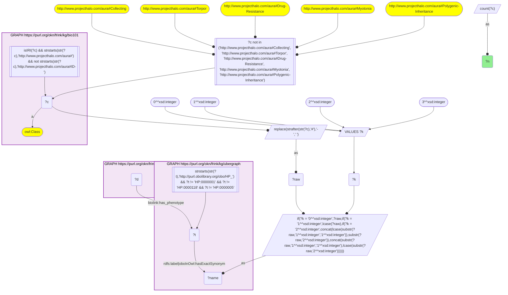
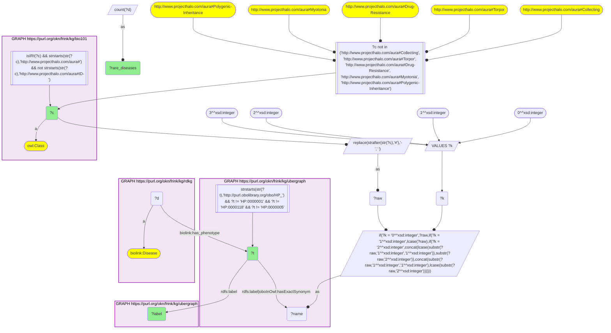

# D55-Q1: KB Bio 101's textbook conditions as phenotypes of RDKG rare diseases

- **Date:** 2026-11-03
- **Model:** claude-opus-5-5
- **SPARQL endpoint:** https://apps.okn.us/federation/sparql
- **Generated by:** mcp-okn v0.3.0 (build 5f97869)
- **Contents:** 2 queries · 2 query diagrams

## Knowledge graphs used

- `bio101` — <https://purl.org/okn/frink/kg/bio101>
- `ubergraph` — <https://purl.org/okn/frink/kg/ubergraph>
- `rdkg` — <https://purl.org/okn/frink/kg/rdkg>

## Conversation

👤 **User**

Crosswalk: `bio101` × `rdkg` on **HP (bio101 label), bridged through `ubergraph`** (crosswalk `KB17-hp-label-bio101-rdkg`, verified_count 33). KB Bio 101 is an OWL ontology of an introductory biology textbook: every concept is an `owl:Class` IRI `http://www.projecthalo.com/aura#{Name}` with no `rdfs:label` and no external id, so the concept NAME (local name, hyphens → spaces, four case forms: as-is, all lower-case, first letter lowered, sentence case) is matched as a bound literal against ubergraph `rdfs:label | oboInOwl:hasExactSynonym` on `obo/HP_` terms. RDKG (`rdkg`) links each rare disease (a `biolink:Disease` node minted as its raw `obo/MONDO_` IRI) to its clinical features with `biolink:has_phenotype`, whose object is a raw `obo/HP_` IRI. The HP roots are excluded, and five homonyms by name (as KB16).

Research question: which concepts KB Bio 101 teaches match an HP phenotype that RDKG uses, and how many rare diseases present each? Rank them.

Why the join is required: bio101 names the signs and conditions a curriculum covers; RDKG records which rare diseases present an HP phenotype. They share no identifier, so only the name → HP bridge through ubergraph joins them.

---

🧠 **Assistant**

**Bridge established (Query 1).** The crosswalk skeleton, run verbatim, returns **33** bio101 concepts. Each concept's name is an exact HP label or exact synonym in ubergraph, *and* its HP term is the object of at least one RDKG `biolink:has_phenotype` edge. This matches the catalogued `verified_count`. Each concept maps to one HP term (Query 2 returns 33 rows).

**Ranking (Query 2).** Rare diseases (`biolink:Disease`) presenting each phenotype:

| Rank | bio101 concept | HP (ubergraph label) | Rare diseases |
|---|---|---|---|
| 1 | Acid-Reflux | HP_0002020 (Gastroesophageal reflux) | 501 |
| 2 | Fever | HP_0001945 | 473 |
| 3 | Hypertension | HP_0000822 | 389 |
| 4 | Obesity | HP_0001513 | 289 |
| 5 | Immunodeficiency | HP_0002721 | 223 |
| 6 | Autoimmune-Disease | HP_0002960 (Autoimmunity) | 198 |
| 7 | Diabetes-Mellitus | HP_0000819 | 188 |
| 8 | Stroke | HP_0001297 | 130 |
| 9 | Pain | HP_0012531 | 109 |
| 10 | Tumor | HP_0002664 (Neoplasm) | 107 |
| 11 | Polydactyly | HP_0010442 | 86 |
| 12 | Heart-Attack | HP_0001658 (Myocardial infarction) | 67 |
| 13 | Goiter | HP_0000853 | 64 |
| 14 | Heart-Murmur | HP_0030148 | 62 |
| 15 | Colon-Cancer | HP_0003003 (Colon cancer) | 57 |

The other 18 concepts run from Breast-Cancer → Breast carcinoma (55) and Schizophrenia (51) down to Arteriosclerosis (8), Gastric-Ulcer (7), and Endometriosis and Shivering (5 each).

**Answer.** The textbook concepts that appear most often as rare-disease features are the most general signs: reflux (501 diseases), fever (473), hypertension (389), obesity (289), immunodeficiency (223), autoimmunity (198) and diabetes (188). Polydactyly (86 diseases) is the one textbook genetics trait that ranks high. It is a feature of many rare syndromes, which fits its role in genetics teaching as a visible Mendelian trait.

Several textbook *diseases* also appear here as RDKG phenotypes, for example breast carcinoma, colon cancer, leukemia and schizophrenia. RDKG uses those HP terms as features of other rare diseases, not as the diseases themselves.

Caveats: this is an exact-name lower bound. The HP roots and five homonyms are excluded (Collecting, Torpor, Drug-Resistance, Myotonia, Polygenic-Inheritance). The counts are of disease nodes, and RDKG's disease list is rare-disease oriented, so common causes of these signs are under-represented.

## SPARQL queries executed

#### Query 1

_2026-11-04T01:00:45+00:00 · `bio101`, `ubergraph`, `rdkg`_

```sparql
SELECT (COUNT(DISTINCT ?c) AS ?n) WHERE {
  { SELECT DISTINCT ?c ?t WHERE {
  { SELECT DISTINCT ?c ?name WHERE {
      GRAPH <https://purl.org/okn/frink/kg/bio101> { ?c a <http://www.w3.org/2002/07/owl#Class> .
        FILTER(isIRI(?c) && STRSTARTS(STR(?c),'http://www.projecthalo.com/aura#') && !STRSTARTS(STR(?c),'http://www.projecthalo.com/aura#ID-')) }
      FILTER(?c NOT IN (<http://www.projecthalo.com/aura#Collecting>, <http://www.projecthalo.com/aura#Torpor>, <http://www.projecthalo.com/aura#Drug-Resistance>, <http://www.projecthalo.com/aura#Myotonia>, <http://www.projecthalo.com/aura#Polygenic-Inheritance>))  # homonyms (spot-checked 2026-11-03)
      BIND(REPLACE(STRAFTER(STR(?c),'#'),'-',' ') AS ?raw)
      VALUES ?k { 0 1 2 3 }  # as-is, all lower, first letter lowered, sentence case
      BIND(IF(?k = 0, ?raw, IF(?k = 1, LCASE(?raw), IF(?k = 2, CONCAT(LCASE(SUBSTR(?raw,1,1)),SUBSTR(?raw,2)),
                CONCAT(SUBSTR(?raw,1,1),LCASE(SUBSTR(?raw,2)))))) AS ?name)
  } }
    GRAPH <https://purl.org/okn/frink/kg/ubergraph> { ?t <http://www.w3.org/2000/01/rdf-schema#label>|<http://www.geneontology.org/formats/oboInOwl#hasExactSynonym> ?name .
      FILTER(STRSTARTS(STR(?t),'http://purl.obolibrary.org/obo/HP_') && ?t != <http://purl.obolibrary.org/obo/HP_0000001> && ?t != <http://purl.obolibrary.org/obo/HP_0000118> && ?t != <http://purl.obolibrary.org/obo/HP_0000005>) }
  } }
  GRAPH <https://purl.org/okn/frink/kg/rdkg> { ?d <https://w3id.org/biolink/vocab/has_phenotype> ?t . }
}
```



_1 row(s)_

| n |
| --- |
| 33 |

#### Query 2

_2026-11-04T01:00:46+00:00 · `bio101`, `ubergraph`, `rdkg`_

```sparql
SELECT ?c ?t ?label (COUNT(DISTINCT ?d) AS ?rare_diseases) WHERE {
  { SELECT DISTINCT ?c ?t WHERE {
  { SELECT DISTINCT ?c ?name WHERE {
      GRAPH <https://purl.org/okn/frink/kg/bio101> { ?c a <http://www.w3.org/2002/07/owl#Class> .
        FILTER(isIRI(?c) && STRSTARTS(STR(?c),'http://www.projecthalo.com/aura#') && !STRSTARTS(STR(?c),'http://www.projecthalo.com/aura#ID-')) }
      FILTER(?c NOT IN (<http://www.projecthalo.com/aura#Collecting>, <http://www.projecthalo.com/aura#Torpor>, <http://www.projecthalo.com/aura#Drug-Resistance>, <http://www.projecthalo.com/aura#Myotonia>, <http://www.projecthalo.com/aura#Polygenic-Inheritance>))  # homonyms (spot-checked 2026-11-03)
      BIND(REPLACE(STRAFTER(STR(?c),'#'),'-',' ') AS ?raw)
      VALUES ?k { 0 1 2 3 }  # as-is, all lower, first letter lowered, sentence case
      BIND(IF(?k = 0, ?raw, IF(?k = 1, LCASE(?raw), IF(?k = 2, CONCAT(LCASE(SUBSTR(?raw,1,1)),SUBSTR(?raw,2)),
                CONCAT(SUBSTR(?raw,1,1),LCASE(SUBSTR(?raw,2)))))) AS ?name)
  } }
    GRAPH <https://purl.org/okn/frink/kg/ubergraph> { ?t <http://www.w3.org/2000/01/rdf-schema#label>|<http://www.geneontology.org/formats/oboInOwl#hasExactSynonym> ?name .
      FILTER(STRSTARTS(STR(?t),'http://purl.obolibrary.org/obo/HP_') && ?t != <http://purl.obolibrary.org/obo/HP_0000001> && ?t != <http://purl.obolibrary.org/obo/HP_0000118> && ?t != <http://purl.obolibrary.org/obo/HP_0000005>) }
  } }
  GRAPH <https://purl.org/okn/frink/kg/rdkg> { ?d <https://w3id.org/biolink/vocab/has_phenotype> ?t ; a <https://w3id.org/biolink/vocab/Disease> . }
  GRAPH <https://purl.org/okn/frink/kg/ubergraph> { ?t <http://www.w3.org/2000/01/rdf-schema#label> ?label }
} GROUP BY ?c ?t ?label ORDER BY DESC(?rare_diseases) ?c
```



_33 row(s) — showing first 5_

| c | t | label | rare_diseases |
| --- | --- | --- | --- |
| http://www.projecthalo.com/aura#Acid-Reflux | http://purl.obolibrary.org/obo/HP_0002020 | Gastroesophageal reflux | 501 |
| http://www.projecthalo.com/aura#Fever | http://purl.obolibrary.org/obo/HP_0001945 | Fever | 473 |
| http://www.projecthalo.com/aura#Hypertension | http://purl.obolibrary.org/obo/HP_0000822 | Hypertension | 389 |
| http://www.projecthalo.com/aura#Obesity | http://purl.obolibrary.org/obo/HP_0001513 | Obesity | 289 |
| http://www.projecthalo.com/aura#Immunodeficiency | http://purl.obolibrary.org/obo/HP_0002721 | Immunodeficiency | 223 |
