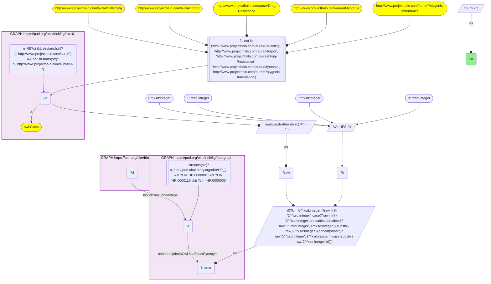

# D55-Q2: Textbook diseases annotated with textbook phenotypes in RDKG

- **Date:** 2026-11-03
- **Model:** claude-opus-5-5
- **SPARQL endpoint:** https://apps.okn.us/federation/sparql
- **Generated by:** mcp-okn v0.3.0 (build 5f97869)
- **Contents:** 2 queries · 2 query diagrams

## Knowledge graphs used

- `bio101` — <https://purl.org/okn/frink/kg/bio101>
- `ubergraph` — <https://purl.org/okn/frink/kg/ubergraph>
- `rdkg` — <https://purl.org/okn/frink/kg/rdkg>

## Conversation

👤 **User**

Crosswalk: `bio101` × `rdkg` on **HP (bio101 label), bridged through `ubergraph`** (crosswalk `KB17-hp-label-bio101-rdkg`, verified_count 33). KB Bio 101 is an OWL ontology of an introductory biology textbook: every concept is an `owl:Class` IRI `http://www.projecthalo.com/aura#{Name}` with no `rdfs:label` and no external id, so the concept NAME (local name, hyphens → spaces, four case forms: as-is, all lower-case, first letter lowered, sentence case) is matched as a bound literal against ubergraph `rdfs:label | oboInOwl:hasExactSynonym` on `obo/HP_` terms. RDKG (`rdkg`) links each rare disease (a `biolink:Disease` node minted as its raw `obo/MONDO_` IRI) to its clinical features with `biolink:has_phenotype`, whose object is a raw `obo/HP_` IRI. This question also uses the sibling crosswalk `KB5-mondo-label-bio101-rdkg` (bio101 disease names → MONDO, scoped to bio101's `aura:Disease` subtree, verified_count 57) on the subject side of the same `biolink:has_phenotype` edges.

Research question: when RDKG says a disease KB Bio 101 teaches has a phenotype KB Bio 101 also teaches, which textbook disease → textbook phenotype pairs occur? Do they read like textbook facts?

Why the join is required: both ends of every pair are textbook concepts with no identifiers; only the two name bridges (→ MONDO and → HP, through ubergraph) can place them on the same RDKG edge.

---

🧠 **Assistant**

**Bridge established (Query 1).** The crosswalk skeleton, run verbatim, returns **33** bio101 concepts that reach an RDKG `biolink:has_phenotype` object through the name → HP bridge, matching the catalogued `verified_count`. Query 2 adds KB5's disease bridge (bio101 Disease subtree → MONDO) on the subject side of the same edges.

**Textbook disease → textbook phenotype pairs (Query 2).** **35 pairs** link 18 textbook diseases to textbook phenotypes:

| bio101 disease | Textbook phenotypes RDKG gives it |
|---|---|
| Turner-Syndrome | Autoimmunity, Myocardial infarction, Hypertension, Obesity |
| Down-Syndrome | Gastroesophageal reflux, Hyperthyroidism, Leukemia, Obesity |
| Alkaptonuria | Atherosclerosis, Myocardial infarction, Hypertension |
| Lupus (systemic lupus erythematosus) | Autoimmunity, Fever, Hypertension |
| Sickle-Cell-Anemia | Hypertension, Pain, Stroke |
| Angelman-Syndrome | Gastroesophageal reflux, Obesity |
| Cholera | Fever, Stroke |
| Cystic-Fibrosis | Gastroesophageal reflux, Immunodeficiency |
| Rheumatoid-Arthritis | Fever, Rheumatoid arthritis |
| Tetanus | Fever, Hypertension |
| CML, Lyme-Disease, Malaria, Tuberculosis | Fever |
| Achondroplasia | Obesity |
| Arteriosclerosis | Atherosclerosis |
| Autoimmune-Disease | Autoimmunity |
| Cri-Du-Chat-Syndrome | Gastroesophageal reflux |

**Answer.** Most pairs read like textbook clinical facts:

- fever for the infectious diseases (cholera, Lyme disease, malaria, tetanus, tuberculosis);
- pain and stroke for sickle cell disease;
- leukemia and hyperthyroidism risk in Down syndrome;
- autoimmunity, hypertension and obesity in Turner syndrome;
- atherosclerosis and myocardial infarction in alkaptonuria.

Three pairs are self-matches, where a textbook disease's MONDO term has its own HP counterpart as a phenotype: Autoimmune-Disease → Autoimmunity, Rheumatoid-Arthritis → Rheumatoid arthritis, and Arteriosclerosis → Atherosclerosis. Fever is the most connected textbook phenotype (8 of the 18 diseases), followed by hypertension (5 diseases), then obesity and gastroesophageal reflux (4 each).

Caveats: both ends are exact-name lower bounds, and the disease side is scoped to bio101's Disease subtree as in KB5. RDKG lists a phenotype if it is recorded for the disease at any frequency, so "has phenotype" does not mean "typical of".

## SPARQL queries executed

#### Query 1

_2026-11-04T01:00:46+00:00 · `bio101`, `ubergraph`, `rdkg`_

```sparql
SELECT (COUNT(DISTINCT ?c) AS ?n) WHERE {
  { SELECT DISTINCT ?c ?t WHERE {
  { SELECT DISTINCT ?c ?name WHERE {
      GRAPH <https://purl.org/okn/frink/kg/bio101> { ?c a <http://www.w3.org/2002/07/owl#Class> .
        FILTER(isIRI(?c) && STRSTARTS(STR(?c),'http://www.projecthalo.com/aura#') && !STRSTARTS(STR(?c),'http://www.projecthalo.com/aura#ID-')) }
      FILTER(?c NOT IN (<http://www.projecthalo.com/aura#Collecting>, <http://www.projecthalo.com/aura#Torpor>, <http://www.projecthalo.com/aura#Drug-Resistance>, <http://www.projecthalo.com/aura#Myotonia>, <http://www.projecthalo.com/aura#Polygenic-Inheritance>))  # homonyms (spot-checked 2026-11-03)
      BIND(REPLACE(STRAFTER(STR(?c),'#'),'-',' ') AS ?raw)
      VALUES ?k { 0 1 2 3 }  # as-is, all lower, first letter lowered, sentence case
      BIND(IF(?k = 0, ?raw, IF(?k = 1, LCASE(?raw), IF(?k = 2, CONCAT(LCASE(SUBSTR(?raw,1,1)),SUBSTR(?raw,2)),
                CONCAT(SUBSTR(?raw,1,1),LCASE(SUBSTR(?raw,2)))))) AS ?name)
  } }
    GRAPH <https://purl.org/okn/frink/kg/ubergraph> { ?t <http://www.w3.org/2000/01/rdf-schema#label>|<http://www.geneontology.org/formats/oboInOwl#hasExactSynonym> ?name .
      FILTER(STRSTARTS(STR(?t),'http://purl.obolibrary.org/obo/HP_') && ?t != <http://purl.obolibrary.org/obo/HP_0000001> && ?t != <http://purl.obolibrary.org/obo/HP_0000118> && ?t != <http://purl.obolibrary.org/obo/HP_0000005>) }
  } }
  GRAPH <https://purl.org/okn/frink/kg/rdkg> { ?d <https://w3id.org/biolink/vocab/has_phenotype> ?t . }
}
```



_1 row(s)_

| n |
| --- |
| 33 |

#### Query 2

_2026-11-04T01:00:47+00:00 · `bio101`, `ubergraph`, `rdkg`_

```sparql
SELECT ?cD ?diseaseLabel ?c ?label WHERE {
  { SELECT DISTINCT ?cD ?tD WHERE {
  { SELECT DISTINCT ?cD ?nameD WHERE {
      GRAPH <https://purl.org/okn/frink/kg/bio101> { ?cD a <http://www.w3.org/2002/07/owl#Class> .
        FILTER(isIRI(?cD) && STRSTARTS(STR(?cD),'http://www.projecthalo.com/aura#') && !STRSTARTS(STR(?cD),'http://www.projecthalo.com/aura#ID-')) }
      GRAPH <https://purl.org/okn/frink/kg/bio101> { ?cD (<http://www.w3.org/2000/01/rdf-schema#subClassOf>/(<http://www.w3.org/2002/07/owl#intersectionOf>/<http://www.w3.org/1999/02/22-rdf-syntax-ns#rest>*/<http://www.w3.org/1999/02/22-rdf-syntax-ns#first>)*)+ <http://www.projecthalo.com/aura#Disease> . }
      BIND(REPLACE(STRAFTER(STR(?cD),'#'),'-',' ') AS ?rawD)
      VALUES ?kD { 0 1 2 3 }  # as-is, all lower, first letter lowered, sentence case
      BIND(IF(?kD = 0, ?rawD, IF(?kD = 1, LCASE(?rawD), IF(?kD = 2, CONCAT(LCASE(SUBSTR(?rawD,1,1)),SUBSTR(?rawD,2)),
                CONCAT(SUBSTR(?rawD,1,1),LCASE(SUBSTR(?rawD,2)))))) AS ?nameD)
  } }
    GRAPH <https://purl.org/okn/frink/kg/ubergraph> { ?tD <http://www.w3.org/2000/01/rdf-schema#label>|<http://www.geneontology.org/formats/oboInOwl#hasExactSynonym> ?nameD .
      FILTER(STRSTARTS(STR(?tD),'http://purl.obolibrary.org/obo/MONDO_') && ?tD != <http://purl.obolibrary.org/obo/MONDO_0000001>) }
  } }
  { SELECT DISTINCT ?c ?t WHERE {
  { SELECT DISTINCT ?c ?name WHERE {
      GRAPH <https://purl.org/okn/frink/kg/bio101> { ?c a <http://www.w3.org/2002/07/owl#Class> .
        FILTER(isIRI(?c) && STRSTARTS(STR(?c),'http://www.projecthalo.com/aura#') && !STRSTARTS(STR(?c),'http://www.projecthalo.com/aura#ID-')) }
      FILTER(?c NOT IN (<http://www.projecthalo.com/aura#Collecting>, <http://www.projecthalo.com/aura#Torpor>, <http://www.projecthalo.com/aura#Drug-Resistance>, <http://www.projecthalo.com/aura#Myotonia>, <http://www.projecthalo.com/aura#Polygenic-Inheritance>))  # homonyms (spot-checked 2026-11-03)
      BIND(REPLACE(STRAFTER(STR(?c),'#'),'-',' ') AS ?raw)
      VALUES ?k { 0 1 2 3 }  # as-is, all lower, first letter lowered, sentence case
      BIND(IF(?k = 0, ?raw, IF(?k = 1, LCASE(?raw), IF(?k = 2, CONCAT(LCASE(SUBSTR(?raw,1,1)),SUBSTR(?raw,2)),
                CONCAT(SUBSTR(?raw,1,1),LCASE(SUBSTR(?raw,2)))))) AS ?name)
  } }
    GRAPH <https://purl.org/okn/frink/kg/ubergraph> { ?t <http://www.w3.org/2000/01/rdf-schema#label>|<http://www.geneontology.org/formats/oboInOwl#hasExactSynonym> ?name .
      FILTER(STRSTARTS(STR(?t),'http://purl.obolibrary.org/obo/HP_') && ?t != <http://purl.obolibrary.org/obo/HP_0000001> && ?t != <http://purl.obolibrary.org/obo/HP_0000118> && ?t != <http://purl.obolibrary.org/obo/HP_0000005>) }
  } }
  GRAPH <https://purl.org/okn/frink/kg/rdkg> { ?tD <https://w3id.org/biolink/vocab/has_phenotype> ?t ; <http://www.w3.org/2000/01/rdf-schema#label> ?diseaseLabel . }
  GRAPH <https://purl.org/okn/frink/kg/ubergraph> { ?t <http://www.w3.org/2000/01/rdf-schema#label> ?label }
} ORDER BY ?cD ?c
```



```mermaid
graph TD
classDef projected fill:lightgreen;
classDef literal fill:orange;
classDef iri fill:yellow;
  q1v6("?c"):::projected 
  q1v4("?cD"):::projected 
  q1v11("?diseaseLabel"):::projected 
  q1v8("?k")
  q1v2("?kD")
  q1v12("?label"):::projected 
  q1v7("?name")
  q1v1("?nameD")
  q1v9("?raw")
  q1v3("?rawD")
  q1v10("?t")
  q1v5("?tD")
  q1c5(["http://www.projecthalo.com/aura#Collecting"]):::iri 
  q1c7(["http://www.projecthalo.com/aura#Drug-Resistance"]):::iri 
  q1c8(["http://www.projecthalo.com/aura#Myotonia"]):::iri 
  q1c9(["http://www.projecthalo.com/aura#Polygenic-Inheritance"]):::iri 
  q1c6(["http://www.projecthalo.com/aura#Torpor"]):::iri 
  subgraph q1graph0["GRAPH https://purl.org/okn/frink/kg/bio101"]
    style q1graph0 fill:#f3e5f5,stroke:#8e24aa,stroke-width:2px,color:#000;
    q1graph0c2(["owl:Class"]):::iri 
    q1graph0f0[["isIRI(?cD) && strstarts(str(?cD),'http://www.projecthalo.com/aura#') && not strstarts(str(?cD),'http://www.projecthalo.com/aura#ID-')"]]
    q1graph0f0 --> q1v4
    q1v4 --"a"--> q1graph0c2
  end
  subgraph q1graph1["GRAPH https://purl.org/okn/frink/kg/bio101"]
    style q1graph1 fill:#f3e5f5,stroke:#8e24aa,stroke-width:2px,color:#000;
    q1graph1c1(["http://www.projecthalo.com/aura#Disease"]):::iri 
    q1v4 --"rdfs:subClassOf/owl:intersectionOf/rdf:rest*/rdf:first*+"--> q1graph1c1
  end
  q1bind0[/"replace(strafter(str(?cD),'#'),'-',' ')"/]
  q1v4 --o q1bind0
  q1bind0 --as--o q1v3
  q1bind1[/"VALUES ?kD"/]
  q1bind1-->q1v2
  q1bind10(["0^^xsd:integer"])
  q1bind10 --> q1bind1
  q1bind11(["1^^xsd:integer"])
  q1bind11 --> q1bind1
  q1bind12(["2^^xsd:integer"])
  q1bind12 --> q1bind1
  q1bind13(["3^^xsd:integer"])
  q1bind13 --> q1bind1
  q1bind2[/"if(?kD = '0^^xsd:integer',?rawD,if(?kD = '1^^xsd:integer',lcase(?rawD),if(?kD = '2^^xsd:integer',concat(lcase(substr(?rawD,'1^^xsd:integer','1^^xsd:integer')),substr(?rawD,'2^^xsd:integer')),concat(substr(?rawD,'1^^xsd:integer','1^^xsd:integer'),lcase(substr(?rawD,'2^^xsd:integer'))))))"/]
  q1v2 --o q1bind2
  q1v3 --o q1bind2
  q1bind2 --as--o q1v1
  subgraph q1graph2["GRAPH https://purl.org/okn/frink/kg/ubergraph"]
    style q1graph2 fill:#f3e5f5,stroke:#8e24aa,stroke-width:2px,color:#000;
    q1graph2f1[["strstarts(str(?tD),'http://purl.obolibrary.org/obo/MONDO_') && ?tD != 'MONDO:0000001'"]]
    q1graph2f1 --> q1v5
    q1v5 --"rdfs:label|oboInOwl:hasExactSynonym"--> q1v1
  end
  q1f2[["?c not in ('http://www.projecthalo.com/aura#Collecting', 'http://www.projecthalo.com/aura#Torpor', 'http://www.projecthalo.com/aura#Drug-Resistance', 'http://www.projecthalo.com/aura#Myotonia', 'http://www.projecthalo.com/aura#Polygenic-Inheritance')"]]
  q1c5 --o q1f2
  q1c6 --o q1f2
  q1c7 --o q1f2
  q1c8 --o q1f2
  q1c9 --o q1f2
  q1f2 --> q1v6
  subgraph q1graph3["GRAPH https://purl.org/okn/frink/kg/bio101"]
    style q1graph3 fill:#f3e5f5,stroke:#8e24aa,stroke-width:2px,color:#000;
    q1graph3c2(["owl:Class"]):::iri 
    q1graph3f3[["isIRI(?c) && strstarts(str(?c),'http://www.projecthalo.com/aura#') && not strstarts(str(?c),'http://www.projecthalo.com/aura#ID-')"]]
    q1graph3f3 --> q1v6
    q1v6 --"a"--> q1graph3c2
  end
  q1bind3[/"replace(strafter(str(?c),'#'),'-',' ')"/]
  q1v6 --o q1bind3
  q1bind3 --as--o q1v9
  q1bind4[/"VALUES ?k"/]
  q1bind4-->q1v8
  q1bind40(["0^^xsd:integer"])
  q1bind40 --> q1bind4
  q1bind41(["1^^xsd:integer"])
  q1bind41 --> q1bind4
  q1bind42(["2^^xsd:integer"])
  q1bind42 --> q1bind4
  q1bind43(["3^^xsd:integer"])
  q1bind43 --> q1bind4
  q1bind5[/"if(?k = '0^^xsd:integer',?raw,if(?k = '1^^xsd:integer',lcase(?raw),if(?k = '2^^xsd:integer',concat(lcase(substr(?raw,'1^^xsd:integer','1^^xsd:integer')),substr(?raw,'2^^xsd:integer')),concat(substr(?raw,'1^^xsd:integer','1^^xsd:integer'),lcase(substr(?raw,'2^^xsd:integer'))))))"/]
  q1v8 --o q1bind5
  q1v9 --o q1bind5
  q1bind5 --as--o q1v7
  subgraph q1graph4["GRAPH https://purl.org/okn/frink/kg/ubergraph"]
    style q1graph4 fill:#f3e5f5,stroke:#8e24aa,stroke-width:2px,color:#000;
    q1graph4f4[["strstarts(str(?t),'http://purl.obolibrary.org/obo/HP_') && ?t != 'HP:0000001' && ?t != 'HP:0000118' && ?t != 'HP:0000005'"]]
    q1graph4f4 --> q1v10
    q1v10 --"rdfs:label|oboInOwl:hasExactSynonym"--> q1v7
  end
  subgraph q1graph5["GRAPH https://purl.org/okn/frink/kg/rdkg"]
    style q1graph5 fill:#f3e5f5,stroke:#8e24aa,stroke-width:2px,color:#000;
    q1v5 --"rdfs:label"--> q1v11
    q1v5 --"biolink:has_phenotype"--> q1v10
  end
  subgraph q1graph6["GRAPH https://purl.org/okn/frink/kg/ubergraph"]
    style q1graph6 fill:#f3e5f5,stroke:#8e24aa,stroke-width:2px,color:#000;
    q1v10 --"rdfs:label"--> q1v12
  end
```

_35 row(s) — showing first 5_

| cD | diseaseLabel | c | label |
| --- | --- | --- | --- |
| http://www.projecthalo.com/aura#Achondroplasia | achondroplasia | http://www.projecthalo.com/aura#Obesity | Obesity |
| http://www.projecthalo.com/aura#Alkaptonuria | alkaptonuria | http://www.projecthalo.com/aura#Atherosclerosis | Atherosclerosis |
| http://www.projecthalo.com/aura#Alkaptonuria | alkaptonuria | http://www.projecthalo.com/aura#Heart-Attack | Myocardial infarction |
| http://www.projecthalo.com/aura#Alkaptonuria | alkaptonuria | http://www.projecthalo.com/aura#Hypertension | Hypertension |
| http://www.projecthalo.com/aura#Angelman-Syndrome | Angelman syndrome | http://www.projecthalo.com/aura#Acid-Reflux | Gastroesophageal reflux |
