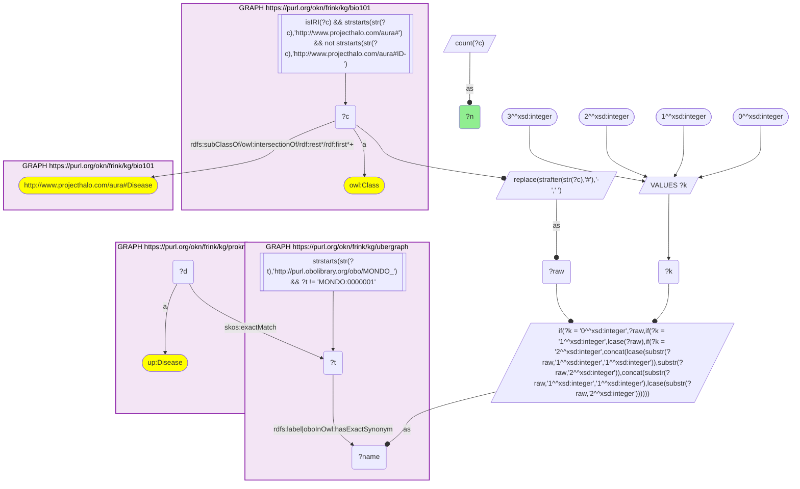
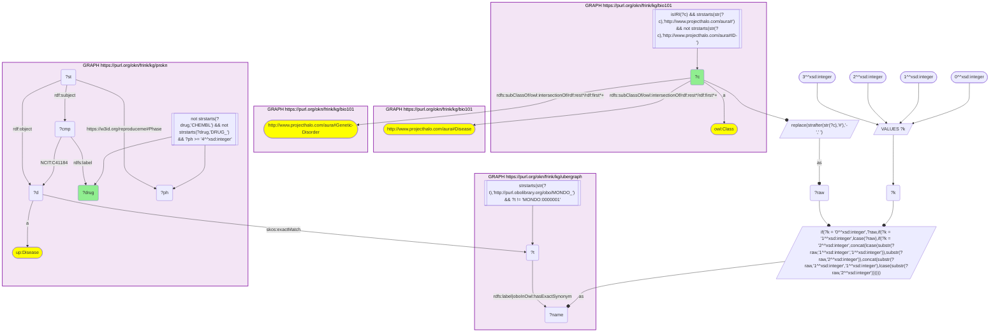

# D56-Q2: Approved drugs for KB Bio 101's genetic disorders

- **Date:** 2026-11-03
- **Model:** claude-opus-5-5
- **SPARQL endpoint:** https://apps.okn.us/federation/sparql
- **Generated by:** mcp-okn v0.3.0 (build 5f97869)
- **Contents:** 2 queries · 2 query diagrams

## Knowledge graphs used

- `bio101` — <https://purl.org/okn/frink/kg/bio101>
- `ubergraph` — <https://purl.org/okn/frink/kg/ubergraph>
- `prokn` — <https://purl.org/okn/frink/kg/prokn>

## Conversation

👤 **User**

Crosswalk: `bio101` × `prokn` on **MONDO (bio101 label), bridged through `ubergraph`** (crosswalk `KB20-mondo-label-bio101-prokn`, verified_count 32). KB Bio 101 is an OWL ontology of an introductory biology textbook: every concept is an `owl:Class` IRI `http://www.projecthalo.com/aura#{Name}` with no `rdfs:label` and no external id, so the concept NAME (local name, hyphens → spaces, four case forms: as-is, all lower-case, first letter lowered, sentence case) is matched as a bound literal against ubergraph `rdfs:label | oboInOwl:hasExactSynonym` on `obo/MONDO_` terms. ProKN (`prokn`) keeps ChEMBL drug-indication disease records as `up:Disease` nodes that point to their MONDO term with `skos:exactMatch`; a compound is linked to the record by `obo:NCIT_C41184` (indication), and a reified `rdf:Statement` on the same compound and record carries the clinical phase on `reproduceme:Phase` (4 = approved). The bridge is scoped to bio101's `aura:Disease` subtree and ProKN's `up:Disease` records.

Research question: for the disorders KB Bio 101 itself classifies as genetic disorders (under `aura:Genetic-Disorder`), which approved (phase 4) drugs does ProKN list as indicated? Do they treat the cause or the symptoms?

Why the join is required: the textbook's genetic-disorder grouping exists only in bio101's class hierarchy and the indications only in ProKN; only the name → MONDO bridge links them.

---

🧠 **Assistant**

**Bridge established (Query 1).** The crosswalk skeleton, run verbatim, returns **32** bio101 diseases that reach a ProKN `up:Disease` node through the name → MONDO bridge, matching the catalogued `verified_count`. Query 2 keeps only the concepts bio101 places under `aura:Genetic-Disorder`. It then lists the compounds whose indication statement reaches phase 4.

**Approved drugs for the textbook's genetic disorders (Query 2).** There are **27** drugs across seven disorders:

| bio101 genetic disorder | Approved drugs (ProKN / ChEMBL) |
|---|---|
| Cystic-Fibrosis (11) | acetylcysteine, azithromycin, aztreonam, aztreonam lysine, ivacaftor, levofloxacin, lumacaftor, mannitol, phytonadione, tezacaftor, tobramycin |
| Sickle-Cell-Anemia (5) | crizanlizumab, deferiprone, glutamine, hydroxyurea, voxelotor |
| Duchenne-Muscular-Dystrophy (4) | ataluren, deflazacort, givinostat hydrochloride, vamorolone |
| Hemophilia (3) | emicizumab, marstacimab, tranexamic acid |
| Inborn-Error-Of-Metabolism (2) | chenodiol, cholic acid |
| Cystinuria (1) | penicillamine |
| Phenylketonuria (1) | sapropterin dihydrochloride |

**Answer.** The rows give the drug names. Sorting them by cause versus symptom uses general pharmacology, not the graph, and about 11 of the 27 act on the disease mechanism:

- **Act on the molecular defect or its direct consequence:**
  - the CFTR modulators ivacaftor, lumacaftor and tezacaftor, which correct or potentiate the faulty chloride channel;
  - ataluren (read-through of nonsense mutations in dystrophin);
  - sapropterin (a cofactor that boosts residual phenylalanine hydroxylase activity);
  - emicizumab (stands in for the missing factor VIII) and marstacimab (rebalances clotting by blocking TFPI);
  - voxelotor (inhibits sickle haemoglobin polymerisation) and hydroxyurea (raises fetal haemoglobin);
  - chenodiol and cholic acid (replace bile acids the patient cannot make).
- **Treat consequences and symptoms:**
  - the cystic fibrosis antibiotics (azithromycin, aztreonam, levofloxacin, tobramycin), the mucus-clearing mannitol and acetylcysteine, and vitamin K (phytonadione) for malabsorption;
  - crizanlizumab and glutamine against sickle-cell crises, and deferiprone for transfusion iron overload;
  - tranexamic acid for bleeding;
  - penicillamine, which keeps cystine soluble so stones do not form;
  - deflazacort, vamorolone and givinostat, which slow muscle damage in Duchenne without restoring dystrophin.

So the textbook examples of single-gene disease now include several mechanism-targeted drugs, notably for cystic fibrosis, haemophilia and sickle cell disease, but most approved drugs still manage downstream effects.

Caveats:

- Phase 4 is ChEMBL's maximum phase for that indication, not current market status. Voxelotor, for example, was withdrawn from the market in 2024.
- Indications sit on the exact MONDO term with no subclass roll-up.
- Genetic disorders bio101 lists outside this subtree, or whose names do not bridge, are absent.

## SPARQL queries executed

#### Query 1

_2026-11-04T01:00:55+00:00 · `bio101`, `ubergraph`, `prokn`_

```sparql
SELECT (COUNT(DISTINCT ?c) AS ?n) WHERE {
  { SELECT DISTINCT ?c ?t WHERE {
  { SELECT DISTINCT ?c ?name WHERE {
      GRAPH <https://purl.org/okn/frink/kg/bio101> { ?c a <http://www.w3.org/2002/07/owl#Class> .
        FILTER(isIRI(?c) && STRSTARTS(STR(?c),'http://www.projecthalo.com/aura#') && !STRSTARTS(STR(?c),'http://www.projecthalo.com/aura#ID-')) }
      GRAPH <https://purl.org/okn/frink/kg/bio101> { ?c (<http://www.w3.org/2000/01/rdf-schema#subClassOf>/(<http://www.w3.org/2002/07/owl#intersectionOf>/<http://www.w3.org/1999/02/22-rdf-syntax-ns#rest>*/<http://www.w3.org/1999/02/22-rdf-syntax-ns#first>)*)+ <http://www.projecthalo.com/aura#Disease> . }
      BIND(REPLACE(STRAFTER(STR(?c),'#'),'-',' ') AS ?raw)
      VALUES ?k { 0 1 2 3 }  # as-is, all lower, first letter lowered, sentence case
      BIND(IF(?k = 0, ?raw, IF(?k = 1, LCASE(?raw), IF(?k = 2, CONCAT(LCASE(SUBSTR(?raw,1,1)),SUBSTR(?raw,2)),
                CONCAT(SUBSTR(?raw,1,1),LCASE(SUBSTR(?raw,2)))))) AS ?name)
  } }
    GRAPH <https://purl.org/okn/frink/kg/ubergraph> { ?t <http://www.w3.org/2000/01/rdf-schema#label>|<http://www.geneontology.org/formats/oboInOwl#hasExactSynonym> ?name .
      FILTER(STRSTARTS(STR(?t),'http://purl.obolibrary.org/obo/MONDO_') && ?t != <http://purl.obolibrary.org/obo/MONDO_0000001>) }
  } }
  GRAPH <https://purl.org/okn/frink/kg/prokn> { ?d a <http://purl.uniprot.org/core/Disease> ; <http://www.w3.org/2004/02/skos/core#exactMatch> ?t . }
}
```



_1 row(s)_

| n |
| --- |
| 32 |

#### Query 2

_2026-11-04T01:00:57+00:00 · `bio101`, `ubergraph`, `prokn`_

```sparql
SELECT ?c ?drug WHERE {
  { SELECT DISTINCT ?c ?t WHERE {
  { SELECT DISTINCT ?c ?name WHERE {
      GRAPH <https://purl.org/okn/frink/kg/bio101> { ?c a <http://www.w3.org/2002/07/owl#Class> .
        FILTER(isIRI(?c) && STRSTARTS(STR(?c),'http://www.projecthalo.com/aura#') && !STRSTARTS(STR(?c),'http://www.projecthalo.com/aura#ID-')) }
      GRAPH <https://purl.org/okn/frink/kg/bio101> { ?c (<http://www.w3.org/2000/01/rdf-schema#subClassOf>/(<http://www.w3.org/2002/07/owl#intersectionOf>/<http://www.w3.org/1999/02/22-rdf-syntax-ns#rest>*/<http://www.w3.org/1999/02/22-rdf-syntax-ns#first>)*)+ <http://www.projecthalo.com/aura#Disease> . }
      BIND(REPLACE(STRAFTER(STR(?c),'#'),'-',' ') AS ?raw)
      VALUES ?k { 0 1 2 3 }  # as-is, all lower, first letter lowered, sentence case
      BIND(IF(?k = 0, ?raw, IF(?k = 1, LCASE(?raw), IF(?k = 2, CONCAT(LCASE(SUBSTR(?raw,1,1)),SUBSTR(?raw,2)),
                CONCAT(SUBSTR(?raw,1,1),LCASE(SUBSTR(?raw,2)))))) AS ?name)
  } }
    GRAPH <https://purl.org/okn/frink/kg/ubergraph> { ?t <http://www.w3.org/2000/01/rdf-schema#label>|<http://www.geneontology.org/formats/oboInOwl#hasExactSynonym> ?name .
      FILTER(STRSTARTS(STR(?t),'http://purl.obolibrary.org/obo/MONDO_') && ?t != <http://purl.obolibrary.org/obo/MONDO_0000001>) }
  } }
  GRAPH <https://purl.org/okn/frink/kg/bio101> { ?c (<http://www.w3.org/2000/01/rdf-schema#subClassOf>/(<http://www.w3.org/2002/07/owl#intersectionOf>/<http://www.w3.org/1999/02/22-rdf-syntax-ns#rest>*/<http://www.w3.org/1999/02/22-rdf-syntax-ns#first>)*)+ <http://www.projecthalo.com/aura#Genetic-Disorder> . }
  GRAPH <https://purl.org/okn/frink/kg/prokn> { ?d a <http://purl.uniprot.org/core/Disease> ; <http://www.w3.org/2004/02/skos/core#exactMatch> ?t . ?cmp <http://purl.obolibrary.org/obo/NCIT_C41184> ?d . ?cmp <http://www.w3.org/2000/01/rdf-schema#label> ?drug . FILTER(!STRSTARTS(?drug, 'CHEMBL') && !STRSTARTS(?drug, 'DRUG_'))
    ?st <http://www.w3.org/1999/02/22-rdf-syntax-ns#subject> ?cmp ; <http://www.w3.org/1999/02/22-rdf-syntax-ns#object> ?d ; <https://w3id.org/reproduceme#Phase> ?ph . FILTER(?ph >= 4) }
} GROUP BY ?c ?drug ORDER BY ?c ?drug
```



_27 row(s) — showing first 5_

| c | drug |
| --- | --- |
| http://www.projecthalo.com/aura#Cystic-Fibrosis | ACETYLCYSTEINE |
| http://www.projecthalo.com/aura#Cystic-Fibrosis | AZITHROMYCIN |
| http://www.projecthalo.com/aura#Cystic-Fibrosis | AZTREONAM |
| http://www.projecthalo.com/aura#Cystic-Fibrosis | AZTREONAM LYSINE |
| http://www.projecthalo.com/aura#Cystic-Fibrosis | IVACAFTOR |
