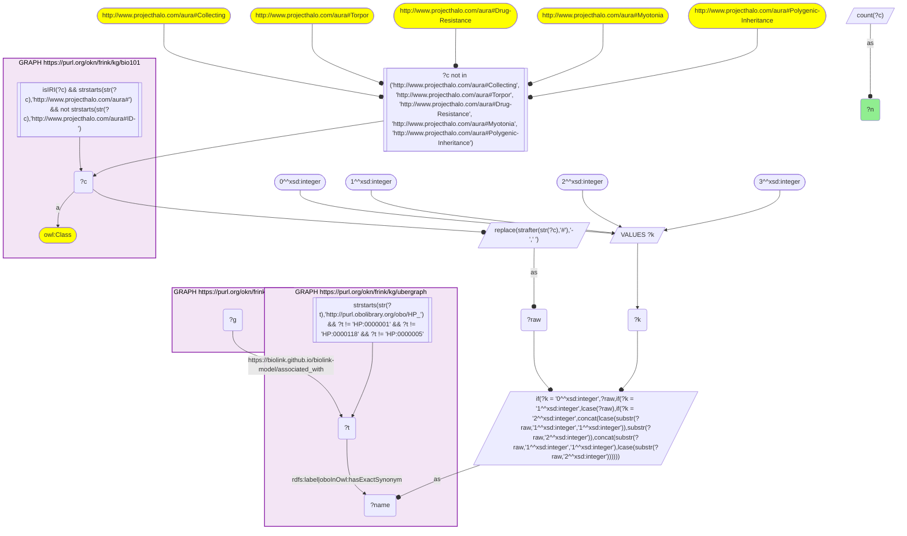
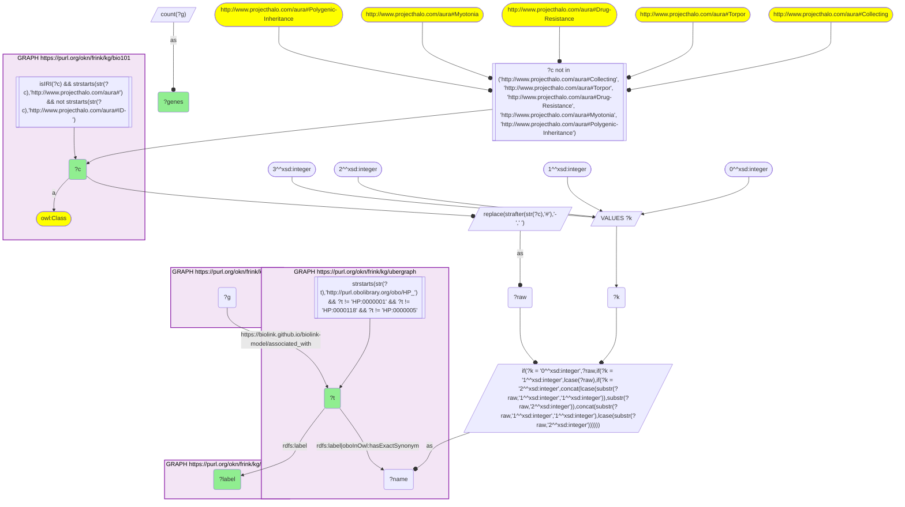

# D57-Q1: Genes ProKN associates with KB Bio 101's textbook phenotypes

- **Date:** 2026-11-03
- **Model:** claude-opus-5-5
- **SPARQL endpoint:** https://apps.okn.us/federation/sparql
- **Generated by:** mcp-okn v0.3.0 (build 5f97869)
- **Contents:** 2 queries · 2 query diagrams

## Knowledge graphs used

- `bio101` — <https://purl.org/okn/frink/kg/bio101>
- `ubergraph` — <https://purl.org/okn/frink/kg/ubergraph>
- `prokn` — <https://purl.org/okn/frink/kg/prokn>

## Conversation

👤 **User**

Crosswalk: `bio101` × `prokn` on **HP (bio101 label), bridged through `ubergraph`** (crosswalk `KB22-hp-label-bio101-prokn`, verified_count 9). KB Bio 101 is an OWL ontology of an introductory biology textbook: every concept is an `owl:Class` IRI `http://www.projecthalo.com/aura#{Name}` with no `rdfs:label` and no external id, so the concept NAME (local name, hyphens → spaces, four case forms: as-is, all lower-case, first letter lowered, sentence case) is matched as a bound literal against ubergraph `rdfs:label | oboInOwl:hasExactSynonym` on `obo/HP_` terms. ProKN (`prokn`) links Ensembl gene nodes (`up:Gene`, symbol on `rdfs:label`) to HPO phenotypes with `biolink:associated_with` (the biolink.github.io namespace), whose object is a raw `obo/HP_` IRI; genes are also members of MSigDB gene sets via `obo:RO_0002431`. The HP roots are excluded, and five homonyms by name (as KB16).

Research question: which concepts KB Bio 101 teaches match an HP phenotype that ProKN links to genes, and how many genes each? Rank them.

Why the join is required: bio101 names the conditions a curriculum covers; ProKN records which genes are associated with an HP phenotype. They share no identifier, so only the name → HP bridge through ubergraph joins them.

---

🧠 **Assistant**

**Bridge established (Query 1).** The crosswalk skeleton, run verbatim, returns **9** bio101 concepts. Each one's name is an exact HP label or exact synonym in ubergraph, *and* its HP term is the object of a ProKN gene `biolink:associated_with` edge. This matches the catalogued `verified_count`. Query 2 returns all 9, one HP term each.

**Ranking (Query 2).**

| Rank | bio101 concept | HP (ubergraph label) | Genes |
|---|---|---|---|
| 1 | Schizophrenia | HP_0100753 | 32 |
| 2 | Prostate-Cancer | HP_0012125 | 11 |
| 3 | Mitochondrial-Myopathy | HP_0003737 | 7 |
| 4 | Diabetes-Mellitus | HP_0000819 | 6 |
| 5 | Anaphylactic-Shock | HP_0100845 | 5 |
| 5 | Polydactyly | HP_0010442 | 5 |
| 7 | Colon-Cancer | HP_0003003 | 3 |
| 7 | Cystinuria | HP_0003131 | 3 |
| 7 | Shivering | HP_0025144 | 3 |

**Answer.** Nine textbook concepts reach ProKN's HP-annotated genes:

- **Schizophrenia:** the largest gene set, 32 genes, which fits a polygenic psychiatric phenotype.
- **Two textbook cancers:** prostate cancer (11 genes) and colon cancer (3).
- **Mendelian examples a genetics chapter uses:** mitochondrial myopathy (7), polydactyly (5) and cystinuria (3).
- **Common physiological conditions:** diabetes mellitus (6), anaphylactic shock (5) and shivering (3).

The gene lists are short, because ProKN carries HP associations for relatively few genes. This crosswalk is a pointer to curated phenotype genes, not a comprehensive gene–phenotype map.

Caveats:

- This is an exact-name lower bound. The HP roots and five homonyms are excluded (Collecting, Torpor, Drug-Resistance, Myotonia, Polygenic-Inheritance).
- Counts sit on the exact HP term with no `subClassOf` roll-up, so genes annotated to more specific phenotypes (for example a particular type of polydactyly) are not counted.
- ProKN's predicate here is the biolink.github.io `associated_with`, not the w3id biolink namespace.

## SPARQL queries executed

#### Query 1

_2026-11-04T01:00:59+00:00 · `bio101`, `ubergraph`, `prokn`_

```sparql
SELECT (COUNT(DISTINCT ?c) AS ?n) WHERE {
  { SELECT DISTINCT ?c ?t WHERE {
  { SELECT DISTINCT ?c ?name WHERE {
      GRAPH <https://purl.org/okn/frink/kg/bio101> { ?c a <http://www.w3.org/2002/07/owl#Class> .
        FILTER(isIRI(?c) && STRSTARTS(STR(?c),'http://www.projecthalo.com/aura#') && !STRSTARTS(STR(?c),'http://www.projecthalo.com/aura#ID-')) }
      FILTER(?c NOT IN (<http://www.projecthalo.com/aura#Collecting>, <http://www.projecthalo.com/aura#Torpor>, <http://www.projecthalo.com/aura#Drug-Resistance>, <http://www.projecthalo.com/aura#Myotonia>, <http://www.projecthalo.com/aura#Polygenic-Inheritance>))  # homonyms (spot-checked 2026-11-03)
      BIND(REPLACE(STRAFTER(STR(?c),'#'),'-',' ') AS ?raw)
      VALUES ?k { 0 1 2 3 }  # as-is, all lower, first letter lowered, sentence case
      BIND(IF(?k = 0, ?raw, IF(?k = 1, LCASE(?raw), IF(?k = 2, CONCAT(LCASE(SUBSTR(?raw,1,1)),SUBSTR(?raw,2)),
                CONCAT(SUBSTR(?raw,1,1),LCASE(SUBSTR(?raw,2)))))) AS ?name)
  } }
    GRAPH <https://purl.org/okn/frink/kg/ubergraph> { ?t <http://www.w3.org/2000/01/rdf-schema#label>|<http://www.geneontology.org/formats/oboInOwl#hasExactSynonym> ?name .
      FILTER(STRSTARTS(STR(?t),'http://purl.obolibrary.org/obo/HP_') && ?t != <http://purl.obolibrary.org/obo/HP_0000001> && ?t != <http://purl.obolibrary.org/obo/HP_0000118> && ?t != <http://purl.obolibrary.org/obo/HP_0000005>) }
  } }
  GRAPH <https://purl.org/okn/frink/kg/prokn> { ?g <https://biolink.github.io/biolink-model/associated_with> ?t . }
}
```



_1 row(s)_

| n |
| --- |
| 9 |

#### Query 2

_2026-11-04T01:01:00+00:00 · `bio101`, `ubergraph`, `prokn`_

```sparql
SELECT ?c ?t ?label (COUNT(DISTINCT ?g) AS ?genes) WHERE {
  { SELECT DISTINCT ?c ?t WHERE {
  { SELECT DISTINCT ?c ?name WHERE {
      GRAPH <https://purl.org/okn/frink/kg/bio101> { ?c a <http://www.w3.org/2002/07/owl#Class> .
        FILTER(isIRI(?c) && STRSTARTS(STR(?c),'http://www.projecthalo.com/aura#') && !STRSTARTS(STR(?c),'http://www.projecthalo.com/aura#ID-')) }
      FILTER(?c NOT IN (<http://www.projecthalo.com/aura#Collecting>, <http://www.projecthalo.com/aura#Torpor>, <http://www.projecthalo.com/aura#Drug-Resistance>, <http://www.projecthalo.com/aura#Myotonia>, <http://www.projecthalo.com/aura#Polygenic-Inheritance>))  # homonyms (spot-checked 2026-11-03)
      BIND(REPLACE(STRAFTER(STR(?c),'#'),'-',' ') AS ?raw)
      VALUES ?k { 0 1 2 3 }  # as-is, all lower, first letter lowered, sentence case
      BIND(IF(?k = 0, ?raw, IF(?k = 1, LCASE(?raw), IF(?k = 2, CONCAT(LCASE(SUBSTR(?raw,1,1)),SUBSTR(?raw,2)),
                CONCAT(SUBSTR(?raw,1,1),LCASE(SUBSTR(?raw,2)))))) AS ?name)
  } }
    GRAPH <https://purl.org/okn/frink/kg/ubergraph> { ?t <http://www.w3.org/2000/01/rdf-schema#label>|<http://www.geneontology.org/formats/oboInOwl#hasExactSynonym> ?name .
      FILTER(STRSTARTS(STR(?t),'http://purl.obolibrary.org/obo/HP_') && ?t != <http://purl.obolibrary.org/obo/HP_0000001> && ?t != <http://purl.obolibrary.org/obo/HP_0000118> && ?t != <http://purl.obolibrary.org/obo/HP_0000005>) }
  } }
  GRAPH <https://purl.org/okn/frink/kg/prokn> { ?g <https://biolink.github.io/biolink-model/associated_with> ?t . }
  GRAPH <https://purl.org/okn/frink/kg/ubergraph> { ?t <http://www.w3.org/2000/01/rdf-schema#label> ?label }
} GROUP BY ?c ?t ?label ORDER BY DESC(?genes) ?c
```



_9 row(s) — showing first 5_

| c | t | label | genes |
| --- | --- | --- | --- |
| http://www.projecthalo.com/aura#Schizophrenia | http://purl.obolibrary.org/obo/HP_0100753 | Schizophrenia | 32 |
| http://www.projecthalo.com/aura#Prostate-Cancer | http://purl.obolibrary.org/obo/HP_0012125 | Prostate cancer | 11 |
| http://www.projecthalo.com/aura#Mitochondrial-Myopathy | http://purl.obolibrary.org/obo/HP_0003737 | Mitochondrial myopathy | 7 |
| http://www.projecthalo.com/aura#Diabetes-Mellitus | http://purl.obolibrary.org/obo/HP_0000819 | Diabetes mellitus | 6 |
| http://www.projecthalo.com/aura#Anaphylactic-Shock | http://purl.obolibrary.org/obo/HP_0100845 | Anaphylactic shock | 5 |
