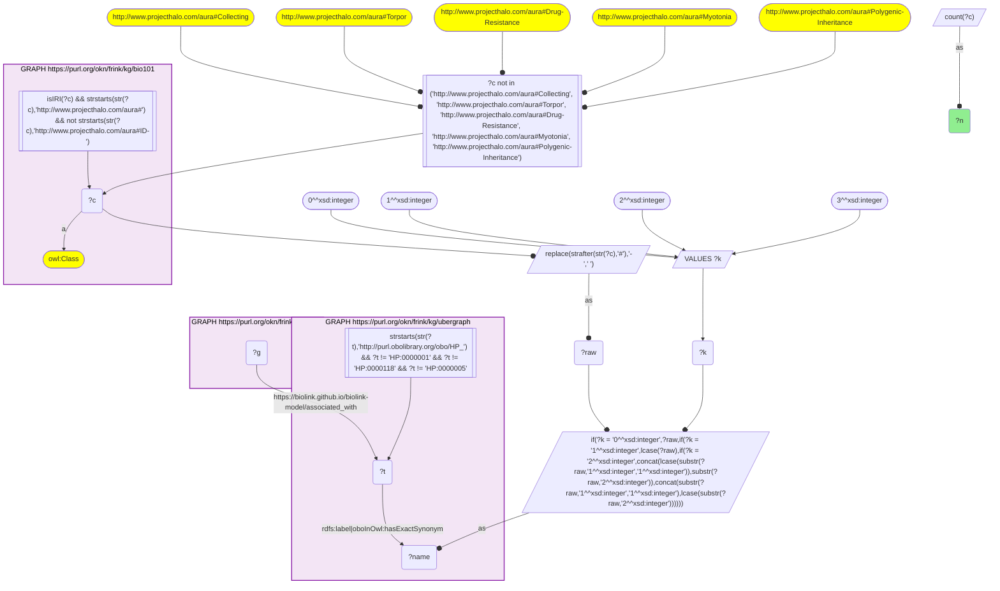
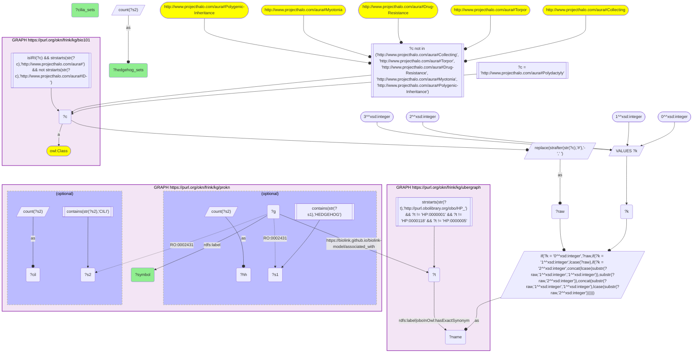

# D57-Q2: Polydactyly genes, Hedgehog signalling and cilia

- **Date:** 2026-11-03
- **Model:** claude-opus-5-5
- **SPARQL endpoint:** https://apps.okn.us/federation/sparql
- **Generated by:** mcp-okn v0.3.0 (build 5f97869)
- **Contents:** 2 queries · 2 query diagrams

## Knowledge graphs used

- `bio101` — <https://purl.org/okn/frink/kg/bio101>
- `ubergraph` — <https://purl.org/okn/frink/kg/ubergraph>
- `prokn` — <https://purl.org/okn/frink/kg/prokn>

## Conversation

👤 **User**

Crosswalk: `bio101` × `prokn` on **HP (bio101 label), bridged through `ubergraph`** (crosswalk `KB22-hp-label-bio101-prokn`, verified_count 9). KB Bio 101 is an OWL ontology of an introductory biology textbook: every concept is an `owl:Class` IRI `http://www.projecthalo.com/aura#{Name}` with no `rdfs:label` and no external id, so the concept NAME (local name, hyphens → spaces, four case forms: as-is, all lower-case, first letter lowered, sentence case) is matched as a bound literal against ubergraph `rdfs:label | oboInOwl:hasExactSynonym` on `obo/HP_` terms. ProKN (`prokn`) links Ensembl gene nodes (`up:Gene`, symbol on `rdfs:label`) to HPO phenotypes with `biolink:associated_with` (the biolink.github.io namespace), whose object is a raw `obo/HP_` IRI; genes are also members of MSigDB gene sets via `obo:RO_0002431`.

Research question: KB Bio 101 teaches polydactyly as a classic inherited trait. Which genes does ProKN associate with the matching HP phenotype, and how many of them belong to MSigDB gene sets for Hedgehog signalling or for cilia — the pathway and organelle developmental biology ties to digit number?

Why the join is required: polydactyly is a textbook concept without an identifier; only the name → HP bridge through ubergraph reaches ProKN's gene associations and gene-set memberships.

---

🧠 **Assistant**

**Bridge established (Query 1).** The crosswalk skeleton, run verbatim, returns **9** bio101 concepts that reach a ProKN gene–HP association through the name → HP bridge, matching the catalogued `verified_count`. Query 2 takes the Polydactyly concept, which bridges to HP_0010442. It lists the genes ProKN associates with that term and counts each gene's MSigDB gene-set memberships (`obo:RO_0002431`) whose set IRI contains "HEDGEHOG" or "CILI".

**Polydactyly genes (Query 2).** ProKN associates **5** genes with HP_0010442:

| Gene | Hedgehog sets | Cilia sets |
|---|---|---|
| MKS1 | 2 | 4 |
| CC2D2A | – | 3 |
| CPLANE1 | – | 2 |
| BRCA2 | – | – |
| MEGF8 | – | – |

**Answer.** Three of the five polydactyly genes, MKS1, CC2D2A and CPLANE1, belong to MSigDB cilia gene sets. Only MKS1 is also in a Hedgehog-signalling set (2 sets). This matches the developmental-biology account a textbook trait points to: the primary cilium is where vertebrate cells read Hedgehog signals, and ciliopathies often widen the limb bud and add digits.

The two remaining genes are not in either kind of set. From general knowledge rather than the graph:

- MEGF8 (Carpenter syndrome 2) is itself a regulator of Hedgehog signalling that these set names do not capture.
- BRCA2 enters through Fanconi anaemia, where limb anomalies are part of the syndrome.

Caveats:

- The gene-set match is by substring of the MSigDB set IRI, so it finds only sets with HEDGEHOG or CILI in their names.
- The gene list is restricted to the exact HP term HP_0010442. Genes annotated to more specific polydactyly subtypes (preaxial, postaxial) are not included, so this is a small lower bound on the genes behind the trait.

## SPARQL queries executed

#### Query 1

_2026-11-04T01:01:00+00:00 · `bio101`, `ubergraph`, `prokn`_

```sparql
SELECT (COUNT(DISTINCT ?c) AS ?n) WHERE {
  { SELECT DISTINCT ?c ?t WHERE {
  { SELECT DISTINCT ?c ?name WHERE {
      GRAPH <https://purl.org/okn/frink/kg/bio101> { ?c a <http://www.w3.org/2002/07/owl#Class> .
        FILTER(isIRI(?c) && STRSTARTS(STR(?c),'http://www.projecthalo.com/aura#') && !STRSTARTS(STR(?c),'http://www.projecthalo.com/aura#ID-')) }
      FILTER(?c NOT IN (<http://www.projecthalo.com/aura#Collecting>, <http://www.projecthalo.com/aura#Torpor>, <http://www.projecthalo.com/aura#Drug-Resistance>, <http://www.projecthalo.com/aura#Myotonia>, <http://www.projecthalo.com/aura#Polygenic-Inheritance>))  # homonyms (spot-checked 2026-11-03)
      BIND(REPLACE(STRAFTER(STR(?c),'#'),'-',' ') AS ?raw)
      VALUES ?k { 0 1 2 3 }  # as-is, all lower, first letter lowered, sentence case
      BIND(IF(?k = 0, ?raw, IF(?k = 1, LCASE(?raw), IF(?k = 2, CONCAT(LCASE(SUBSTR(?raw,1,1)),SUBSTR(?raw,2)),
                CONCAT(SUBSTR(?raw,1,1),LCASE(SUBSTR(?raw,2)))))) AS ?name)
  } }
    GRAPH <https://purl.org/okn/frink/kg/ubergraph> { ?t <http://www.w3.org/2000/01/rdf-schema#label>|<http://www.geneontology.org/formats/oboInOwl#hasExactSynonym> ?name .
      FILTER(STRSTARTS(STR(?t),'http://purl.obolibrary.org/obo/HP_') && ?t != <http://purl.obolibrary.org/obo/HP_0000001> && ?t != <http://purl.obolibrary.org/obo/HP_0000118> && ?t != <http://purl.obolibrary.org/obo/HP_0000005>) }
  } }
  GRAPH <https://purl.org/okn/frink/kg/prokn> { ?g <https://biolink.github.io/biolink-model/associated_with> ?t . }
}
```



_1 row(s)_

| n |
| --- |
| 9 |

#### Query 2

_2026-11-04T01:01:01+00:00 · `bio101`, `ubergraph`, `prokn`_

```sparql
SELECT ?symbol (MAX(?hh) AS ?hedgehog_sets) (MAX(?cil) AS ?cilia_sets) WHERE {
  { SELECT DISTINCT ?c ?t WHERE {
  { SELECT DISTINCT ?c ?name WHERE {
      GRAPH <https://purl.org/okn/frink/kg/bio101> { ?c a <http://www.w3.org/2002/07/owl#Class> .
        FILTER(isIRI(?c) && STRSTARTS(STR(?c),'http://www.projecthalo.com/aura#') && !STRSTARTS(STR(?c),'http://www.projecthalo.com/aura#ID-')) }
      FILTER(?c NOT IN (<http://www.projecthalo.com/aura#Collecting>, <http://www.projecthalo.com/aura#Torpor>, <http://www.projecthalo.com/aura#Drug-Resistance>, <http://www.projecthalo.com/aura#Myotonia>, <http://www.projecthalo.com/aura#Polygenic-Inheritance>))  # homonyms (spot-checked 2026-11-03)
      BIND(REPLACE(STRAFTER(STR(?c),'#'),'-',' ') AS ?raw)
      VALUES ?k { 0 1 2 3 }  # as-is, all lower, first letter lowered, sentence case
      BIND(IF(?k = 0, ?raw, IF(?k = 1, LCASE(?raw), IF(?k = 2, CONCAT(LCASE(SUBSTR(?raw,1,1)),SUBSTR(?raw,2)),
                CONCAT(SUBSTR(?raw,1,1),LCASE(SUBSTR(?raw,2)))))) AS ?name)
  } }
    GRAPH <https://purl.org/okn/frink/kg/ubergraph> { ?t <http://www.w3.org/2000/01/rdf-schema#label>|<http://www.geneontology.org/formats/oboInOwl#hasExactSynonym> ?name .
      FILTER(STRSTARTS(STR(?t),'http://purl.obolibrary.org/obo/HP_') && ?t != <http://purl.obolibrary.org/obo/HP_0000001> && ?t != <http://purl.obolibrary.org/obo/HP_0000118> && ?t != <http://purl.obolibrary.org/obo/HP_0000005>) }
  } }
  FILTER(?c = <http://www.projecthalo.com/aura#Polydactyly>)
  GRAPH <https://purl.org/okn/frink/kg/prokn> { ?g <https://biolink.github.io/biolink-model/associated_with> ?t ; <http://www.w3.org/2000/01/rdf-schema#label> ?symbol .
    OPTIONAL { SELECT ?g (COUNT(DISTINCT ?s1) AS ?hh) WHERE { ?g <http://purl.obolibrary.org/obo/RO_0002431> ?s1 . FILTER(CONTAINS(STR(?s1), 'HEDGEHOG')) } GROUP BY ?g }
    OPTIONAL { SELECT ?g (COUNT(DISTINCT ?s2) AS ?cil) WHERE { ?g <http://purl.obolibrary.org/obo/RO_0002431> ?s2 . FILTER(CONTAINS(STR(?s2), 'CILI')) } GROUP BY ?g } }
} GROUP BY ?symbol ORDER BY DESC(?hedgehog_sets) DESC(?cilia_sets) ?symbol
```



_5 row(s)_

| symbol | hedgehog_sets | cilia_sets |
| --- | --- | --- |
| MKS1 | 2 | 4 |
| CC2D2A |  | 3 |
| CPLANE1 |  | 2 |
| BRCA2 |  |  |
| MEGF8 |  |  |
