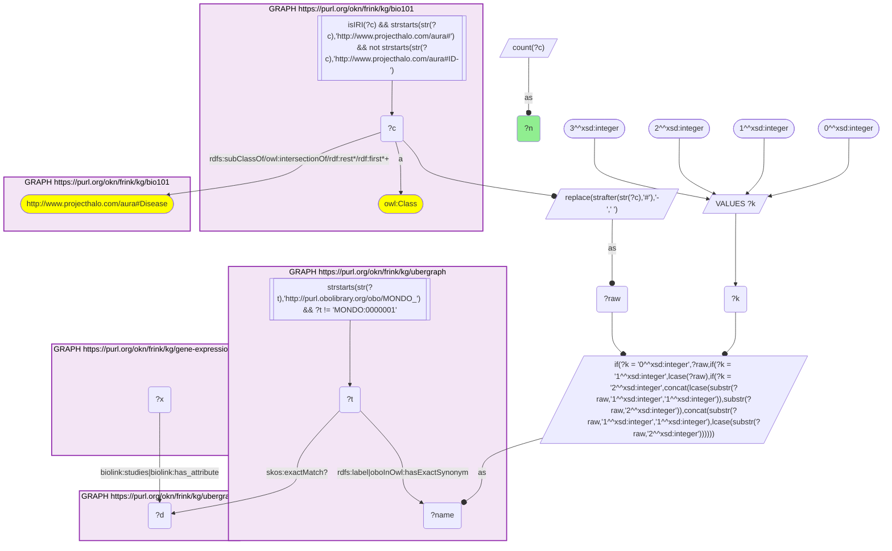
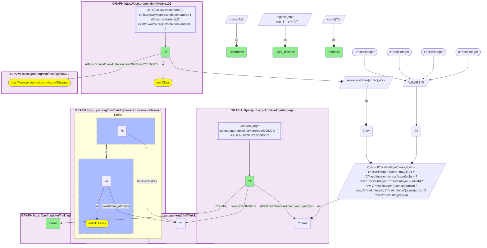

# D58-Q1: KB Bio 101's textbook diseases in Expression Atlas studies

- **Date:** 2026-11-03
- **Model:** claude-opus-5-5
- **SPARQL endpoint:** https://apps.okn.us/federation/sparql
- **Generated by:** mcp-okn v0.3.0 (build d9c9ef9)
- **Contents:** 2 queries · 2 query diagrams

## Knowledge graphs used

- `bio101` — <https://purl.org/okn/frink/kg/bio101>
- `ubergraph` — <https://purl.org/okn/frink/kg/ubergraph>
- `gene-expression-atlas-okn` — <https://purl.org/okn/frink/kg/gene-expression-atlas-okn>

## Conversation

👤 **User**

Crosswalk: `bio101` × `gene-expression-atlas-okn` on **MONDO (bio101 label), bridged through `ubergraph`** (crosswalk `KB23-mondo-label-bio101-gxa`, verified_count 27). KB Bio 101 is an OWL ontology of an introductory biology textbook: every concept is an `owl:Class` IRI `http://www.projecthalo.com/aura#{Name}` with no `rdfs:label` and no external id, so the concept NAME (local name, hyphens → spaces, four case forms: as-is, all lower-case, first letter lowered, sentence case) is matched as a bound literal against ubergraph `rdfs:label | oboInOwl:hasExactSynonym` on `obo/MONDO_` terms. Expression Atlas (`gene-expression-atlas-okn`) types the disease a study is about as a `biolink:Disease` node, mostly an EFO IRI, sometimes a raw `obo/MONDO_` IRI or an Orphanet IRI. A study (`biolink:Study`, `wobd/study/E-GEOD-1919`) points at it with `biolink:studies`, and each differential-expression contrast (`biolink:Assay`, named `'test' vs 'reference'` on `biolink:name`) with `biolink:has_attribute`. The matched MONDO term reaches that node either directly or through ubergraph `skos:exactMatch` (MONDO → EFO / Orphanet), the curated mapping crosswalk A19 uses; the name match is scoped to bio101's Disease subtree.

Research question: which diseases KB Bio 101 teaches are studied in Expression Atlas differential-expression experiments, in how many studies and contrasts, and under which disease identifier (MONDO, EFO or Orphanet)? Rank them.

Why the join is required: bio101 names the diseases a curriculum covers but holds no identifiers; Expression Atlas knows which experiments study a disease, mostly under EFO. Only the name → MONDO bridge through ubergraph, plus ubergraph's MONDO → EFO / Orphanet exact matches, joins them.

---

🧠 **Assistant**

**Bridge established (Query 1).** The crosswalk skeleton, run verbatim, returns **27** bio101 diseases, matching the catalogued `verified_count`. Each one's name is an exact MONDO label or exact synonym in ubergraph within bio101's Disease subtree, *and* that MONDO term, or the EFO / Orphanet term it exactly matches in ubergraph, is the disease of at least one Expression Atlas study or contrast. Query 2 returns all 27, one Expression Atlas disease node each.

**Ranking (Query 2).** Studies (`biolink:studies`) and contrasts (`biolink:Assay` with the disease on `biolink:has_attribute`):

| Rank | bio101 disease | MONDO (ubergraph label) | Expression Atlas node | Studies | Contrasts |
|---|---|---|---|---|---|
| 1 | Alzheimers-Disease | MONDO_0004975 | MONDO_0004975 | 22 | 27 |
| 2 | CML | MONDO_0011996 (chronic myelogenous leukemia, BCR-ABL1 positive) | EFO_0000339 | 18 | 3 |
| 3 | Diabetes-Mellitus | MONDO_0005015 | EFO_0000400 | 10 | 15 |
| 4 | Type-2-Diabetes-Mellitus | MONDO_0005148 | MONDO_0005148 | 9 | 10 |
| 5 | Rheumatoid-Arthritis | MONDO_0008383 | EFO_0000685 | 8 | 11 |
| 6 | Leukemia | MONDO_0005059 | EFO_0000565 | 7 | 0 |
| 7 | Multiple-Sclerosis | MONDO_0005301 | MONDO_0005301 | 6 | 17 |
| 8 | Influenza | MONDO_0005812 | EFO_0007328 | 5 | 8 |
| 8 | Bipolar-Disorder | MONDO_0004985 | MONDO_0004985 | 5 | 7 |
| 10 | Cancer | MONDO_0004992 | MONDO_0004992 | 5 | 5 |
| 11 | Tuberculosis | MONDO_0018076 | Orphanet_3389 | 4 | 6 |
| 12 | Cystic-Fibrosis | MONDO_0009061 | Orphanet_586 | 4 | 5 |
| 12 | Down-Syndrome | MONDO_0008608 | EFO_0001064 | 4 | 5 |
| 14 | Lupus | MONDO_0007915 (systemic lupus erythematosus) | MONDO_0007915 | 4 | 4 |

The other 13 have 1–3 studies each:

- Schizophrenia (3 studies, 6 contrasts) and Type-1-Diabetes-Mellitus (3, 2);
- Duchenne-Muscular-Dystrophy, Endometriosis and Malaria (2 studies each);
- Hyperthyroidism, Klinefelter-Syndrome and Lyme-Disease (1 study, 3 contrasts each);
- Bacterial-Disease (1 study, 1 contrast);
- Hypopituitarism, Renal-Disease, Turner-Syndrome and Viral-Disease (1 study each, with no contrast annotated to the disease).

**Answer.** **27** of the textbook's diseases are studied in Expression Atlas, by three routes:

- **Directly as MONDO (10 diseases):** Alzheimer's disease, both diabetes types, multiple sclerosis, bipolar disorder, cancer, lupus, schizophrenia, and the bacterial and viral disease classes.
- **Through EFO (13 diseases):** CML, diabetes mellitus, rheumatoid arthritis, leukaemia, influenza, Down syndrome, endometriosis, malaria, hyperthyroidism, Klinefelter syndrome, Lyme disease, hypopituitarism and kidney disease.
- **Through Orphanet (4 diseases):** tuberculosis, cystic fibrosis, Duchenne muscular dystrophy and Turner syndrome.

Without the MONDO → EFO / Orphanet exact matches, only 10 would bridge.

Alzheimer's disease is the most studied (22 studies, 27 contrasts), then CML, diabetes, rheumatoid arthritis and multiple sclerosis.

The two counts measure different things:

- CML has 18 studies but only 3 contrasts annotated with it.
- Leukaemia, malaria, hypopituitarism, kidney disease, Turner syndrome and viral disease have studies but no contrast annotated with the disease. Their contrasts are presumably labelled by other factors, so a study count is the safer measure of coverage.

Caveats:

- This is an exact-name lower bound. The MONDO root is excluded, and the scope to bio101's Disease subtree drops homonyms (unscoped, the name Cold matches a MONDO synonym of COPD, as noted for KB5/KB12) along with true conditions bio101 files elsewhere (Allergy, Heart-Attack, Obesity).
- The EFO / Orphanet leg uses ubergraph's curated `skos:exactMatch`, not label matching. Expression Atlas diseases with no exact match to the bridged MONDO term are not counted.

## SPARQL queries executed

#### Query 1

_2026-11-04T01:41:58+00:00 · `bio101`, `ubergraph`, `gene-expression-atlas-okn`_

```sparql
SELECT (COUNT(DISTINCT ?c) AS ?n) WHERE {
  { SELECT DISTINCT ?c ?t WHERE {
  { SELECT DISTINCT ?c ?name WHERE {
      GRAPH <https://purl.org/okn/frink/kg/bio101> { ?c a <http://www.w3.org/2002/07/owl#Class> .
        FILTER(isIRI(?c) && STRSTARTS(STR(?c),'http://www.projecthalo.com/aura#') && !STRSTARTS(STR(?c),'http://www.projecthalo.com/aura#ID-')) }
      GRAPH <https://purl.org/okn/frink/kg/bio101> { ?c (<http://www.w3.org/2000/01/rdf-schema#subClassOf>/(<http://www.w3.org/2002/07/owl#intersectionOf>/<http://www.w3.org/1999/02/22-rdf-syntax-ns#rest>*/<http://www.w3.org/1999/02/22-rdf-syntax-ns#first>)*)+ <http://www.projecthalo.com/aura#Disease> . }
      BIND(REPLACE(STRAFTER(STR(?c),'#'),'-',' ') AS ?raw)
      VALUES ?k { 0 1 2 3 }  # as-is, all lower, first letter lowered, sentence case
      BIND(IF(?k = 0, ?raw, IF(?k = 1, LCASE(?raw), IF(?k = 2, CONCAT(LCASE(SUBSTR(?raw,1,1)),SUBSTR(?raw,2)),
                CONCAT(SUBSTR(?raw,1,1),LCASE(SUBSTR(?raw,2)))))) AS ?name)
  } }
    GRAPH <https://purl.org/okn/frink/kg/ubergraph> { ?t <http://www.w3.org/2000/01/rdf-schema#label>|<http://www.geneontology.org/formats/oboInOwl#hasExactSynonym> ?name .
      FILTER(STRSTARTS(STR(?t),'http://purl.obolibrary.org/obo/MONDO_') && ?t != <http://purl.obolibrary.org/obo/MONDO_0000001>) }
  } }
  GRAPH <https://purl.org/okn/frink/kg/ubergraph> { ?t <http://www.w3.org/2004/02/skos/core#exactMatch>? ?d . }
  GRAPH <https://purl.org/okn/frink/kg/gene-expression-atlas-okn> { ?x <https://w3id.org/biolink/vocab/studies>|<https://w3id.org/biolink/vocab/has_attribute> ?d . }
}
```



_1 row(s)_

| n |
| --- |
| 27 |

#### Query 2

_2026-11-04T01:42:00+00:00 · `bio101`, `ubergraph`, `gene-expression-atlas-okn`_

```sparql
SELECT ?c ?t ?label (REPLACE(STR(?d), '^.*/', '') AS ?gxa_disease) (COUNT(DISTINCT ?s) AS ?studies) (COUNT(DISTINCT ?a) AS ?contrasts) WHERE {
  { SELECT DISTINCT ?c ?t WHERE {
  { SELECT DISTINCT ?c ?name WHERE {
      GRAPH <https://purl.org/okn/frink/kg/bio101> { ?c a <http://www.w3.org/2002/07/owl#Class> .
        FILTER(isIRI(?c) && STRSTARTS(STR(?c),'http://www.projecthalo.com/aura#') && !STRSTARTS(STR(?c),'http://www.projecthalo.com/aura#ID-')) }
      GRAPH <https://purl.org/okn/frink/kg/bio101> { ?c (<http://www.w3.org/2000/01/rdf-schema#subClassOf>/(<http://www.w3.org/2002/07/owl#intersectionOf>/<http://www.w3.org/1999/02/22-rdf-syntax-ns#rest>*/<http://www.w3.org/1999/02/22-rdf-syntax-ns#first>)*)+ <http://www.projecthalo.com/aura#Disease> . }
      BIND(REPLACE(STRAFTER(STR(?c),'#'),'-',' ') AS ?raw)
      VALUES ?k { 0 1 2 3 }  # as-is, all lower, first letter lowered, sentence case
      BIND(IF(?k = 0, ?raw, IF(?k = 1, LCASE(?raw), IF(?k = 2, CONCAT(LCASE(SUBSTR(?raw,1,1)),SUBSTR(?raw,2)),
                CONCAT(SUBSTR(?raw,1,1),LCASE(SUBSTR(?raw,2)))))) AS ?name)
  } }
    GRAPH <https://purl.org/okn/frink/kg/ubergraph> { ?t <http://www.w3.org/2000/01/rdf-schema#label>|<http://www.geneontology.org/formats/oboInOwl#hasExactSynonym> ?name .
      FILTER(STRSTARTS(STR(?t),'http://purl.obolibrary.org/obo/MONDO_') && ?t != <http://purl.obolibrary.org/obo/MONDO_0000001>) }
  } }
  GRAPH <https://purl.org/okn/frink/kg/ubergraph> { ?t <http://www.w3.org/2004/02/skos/core#exactMatch>? ?d . }
  GRAPH <https://purl.org/okn/frink/kg/gene-expression-atlas-okn> { { ?s <https://w3id.org/biolink/vocab/studies> ?d . } UNION { ?a a <https://w3id.org/biolink/vocab/Assay> ; <https://w3id.org/biolink/vocab/has_attribute> ?d . } }
  GRAPH <https://purl.org/okn/frink/kg/ubergraph> { ?t <http://www.w3.org/2000/01/rdf-schema#label> ?label }
} GROUP BY ?c ?t ?label ?d ORDER BY DESC(?studies) DESC(?contrasts) ?c
```



_27 row(s) — showing first 5_

| c | t | label | gxa_disease | studies | contrasts |
| --- | --- | --- | --- | --- | --- |
| http://www.projecthalo.com/aura#Alzheimers-Disease | http://purl.obolibrary.org/obo/MONDO_0004975 | Alzheimer disease | MONDO_0004975 | 22 | 27 |
| http://www.projecthalo.com/aura#CML | http://purl.obolibrary.org/obo/MONDO_0011996 | chronic myelogenous leukemia, BCR-ABL1 positive | EFO_0000339 | 18 | 3 |
| http://www.projecthalo.com/aura#Diabetes-Mellitus | http://purl.obolibrary.org/obo/MONDO_0005015 | diabetes mellitus | EFO_0000400 | 10 | 15 |
| http://www.projecthalo.com/aura#Type-2-Diabetes-Mellitus | http://purl.obolibrary.org/obo/MONDO_0005148 | type 2 diabetes mellitus | MONDO_0005148 | 9 | 10 |
| http://www.projecthalo.com/aura#Rheumatoid-Arthritis | http://purl.obolibrary.org/obo/MONDO_0008383 | rheumatoid arthritis | EFO_0000685 | 8 | 11 |
