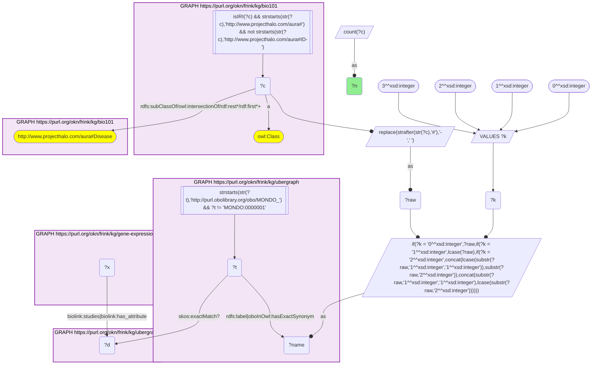

# D58-Q2: Which textbook processes change in textbook diseases

- **Date:** 2026-11-03
- **Model:** claude-opus-5-5
- **SPARQL endpoint:** https://apps.okn.us/federation/sparql
- **Generated by:** mcp-okn v0.3.0 (build d9c9ef9)
- **Contents:** 2 queries · 2 query diagrams

## Knowledge graphs used

- `bio101` — <https://purl.org/okn/frink/kg/bio101>
- `ubergraph` — <https://purl.org/okn/frink/kg/ubergraph>
- `gene-expression-atlas-okn` — <https://purl.org/okn/frink/kg/gene-expression-atlas-okn>

## Conversation

👤 **User**

Crosswalk: `bio101` × `gene-expression-atlas-okn` on **MONDO (bio101 label), bridged through `ubergraph`** (crosswalk `KB23-mondo-label-bio101-gxa`, verified_count 27). KB Bio 101 is an OWL ontology of an introductory biology textbook: every concept is an `owl:Class` IRI `http://www.projecthalo.com/aura#{Name}` with no `rdfs:label` and no external id, so the concept NAME (local name, hyphens → spaces, four case forms: as-is, all lower-case, first letter lowered, sentence case) is matched as a bound literal against ubergraph `rdfs:label | oboInOwl:hasExactSynonym` on `obo/MONDO_` terms. Expression Atlas (`gene-expression-atlas-okn`) types the disease a study is about as a `biolink:Disease` node, mostly an EFO IRI, sometimes a raw `obo/MONDO_` IRI or an Orphanet IRI. A study (`biolink:Study`, `wobd/study/E-GEOD-1919`) points at it with `biolink:studies`, and each differential-expression contrast (`biolink:Assay`, named `'test' vs 'reference'` on `biolink:name`) with `biolink:has_attribute`. The matched MONDO term reaches that node either directly or through ubergraph `skos:exactMatch` (MONDO → EFO / Orphanet), the curated mapping crosswalk A19 uses; the name match is scoped to bio101's Disease subtree. This question also uses the sibling crosswalk `KB18-go-label-bio101-gxa` (bio101 process and structure names → GO, verified_count 193) on the GO enrichments of the same contrasts (`biolink:subject` = the contrast, `biolink:object` = a raw `obo/GO_` IRI; `wobd:direction` is 'up' on every enrichment in this release).

Research question: when an Expression Atlas contrast is annotated with a disease KB Bio 101 teaches and is enriched for a process or structure KB Bio 101 teaches, which textbook disease × textbook process pairs occur in the most contrasts? Do they read like textbook pathophysiology?

Why the join is required: both ends are textbook concepts without identifiers; only the two name bridges (→ MONDO and → GO, through ubergraph) can place them on the same contrast.

---

🧠 **Assistant**

**Bridge established (Query 1).** The crosswalk skeleton, run verbatim, returns **27** bio101 diseases that reach an Expression Atlas disease node through the name → MONDO bridge (directly or via ubergraph's exact match to EFO / Orphanet), matching the catalogued `verified_count`. Query 2 keeps the contrasts annotated with one of those diseases. It then adds a second name bridge, bio101 → GO through ubergraph (the KB18 recipe), on the GO enrichments of the same contrasts.

**Textbook disease × textbook process pairs (Query 2).** **36** pairs in all, each found in 1–4 contrasts:

| bio101 disease | bio101 process / structure | Contrasts |
|---|---|---|
| Influenza | Chemotaxis | 4 |
| Alzheimers-Disease | Proteasome | 3 |
| Rheumatoid-Arthritis | Antigen-Presentation | 3 |
| Alzheimers-Disease | Synaptic-Vesicle | 2 |
| Cancer | Chemotaxis | 2 |
| CML | Proteasome | 2 |
| Rheumatoid-Arthritis | Chemotaxis | 2 |

The 29 single-contrast pairs include:

- **Alzheimers-Disease:** Associative-Learning and Classical-Conditioning (one GO term, GO_0008306, reached by both names).
- **Rheumatoid-Arthritis:** Antibody, Phagocytosis and Circadian-Rhythm.
- **Infections:** Tuberculosis × Chemotaxis and × Microfilament; Lyme-Disease × Antibody; Influenza × Microvillus.
- **Schizophrenia:** Memory and Cell-Body.
- **Diabetes-Mellitus:** Muscle-Contraction, Myofibril and Sarcoplasmic-Reticulum.
- **Endometriosis:** a block of cell-division and cilium terms (Kinetochore, Mitotic-Cell-Cycle, Spindle, Mitotic-Spindle, Microtubule, Cilium, Eukaryotic-Flagellum).
- **Cancer:** Electron-Transport-Chain and Proteasome.
- **CML:** Antigen-Presentation and Kinetochore.
- **Multiple-Sclerosis:** Receptor-Mediated-Endocytosis and Small-Ribosomal-Subunit.
- **Type-2-Diabetes-Mellitus:** Basement-Membrane and Chemotaxis.

**Answer.** The overlap is small: 36 pairs, none in more than 4 contrasts. Most of the textbook's diseases have few contrasts annotated with the disease itself, and only part of those are enriched for a GO term the textbook names.

Many pairs read like the pathophysiology a textbook would give:

- immune-cell chemotaxis in influenza, tuberculosis and rheumatoid arthritis;
- antigen presentation, antibody and phagocytosis in rheumatoid arthritis, an autoimmune disease;
- synaptic vesicles and learning or memory terms in Alzheimer's disease and schizophrenia;
- proteasome enrichment in Alzheimer's disease, where protein clearance fails, and in CML;
- muscle contraction and sarcoplasmic reticulum in a diabetes contrast, which suggests muscle tissue was sampled;
- cell-division and cilium terms in endometriosis, consistent with proliferating, partly ciliated endometrial tissue.

Caveats:

- Every Expression Atlas enrichment carries `wobd:direction` "up", so these rows cannot tell whether a process went up or down.
- A disease annotation on a contrast does not say which side of the comparison is diseased.
- With counts this small, single-contrast pairs are anecdotes, not trends.
- Both bridges are exact-name lower bounds. The disease side is scoped to bio101's Disease subtree; the GO side excludes four homonyms (Internode, Pore, Degradation, Neurohormone).

## SPARQL queries executed

#### Query 1

_2026-11-04T01:41:26+00:00 · `bio101`, `ubergraph`, `gene-expression-atlas-okn`_

```sparql
SELECT (COUNT(DISTINCT ?c) AS ?n) WHERE {
  { SELECT DISTINCT ?c ?t WHERE {
  { SELECT DISTINCT ?c ?name WHERE {
      GRAPH <https://purl.org/okn/frink/kg/bio101> { ?c a <http://www.w3.org/2002/07/owl#Class> .
        FILTER(isIRI(?c) && STRSTARTS(STR(?c),'http://www.projecthalo.com/aura#') && !STRSTARTS(STR(?c),'http://www.projecthalo.com/aura#ID-')) }
      GRAPH <https://purl.org/okn/frink/kg/bio101> { ?c (<http://www.w3.org/2000/01/rdf-schema#subClassOf>/(<http://www.w3.org/2002/07/owl#intersectionOf>/<http://www.w3.org/1999/02/22-rdf-syntax-ns#rest>*/<http://www.w3.org/1999/02/22-rdf-syntax-ns#first>)*)+ <http://www.projecthalo.com/aura#Disease> . }
      BIND(REPLACE(STRAFTER(STR(?c),'#'),'-',' ') AS ?raw)
      VALUES ?k { 0 1 2 3 }  # as-is, all lower, first letter lowered, sentence case
      BIND(IF(?k = 0, ?raw, IF(?k = 1, LCASE(?raw), IF(?k = 2, CONCAT(LCASE(SUBSTR(?raw,1,1)),SUBSTR(?raw,2)),
                CONCAT(SUBSTR(?raw,1,1),LCASE(SUBSTR(?raw,2)))))) AS ?name)
  } }
    GRAPH <https://purl.org/okn/frink/kg/ubergraph> { ?t <http://www.w3.org/2000/01/rdf-schema#label>|<http://www.geneontology.org/formats/oboInOwl#hasExactSynonym> ?name .
      FILTER(STRSTARTS(STR(?t),'http://purl.obolibrary.org/obo/MONDO_') && ?t != <http://purl.obolibrary.org/obo/MONDO_0000001>) }
  } }
  GRAPH <https://purl.org/okn/frink/kg/ubergraph> { ?t <http://www.w3.org/2004/02/skos/core#exactMatch>? ?d . }
  GRAPH <https://purl.org/okn/frink/kg/gene-expression-atlas-okn> { ?x <https://w3id.org/biolink/vocab/studies>|<https://w3id.org/biolink/vocab/has_attribute> ?d . }
}
```



_1 row(s)_

| n |
| --- |
| 27 |

#### Query 2

_2026-11-04T01:41:28+00:00 · `bio101`, `ubergraph`, `gene-expression-atlas-okn`_

```sparql
SELECT ?c ?cG (COUNT(DISTINCT ?a) AS ?contrasts) WHERE {
  { SELECT DISTINCT ?c ?t WHERE {
  { SELECT DISTINCT ?c ?name WHERE {
      GRAPH <https://purl.org/okn/frink/kg/bio101> { ?c a <http://www.w3.org/2002/07/owl#Class> .
        FILTER(isIRI(?c) && STRSTARTS(STR(?c),'http://www.projecthalo.com/aura#') && !STRSTARTS(STR(?c),'http://www.projecthalo.com/aura#ID-')) }
      GRAPH <https://purl.org/okn/frink/kg/bio101> { ?c (<http://www.w3.org/2000/01/rdf-schema#subClassOf>/(<http://www.w3.org/2002/07/owl#intersectionOf>/<http://www.w3.org/1999/02/22-rdf-syntax-ns#rest>*/<http://www.w3.org/1999/02/22-rdf-syntax-ns#first>)*)+ <http://www.projecthalo.com/aura#Disease> . }
      BIND(REPLACE(STRAFTER(STR(?c),'#'),'-',' ') AS ?raw)
      VALUES ?k { 0 1 2 3 }  # as-is, all lower, first letter lowered, sentence case
      BIND(IF(?k = 0, ?raw, IF(?k = 1, LCASE(?raw), IF(?k = 2, CONCAT(LCASE(SUBSTR(?raw,1,1)),SUBSTR(?raw,2)),
                CONCAT(SUBSTR(?raw,1,1),LCASE(SUBSTR(?raw,2)))))) AS ?name)
  } }
    GRAPH <https://purl.org/okn/frink/kg/ubergraph> { ?t <http://www.w3.org/2000/01/rdf-schema#label>|<http://www.geneontology.org/formats/oboInOwl#hasExactSynonym> ?name .
      FILTER(STRSTARTS(STR(?t),'http://purl.obolibrary.org/obo/MONDO_') && ?t != <http://purl.obolibrary.org/obo/MONDO_0000001>) }
  } }
  GRAPH <https://purl.org/okn/frink/kg/ubergraph> { ?t <http://www.w3.org/2004/02/skos/core#exactMatch>? ?d . }
  GRAPH <https://purl.org/okn/frink/kg/gene-expression-atlas-okn> { ?a a <https://w3id.org/biolink/vocab/Assay> ; <https://w3id.org/biolink/vocab/has_attribute> ?d . ?e <https://w3id.org/biolink/vocab/subject> ?a ; <https://w3id.org/biolink/vocab/object> ?tG . }
  { SELECT DISTINCT ?cG ?tG WHERE {
  { SELECT DISTINCT ?cG ?nameG WHERE {
      GRAPH <https://purl.org/okn/frink/kg/bio101> { ?cG a <http://www.w3.org/2002/07/owl#Class> .
        FILTER(isIRI(?cG) && STRSTARTS(STR(?cG),'http://www.projecthalo.com/aura#') && !STRSTARTS(STR(?cG),'http://www.projecthalo.com/aura#ID-')) }
      FILTER(?cG NOT IN (<http://www.projecthalo.com/aura#Internode>, <http://www.projecthalo.com/aura#Pore>, <http://www.projecthalo.com/aura#Degradation>, <http://www.projecthalo.com/aura#Neurohormone>))  # homonyms (spot-checked 2026-11-03)
      BIND(REPLACE(STRAFTER(STR(?cG),'#'),'-',' ') AS ?rawG)
      VALUES ?kG { 0 1 2 3 }  # as-is, all lower, first letter lowered, sentence case
      BIND(IF(?kG = 0, ?rawG, IF(?kG = 1, LCASE(?rawG), IF(?kG = 2, CONCAT(LCASE(SUBSTR(?rawG,1,1)),SUBSTR(?rawG,2)),
                CONCAT(SUBSTR(?rawG,1,1),LCASE(SUBSTR(?rawG,2)))))) AS ?nameG)
  } }
    GRAPH <https://purl.org/okn/frink/kg/ubergraph> { ?tG <http://www.w3.org/2000/01/rdf-schema#label>|<http://www.geneontology.org/formats/oboInOwl#hasExactSynonym> ?nameG .
      FILTER(STRSTARTS(STR(?tG),'http://purl.obolibrary.org/obo/GO_') && ?tG != <http://purl.obolibrary.org/obo/GO_0008150> && ?tG != <http://purl.obolibrary.org/obo/GO_0005575> && ?tG != <http://purl.obolibrary.org/obo/GO_0003674>) }
  } }
} GROUP BY ?c ?cG ORDER BY DESC(?contrasts) ?c ?cG LIMIT 40
```



```mermaid
graph TD
classDef projected fill:lightgreen;
classDef literal fill:orange;
classDef iri fill:yellow;
  q1v12("?a")
  q1v3("?c"):::projected 
  q1v2("?cG"):::projected 
  q1v1("?contrasts"):::projected 
  q1v11("?d")
  q1v13("?e")
  q1v8("?k")
  q1v16("?kG")
  q1v7("?name")
  q1v15("?nameG")
  q1v9("?raw")
  q1v17("?rawG")
  q1v10("?t")
  q1v14("?tG")
  q1c7(["http://www.projecthalo.com/aura#Degradation"]):::iri 
  q1c5(["http://www.projecthalo.com/aura#Internode"]):::iri 
  q1c8(["http://www.projecthalo.com/aura#Neurohormone"]):::iri 
  q1c6(["http://www.projecthalo.com/aura#Pore"]):::iri 
  subgraph q1graph0["GRAPH https://purl.org/okn/frink/kg/bio101"]
    style q1graph0 fill:#f3e5f5,stroke:#8e24aa,stroke-width:2px,color:#000;
    q1graph0c2(["owl:Class"]):::iri 
    q1graph0f0[["isIRI(?c) && strstarts(str(?c),'http://www.projecthalo.com/aura#') && not strstarts(str(?c),'http://www.projecthalo.com/aura#ID-')"]]
    q1graph0f0 --> q1v3
    q1v3 --"a"--> q1graph0c2
  end
  subgraph q1graph1["GRAPH https://purl.org/okn/frink/kg/bio101"]
    style q1graph1 fill:#f3e5f5,stroke:#8e24aa,stroke-width:2px,color:#000;
    q1graph1c1(["http://www.projecthalo.com/aura#Disease"]):::iri 
    q1v3 --"rdfs:subClassOf/owl:intersectionOf/rdf:rest*/rdf:first*+"--> q1graph1c1
  end
  q1bind0[/"replace(strafter(str(?c),'#'),'-',' ')"/]
  q1v3 --o q1bind0
  q1bind0 --as--o q1v9
  q1bind1[/"VALUES ?k"/]
  q1bind1-->q1v8
  q1bind10(["0^^xsd:integer"])
  q1bind10 --> q1bind1
  q1bind11(["1^^xsd:integer"])
  q1bind11 --> q1bind1
  q1bind12(["2^^xsd:integer"])
  q1bind12 --> q1bind1
  q1bind13(["3^^xsd:integer"])
  q1bind13 --> q1bind1
  q1bind2[/"if(?k = '0^^xsd:integer',?raw,if(?k = '1^^xsd:integer',lcase(?raw),if(?k = '2^^xsd:integer',concat(lcase(substr(?raw,'1^^xsd:integer','1^^xsd:integer')),substr(?raw,'2^^xsd:integer')),concat(substr(?raw,'1^^xsd:integer','1^^xsd:integer'),lcase(substr(?raw,'2^^xsd:integer'))))))"/]
  q1v8 --o q1bind2
  q1v9 --o q1bind2
  q1bind2 --as--o q1v7
  subgraph q1graph2["GRAPH https://purl.org/okn/frink/kg/ubergraph"]
    style q1graph2 fill:#f3e5f5,stroke:#8e24aa,stroke-width:2px,color:#000;
    q1graph2f1[["strstarts(str(?t),'http://purl.obolibrary.org/obo/MONDO_') && ?t != 'MONDO:0000001'"]]
    q1graph2f1 --> q1v10
    q1v10 --"rdfs:label|oboInOwl:hasExactSynonym"--> q1v7
  end
  subgraph q1graph3["GRAPH https://purl.org/okn/frink/kg/ubergraph"]
    style q1graph3 fill:#f3e5f5,stroke:#8e24aa,stroke-width:2px,color:#000;
    q1v10 --"skos:exactMatch?"--> q1v11
  end
  subgraph q1graph4["GRAPH https://purl.org/okn/frink/kg/gene-expression-atlas-okn"]
    style q1graph4 fill:#f3e5f5,stroke:#8e24aa,stroke-width:2px,color:#000;
    q1graph4c2(["biolink:Assay"]):::iri 
    q1v12 --"a"--> q1graph4c2
    q1v13 --"biolink:subject"--> q1v12
    q1v12 --"biolink:has_attribute"--> q1v11
    q1v13 --"biolink:object"--> q1v14
  end
  q1f2[["?cG not in ('http://www.projecthalo.com/aura#Internode', 'http://www.projecthalo.com/aura#Pore', 'http://www.projecthalo.com/aura#Degradation', 'http://www.projecthalo.com/aura#Neurohormone')"]]
  q1c5 --o q1f2
  q1c6 --o q1f2
  q1c7 --o q1f2
  q1c8 --o q1f2
  q1f2 --> q1v2
  subgraph q1graph5["GRAPH https://purl.org/okn/frink/kg/bio101"]
    style q1graph5 fill:#f3e5f5,stroke:#8e24aa,stroke-width:2px,color:#000;
    q1graph5c2(["owl:Class"]):::iri 
    q1graph5f3[["isIRI(?cG) && strstarts(str(?cG),'http://www.projecthalo.com/aura#') && not strstarts(str(?cG),'http://www.projecthalo.com/aura#ID-')"]]
    q1graph5f3 --> q1v2
    q1v2 --"a"--> q1graph5c2
  end
  q1bind3[/"replace(strafter(str(?cG),'#'),'-',' ')"/]
  q1v2 --o q1bind3
  q1bind3 --as--o q1v17
  q1bind4[/"VALUES ?kG"/]
  q1bind4-->q1v16
  q1bind40(["0^^xsd:integer"])
  q1bind40 --> q1bind4
  q1bind41(["1^^xsd:integer"])
  q1bind41 --> q1bind4
  q1bind42(["2^^xsd:integer"])
  q1bind42 --> q1bind4
  q1bind43(["3^^xsd:integer"])
  q1bind43 --> q1bind4
  q1bind5[/"if(?kG = '0^^xsd:integer',?rawG,if(?kG = '1^^xsd:integer',lcase(?rawG),if(?kG = '2^^xsd:integer',concat(lcase(substr(?rawG,'1^^xsd:integer','1^^xsd:integer')),substr(?rawG,'2^^xsd:integer')),concat(substr(?rawG,'1^^xsd:integer','1^^xsd:integer'),lcase(substr(?rawG,'2^^xsd:integer'))))))"/]
  q1v16 --o q1bind5
  q1v17 --o q1bind5
  q1bind5 --as--o q1v15
  subgraph q1graph6["GRAPH https://purl.org/okn/frink/kg/ubergraph"]
    style q1graph6 fill:#f3e5f5,stroke:#8e24aa,stroke-width:2px,color:#000;
    q1graph6f4[["strstarts(str(?tG),'http://purl.obolibrary.org/obo/GO_') && ?tG != 'GO:0008150' && ?tG != 'GO:0005575' && ?tG != 'GO:0003674'"]]
    q1graph6f4 --> q1v14
    q1v14 --"rdfs:label|oboInOwl:hasExactSynonym"--> q1v15
  end
  q1bind6[/"count(?a)"/]
  q1bind6 --as--o q1v1
```

_36 row(s) — showing first 5_

| c | cG | contrasts |
| --- | --- | --- |
| http://www.projecthalo.com/aura#Influenza | http://www.projecthalo.com/aura#Chemotaxis | 4 |
| http://www.projecthalo.com/aura#Alzheimers-Disease | http://www.projecthalo.com/aura#Proteasome | 3 |
| http://www.projecthalo.com/aura#Rheumatoid-Arthritis | http://www.projecthalo.com/aura#Antigen-Presentation | 3 |
| http://www.projecthalo.com/aura#Alzheimers-Disease | http://www.projecthalo.com/aura#Synaptic-Vesicle | 2 |
| http://www.projecthalo.com/aura#Cancer | http://www.projecthalo.com/aura#Chemotaxis | 2 |
