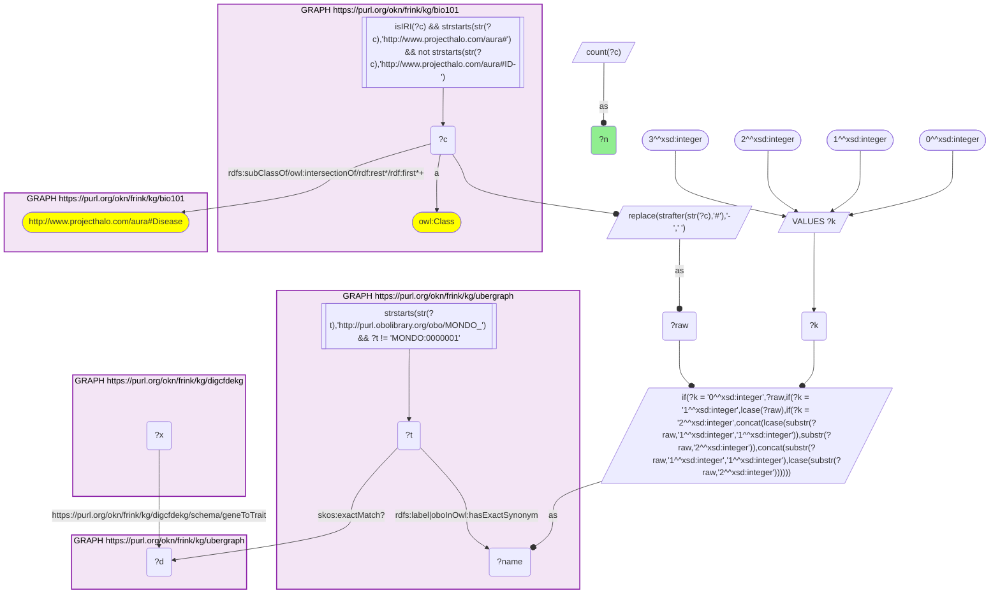
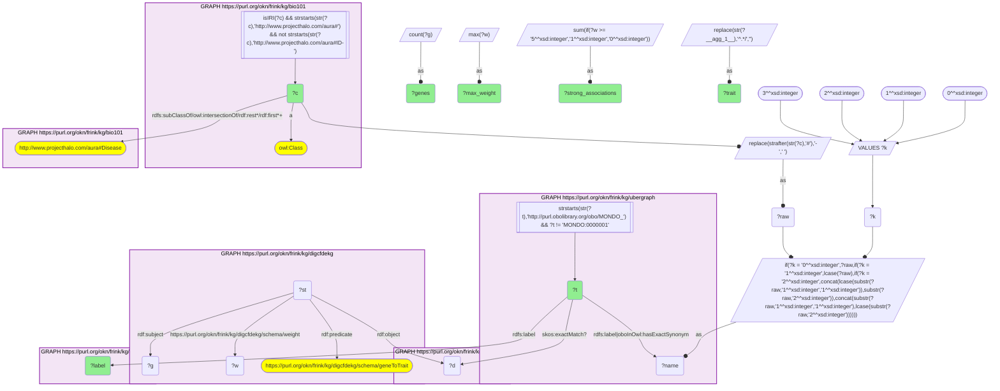

# D59-Q1: KB Bio 101's textbook diseases ranked by PIGEAN gene associations

- **Date:** 2026-11-03
- **Model:** claude-opus-5-5
- **SPARQL endpoint:** https://apps.okn.us/federation/sparql
- **Generated by:** mcp-okn v0.3.0 (build d056eb6)
- **Contents:** 2 queries · 2 query diagrams

## Knowledge graphs used

- `bio101` — <https://purl.org/okn/frink/kg/bio101>
- `ubergraph` — <https://purl.org/okn/frink/kg/ubergraph>
- `digcfdekg` — <https://purl.org/okn/frink/kg/digcfdekg>

## Conversation

👤 **User**

Crosswalk: `bio101` × `digcfdekg` on **MONDO (bio101 label), bridged through `ubergraph`** (crosswalk `KB25-mondo-label-bio101-digcfdekg`, verified_count 20). KB Bio 101 is an OWL ontology of an introductory biology textbook: every concept is an `owl:Class` IRI `http://www.projecthalo.com/aura#{Name}` with no `rdfs:label` and no external id, so the concept NAME (local name, hyphens → spaces, four case forms: as-is, all lower-case, first letter lowered, sentence case) is matched as a bound literal against ubergraph `rdfs:label | oboInOwl:hasExactSynonym` on `obo/MONDO_` terms. digcfdekg (`digcfdekg`) holds PIGEAN gene → trait associations: `?gene digcfdekg:geneToTrait ?trait` (gene = an NCBI Gene IRI, symbol on `rdfs:label`), each also reified as an `rdf:Statement` (`digcfdekg:GeneTraitAssociation`) that carries the PIGEAN combined score on `digcfdekg:weight`. Traits are MONDO, EFO or Orphanet IRIs, so the matched MONDO term reaches the trait either directly or through ubergraph `skos:exactMatch` (MONDO → EFO / Orphanet), the curated mapping crosswalk A25 uses; the name match is scoped to bio101's Disease subtree.

Research question: which diseases KB Bio 101 teaches carry PIGEAN gene associations in digcfdekg, how many genes each, how many of them strongly (weight ≥ 5), and under which trait identifier? Rank them.

Why the join is required: bio101 names the diseases a curriculum covers but holds no genes or identifiers; digcfdekg holds genome-wide gene → trait scores keyed on MONDO, EFO and Orphanet. Only the name → MONDO bridge through ubergraph, plus ubergraph's MONDO → EFO / Orphanet exact matches, joins them.

---

🧠 **Assistant**

**Bridge established (Query 1).** The crosswalk skeleton, run verbatim, returns **20** bio101 diseases, matching the catalogued `verified_count`. Each one's name is an exact MONDO label or exact synonym in ubergraph within bio101's Disease subtree, *and* that MONDO term, or the EFO / Orphanet term it exactly matches in ubergraph, is the trait of at least one digcfdekg `geneToTrait` association. Query 2 returns 21 rows, because Color-Blindness reaches two traits (the MONDO term and an Orphanet term).

**Ranking (Query 2).** Distinct PIGEAN genes, associations with weight ≥ 5, and the highest weight:

| Rank | bio101 disease | MONDO (ubergraph label) | digcfdekg trait | Genes | Weight ≥ 5 | Max weight |
|---|---|---|---|---|---|---|
| 1 | Inborn-Error-Of-Metabolism | MONDO_0019052 | Orphanet_68367 | 2,046 | 814 | 13.9 |
| 2 | Major-Depression | MONDO_0002009 | MONDO_0002009 | 1,466 | 4 | 6.38 |
| 3 | Color-Blindness | MONDO_0001703 (color vision disorder) | MONDO_0001703 | 1,336 | 13 | 6.28 |
| 4 | Chromosomal-Disorder | MONDO_0019040 | Orphanet_68335 | 1,093 | 85 | 9.25 |
| 5 | Multiple-Sclerosis | MONDO_0005301 | MONDO_0005301 | 1,059 | 107 | 10.6 |
| 6 | Mitochondrial-Myopathy | MONDO_0009637 (inborn mitochondrial myopathy) | Orphanet_206966 | 857 | 75 | 13.7 |
| 7 | Type-2-Diabetes-Mellitus | MONDO_0005148 | MONDO_0005148 | 849 | 37 | 10.3 |
| 8 | Breast-Cancer | MONDO_0007254 | MONDO_0007254 | 484 | 9 | 8.27 |
| 9 | Bipolar-Disorder | MONDO_0004985 | MONDO_0004985 | 482 | 0 | 4.78 |
| 10 | Autoimmune-Disease | MONDO_0007179 | MONDO_0007179 | 440 | 25 | 7.77 |
| 11 | Lysosomal-Disorder | MONDO_0002561 (lysosomal storage disease) | Orphanet_68366 | 328 | 58 | 12.3 |
| 12 | Cancer | MONDO_0004992 | MONDO_0004992 | 322 | 5 | 7.56 |
| 13 | Type-1-Diabetes-Mellitus | MONDO_0005147 | MONDO_0005147 | 232 | 8 | 8.13 |
| 14 | Lupus | MONDO_0007915 (systemic lupus erythematosus) | Orphanet_536 | 224 | 21 | 9.04 |

The rest are:

- Color-Blindness's second trait, Orphanet_98658 (197 genes, 10 strong, max 10.3);
- Diabetes-Mellitus (130, 0 strong), Tuberculosis (98, 0), Malaria (69, 0) and AIDS (24, 0);
- Cystic-Fibrosis (19 genes, 1 strong, max 5.97) and Encephalitis (10 genes, 5 strong).

**Answer.** **20** of the textbook's diseases carry PIGEAN gene scores:

- 12 directly as MONDO traits;
- 7 only through ubergraph's exact match to an Orphanet trait: inborn errors of metabolism, chromosomal disorder, mitochondrial myopathy, lysosomal storage disease, lupus, cystic fibrosis and encephalitis;
- Color-Blindness through both routes.

The number of genes and the strength of evidence diverge:

- **Broad metabolic and genetic classes score strongly.** Inborn errors of metabolism has 2,046 genes with 814 strong associations (max 13.9), and mitochondrial myopathy and lysosomal storage disease reach weights above 12. These classes collect many well-established monogenic genes.
- **Common complex diseases score weakly despite long lists.** Major depression has 1,466 genes but only 4 strong associations, and bipolar disorder has 482 genes with none.
- **Multiple sclerosis (107 strong) and type 2 diabetes (37) sit between the two.**
- **The textbook infections score weakly.** Tuberculosis, malaria and AIDS have only weak associations (max weight ≤ 4.44).

Caveats:

- The weight is PIGEAN's combined score. "≥ 5" is a reading aid chosen here, not a PIGEAN significance threshold.
- Counts are per trait IRI. A class-level Orphanet trait (such as "inborn errors of metabolism") gathers genes of many specific disorders.
- This is an exact-name lower bound, scoped to bio101's Disease subtree (MONDO root excluded). The EFO / Orphanet leg uses ubergraph's curated `skos:exactMatch`, not label matching.

## SPARQL queries executed

#### Query 1

_2026-11-04T01:55:18+00:00 · `bio101`, `ubergraph`, `digcfdekg`_

```sparql
SELECT (COUNT(DISTINCT ?c) AS ?n) WHERE {
  { SELECT DISTINCT ?c ?t WHERE {
  { SELECT DISTINCT ?c ?name WHERE {
      GRAPH <https://purl.org/okn/frink/kg/bio101> { ?c a <http://www.w3.org/2002/07/owl#Class> .
        FILTER(isIRI(?c) && STRSTARTS(STR(?c),'http://www.projecthalo.com/aura#') && !STRSTARTS(STR(?c),'http://www.projecthalo.com/aura#ID-')) }
      GRAPH <https://purl.org/okn/frink/kg/bio101> { ?c (<http://www.w3.org/2000/01/rdf-schema#subClassOf>/(<http://www.w3.org/2002/07/owl#intersectionOf>/<http://www.w3.org/1999/02/22-rdf-syntax-ns#rest>*/<http://www.w3.org/1999/02/22-rdf-syntax-ns#first>)*)+ <http://www.projecthalo.com/aura#Disease> . }
      BIND(REPLACE(STRAFTER(STR(?c),'#'),'-',' ') AS ?raw)
      VALUES ?k { 0 1 2 3 }  # as-is, all lower, first letter lowered, sentence case
      BIND(IF(?k = 0, ?raw, IF(?k = 1, LCASE(?raw), IF(?k = 2, CONCAT(LCASE(SUBSTR(?raw,1,1)),SUBSTR(?raw,2)),
                CONCAT(SUBSTR(?raw,1,1),LCASE(SUBSTR(?raw,2)))))) AS ?name)
  } }
    GRAPH <https://purl.org/okn/frink/kg/ubergraph> { ?t <http://www.w3.org/2000/01/rdf-schema#label>|<http://www.geneontology.org/formats/oboInOwl#hasExactSynonym> ?name .
      FILTER(STRSTARTS(STR(?t),'http://purl.obolibrary.org/obo/MONDO_') && ?t != <http://purl.obolibrary.org/obo/MONDO_0000001>) }
  } }
  GRAPH <https://purl.org/okn/frink/kg/ubergraph> { ?t <http://www.w3.org/2004/02/skos/core#exactMatch>? ?d . }
  GRAPH <https://purl.org/okn/frink/kg/digcfdekg> { ?x <https://purl.org/okn/frink/kg/digcfdekg/schema/geneToTrait> ?d . }
}
```



_1 row(s)_

| n |
| --- |
| 20 |

#### Query 2

_2026-11-04T01:55:19+00:00 · `bio101`, `ubergraph`, `digcfdekg`_

```sparql
SELECT ?c ?t ?label (REPLACE(STR(?d), '^.*/', '') AS ?trait) (COUNT(DISTINCT ?g) AS ?genes) (SUM(IF(?w >= 5, 1, 0)) AS ?strong_associations) (MAX(?w) AS ?max_weight) WHERE {
  { SELECT DISTINCT ?c ?t WHERE {
  { SELECT DISTINCT ?c ?name WHERE {
      GRAPH <https://purl.org/okn/frink/kg/bio101> { ?c a <http://www.w3.org/2002/07/owl#Class> .
        FILTER(isIRI(?c) && STRSTARTS(STR(?c),'http://www.projecthalo.com/aura#') && !STRSTARTS(STR(?c),'http://www.projecthalo.com/aura#ID-')) }
      GRAPH <https://purl.org/okn/frink/kg/bio101> { ?c (<http://www.w3.org/2000/01/rdf-schema#subClassOf>/(<http://www.w3.org/2002/07/owl#intersectionOf>/<http://www.w3.org/1999/02/22-rdf-syntax-ns#rest>*/<http://www.w3.org/1999/02/22-rdf-syntax-ns#first>)*)+ <http://www.projecthalo.com/aura#Disease> . }
      BIND(REPLACE(STRAFTER(STR(?c),'#'),'-',' ') AS ?raw)
      VALUES ?k { 0 1 2 3 }  # as-is, all lower, first letter lowered, sentence case
      BIND(IF(?k = 0, ?raw, IF(?k = 1, LCASE(?raw), IF(?k = 2, CONCAT(LCASE(SUBSTR(?raw,1,1)),SUBSTR(?raw,2)),
                CONCAT(SUBSTR(?raw,1,1),LCASE(SUBSTR(?raw,2)))))) AS ?name)
  } }
    GRAPH <https://purl.org/okn/frink/kg/ubergraph> { ?t <http://www.w3.org/2000/01/rdf-schema#label>|<http://www.geneontology.org/formats/oboInOwl#hasExactSynonym> ?name .
      FILTER(STRSTARTS(STR(?t),'http://purl.obolibrary.org/obo/MONDO_') && ?t != <http://purl.obolibrary.org/obo/MONDO_0000001>) }
  } }
  GRAPH <https://purl.org/okn/frink/kg/ubergraph> { ?t <http://www.w3.org/2004/02/skos/core#exactMatch>? ?d . }
  GRAPH <https://purl.org/okn/frink/kg/digcfdekg> { ?st <http://www.w3.org/1999/02/22-rdf-syntax-ns#predicate> <https://purl.org/okn/frink/kg/digcfdekg/schema/geneToTrait> ; <http://www.w3.org/1999/02/22-rdf-syntax-ns#object> ?d ; <http://www.w3.org/1999/02/22-rdf-syntax-ns#subject> ?g ; <https://purl.org/okn/frink/kg/digcfdekg/schema/weight> ?w . }
  GRAPH <https://purl.org/okn/frink/kg/ubergraph> { ?t <http://www.w3.org/2000/01/rdf-schema#label> ?label }
} GROUP BY ?c ?t ?label ?d ORDER BY DESC(?genes) ?c
```



_21 row(s) — showing first 5_

| c | t | label | trait | genes | strong_associations | max_weight |
| --- | --- | --- | --- | --- | --- | --- |
| http://www.projecthalo.com/aura#Inborn-Error-Of-Metabolism | http://purl.obolibrary.org/obo/MONDO_0019052 | inborn errors of metabolism | Orphanet_68367 | 2046 | 814 | 13.9 |
| http://www.projecthalo.com/aura#Major-Depression | http://purl.obolibrary.org/obo/MONDO_0002009 | major depressive disorder | MONDO_0002009 | 1466 | 4 | 6.38 |
| http://www.projecthalo.com/aura#Color-Blindness | http://purl.obolibrary.org/obo/MONDO_0001703 | color vision disorder | MONDO_0001703 | 1336 | 13 | 6.28 |
| http://www.projecthalo.com/aura#Chromosomal-Disorder | http://purl.obolibrary.org/obo/MONDO_0019040 | chromosomal disorder | Orphanet_68335 | 1093 | 85 | 9.25 |
| http://www.projecthalo.com/aura#Multiple-Sclerosis | http://purl.obolibrary.org/obo/MONDO_0005301 | multiple sclerosis | MONDO_0005301 | 1059 | 107 | 10.6 |
