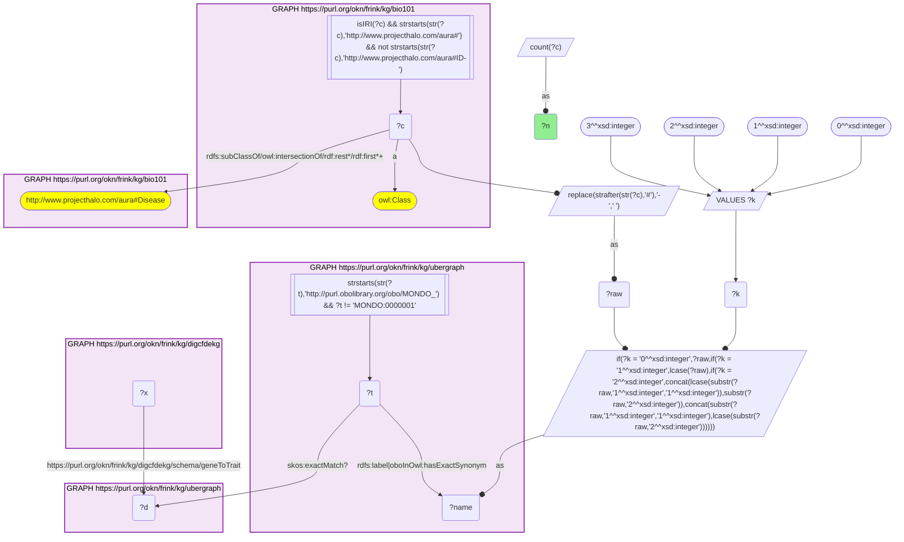
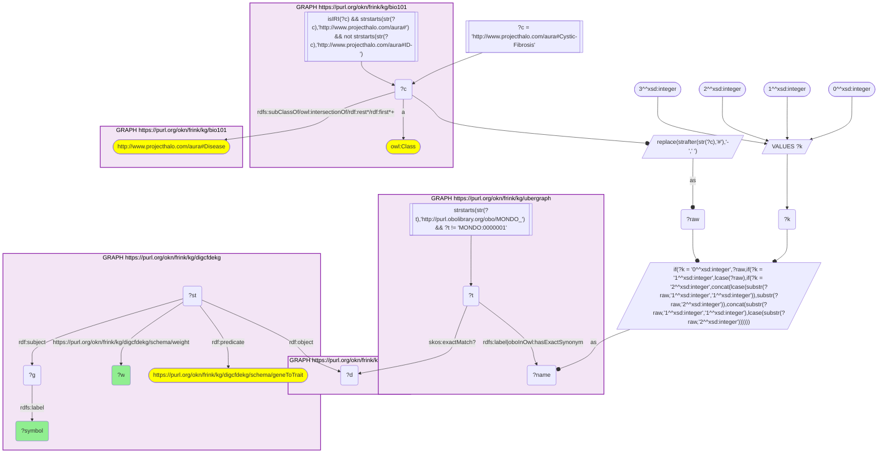

# D59-Q2: Top PIGEAN genes for KB Bio 101's genetic disorders

- **Date:** 2026-11-03
- **Model:** claude-opus-5-5
- **SPARQL endpoint:** https://apps.okn.us/federation/sparql
- **Generated by:** mcp-okn v0.3.0 (build d056eb6)
- **Contents:** 3 queries · 3 query diagrams

## Knowledge graphs used

- `bio101` — <https://purl.org/okn/frink/kg/bio101>
- `ubergraph` — <https://purl.org/okn/frink/kg/ubergraph>
- `digcfdekg` — <https://purl.org/okn/frink/kg/digcfdekg>

## Conversation

👤 **User**

Crosswalk: `bio101` × `digcfdekg` on **MONDO (bio101 label), bridged through `ubergraph`** (crosswalk `KB25-mondo-label-bio101-digcfdekg`, verified_count 20). KB Bio 101 is an OWL ontology of an introductory biology textbook: every concept is an `owl:Class` IRI `http://www.projecthalo.com/aura#{Name}` with no `rdfs:label` and no external id, so the concept NAME (local name, hyphens → spaces, four case forms: as-is, all lower-case, first letter lowered, sentence case) is matched as a bound literal against ubergraph `rdfs:label | oboInOwl:hasExactSynonym` on `obo/MONDO_` terms. digcfdekg (`digcfdekg`) holds PIGEAN gene → trait associations: `?gene digcfdekg:geneToTrait ?trait` (gene = an NCBI Gene IRI, symbol on `rdfs:label`), each also reified as an `rdf:Statement` (`digcfdekg:GeneTraitAssociation`) that carries the PIGEAN combined score on `digcfdekg:weight`. Traits are MONDO, EFO or Orphanet IRIs, so the matched MONDO term reaches the trait either directly or through ubergraph `skos:exactMatch` (MONDO → EFO / Orphanet), the curated mapping crosswalk A25 uses; the name match is scoped to bio101's Disease subtree.

Research question: for the disorders KB Bio 101 itself classifies as genetic disorders (under `aura:Genetic-Disorder`), which gene does PIGEAN score highest, and how many genes does it score strongly (weight ≥ 5)? For cystic fibrosis, the textbook single-gene example, does CFTR come first?

Why the join is required: the textbook's genetic-disorder grouping exists only in bio101's class hierarchy and the gene scores only in digcfdekg; only the name → MONDO bridge (with ubergraph's MONDO → EFO / Orphanet exact matches) links them.

---

🧠 **Assistant**

**Bridge established (Query 1).** The crosswalk skeleton, run verbatim, returns **20** bio101 diseases that reach a digcfdekg trait through the name → MONDO bridge (directly or via ubergraph's exact match to EFO / Orphanet), matching the catalogued `verified_count`. Query 2 keeps the concepts under `aura:Genetic-Disorder`, summarises each trait and returns the gene that holds the highest weight. Query 3 lists every cystic fibrosis gene by weight.

**The textbook's genetic disorders (Query 2).** Five concepts, six traits:

| bio101 genetic disorder | digcfdekg trait | Genes | Weight ≥ 5 | Max weight | Top gene |
|---|---|---|---|---|---|
| Inborn-Error-Of-Metabolism | Orphanet_68367 | 2,046 | 814 | 13.9 | MT-ATP6 |
| Lysosomal-Disorder | Orphanet_68366 | 328 | 58 | 12.3 | GBA1 |
| Color-Blindness | Orphanet_98658 | 197 | 10 | 10.3 | GNAT2 |
| Chromosomal-Disorder | Orphanet_68335 | 1,093 | 85 | 9.25 | TBX1 |
| Color-Blindness | MONDO_0001703 | 1,336 | 13 | 6.28 | INO80C |
| Cystic-Fibrosis | Orphanet_586 | 19 | 1 | 5.97 | CFTR |

**Cystic fibrosis genes (Query 3).** CFTR leads at **5.97**, about twice the next gene, TGFB1 (2.94). The remaining 17 genes all score between 2.12 and 2.90: HMOX1, CEACAM6, CLCA4, EDNRA, SERPINA1, SLC6A14, SLC11A1, KCNN4, HFE, GCLC, MIF, STX1A, SLC9A3, GSTM3, SLC26A9, CEACAM3 and DCTN4.

**Answer.** Yes. For cystic fibrosis, PIGEAN puts the textbook causal gene CFTR first, and it is the only association with weight ≥ 5. Several of the weaker genes are, from the literature rather than the graph, known CF modifier genes:

- TGFB1, SLC26A9, SLC6A14, SLC9A3 and EDNRA for lung or intestinal severity;
- DCTN4 for *Pseudomonas* infection.

So the list reads as "the cause, then the modifiers".

The other top genes are also textbook-coherent:

- **Lysosomal storage disease:** GBA1, the Gaucher disease gene.
- **Chromosomal disorders:** TBX1, the key gene of the 22q11.2 deletion (DiGeorge) syndrome.
- **Colour blindness (Orphanet trait):** GNAT2, a cone phototransduction gene mutated in achromatopsia.
- **Inborn errors of metabolism:** MT-ATP6, a mitochondrial ATP-synthase gene.

The MONDO colour-vision trait is the exception. Its top gene, INO80C (6.28), is a chromatin-remodelling gene with no textbook link to colour vision. Its 1,336 genes with only 13 strong associations look like a broad, weakly supported trait.

Caveats:

- The X-linked red–green colour-blindness genes a textbook names (OPN1LW / OPN1MW) are not in either top position. Query 2 shows only the top gene, so their exact rank is not measured here.
- Weights are PIGEAN combined scores, and "≥ 5" is a reading aid, not a significance threshold.
- Only bio101 concepts under `aura:Genetic-Disorder` that bridge are included.

## SPARQL queries executed

#### Query 1

_2026-11-04T01:55:20+00:00 · `bio101`, `ubergraph`, `digcfdekg`_

```sparql
SELECT (COUNT(DISTINCT ?c) AS ?n) WHERE {
  { SELECT DISTINCT ?c ?t WHERE {
  { SELECT DISTINCT ?c ?name WHERE {
      GRAPH <https://purl.org/okn/frink/kg/bio101> { ?c a <http://www.w3.org/2002/07/owl#Class> .
        FILTER(isIRI(?c) && STRSTARTS(STR(?c),'http://www.projecthalo.com/aura#') && !STRSTARTS(STR(?c),'http://www.projecthalo.com/aura#ID-')) }
      GRAPH <https://purl.org/okn/frink/kg/bio101> { ?c (<http://www.w3.org/2000/01/rdf-schema#subClassOf>/(<http://www.w3.org/2002/07/owl#intersectionOf>/<http://www.w3.org/1999/02/22-rdf-syntax-ns#rest>*/<http://www.w3.org/1999/02/22-rdf-syntax-ns#first>)*)+ <http://www.projecthalo.com/aura#Disease> . }
      BIND(REPLACE(STRAFTER(STR(?c),'#'),'-',' ') AS ?raw)
      VALUES ?k { 0 1 2 3 }  # as-is, all lower, first letter lowered, sentence case
      BIND(IF(?k = 0, ?raw, IF(?k = 1, LCASE(?raw), IF(?k = 2, CONCAT(LCASE(SUBSTR(?raw,1,1)),SUBSTR(?raw,2)),
                CONCAT(SUBSTR(?raw,1,1),LCASE(SUBSTR(?raw,2)))))) AS ?name)
  } }
    GRAPH <https://purl.org/okn/frink/kg/ubergraph> { ?t <http://www.w3.org/2000/01/rdf-schema#label>|<http://www.geneontology.org/formats/oboInOwl#hasExactSynonym> ?name .
      FILTER(STRSTARTS(STR(?t),'http://purl.obolibrary.org/obo/MONDO_') && ?t != <http://purl.obolibrary.org/obo/MONDO_0000001>) }
  } }
  GRAPH <https://purl.org/okn/frink/kg/ubergraph> { ?t <http://www.w3.org/2004/02/skos/core#exactMatch>? ?d . }
  GRAPH <https://purl.org/okn/frink/kg/digcfdekg> { ?x <https://purl.org/okn/frink/kg/digcfdekg/schema/geneToTrait> ?d . }
}
```



_1 row(s)_

| n |
| --- |
| 20 |

#### Query 2

_2026-11-04T01:55:22+00:00 · `bio101`, `ubergraph`, `digcfdekg`_

```sparql
SELECT ?c ?trait ?genes ?strong_associations ?max_weight (GROUP_CONCAT(DISTINCT ?sym; separator=", ") AS ?top_gene) WHERE {
  { SELECT ?c ?d (COUNT(DISTINCT ?g) AS ?genes) (SUM(IF(?w >= 5, 1, 0)) AS ?strong_associations) (MAX(?w) AS ?max_weight) WHERE {
  { SELECT DISTINCT ?c ?t WHERE {
  { SELECT DISTINCT ?c ?name WHERE {
      GRAPH <https://purl.org/okn/frink/kg/bio101> { ?c a <http://www.w3.org/2002/07/owl#Class> .
        FILTER(isIRI(?c) && STRSTARTS(STR(?c),'http://www.projecthalo.com/aura#') && !STRSTARTS(STR(?c),'http://www.projecthalo.com/aura#ID-')) }
      GRAPH <https://purl.org/okn/frink/kg/bio101> { ?c (<http://www.w3.org/2000/01/rdf-schema#subClassOf>/(<http://www.w3.org/2002/07/owl#intersectionOf>/<http://www.w3.org/1999/02/22-rdf-syntax-ns#rest>*/<http://www.w3.org/1999/02/22-rdf-syntax-ns#first>)*)+ <http://www.projecthalo.com/aura#Disease> . }
      BIND(REPLACE(STRAFTER(STR(?c),'#'),'-',' ') AS ?raw)
      VALUES ?k { 0 1 2 3 }  # as-is, all lower, first letter lowered, sentence case
      BIND(IF(?k = 0, ?raw, IF(?k = 1, LCASE(?raw), IF(?k = 2, CONCAT(LCASE(SUBSTR(?raw,1,1)),SUBSTR(?raw,2)),
                CONCAT(SUBSTR(?raw,1,1),LCASE(SUBSTR(?raw,2)))))) AS ?name)
  } }
    GRAPH <https://purl.org/okn/frink/kg/ubergraph> { ?t <http://www.w3.org/2000/01/rdf-schema#label>|<http://www.geneontology.org/formats/oboInOwl#hasExactSynonym> ?name .
      FILTER(STRSTARTS(STR(?t),'http://purl.obolibrary.org/obo/MONDO_') && ?t != <http://purl.obolibrary.org/obo/MONDO_0000001>) }
  } }
  GRAPH <https://purl.org/okn/frink/kg/ubergraph> { ?t <http://www.w3.org/2004/02/skos/core#exactMatch>? ?d . }
    GRAPH <https://purl.org/okn/frink/kg/bio101> { ?c (<http://www.w3.org/2000/01/rdf-schema#subClassOf>/(<http://www.w3.org/2002/07/owl#intersectionOf>/<http://www.w3.org/1999/02/22-rdf-syntax-ns#rest>*/<http://www.w3.org/1999/02/22-rdf-syntax-ns#first>)*)+ <http://www.projecthalo.com/aura#Genetic-Disorder> . }
    GRAPH <https://purl.org/okn/frink/kg/digcfdekg> { ?st <http://www.w3.org/1999/02/22-rdf-syntax-ns#predicate> <https://purl.org/okn/frink/kg/digcfdekg/schema/geneToTrait> ; <http://www.w3.org/1999/02/22-rdf-syntax-ns#object> ?d ; <http://www.w3.org/1999/02/22-rdf-syntax-ns#subject> ?g ; <https://purl.org/okn/frink/kg/digcfdekg/schema/weight> ?w . }
  } GROUP BY ?c ?d }
  GRAPH <https://purl.org/okn/frink/kg/digcfdekg> { ?st3 <http://www.w3.org/1999/02/22-rdf-syntax-ns#predicate> <https://purl.org/okn/frink/kg/digcfdekg/schema/geneToTrait> ; <http://www.w3.org/1999/02/22-rdf-syntax-ns#object> ?d ; <https://purl.org/okn/frink/kg/digcfdekg/schema/weight> ?max_weight ; <http://www.w3.org/1999/02/22-rdf-syntax-ns#subject> ?g3 . ?g3 <http://www.w3.org/2000/01/rdf-schema#label> ?sym . }
  BIND(REPLACE(STR(?d), '^.*/', '') AS ?trait)
} GROUP BY ?c ?trait ?genes ?strong_associations ?max_weight ORDER BY DESC(?max_weight) ?c
```



```mermaid
graph TD
classDef projected fill:lightgreen;
classDef literal fill:orange;
classDef iri fill:yellow;
  q1v6("?c"):::projected 
  q1v13("?d")
  q1v19("?g")
  q1v22("?g3")
  q1v4("?genes"):::projected 
  q1v15("?k")
  q1v2("?max_weight"):::projected 
  q1v14("?name")
  q1v16("?raw")
  q1v18("?st")
  q1v21("?st3")
  q1v3("?strong_associations"):::projected 
  q1v23("?sym")
  q1v17("?t")
  q1v1("?top_gene"):::projected 
  q1v5("?trait"):::projected 
  q1v20("?w")
  subgraph q1graph0["GRAPH https://purl.org/okn/frink/kg/bio101"]
    style q1graph0 fill:#f3e5f5,stroke:#8e24aa,stroke-width:2px,color:#000;
    q1graph0c2(["owl:Class"]):::iri 
    q1graph0f0[["isIRI(?c) && strstarts(str(?c),'http://www.projecthalo.com/aura#') && not strstarts(str(?c),'http://www.projecthalo.com/aura#ID-')"]]
    q1graph0f0 --> q1v6
    q1v6 --"a"--> q1graph0c2
  end
  subgraph q1graph1["GRAPH https://purl.org/okn/frink/kg/bio101"]
    style q1graph1 fill:#f3e5f5,stroke:#8e24aa,stroke-width:2px,color:#000;
    q1graph1c1(["http://www.projecthalo.com/aura#Disease"]):::iri 
    q1v6 --"rdfs:subClassOf/owl:intersectionOf/rdf:rest*/rdf:first*+"--> q1graph1c1
  end
  q1bind0[/"replace(strafter(str(?c),'#'),'-',' ')"/]
  q1v6 --o q1bind0
  q1bind0 --as--o q1v16
  q1bind1[/"VALUES ?k"/]
  q1bind1-->q1v15
  q1bind10(["0^^xsd:integer"])
  q1bind10 --> q1bind1
  q1bind11(["1^^xsd:integer"])
  q1bind11 --> q1bind1
  q1bind12(["2^^xsd:integer"])
  q1bind12 --> q1bind1
  q1bind13(["3^^xsd:integer"])
  q1bind13 --> q1bind1
  q1bind2[/"if(?k = '0^^xsd:integer',?raw,if(?k = '1^^xsd:integer',lcase(?raw),if(?k = '2^^xsd:integer',concat(lcase(substr(?raw,'1^^xsd:integer','1^^xsd:integer')),substr(?raw,'2^^xsd:integer')),concat(substr(?raw,'1^^xsd:integer','1^^xsd:integer'),lcase(substr(?raw,'2^^xsd:integer'))))))"/]
  q1v15 --o q1bind2
  q1v16 --o q1bind2
  q1bind2 --as--o q1v14
  subgraph q1graph2["GRAPH https://purl.org/okn/frink/kg/ubergraph"]
    style q1graph2 fill:#f3e5f5,stroke:#8e24aa,stroke-width:2px,color:#000;
    q1graph2f1[["strstarts(str(?t),'http://purl.obolibrary.org/obo/MONDO_') && ?t != 'MONDO:0000001'"]]
    q1graph2f1 --> q1v17
    q1v17 --"rdfs:label|oboInOwl:hasExactSynonym"--> q1v14
  end
  subgraph q1graph3["GRAPH https://purl.org/okn/frink/kg/ubergraph"]
    style q1graph3 fill:#f3e5f5,stroke:#8e24aa,stroke-width:2px,color:#000;
    q1v17 --"skos:exactMatch?"--> q1v13
  end
  subgraph q1graph4["GRAPH https://purl.org/okn/frink/kg/bio101"]
    style q1graph4 fill:#f3e5f5,stroke:#8e24aa,stroke-width:2px,color:#000;
    q1graph4c1(["http://www.projecthalo.com/aura#Genetic-Disorder"]):::iri 
    q1v6 --"rdfs:subClassOf/owl:intersectionOf/rdf:rest*/rdf:first*+"--> q1graph4c1
  end
  subgraph q1graph5["GRAPH https://purl.org/okn/frink/kg/digcfdekg"]
    style q1graph5 fill:#f3e5f5,stroke:#8e24aa,stroke-width:2px,color:#000;
    q1graph5c2(["https://purl.org/okn/frink/kg/digcfdekg/schema/geneToTrait"]):::iri 
    q1v18 --"rdf:predicate"--> q1graph5c2
    q1v18 --"rdf:object"--> q1v13
    q1v18 --"rdf:subject"--> q1v19
    q1v18 --"https://purl.org/okn/frink/kg/digcfdekg/schema/weight"--> q1v20
  end
  q1bind3[/"count(?g)"/]
  q1bind3 --as--o q1v4
  subgraph q1graph6["GRAPH https://purl.org/okn/frink/kg/digcfdekg"]
    style q1graph6 fill:#f3e5f5,stroke:#8e24aa,stroke-width:2px,color:#000;
    q1graph6c2(["https://purl.org/okn/frink/kg/digcfdekg/schema/geneToTrait"]):::iri 
    q1v21 --"rdf:predicate"--> q1graph6c2
    q1v21 --"rdf:subject"--> q1v22
    q1v21 --"rdf:object"--> q1v13
    q1v21 --"https://purl.org/okn/frink/kg/digcfdekg/schema/weight"--> q1v2
    q1v22 --"rdfs:label"--> q1v23
  end
  q1bind4[/"replace(str(?d),'^.*/','')"/]
  q1v13 --o q1bind4
  q1bind4 --as--o q1v5
  q1bind5[/"count(?g)"/]
  q1bind5 --as--o q1v1
```

_6 row(s) — showing first 3_

| c | trait | genes | strong_associations | max_weight | top_gene |
| --- | --- | --- | --- | --- | --- |
| http://www.projecthalo.com/aura#Inborn-Error-Of-Metabolism | Orphanet_68367 | 2046 | 814 | 13.9 | MT-ATP6 |
| http://www.projecthalo.com/aura#Lysosomal-Disorder | Orphanet_68366 | 328 | 58 | 12.3 | GBA1 |
| http://www.projecthalo.com/aura#Color-Blindness | Orphanet_98658 | 197 | 10 | 10.3 | GNAT2 |

#### Query 3

_2026-11-04T01:55:23+00:00 · `bio101`, `ubergraph`, `digcfdekg`_

```sparql
SELECT ?symbol ?w WHERE {
  { SELECT DISTINCT ?c ?t WHERE {
  { SELECT DISTINCT ?c ?name WHERE {
      GRAPH <https://purl.org/okn/frink/kg/bio101> { ?c a <http://www.w3.org/2002/07/owl#Class> .
        FILTER(isIRI(?c) && STRSTARTS(STR(?c),'http://www.projecthalo.com/aura#') && !STRSTARTS(STR(?c),'http://www.projecthalo.com/aura#ID-')) }
      GRAPH <https://purl.org/okn/frink/kg/bio101> { ?c (<http://www.w3.org/2000/01/rdf-schema#subClassOf>/(<http://www.w3.org/2002/07/owl#intersectionOf>/<http://www.w3.org/1999/02/22-rdf-syntax-ns#rest>*/<http://www.w3.org/1999/02/22-rdf-syntax-ns#first>)*)+ <http://www.projecthalo.com/aura#Disease> . }
      BIND(REPLACE(STRAFTER(STR(?c),'#'),'-',' ') AS ?raw)
      VALUES ?k { 0 1 2 3 }  # as-is, all lower, first letter lowered, sentence case
      BIND(IF(?k = 0, ?raw, IF(?k = 1, LCASE(?raw), IF(?k = 2, CONCAT(LCASE(SUBSTR(?raw,1,1)),SUBSTR(?raw,2)),
                CONCAT(SUBSTR(?raw,1,1),LCASE(SUBSTR(?raw,2)))))) AS ?name)
  } }
    GRAPH <https://purl.org/okn/frink/kg/ubergraph> { ?t <http://www.w3.org/2000/01/rdf-schema#label>|<http://www.geneontology.org/formats/oboInOwl#hasExactSynonym> ?name .
      FILTER(STRSTARTS(STR(?t),'http://purl.obolibrary.org/obo/MONDO_') && ?t != <http://purl.obolibrary.org/obo/MONDO_0000001>) }
  } }
  GRAPH <https://purl.org/okn/frink/kg/ubergraph> { ?t <http://www.w3.org/2004/02/skos/core#exactMatch>? ?d . }
  FILTER(?c = <http://www.projecthalo.com/aura#Cystic-Fibrosis>)
  GRAPH <https://purl.org/okn/frink/kg/digcfdekg> { ?st <http://www.w3.org/1999/02/22-rdf-syntax-ns#predicate> <https://purl.org/okn/frink/kg/digcfdekg/schema/geneToTrait> ; <http://www.w3.org/1999/02/22-rdf-syntax-ns#object> ?d ; <http://www.w3.org/1999/02/22-rdf-syntax-ns#subject> ?g ; <https://purl.org/okn/frink/kg/digcfdekg/schema/weight> ?w . ?g <http://www.w3.org/2000/01/rdf-schema#label> ?symbol . }
} ORDER BY DESC(?w) ?symbol
```



_19 row(s) — showing first 5_

| symbol | w |
| --- | --- |
| CFTR | 5.97 |
| TGFB1 | 2.94 |
| HMOX1 | 2.9 |
| CEACAM6 | 2.63 |
| CLCA4 | 2.55 |
