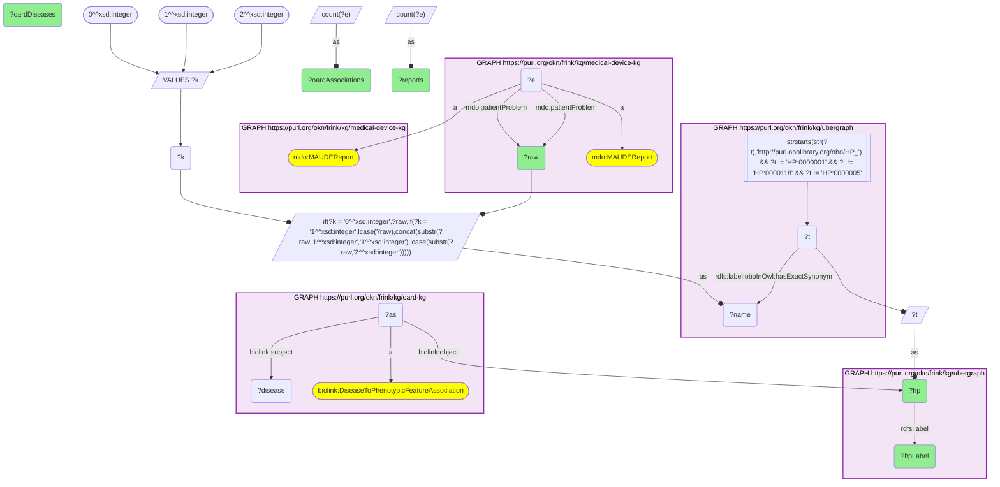

# D60-Q1: The most-reported MAUDE patient problems that are HP phenotypes, and their OARD disease footprint

- **Date:** 2026-11-04
- **Model:** claude-opus-5-5
- **SPARQL endpoint:** https://apps.okn.us/federation/sparql
- **Generated by:** mcp-okn v0.3.0 (build bd8dd05)
- **Contents:** 1 query · 1 query diagram

## Knowledge graphs used

- `medical-device-kg` — <https://purl.org/okn/frink/kg/medical-device-kg>
- `ubergraph` — <https://purl.org/okn/frink/kg/ubergraph>
- `oard-kg` — <https://purl.org/okn/frink/kg/oard-kg>

## Conversation

👤 **User**

medical-device-kg now carries FDA MAUDE adverse-event reports (`mdo:MAUDEReport`), each with coded patient problems (`mdo:patientProblem`): FDA patient-problem terms such as 'Hyperglycemia' or 'Capsular Contracture', stored as plain strings with no ontology id. OARD (oard-kg) holds EHR-derived disease–phenotype co-occurrence associations keyed on HP. **Crosswalk on HP via a label bridge:** match each patient-problem term to an HP class by its ubergraph label or exact synonym. For the 15 most-reported patient problems that map to HP, how many MAUDE reports carry each, and how many OARD disease-to-phenotype associations (and distinct diseases) involve that phenotype?

---

🧠 **Assistant**

**The three most-reported patient problems that map to HP are Hyperglycemia (1,150,740 MAUDE reports), Pain (1,045,227) and Hypoglycemia (297,375). How widely OARD connects a phenotype to diseases has little to do with how often devices report it.**

**The bridge.** MAUDE patient problems carry no ontology id. The query tries each term in three case forms (as written, all lower-case, sentence case) against ubergraph's HP `rdfs:label` and `oboInOwl:hasExactSynonym`, excluding the HP root classes. Most matches are label-for-label; one in this table comes through a synonym: **Numbness → Hypoesthesia** (HP_0033748). The query takes the 15 most-reported mapped terms and counts the OARD `DiseaseToPhenotypicFeatureAssociation` records that have the phenotype as object.

| MAUDE patient problem | HP class | MAUDE reports | OARD associations | OARD diseases |
|---|---|---|---|---|
| Hyperglycemia | HP_0003074 | 1,150,740 | 399 | 399 |
| Pain | HP_0012531 | 1,045,227 | 708 | 706 |
| Hypoglycemia | HP_0001943 | 297,375 | 355 | 355 |
| Osteolysis | HP_0002797 | 73,474 | 9 | 9 |
| Headache | HP_0002315 | 72,446 | 685 | 685 |
| Peritonitis | HP_0002586 | 67,618 | 194 | 194 |
| Loss of consciousness | HP_0007185 | 64,650 | 210 | 210 |
| Abscess | HP_0025615 | 64,397 | 196 | 196 |
| Numbness | HP_0033748 (Hypoesthesia) | 59,594 | 295 | 295 |
| Nausea | HP_0002018 | 59,115 | 765 | 764 |
| Vomiting | HP_0002013 | 56,064 | 711 | 710 |
| Abdominal Pain | HP_0002027 | 54,069 | 637 | 637 |
| Dyspnea | HP_0002094 | 52,730 | 774 | 774 |
| Fatigue | HP_0012378 | 46,128 | 1,046 | 1,045 |
| Hernia | HP_0100790 | 43,970 | 229 | 229 |

**What the two columns say together.**
- **Glycaemic terms dominate MAUDE but are mid-range in OARD.** Hyperglycemia and Hypoglycemia together account for nearly 1.45 million reports. In OARD they connect to 399 and 355 diseases. (Which devices generate them is the subject of D61-Q1.)
- **Osteolysis is the outlier.** It has 73,474 device reports but only 9 OARD diseases. In MAUDE it is mostly a device complication (bone loss around an implant). In EHR co-occurrence data it is a rare finding.
- **Fatigue is the reverse.** It has the second-fewest reports in the table (46,128) and the broadest OARD footprint: 1,045 diseases.
- **Associations and diseases are almost one-to-one.** A few phenotypes (Pain, Nausea, Vomiting, Fatigue) have one or two diseases with a second association.

**Caveats.**
- This is an exact-name bridge: a lower bound, with no fuzzy matching.
- "Pain" maps to the generic HP class, which says nothing about where the pain is.
- The report counts are MAUDE report–term pairs. A report that lists several problems counts once under each.

## SPARQL queries executed

#### Query 1

_2026-11-04T09:04:51+00:00 · `medical-device-kg`, `ubergraph`, `oard-kg`_

```sparql
PREFIX mdo: <https://bmedesign.org/medical-device-kg/ns/>
PREFIX biolink: <https://w3id.org/biolink/vocab/>
PREFIX rdfs: <http://www.w3.org/2000/01/rdf-schema#>
SELECT ?raw ?hp ?hpLabel ?reports (COUNT(DISTINCT ?as) AS ?oardAssociations) (COUNT(DISTINCT ?disease) AS ?oardDiseases) WHERE {
  { SELECT ?raw ?hp ?hpLabel ?reports WHERE {
    { SELECT ?raw (COUNT(?e) AS ?reports) WHERE { GRAPH <https://purl.org/okn/frink/kg/medical-device-kg> { ?e a mdo:MAUDEReport ; mdo:patientProblem ?raw } } GROUP BY ?raw }
    { SELECT DISTINCT ?raw ?t WHERE {
  { SELECT DISTINCT ?raw ?name WHERE {
      { SELECT DISTINCT ?raw WHERE { GRAPH <https://purl.org/okn/frink/kg/medical-device-kg> { ?e a <https://bmedesign.org/medical-device-kg/ns/MAUDEReport> ; <https://bmedesign.org/medical-device-kg/ns/patientProblem> ?raw . } } }
      VALUES ?k { 0 1 2 }  # as-is, all lower, sentence case
      BIND(IF(?k = 0, ?raw, IF(?k = 1, LCASE(?raw), CONCAT(SUBSTR(?raw,1,1),LCASE(SUBSTR(?raw,2))))) AS ?name)
  } }
    GRAPH <https://purl.org/okn/frink/kg/ubergraph> { ?t <http://www.w3.org/2000/01/rdf-schema#label>|<http://www.geneontology.org/formats/oboInOwl#hasExactSynonym> ?name .
      FILTER(STRSTARTS(STR(?t),'http://purl.obolibrary.org/obo/HP_') && ?t != <http://purl.obolibrary.org/obo/HP_0000001> && ?t != <http://purl.obolibrary.org/obo/HP_0000118> && ?t != <http://purl.obolibrary.org/obo/HP_0000005>) }
  } }
    BIND(?t AS ?hp)
    GRAPH <https://purl.org/okn/frink/kg/ubergraph> { ?hp rdfs:label ?hpLabel }
  } ORDER BY DESC(?reports) LIMIT 15 }
  GRAPH <https://purl.org/okn/frink/kg/oard-kg> { ?as biolink:object ?hp ; biolink:subject ?disease . ?as a biolink:DiseaseToPhenotypicFeatureAssociation }
} GROUP BY ?raw ?hp ?hpLabel ?reports ORDER BY DESC(?reports)
```



_15 row(s) — showing first 5_

| raw | hp | hpLabel | reports | oardAssociations | oardDiseases |
| --- | --- | --- | --- | --- | --- |
| Hyperglycemia | http://purl.obolibrary.org/obo/HP_0003074 | Hyperglycemia | 1150740 | 399 | 399 |
| Pain | http://purl.obolibrary.org/obo/HP_0012531 | Pain | 1045227 | 708 | 706 |
| Hypoglycemia | http://purl.obolibrary.org/obo/HP_0001943 | Hypoglycemia | 297375 | 355 | 355 |
| Osteolysis | http://purl.obolibrary.org/obo/HP_0002797 | Osteolysis | 73474 | 9 | 9 |
| Headache | http://purl.obolibrary.org/obo/HP_0002315 | Headache | 72446 | 685 | 685 |
