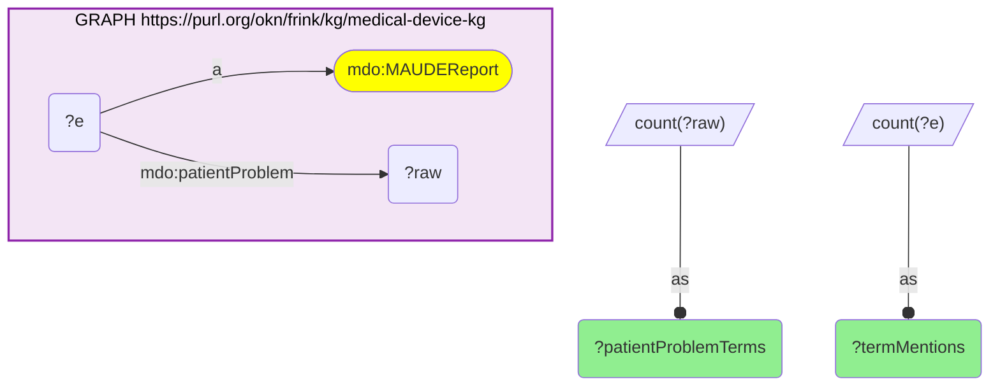
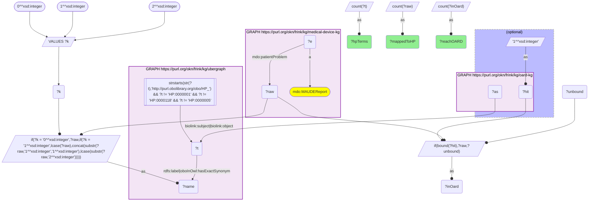
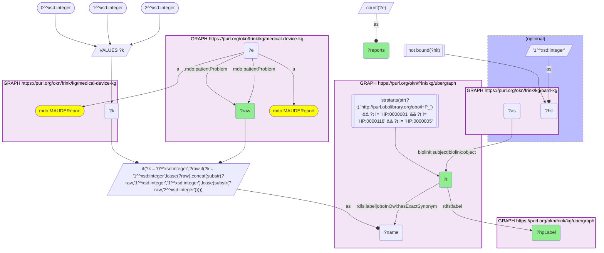
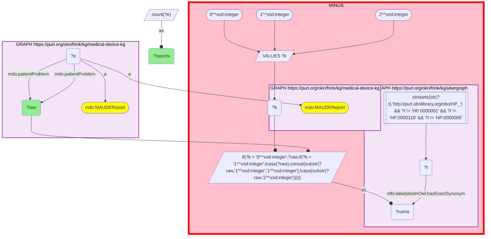

# D60-Q2: 322 of 1,133 MAUDE patient-problem terms map to an HP class by name; 314 reach OARD

- **Date:** 2026-11-04
- **Model:** claude-opus-5-5
- **SPARQL endpoint:** https://apps.okn.us/federation/sparql
- **Generated by:** mcp-okn v0.3.0 (build bd8dd05)
- **Contents:** 4 queries · 4 query diagrams

## Knowledge graphs used

- `medical-device-kg` — <https://purl.org/okn/frink/kg/medical-device-kg>
- `ubergraph` — <https://purl.org/okn/frink/kg/ubergraph>
- `oard-kg` — <https://purl.org/okn/frink/kg/oard-kg>

## Conversation

👤 **User**

medical-device-kg now carries FDA MAUDE adverse-event reports (`mdo:MAUDEReport`), each with coded patient problems (`mdo:patientProblem`): FDA patient-problem terms such as 'Hyperglycemia' or 'Capsular Contracture', stored as plain strings with no ontology id. **Crosswalk on HP via a label bridge to OARD:** how many distinct patient-problem terms do the MAUDE reports use, how many map to an HP class by ubergraph label or exact synonym, and how many of those reach an OARD association? Which mapped terms miss OARD, and what do the most-reported unmapped terms look like?

---

🧠 **Assistant**

**The MAUDE reports use 1,133 distinct patient-problem terms. 322 of them map to an HP class by exact name, and 314 of those 322 (97.5%) reach an OARD association.**

**Scale (query 1).** 1,133 distinct terms account for 31,048,578 term mentions on `mdo:MAUDEReport` nodes.

**The bridge (query 2).** Each term is tried in three case forms against ubergraph's HP `rdfs:label` / `oboInOwl:hasExactSynonym`, excluding the HP root classes.
- **322 terms** map to **301 HP classes**. There are fewer classes than terms because several FDA wordings land on the same HP class.
- **314** of the 322 appear in at least one OARD association, as subject or object.

**The 8 mapped terms OARD lacks (query 3):**

| MAUDE term | HP class | MAUDE reports |
|---|---|---|
| Abnormal Vaginal Discharge | HP_0034269 | 5,016 |
| Pelvic Pain | HP_0034267 | 858 |
| Hypopyon | HP_0031615 | 824 |
| Joint Contracture | HP_0034392 | 379 |
| Bronchial Hemorrhage | HP_0033999 | 84 |
| Mediastinal Shift | HP_6000012 | 46 |
| Urolithiasis | HP_0034368 | 34 |
| Loose body in joint | HP_6000591 | 31 |

Seven of the eight are high-numbered HP classes (HP_0033999 and above, or the HP_6000000 range). That is consistent with OARD having been built before those terms existed, but this transcript does not test it.

**Why 811 terms don't map (query 4).** The most-reported unmapped terms are mostly not phenotypes:
- **Null codes:** 'No Clinical Signs, Symptoms or Conditions' (9,259,645 mentions), 'No Consequences Or Impact To Patient' (2,928,617), 'No Known Impact Or Consequence To Patient' (2,614,369), 'Insufficient Information', 'No Patient Involvement', 'No Code Available', 'No Information' and 'Unknown'.
- **Device events:** 'Failure of Implant' (1,862,509).
- **Genuine phenotypes the exact-name rule misses:** 'Unspecified Infection' (808,740), 'Fibrosis' (270,001) and 'Inflammation' (203,986). HP's classes for these carry different wording.

**Use.** The bridge covers the specific clinical phenotypes. It deliberately does not cover MAUDE's null and administrative codes, which make up most of the mentions. Treat 322 as a lower bound. A synonym list or curated mapping would add terms like Fibrosis and Inflammation, at the cost of the exact-match guarantee.

## SPARQL queries executed

#### Query 1

_2026-11-04T09:04:52+00:00 · `medical-device-kg`_

```sparql
PREFIX mdo: <https://bmedesign.org/medical-device-kg/ns/>
PREFIX biolink: <https://w3id.org/biolink/vocab/>
PREFIX rdfs: <http://www.w3.org/2000/01/rdf-schema#>
SELECT (COUNT(DISTINCT ?raw) AS ?patientProblemTerms) (COUNT(?e) AS ?termMentions) WHERE {
  GRAPH <https://purl.org/okn/frink/kg/medical-device-kg> { ?e a mdo:MAUDEReport ; mdo:patientProblem ?raw }
}
```



_1 row(s)_

| patientProblemTerms | termMentions |
| --- | --- |
| 1133 | 31048578 |

#### Query 2

_2026-11-04T09:04:52+00:00 · `medical-device-kg`, `ubergraph`, `oard-kg`_

```sparql
PREFIX mdo: <https://bmedesign.org/medical-device-kg/ns/>
PREFIX biolink: <https://w3id.org/biolink/vocab/>
PREFIX rdfs: <http://www.w3.org/2000/01/rdf-schema#>
SELECT (COUNT(DISTINCT ?raw) AS ?mappedToHP) (COUNT(DISTINCT ?t) AS ?hpTerms) (COUNT(DISTINCT ?inOard) AS ?reachOARD) WHERE {
  { SELECT DISTINCT ?raw ?t WHERE {
  { SELECT DISTINCT ?raw ?name WHERE {
      { SELECT DISTINCT ?raw WHERE { GRAPH <https://purl.org/okn/frink/kg/medical-device-kg> { ?e a <https://bmedesign.org/medical-device-kg/ns/MAUDEReport> ; <https://bmedesign.org/medical-device-kg/ns/patientProblem> ?raw . } } }
      VALUES ?k { 0 1 2 }  # as-is, all lower, sentence case
      BIND(IF(?k = 0, ?raw, IF(?k = 1, LCASE(?raw), CONCAT(SUBSTR(?raw,1,1),LCASE(SUBSTR(?raw,2))))) AS ?name)
  } }
    GRAPH <https://purl.org/okn/frink/kg/ubergraph> { ?t <http://www.w3.org/2000/01/rdf-schema#label>|<http://www.geneontology.org/formats/oboInOwl#hasExactSynonym> ?name .
      FILTER(STRSTARTS(STR(?t),'http://purl.obolibrary.org/obo/HP_') && ?t != <http://purl.obolibrary.org/obo/HP_0000001> && ?t != <http://purl.obolibrary.org/obo/HP_0000118> && ?t != <http://purl.obolibrary.org/obo/HP_0000005>) }
  } }
  OPTIONAL { SELECT DISTINCT ?t (1 AS ?hit) WHERE { GRAPH <https://purl.org/okn/frink/kg/oard-kg> { ?as biolink:subject|biolink:object ?t } } }
  BIND(IF(BOUND(?hit), ?raw, ?unbound) AS ?inOard)
}
```



_1 row(s)_

| mappedToHP | hpTerms | reachOARD |
| --- | --- | --- |
| 322 | 301 | 314 |

#### Query 3

_2026-11-04T09:04:53+00:00 · `medical-device-kg`, `ubergraph`, `oard-kg`_

```sparql
PREFIX mdo: <https://bmedesign.org/medical-device-kg/ns/>
PREFIX biolink: <https://w3id.org/biolink/vocab/>
PREFIX rdfs: <http://www.w3.org/2000/01/rdf-schema#>
SELECT ?raw ?t ?hpLabel ?reports WHERE {
  { SELECT DISTINCT ?raw ?t WHERE {
  { SELECT DISTINCT ?raw ?name WHERE {
      { SELECT DISTINCT ?raw WHERE { GRAPH <https://purl.org/okn/frink/kg/medical-device-kg> { ?e a <https://bmedesign.org/medical-device-kg/ns/MAUDEReport> ; <https://bmedesign.org/medical-device-kg/ns/patientProblem> ?raw . } } }
      VALUES ?k { 0 1 2 }  # as-is, all lower, sentence case
      BIND(IF(?k = 0, ?raw, IF(?k = 1, LCASE(?raw), CONCAT(SUBSTR(?raw,1,1),LCASE(SUBSTR(?raw,2))))) AS ?name)
  } }
    GRAPH <https://purl.org/okn/frink/kg/ubergraph> { ?t <http://www.w3.org/2000/01/rdf-schema#label>|<http://www.geneontology.org/formats/oboInOwl#hasExactSynonym> ?name .
      FILTER(STRSTARTS(STR(?t),'http://purl.obolibrary.org/obo/HP_') && ?t != <http://purl.obolibrary.org/obo/HP_0000001> && ?t != <http://purl.obolibrary.org/obo/HP_0000118> && ?t != <http://purl.obolibrary.org/obo/HP_0000005>) }
  } }
  OPTIONAL { SELECT DISTINCT ?t (1 AS ?hit) WHERE { GRAPH <https://purl.org/okn/frink/kg/oard-kg> { ?as biolink:subject|biolink:object ?t } } }
  FILTER(!BOUND(?hit))
  GRAPH <https://purl.org/okn/frink/kg/ubergraph> { ?t rdfs:label ?hpLabel }
  { SELECT ?raw (COUNT(?e) AS ?reports) WHERE { GRAPH <https://purl.org/okn/frink/kg/medical-device-kg> { ?e a mdo:MAUDEReport ; mdo:patientProblem ?raw } } GROUP BY ?raw }
} ORDER BY DESC(?reports)
```



_8 row(s) — showing first 3_

| raw | t | hpLabel | reports |
| --- | --- | --- | --- |
| Abnormal Vaginal Discharge | http://purl.obolibrary.org/obo/HP_0034269 | Abnormal vaginal discharge | 5016 |
| Pelvic Pain | http://purl.obolibrary.org/obo/HP_0034267 | Pelvic pain | 858 |
| Hypopyon | http://purl.obolibrary.org/obo/HP_0031615 | Hypopyon | 824 |

#### Query 4

_2026-11-04T09:04:53+00:00 · `medical-device-kg`, `ubergraph`_

```sparql
PREFIX mdo: <https://bmedesign.org/medical-device-kg/ns/>
PREFIX biolink: <https://w3id.org/biolink/vocab/>
PREFIX rdfs: <http://www.w3.org/2000/01/rdf-schema#>
SELECT ?raw ?reports WHERE {
  { SELECT ?raw (COUNT(?e) AS ?reports) WHERE { GRAPH <https://purl.org/okn/frink/kg/medical-device-kg> { ?e a mdo:MAUDEReport ; mdo:patientProblem ?raw } } GROUP BY ?raw }
  MINUS { SELECT DISTINCT ?raw ?t WHERE {
  { SELECT DISTINCT ?raw ?name WHERE {
      { SELECT DISTINCT ?raw WHERE { GRAPH <https://purl.org/okn/frink/kg/medical-device-kg> { ?e a <https://bmedesign.org/medical-device-kg/ns/MAUDEReport> ; <https://bmedesign.org/medical-device-kg/ns/patientProblem> ?raw . } } }
      VALUES ?k { 0 1 2 }  # as-is, all lower, sentence case
      BIND(IF(?k = 0, ?raw, IF(?k = 1, LCASE(?raw), CONCAT(SUBSTR(?raw,1,1),LCASE(SUBSTR(?raw,2))))) AS ?name)
  } }
    GRAPH <https://purl.org/okn/frink/kg/ubergraph> { ?t <http://www.w3.org/2000/01/rdf-schema#label>|<http://www.geneontology.org/formats/oboInOwl#hasExactSynonym> ?name .
      FILTER(STRSTARTS(STR(?t),'http://purl.obolibrary.org/obo/HP_') && ?t != <http://purl.obolibrary.org/obo/HP_0000001> && ?t != <http://purl.obolibrary.org/obo/HP_0000118> && ?t != <http://purl.obolibrary.org/obo/HP_0000005>) }
  } }
} ORDER BY DESC(?reports) LIMIT 12
```



_12 row(s) — showing first 5_

| raw | reports |
| --- | --- |
| No Clinical Signs, Symptoms or Conditions | 9259645 |
| No Consequences Or Impact To Patient | 2928617 |
| No Known Impact Or Consequence To Patient | 2614369 |
| Failure of Implant | 1862509 |
| Insufficient Information | 1218140 |
