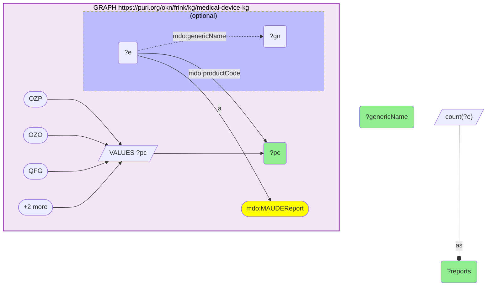
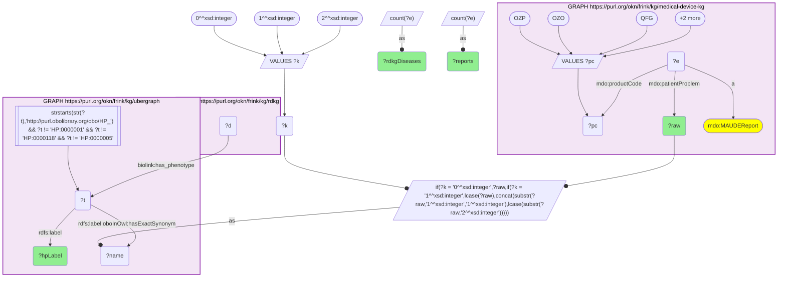
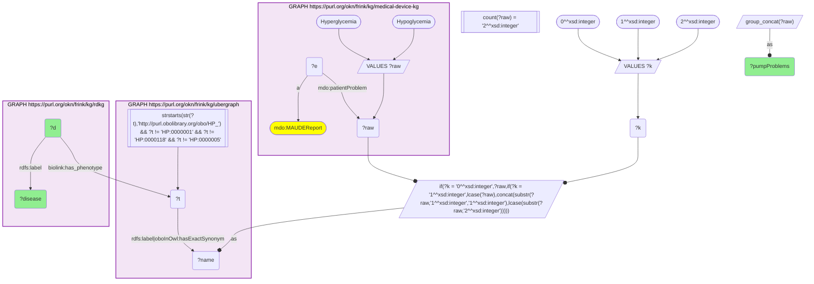

# D61-Q1: Insulin-pump MAUDE reports through HP to RDKG: hyperglycemia and hypoglycemia dominate, and 11 rare diseases present both

- **Date:** 2026-11-04
- **Model:** claude-opus-5-5
- **SPARQL endpoint:** https://apps.okn.us/federation/sparql
- **Generated by:** mcp-okn v0.3.0 (build bd8dd05)
- **Contents:** 3 queries · 3 query diagrams

## Knowledge graphs used

- `medical-device-kg` — <https://purl.org/okn/frink/kg/medical-device-kg>
- `ubergraph` — <https://purl.org/okn/frink/kg/ubergraph>
- `rdkg` — <https://purl.org/okn/frink/kg/rdkg>

## Conversation

👤 **User**

medical-device-kg now carries FDA MAUDE adverse-event reports (`mdo:MAUDEReport`), each with coded patient problems (`mdo:patientProblem`): FDA patient-problem terms such as 'Hyperglycemia' or 'Capsular Contracture', stored as plain strings with no ontology id. Each report also carries the device's FDA product code (`mdo:productCode`). RDKG links rare diseases to HP phenotypes (`biolink:has_phenotype`). **Crosswalk on HP via a label bridge:** for insulin-delivery devices (product codes OZP, OZO, QFG, OYC, LZG), which patient problems that map to an HP class are reported most, and how many RDKG rare diseases present each phenotype? Which rare diseases present both of the top two?

---

🧠 **Assistant**

**For insulin-delivery devices, two phenotypes dominate: Hyperglycemia (868,769 reports) and Hypoglycemia (190,946). RDKG links them to 75 and 265 rare diseases, and 11 rare diseases present both.**

**The device cohort (query 1).** Report counts for the five insulin-delivery product codes:

| Product code | Generic name | Reports |
|---|---|---|
| QFG | Alternate controller enabled insulin infusion pump | 1,297,882 |
| OZP | Artificial pancreas device system, single hormonal control | 893,191 |
| OYC | Insulin infusion pump used with an invasive glucose sensor | 891,171 |
| LZG | Insulin infusion pump | 539,974 |
| OZO | Artificial pancreas device system, threshold suspend | 439,495 |

**Patient problems → HP → RDKG (query 2).** Each patient problem on those reports is matched to an HP class by ubergraph label or exact synonym. The query then counts the RDKG rare diseases that list the phenotype (`biolink:has_phenotype`). The top of the 20 rows:

| MAUDE term | HP class | Pump reports | RDKG rare diseases |
|---|---|---|---|
| Hyperglycemia | Hyperglycemia | 868,769 | 75 |
| Hypoglycemia | Hypoglycemia | 190,946 | 265 |
| Vomiting | Vomiting | 24,220 | 475 |
| Nausea | Nausea | 19,911 | 148 |
| Loss of consciousness | Loss of consciousness | 12,410 | 43 |
| Pain | Pain | 10,277 | 109 |
| Polydipsia | Polydipsia | 7,990 | 82 |
| Headache | Headache | 7,112 | 373 |
| Fatigue | Fatigue | 6,769 | 460 |
| Malaise | Malaise | 5,717 | 15 |

- Hyperglycemia alone has more pump reports than the other 19 rows combined.
- Polydipsia (excessive thirst) is a classic sign of high blood glucose and is the seventh-ranked term.
- The phenotypes that connect to the most rare diseases are not the ones pumps report most: Seizures (via HP Seizure) reaches 2,503 RDKG diseases but has only 2,221 pump reports.
- One term maps through a synonym: Skin Infection → Cellulitis (3,577 reports, 58 diseases).

**Rare diseases presenting both glycaemic phenotypes (query 3).** These 11 RDKG diseases list both the hyperglycemia and the hypoglycemia HP class, reached through the same label bridge:
- **Insulin-axis disorders:** Rabson-Mendenhall syndrome (an insulin-receptor disorder), Wolcott-Rallison syndrome, and permanent neonatal diabetes mellitus–pancreatic and cerebellar agenesis syndrome.
- **Inborn errors of energy metabolism:** beta-ketothiolase deficiency, pyruvate carboxylase deficiency disease, mitochondrial complex III deficiency (plus nuclear types 1 and 6), multiple mitochondrial dysfunctions syndrome 7, congenital lactic acidosis (Saguenay-Lac-Saint-Jean type), and renal tubulopathy–encephalopathy–liver failure syndrome.

**How to read it.** This is a phenotype bridge, not a causal link. The pump reports describe glucose swings around a device event. The RDKG diseases are conditions in which the same phenotype occurs on its own. The join answers "which rare diseases share this reported harm's phenotype", which helps with differential diagnosis or with flagging confounded reports. It does not answer "which diseases do pumps cause".

The label bridge is exact-name and therefore a lower bound. Report counts are distinct reports per term across the five product codes.

## SPARQL queries executed

#### Query 1

_2026-11-04T09:04:54+00:00 · `medical-device-kg`_

```sparql
PREFIX mdo: <https://bmedesign.org/medical-device-kg/ns/>
PREFIX biolink: <https://w3id.org/biolink/vocab/>
PREFIX rdfs: <http://www.w3.org/2000/01/rdf-schema#>
SELECT ?pc (SAMPLE(?gn) AS ?genericName) (COUNT(DISTINCT ?e) AS ?reports) WHERE {
  GRAPH <https://purl.org/okn/frink/kg/medical-device-kg> { VALUES ?pc { "OZP" "OZO" "QFG" "OYC" "LZG" } ?e a mdo:MAUDEReport ; mdo:productCode ?pc . OPTIONAL { ?e mdo:genericName ?gn } }
} GROUP BY ?pc ORDER BY DESC(?reports)
```



_5 row(s) — showing first 3_

| pc | genericName | reports |
| --- | --- | --- |
| QFG | ALTERNATE CONTROLLER ENABLED INSULIN INFUSION PUMP | 1297882 |
| OZP | ARTIFICIAL PANCREAS DEVICE SYSTEM, SINGLE HORMONAL CONTROL | 893191 |
| OYC | PUMP, INFUSION, INSULIN, TO BE USED WITH INVASIVE GLUCOSE SENSOR | 891171 |

#### Query 2

_2026-11-04T09:04:55+00:00 · `medical-device-kg`, `ubergraph`, `rdkg`_

```sparql
PREFIX mdo: <https://bmedesign.org/medical-device-kg/ns/>
PREFIX biolink: <https://w3id.org/biolink/vocab/>
PREFIX rdfs: <http://www.w3.org/2000/01/rdf-schema#>
SELECT ?raw ?hpLabel ?reports (COUNT(DISTINCT ?d) AS ?rdkgDiseases) WHERE {
  { SELECT ?raw (COUNT(DISTINCT ?e) AS ?reports) WHERE { GRAPH <https://purl.org/okn/frink/kg/medical-device-kg> { VALUES ?pc { "OZP" "OZO" "QFG" "OYC" "LZG" } ?e a mdo:MAUDEReport ; mdo:productCode ?pc ; mdo:patientProblem ?raw } } GROUP BY ?raw }
  VALUES ?k { 0 1 2 }
  BIND(IF(?k = 0, ?raw, IF(?k = 1, LCASE(?raw), CONCAT(SUBSTR(?raw,1,1),LCASE(SUBSTR(?raw,2))))) AS ?name)
  GRAPH <https://purl.org/okn/frink/kg/ubergraph> { ?t rdfs:label|<http://www.geneontology.org/formats/oboInOwl#hasExactSynonym> ?name .
    FILTER(STRSTARTS(STR(?t),'http://purl.obolibrary.org/obo/HP_') && ?t != <http://purl.obolibrary.org/obo/HP_0000001> && ?t != <http://purl.obolibrary.org/obo/HP_0000118> && ?t != <http://purl.obolibrary.org/obo/HP_0000005>)
    ?t rdfs:label ?hpLabel }
  GRAPH <https://purl.org/okn/frink/kg/rdkg> { ?d biolink:has_phenotype ?t }
} GROUP BY ?raw ?hpLabel ?reports ORDER BY DESC(?reports) LIMIT 20
```



_20 row(s) — showing first 3_

| raw | hpLabel | reports | rdkgDiseases |
| --- | --- | --- | --- |
| Hyperglycemia | Hyperglycemia | 868769 | 75 |
| Hypoglycemia | Hypoglycemia | 190946 | 265 |
| Vomiting | Vomiting | 24220 | 475 |

#### Query 3

_2026-11-04T09:04:55+00:00 · `medical-device-kg`, `ubergraph`, `rdkg`_

```sparql
PREFIX mdo: <https://bmedesign.org/medical-device-kg/ns/>
PREFIX biolink: <https://w3id.org/biolink/vocab/>
PREFIX rdfs: <http://www.w3.org/2000/01/rdf-schema#>
SELECT ?d ?disease (GROUP_CONCAT(DISTINCT ?raw; separator=" + ") AS ?pumpProblems) WHERE {
  { SELECT DISTINCT ?raw ?t WHERE {
  { SELECT DISTINCT ?raw ?name WHERE {
      { SELECT DISTINCT ?raw WHERE { GRAPH <https://purl.org/okn/frink/kg/medical-device-kg> { ?e a <https://bmedesign.org/medical-device-kg/ns/MAUDEReport> ; <https://bmedesign.org/medical-device-kg/ns/patientProblem> ?raw . VALUES ?raw { "Hyperglycemia" "Hypoglycemia" } } } }
      VALUES ?k { 0 1 2 }  # as-is, all lower, sentence case
      BIND(IF(?k = 0, ?raw, IF(?k = 1, LCASE(?raw), CONCAT(SUBSTR(?raw,1,1),LCASE(SUBSTR(?raw,2))))) AS ?name)
  } }
    GRAPH <https://purl.org/okn/frink/kg/ubergraph> { ?t <http://www.w3.org/2000/01/rdf-schema#label>|<http://www.geneontology.org/formats/oboInOwl#hasExactSynonym> ?name .
      FILTER(STRSTARTS(STR(?t),'http://purl.obolibrary.org/obo/HP_') && ?t != <http://purl.obolibrary.org/obo/HP_0000001> && ?t != <http://purl.obolibrary.org/obo/HP_0000118> && ?t != <http://purl.obolibrary.org/obo/HP_0000005>) }
  } }
  GRAPH <https://purl.org/okn/frink/kg/rdkg> { ?d biolink:has_phenotype ?t ; rdfs:label ?disease }
} GROUP BY ?d ?disease HAVING(COUNT(DISTINCT ?raw) = 2) ORDER BY ?disease
```



_11 row(s) — showing first 5_

| d | disease | pumpProblems |
| --- | --- | --- |
| http://purl.obolibrary.org/obo/MONDO_0008760 | beta-ketothiolase deficiency | Hyperglycemia + Hypoglycemia |
| http://purl.obolibrary.org/obo/MONDO_0009069 | congenital lactic acidosis, Saguenay-Lac-Saint-Jean type | Hyperglycemia + Hypoglycemia |
| http://purl.obolibrary.org/obo/MONDO_0015448 | mitochondrial complex III deficiency | Hypoglycemia + Hyperglycemia |
| http://purl.obolibrary.org/obo/MONDO_0007415 | mitochondrial complex III deficiency nuclear type 1 | Hyperglycemia + Hypoglycemia |
| http://purl.obolibrary.org/obo/MONDO_0014194 | mitochondrial complex III deficiency nuclear type 6 | Hypoglycemia + Hyperglycemia |
