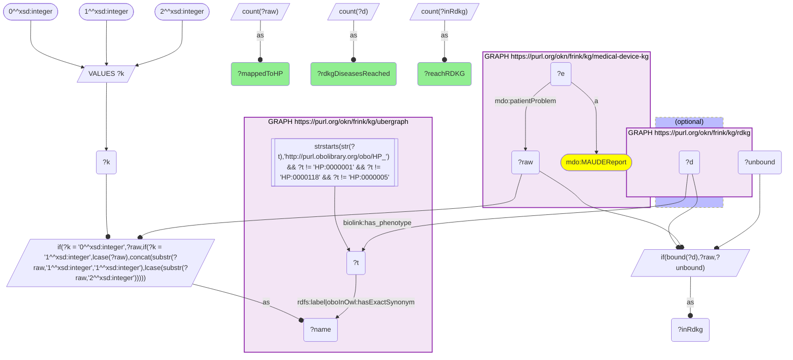
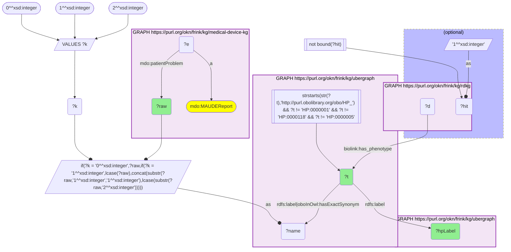
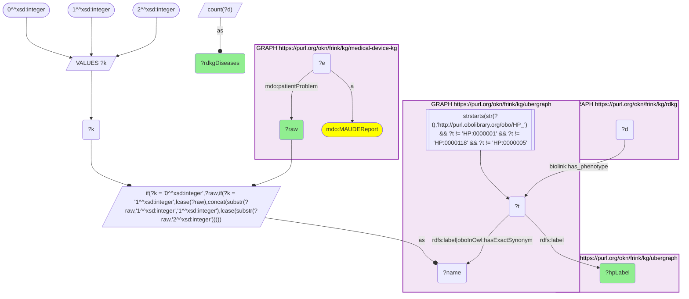

# D61-Q2: 315 of 322 HP-mapped MAUDE patient problems reach RDKG, touching 8,365 rare diseases

- **Date:** 2026-11-04
- **Model:** claude-opus-5-5
- **SPARQL endpoint:** https://apps.okn.us/federation/sparql
- **Generated by:** mcp-okn v0.3.0 (build bd8dd05)
- **Contents:** 3 queries · 3 query diagrams

## Knowledge graphs used

- `medical-device-kg` — <https://purl.org/okn/frink/kg/medical-device-kg>
- `ubergraph` — <https://purl.org/okn/frink/kg/ubergraph>
- `rdkg` — <https://purl.org/okn/frink/kg/rdkg>

## Conversation

👤 **User**

medical-device-kg now carries FDA MAUDE adverse-event reports (`mdo:MAUDEReport`), each with coded patient problems (`mdo:patientProblem`): FDA patient-problem terms such as 'Hyperglycemia' or 'Capsular Contracture', stored as plain strings with no ontology id. **Crosswalk on HP via a label bridge to RDKG:** of the patient-problem terms that map to an HP class, how many reach an RDKG rare disease, how many distinct rare diseases does the bridge touch, which mapped terms miss RDKG, and which phenotypes connect to the most rare diseases?

---

🧠 **Assistant**

**315 of the 322 MAUDE patient-problem terms that map to HP reach at least one RDKG rare disease. Together they touch 8,365 distinct rare diseases.**

**Coverage (query 1).**
- 322 terms map to an HP class by ubergraph label or exact synonym (three case forms; HP root classes excluded).
- 315 of them (97.8%) hit an RDKG disease through `biolink:has_phenotype`.
- That reaches 8,365 RDKG diseases.

**The 7 mapped terms RDKG lacks (query 2):** Abnormal Vaginal Discharge (HP_0034269), Ageusia (HP_0041051), Breast Mass (HP_0032408), Bronchial Hemorrhage (HP_0033999), Cardiac Tamponade (HP_0033415), Loose body in joint (HP_6000591) and Nasal Dryness (HP_0033521). All seven are high-numbered HP classes (HP_0032408 and above).

**The phenotypes connecting to the most rare diseases (query 3):**

| MAUDE term | HP class | RDKG rare diseases |
|---|---|---|
| Seizures | Seizure | 2,503 |
| Muscle Hypotonia | Hypotonia | 1,812 |
| Hearing Impairment | Hearing impairment | 1,058 |
| Deafness | Hearing impairment | 1,058 |
| Ptosis | Ptosis | 747 |
| Cataract | Cataract | 651 |
| Visual Impairment | Visual impairment | 610 |
| Joint Laxity | Joint hypermobility | 571 |
| Hydrocephalus | Hydrocephalus | 493 |
| Thrombocytopenia | Thrombocytopenia | 483 |
| Respiratory Insufficiency | Respiratory insufficiency | 479 |
| Vomiting | Vomiting | 475 |

Two FDA terms, Hearing Impairment and Deafness, collapse onto one HP class, so they reach the same 1,058 diseases. Joint Laxity reaches RDKG through HP's Joint hypermobility. MAUDE's wording and HP's preferred label differ, and the exact synonym bridges them.

**How to read 8,365.** It measures breadth, not specificity. Hub phenotypes such as Seizure and Hypotonia appear in thousands of rare-disease annotations, so most of the reach comes from a few general terms. The bridge is useful one phenotype at a time: a device-reported phenotype joined to the specific rare diseases that present it, as in D61-Q1. Coverage into OARD is worked separately in D60-Q2.

## SPARQL queries executed

#### Query 1

_2026-11-04T09:04:56+00:00 · `medical-device-kg`, `ubergraph`, `rdkg`_

```sparql
PREFIX mdo: <https://bmedesign.org/medical-device-kg/ns/>
PREFIX biolink: <https://w3id.org/biolink/vocab/>
PREFIX rdfs: <http://www.w3.org/2000/01/rdf-schema#>
SELECT (COUNT(DISTINCT ?raw) AS ?mappedToHP) (COUNT(DISTINCT ?inRdkg) AS ?reachRDKG) (COUNT(DISTINCT ?d) AS ?rdkgDiseasesReached) WHERE {
  { SELECT DISTINCT ?raw ?t WHERE {
  { SELECT DISTINCT ?raw ?name WHERE {
      { SELECT DISTINCT ?raw WHERE { GRAPH <https://purl.org/okn/frink/kg/medical-device-kg> { ?e a <https://bmedesign.org/medical-device-kg/ns/MAUDEReport> ; <https://bmedesign.org/medical-device-kg/ns/patientProblem> ?raw . } } }
      VALUES ?k { 0 1 2 }  # as-is, all lower, sentence case
      BIND(IF(?k = 0, ?raw, IF(?k = 1, LCASE(?raw), CONCAT(SUBSTR(?raw,1,1),LCASE(SUBSTR(?raw,2))))) AS ?name)
  } }
    GRAPH <https://purl.org/okn/frink/kg/ubergraph> { ?t <http://www.w3.org/2000/01/rdf-schema#label>|<http://www.geneontology.org/formats/oboInOwl#hasExactSynonym> ?name .
      FILTER(STRSTARTS(STR(?t),'http://purl.obolibrary.org/obo/HP_') && ?t != <http://purl.obolibrary.org/obo/HP_0000001> && ?t != <http://purl.obolibrary.org/obo/HP_0000118> && ?t != <http://purl.obolibrary.org/obo/HP_0000005>) }
  } }
  OPTIONAL { GRAPH <https://purl.org/okn/frink/kg/rdkg> { ?d biolink:has_phenotype ?t } }
  BIND(IF(BOUND(?d), ?raw, ?unbound) AS ?inRdkg)
}
```



_1 row(s)_

| mappedToHP | reachRDKG | rdkgDiseasesReached |
| --- | --- | --- |
| 322 | 315 | 8365 |

#### Query 2

_2026-11-04T09:04:56+00:00 · `medical-device-kg`, `ubergraph`, `rdkg`_

```sparql
PREFIX mdo: <https://bmedesign.org/medical-device-kg/ns/>
PREFIX biolink: <https://w3id.org/biolink/vocab/>
PREFIX rdfs: <http://www.w3.org/2000/01/rdf-schema#>
SELECT ?raw ?t ?hpLabel WHERE {
  { SELECT DISTINCT ?raw ?t WHERE {
  { SELECT DISTINCT ?raw ?name WHERE {
      { SELECT DISTINCT ?raw WHERE { GRAPH <https://purl.org/okn/frink/kg/medical-device-kg> { ?e a <https://bmedesign.org/medical-device-kg/ns/MAUDEReport> ; <https://bmedesign.org/medical-device-kg/ns/patientProblem> ?raw . } } }
      VALUES ?k { 0 1 2 }  # as-is, all lower, sentence case
      BIND(IF(?k = 0, ?raw, IF(?k = 1, LCASE(?raw), CONCAT(SUBSTR(?raw,1,1),LCASE(SUBSTR(?raw,2))))) AS ?name)
  } }
    GRAPH <https://purl.org/okn/frink/kg/ubergraph> { ?t <http://www.w3.org/2000/01/rdf-schema#label>|<http://www.geneontology.org/formats/oboInOwl#hasExactSynonym> ?name .
      FILTER(STRSTARTS(STR(?t),'http://purl.obolibrary.org/obo/HP_') && ?t != <http://purl.obolibrary.org/obo/HP_0000001> && ?t != <http://purl.obolibrary.org/obo/HP_0000118> && ?t != <http://purl.obolibrary.org/obo/HP_0000005>) }
  } }
  OPTIONAL { SELECT DISTINCT ?t (1 AS ?hit) WHERE { GRAPH <https://purl.org/okn/frink/kg/rdkg> { ?d biolink:has_phenotype ?t } } }
  FILTER(!BOUND(?hit))
  GRAPH <https://purl.org/okn/frink/kg/ubergraph> { ?t rdfs:label ?hpLabel }
} ORDER BY ?raw
```



_7 row(s) — showing first 3_

| raw | t | hpLabel |
| --- | --- | --- |
| Abnormal Vaginal Discharge | http://purl.obolibrary.org/obo/HP_0034269 | Abnormal vaginal discharge |
| Ageusia | http://purl.obolibrary.org/obo/HP_0041051 | Ageusia |
| Breast Mass | http://purl.obolibrary.org/obo/HP_0032408 | Breast mass |

#### Query 3

_2026-11-04T09:04:57+00:00 · `medical-device-kg`, `ubergraph`, `rdkg`_

```sparql
PREFIX mdo: <https://bmedesign.org/medical-device-kg/ns/>
PREFIX biolink: <https://w3id.org/biolink/vocab/>
PREFIX rdfs: <http://www.w3.org/2000/01/rdf-schema#>
SELECT ?raw ?hpLabel (COUNT(DISTINCT ?d) AS ?rdkgDiseases) WHERE {
  { SELECT DISTINCT ?raw ?t WHERE {
  { SELECT DISTINCT ?raw ?name WHERE {
      { SELECT DISTINCT ?raw WHERE { GRAPH <https://purl.org/okn/frink/kg/medical-device-kg> { ?e a <https://bmedesign.org/medical-device-kg/ns/MAUDEReport> ; <https://bmedesign.org/medical-device-kg/ns/patientProblem> ?raw . } } }
      VALUES ?k { 0 1 2 }  # as-is, all lower, sentence case
      BIND(IF(?k = 0, ?raw, IF(?k = 1, LCASE(?raw), CONCAT(SUBSTR(?raw,1,1),LCASE(SUBSTR(?raw,2))))) AS ?name)
  } }
    GRAPH <https://purl.org/okn/frink/kg/ubergraph> { ?t <http://www.w3.org/2000/01/rdf-schema#label>|<http://www.geneontology.org/formats/oboInOwl#hasExactSynonym> ?name .
      FILTER(STRSTARTS(STR(?t),'http://purl.obolibrary.org/obo/HP_') && ?t != <http://purl.obolibrary.org/obo/HP_0000001> && ?t != <http://purl.obolibrary.org/obo/HP_0000118> && ?t != <http://purl.obolibrary.org/obo/HP_0000005>) }
  } }
  GRAPH <https://purl.org/okn/frink/kg/rdkg> { ?d biolink:has_phenotype ?t }
  GRAPH <https://purl.org/okn/frink/kg/ubergraph> { ?t rdfs:label ?hpLabel }
} GROUP BY ?raw ?hpLabel ORDER BY DESC(?rdkgDiseases) LIMIT 12
```



_12 row(s) — showing first 5_

| raw | hpLabel | rdkgDiseases |
| --- | --- | --- |
| Seizures | Seizure | 2503 |
| Muscle Hypotonia | Hypotonia | 1812 |
| Hearing Impairment | Hearing impairment | 1058 |
| Deafness | Hearing impairment | 1058 |
| Ptosis | Ptosis | 747 |
