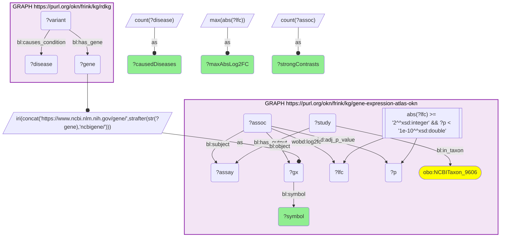
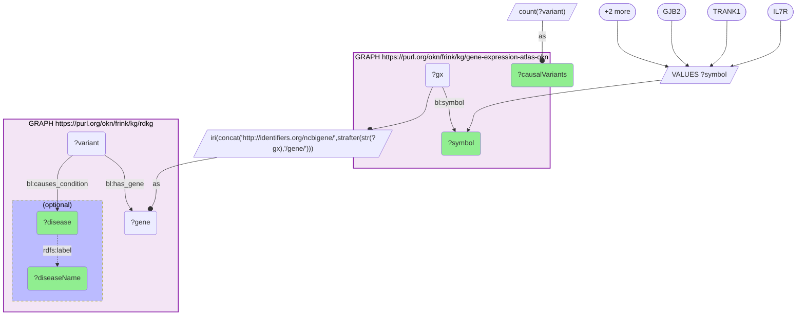

# G38-Q1: rdkg×gene-expression-atlas-okn (Entrez) — IL7R, TRANK1 and GJB2 are the RDKG causal-variant genes most often strongly differentially expressed in human Atlas contrasts

- **Date:** 2026-11-09
- **Model:** claude-opus-5-5
- **SPARQL endpoint:** https://apps.okn.us/federation/sparql
- **Generated by:** mcp-okn v0.6.2 (build 0707cab)
- **Contents:** 2 queries · 2 query diagrams

## Knowledge graphs used

- `rdkg` — <https://purl.org/okn/frink/kg/rdkg>
- `gene-expression-atlas-okn` — <https://purl.org/okn/frink/kg/gene-expression-atlas-okn>

## Conversation

👤 **User**

Which RDKG genes with a variant on record as causing a rare disease are strongly differentially expressed in human Expression Atlas contrasts (|log2FC| ≥ 2, adjusted p < 1e-10)? Give the top 15 by number of such contrasts, with how many diseases rdkg says each gene's variants cause, and show what those diseases are for the top five.

---

🧠 **Assistant**

**IL7R leads: 96 strong human contrasts (largest |log2FC| 9.8), for the one disease its 8 causal variants cause in RDKG, immunodeficiency 104.**

The two graphs write the same NCBI Gene number under different IRIs — RDKG `http://identifiers.org/ncbigene/N`, the Expression Atlas `https://www.ncbi.nlm.nih.gov/gene/N` — so the join rewrites the RDKG IRI before matching the Atlas gene node, whose differential-expression associations hang off it.

| Gene | Diseases caused (RDKG) | Strong human contrasts | Max \|log2FC\| |
|---|---|---|---|
| IL7R | 1 | 96 | 9.8 |
| TRANK1 | 1 | 68 | 5.0 |
| GJB2 | 2 | 63 | 11.1 |
| DYSF | 2 | 53 | 7.5 |
| LDLR | 4 | 49 | 4.4 |
| ACVRL1 | 1 | 41 | 6.7 |
| VWF | 9 | 40 | 7.2 |
| CDH1 | 3 | 39 | 12.5 |
| ITGB3 | 5 | 36 | 8.0 |
| SCN2A | 1 | 36 | 6.8 |
| ENG | 2 | 35 | 9.7 |
| BRCA2 | 22 | 34 | 6.0 |
| ADA | 3 | 32 | 8.1 |
| BRCA1 | 16 | 32 | 5.3 |
| MYO7A | 3 | 32 | 8.3 |

What the top five's variants cause, as RDKG records it:

- **IL7R** — immunodeficiency 104 (8 causal variants).
- **TRANK1** — Lynch syndrome, on a single variant.
- **GJB2** — autosomal recessive nonsyndromic hearing loss 1A (2 variants), and the same 2 under RDKG's grouped node "hearing loss disorder".
- **DYSF** — autosomal recessive limb-girdle muscular dystrophy (12 variants) and its type 2B (1).
- **LDLR** — familial hypercholesterolemia as a grouped node (79 variants), plus three MONDO subtypes: hypercholesterolemia, familial, 1 (68), homozygous familial hypercholesterolemia (22) and autosomal dominant type B (1).

Two cautions on reading the table:

- The disease count includes RDKG's grouped disease nodes (`https://rdaccelerate.org/resource/MONDO_GROUPED_…`) alongside MONDO terms, so a gene's subtypes and their group are counted separately — GJB2's 2 and LDLR's 4 are each one disease family.
- A contrast count says how often a gene moves strongly across Atlas experiments, not that it moves in its disease: BRCA2 (22 diseases) and BRCA1 (16) cause the most diseases here but rank 12th and 14th on contrasts.

## SPARQL queries executed

#### Query 1

_2026-11-10T00:26:47+00:00 · `rdkg`, `gene-expression-atlas-okn`_

```sparql
PREFIX bl:   <https://w3id.org/biolink/vocab/>
PREFIX wobd: <http://purl.org/okn/wobd/>
PREFIX rdfs: <http://www.w3.org/2000/01/rdf-schema#>
# rdkg causal-variant genes -> Expression Atlas, rewriting the NCBI Gene IRI
# (identifiers.org/ncbigene/N -> https://www.ncbi.nlm.nih.gov/gene/N), strong human DE only.
SELECT ?symbol (COUNT(DISTINCT ?disease) AS ?causedDiseases)
       (COUNT(DISTINCT ?assoc) AS ?strongContrasts) (MAX(ABS(?lfc)) AS ?maxAbsLog2FC)
WHERE {
  GRAPH <https://purl.org/okn/frink/kg/rdkg> {
    ?variant bl:causes_condition ?disease ; bl:has_gene ?gene .
  }
  BIND(IRI(CONCAT("https://www.ncbi.nlm.nih.gov/gene/", STRAFTER(STR(?gene), "ncbigene/"))) AS ?gx)
  GRAPH <https://purl.org/okn/frink/kg/gene-expression-atlas-okn> {
    ?gx bl:symbol ?symbol .
    ?assoc bl:object ?gx ; bl:subject ?assay ; wobd:log2fc ?lfc ; wobd:adj_p_value ?p .
    ?study bl:has_output ?assay ; bl:in_taxon <http://purl.obolibrary.org/obo/NCBITaxon_9606> .
    FILTER(ABS(?lfc) >= 2 && ?p < 1e-10)
  }
}
GROUP BY ?symbol ORDER BY DESC(?strongContrasts) ?symbol LIMIT 15
```



_15 row(s) — showing first 3_

| symbol | causedDiseases | strongContrasts | maxAbsLog2FC |
| --- | --- | --- | --- |
| IL7R | 1 | 96 | 9.8 |
| TRANK1 | 1 | 68 | 5.0 |
| GJB2 | 2 | 63 | 11.1 |

#### Query 2

_2026-11-10T00:26:48+00:00 · `gene-expression-atlas-okn`, `rdkg`_

```sparql
PREFIX bl:   <https://w3id.org/biolink/vocab/>
PREFIX wobd: <http://purl.org/okn/wobd/>
PREFIX rdfs: <http://www.w3.org/2000/01/rdf-schema#>
# The diseases behind the top genes: what rdkg says each causal variant causes.
SELECT ?symbol ?disease ?diseaseName (COUNT(DISTINCT ?variant) AS ?causalVariants) WHERE {
  VALUES ?symbol { "IL7R" "TRANK1" "GJB2" "DYSF" "LDLR" }
  GRAPH <https://purl.org/okn/frink/kg/gene-expression-atlas-okn> { ?gx bl:symbol ?symbol }
  BIND(IRI(CONCAT("http://identifiers.org/ncbigene/", STRAFTER(STR(?gx), "/gene/"))) AS ?gene)
  GRAPH <https://purl.org/okn/frink/kg/rdkg> {
    ?variant bl:has_gene ?gene ; bl:causes_condition ?disease .
    OPTIONAL { ?disease rdfs:label ?diseaseName }
  }
}
GROUP BY ?symbol ?disease ?diseaseName ORDER BY ?symbol DESC(?causalVariants)
```



_10 row(s) — showing first 5_

| symbol | disease | diseaseName | causalVariants |
| --- | --- | --- | --- |
| DYSF | http://purl.obolibrary.org/obo/MONDO_0015152 | autosomal recessive limb-girdle muscular dystrophy | 12 |
| DYSF | http://purl.obolibrary.org/obo/MONDO_0009676 | autosomal recessive limb-girdle muscular dystrophy type 2B | 1 |
| GJB2 | http://purl.obolibrary.org/obo/MONDO_0009076 | autosomal recessive nonsyndromic hearing loss 1A | 2 |
| GJB2 | https://rdaccelerate.org/resource/MONDO_GROUPED_5365_20677 | hearing loss disorder | 2 |
| IL7R | http://purl.obolibrary.org/obo/MONDO_0012163 | immunodeficiency 104 | 8 |
