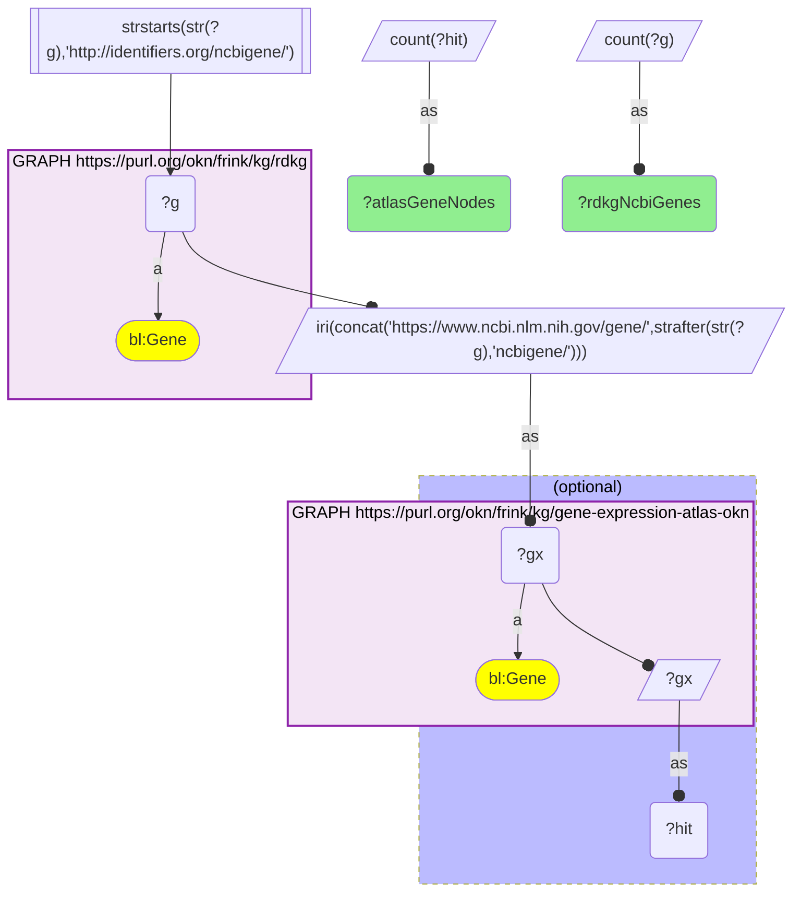
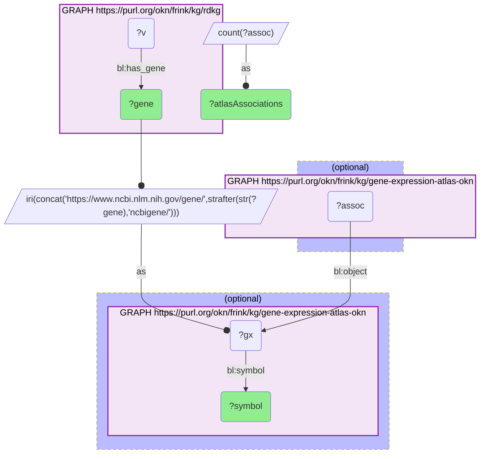

# G38-Q2: rdkg×gene-expression-atlas-okn (Entrez) — 9,219 of RDKG's 9,293 genes are Atlas gene nodes; 92 of its 94 causal-variant genes have expression records

- **Date:** 2026-11-09
- **Model:** claude-opus-5-5
- **SPARQL endpoint:** https://apps.okn.us/federation/sparql
- **Generated by:** mcp-okn v0.6.2 (build 0707cab)
- **Contents:** 2 queries · 2 query diagrams

## Knowledge graphs used

- `rdkg` — <https://purl.org/okn/frink/kg/rdkg>
- `gene-expression-atlas-okn` — <https://purl.org/okn/frink/kg/gene-expression-atlas-okn>

## Conversation

👤 **User**

How many RDKG genes are also Expression Atlas gene nodes, and how many of RDKG's causal-variant genes have expression records there?

---

🧠 **Assistant**

**9,219 of RDKG's 9,293 NCBI Gene nodes (99.2%) are Expression Atlas gene nodes once the IRI is rewritten. All 94 genes RDKG links to a causal variant resolve to an Atlas gene, and 92 of them carry differential-expression associations.**

| Measure | Count |
|---|---|
| RDKG genes under `identifiers.org/ncbigene/` | 9,293 |
| … that are Expression Atlas gene nodes | 9,219 |
| RDKG genes linked to a causal variant (`biolink:has_gene`) | 94 |
| … with an Atlas gene symbol | 94 |
| … with at least one Atlas association | 92 |

The rewrite is the whole join: RDKG mints `http://identifiers.org/ncbigene/N` and the Atlas `https://www.ncbi.nlm.nih.gov/gene/N`, so the raw IRIs never match. With `N` carried across, the Atlas node is the one its expression associations point at, so the join reaches the expression data and not just the gene catalog.

The two causal genes with no Atlas association are **GP1BB** (NCBI Gene 2812) and **RMRP** (6023): both are Atlas gene nodes with a symbol, but no contrast reports them. Among the other 92, association counts run from 28 (F9) to 533 (IL7R), with LDLR next at 484 — these count every recorded association, before any fold-change or p-value threshold.

## SPARQL queries executed

#### Query 1

_2026-11-10T00:26:49+00:00 · `rdkg`, `gene-expression-atlas-okn`_

```sparql
PREFIX bl:   <https://w3id.org/biolink/vocab/>
PREFIX wobd: <http://purl.org/okn/wobd/>
PREFIX rdfs: <http://www.w3.org/2000/01/rdf-schema#>
# Coverage: rdkg NCBI-Gene nodes that are Expression Atlas gene nodes, after the rewrite.
SELECT (COUNT(DISTINCT ?g) AS ?rdkgNcbiGenes) (COUNT(DISTINCT ?hit) AS ?atlasGeneNodes) WHERE {
  { SELECT DISTINCT ?g WHERE {
      GRAPH <https://purl.org/okn/frink/kg/rdkg> { ?g a bl:Gene }
      FILTER(STRSTARTS(STR(?g), "http://identifiers.org/ncbigene/")) } }
  BIND(IRI(CONCAT("https://www.ncbi.nlm.nih.gov/gene/", STRAFTER(STR(?g), "ncbigene/"))) AS ?gx)
  OPTIONAL { GRAPH <https://purl.org/okn/frink/kg/gene-expression-atlas-okn> { ?gx a bl:Gene } BIND(?gx AS ?hit) }
}
```



_1 row(s)_

| rdkgNcbiGenes | atlasGeneNodes |
| --- | --- |
| 9293 | 9219 |

#### Query 2

_2026-11-10T00:26:50+00:00 · `rdkg`, `gene-expression-atlas-okn`_

```sparql
PREFIX bl:   <https://w3id.org/biolink/vocab/>
PREFIX wobd: <http://purl.org/okn/wobd/>
PREFIX rdfs: <http://www.w3.org/2000/01/rdf-schema#>
# The causal-variant genes: which carry Atlas expression records, and which do not.
SELECT ?gene ?symbol (COUNT(DISTINCT ?assoc) AS ?atlasAssociations) WHERE {
  { SELECT DISTINCT ?gene WHERE { GRAPH <https://purl.org/okn/frink/kg/rdkg> { ?v bl:has_gene ?gene } } }
  BIND(IRI(CONCAT("https://www.ncbi.nlm.nih.gov/gene/", STRAFTER(STR(?gene), "ncbigene/"))) AS ?gx)
  OPTIONAL { GRAPH <https://purl.org/okn/frink/kg/gene-expression-atlas-okn> { ?gx bl:symbol ?symbol } }
  OPTIONAL { GRAPH <https://purl.org/okn/frink/kg/gene-expression-atlas-okn> { ?assoc bl:object ?gx } }
}
GROUP BY ?gene ?symbol ORDER BY ?atlasAssociations ?gene
```



_94 row(s) — showing first 5_

| gene | symbol | atlasAssociations |
| --- | --- | --- |
| http://identifiers.org/ncbigene/2812 | GP1BB | 0 |
| http://identifiers.org/ncbigene/6023 | RMRP | 0 |
| http://identifiers.org/ncbigene/2158 | F9 | 28 |
| http://identifiers.org/ncbigene/7428 | VHL | 35 |
| http://identifiers.org/ncbigene/5395 | PMS2 | 36 |
