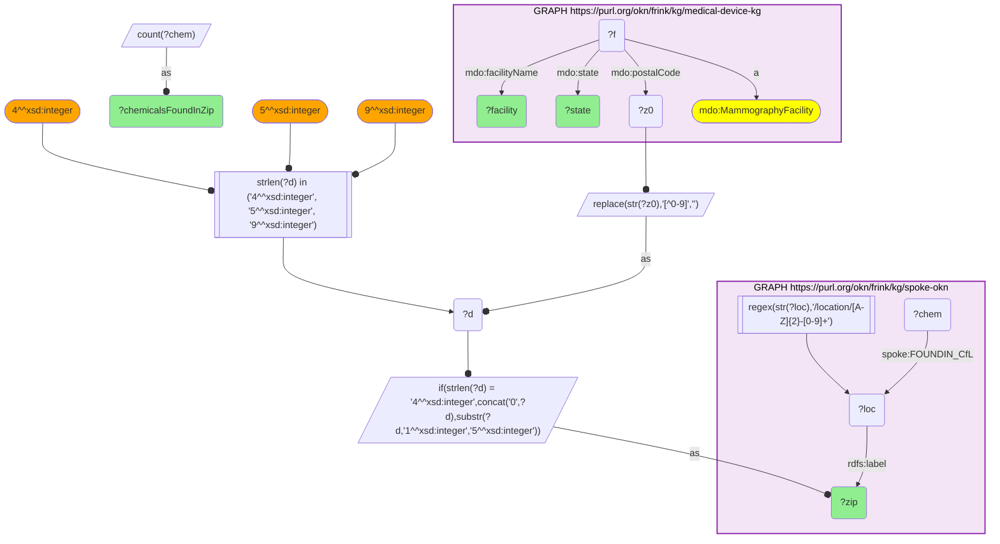
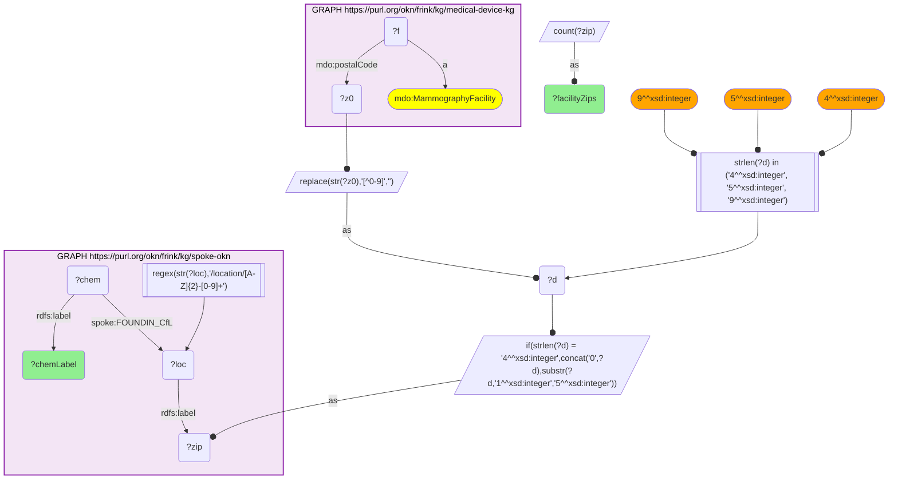

# GEO35-Q1: Environmental exposure at the ZIPs of FDA-regulated mammography facilities

- **Date:** 2026-11-03
- **Model:** claude-opus-5-5
- **SPARQL endpoint:** https://apps.okn.us/federation/sparql
- **Generated by:** mcp-okn v0.3.0 (build f9c4776)
- **Contents:** 2 queries · 2 query diagrams

## Knowledge graphs used

- `medical-device-kg` — <https://purl.org/okn/frink/kg/medical-device-kg>
- `spoke-okn` — <https://purl.org/okn/frink/kg/spoke-okn>

## Conversation

👤 **User**

Crosswalk: medical-device-kg × spoke-okn on ZIP5. medical-device-kg (namespace `https://bmedesign.org/medical-device-kg/ns/`) carries every address on one predicate, `mdo:postalCode`: X-ray assembler sites, MQSA mammography facilities, 510(k)/PMA applicants, recalling firms and FDA establishment registrations, with `mdo:country` on the company records. SPOKE carries ~42,724 ZIP nodes (`/location/{ST}-{zip}`) with the ZIP as `rdfs:label`, and hangs environmental chemical measurements off them via `FOUNDIN_CfL`.

Research question: what does SPOKE record for the ZIPs where FDA-regulated device facilities sit?

---

🧠 **Assistant**

SPOKE's payload at a ZIP node is **environmental chemical measurement** (`FOUNDIN_CfL`, compound-found-in-location), so the join places every FDA-regulated facility in its local contamination context.

**Mammography facilities ranked by the number of distinct chemicals SPOKE records in their ZIP (Query 1, top 15):**

| Facility (MQSA) | State | ZIP | Chemicals in ZIP |
|---|---|---|---|
| Baptist Health - El Dorado; SAMA Healthcare Services; The Breast Center at CARTI El Dorado | AR | 71730 | 188 |
| East Liverpool City Hospital | OH | 43920 | 163 |
| CHRISTUS Hospital Orange; Baptist Beaumont Hospital | TX | 77630 | 108 |
| Hospital of Central Connecticut Breast Imaging; Physicians for Women's Health (Central CT OB/Gyn) | CT | 06489 | 106 |
| Northwestern Medicine Woodstock Hospital; Mercy Woodstock Medical Center | IL | 60098 | 106 |
| Delaney Radiologists; Novant Health New Hanover Regional Medical Center; Novant Health NHRMC-Medical Mall | NC | 28401 | 105 |
| Sutter Tracy Imaging Center | CA | 95376 | 101 |
| Elkhart General Hospital | IN | 46514 | 97 |

**What chemicals, across all mammography-facility ZIPs (Query 2, top 12):**

| Chemical (SPOKE) | Facility ZIPs where recorded |
|---|---|
| Manganese | 4,302 |
| Lead | 1,198 |
| Lithium | 1,085 |
| Heptafluorobutyric acid (PFBA) | 1,008 |
| Perfluorovaleric acid (PFPeA) | 965 |
| Perfluorohexanoic acid (PFHxA) | 847 |
| lead molecular entity | 816 |
| Perfluorobutanesulfonic acid (PFBS) | 806 |
| Toluene | 775 |
| Chromium | 769 |
| Nickel | 725 |
| Germanium | 708 |

**Why this answers the question.** Neither graph can produce this alone. The FDA knows where certified mammography facilities are but nothing about their environment; SPOKE knows what has been measured in a ZIP but nothing about which regulated medical facilities operate there. Joined on ZIP5, you get a screening-infrastructure map overlaid on an exposure map. The exposures that dominate are ones with regulatory weight:

- **four PFAS compounds:** PFBA, PFPeA, PFHxA and PFBS;
- **the heavy metals** manganese, lead, chromium and nickel;
- **the solvent** toluene.

The concrete use is siting and cohort selection: if you want a breast-imaging cohort in a high-PFAS catchment, this join names the certified facilities in those ZIPs directly.

**Caveats.**

1. ZIP co-location is not exposure of the facility or its patients. A chemical measured in a ZIP says nothing about dose at the clinic.
2. The chemical counts reflect **sampling effort**, not contamination severity. The top ZIP (71730, El Dorado AR, 188 chemicals) is likely a well-sampled site rather than the most polluted one.
3. SPOKE carries lead under two labels ("Lead" and "lead molecular entity"), so the two rows overlap and should not be added.
4. Some facility names arrive cut off at 64 characters in the FDA MQSA extract ("…Baptist Beaumont Hospita"). That is a source artifact, not a join artifact.

## SPARQL queries executed

#### Query 1

_2026-11-04T06:01:17+00:00 · `medical-device-kg`, `spoke-okn`_

```sparql
PREFIX mdo: <https://bmedesign.org/medical-device-kg/ns/>
PREFIX rdfs: <http://www.w3.org/2000/01/rdf-schema#>
PREFIX spoke: <https://purl.org/okn/frink/kg/spoke-okn/schema/>
SELECT ?facility ?state ?zip (COUNT(DISTINCT ?chem) AS ?chemicalsFoundInZip) WHERE {
  GRAPH <https://purl.org/okn/frink/kg/medical-device-kg> {
    ?f a mdo:MammographyFacility ; mdo:facilityName ?facility ; mdo:postalCode ?z0 ; mdo:state ?state .
  }
  BIND(REPLACE(STR(?z0),"[^0-9]","") AS ?d)
  FILTER(STRLEN(?d) IN (4, 5, 9))
  BIND(IF(STRLEN(?d)=4, CONCAT("0",?d), SUBSTR(?d,1,5)) AS ?zip)
  GRAPH <https://purl.org/okn/frink/kg/spoke-okn> {
    ?loc rdfs:label ?zip .
    FILTER(REGEX(STR(?loc),'/location/[A-Z]{2}-[0-9]+'))
    ?chem spoke:FOUNDIN_CfL ?loc .
  }
} GROUP BY ?facility ?state ?zip ORDER BY DESC(?chemicalsFoundInZip) LIMIT 15
```



_15 row(s) — showing first 3_

| facility | state | zip | chemicalsFoundInZip |
| --- | --- | --- | --- |
| Baptist Health - El Dorado | AR | 71730 | 188 |
| SAMA Healthcare Services | AR | 71730 | 188 |
| The Breast Center at CARTI El Dorado | AR | 71730 | 188 |

#### Query 2

_2026-11-04T06:01:17+00:00 · `medical-device-kg`, `spoke-okn`_

```sparql
PREFIX mdo: <https://bmedesign.org/medical-device-kg/ns/>
PREFIX rdfs: <http://www.w3.org/2000/01/rdf-schema#>
PREFIX spoke: <https://purl.org/okn/frink/kg/spoke-okn/schema/>
SELECT ?chemLabel (COUNT(DISTINCT ?zip) AS ?facilityZips) WHERE {
  GRAPH <https://purl.org/okn/frink/kg/medical-device-kg> {
    ?f a mdo:MammographyFacility ; mdo:postalCode ?z0 .
  }
  BIND(REPLACE(STR(?z0),"[^0-9]","") AS ?d)
  FILTER(STRLEN(?d) IN (4, 5, 9))
  BIND(IF(STRLEN(?d)=4, CONCAT("0",?d), SUBSTR(?d,1,5)) AS ?zip)
  GRAPH <https://purl.org/okn/frink/kg/spoke-okn> {
    ?loc rdfs:label ?zip .
    FILTER(REGEX(STR(?loc),'/location/[A-Z]{2}-[0-9]+'))
    ?chem spoke:FOUNDIN_CfL ?loc ; rdfs:label ?chemLabel .
  }
} GROUP BY ?chemLabel ORDER BY DESC(?facilityZips) LIMIT 12
```



_12 row(s) — showing first 5_

| chemLabel | facilityZips |
| --- | --- |
| Manganese | 4302 |
| Lead | 1198 |
| Lithium | 1085 |
| Heptafluorobutyric acid | 1008 |
| Perfluorovaleric acid | 965 |
