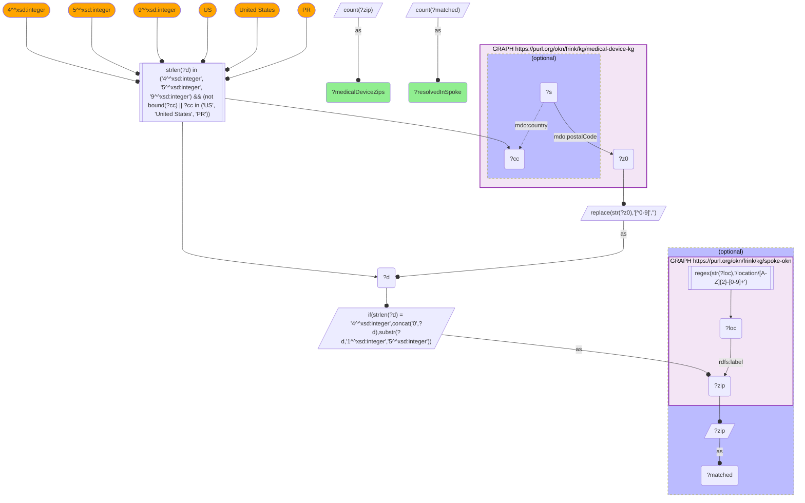
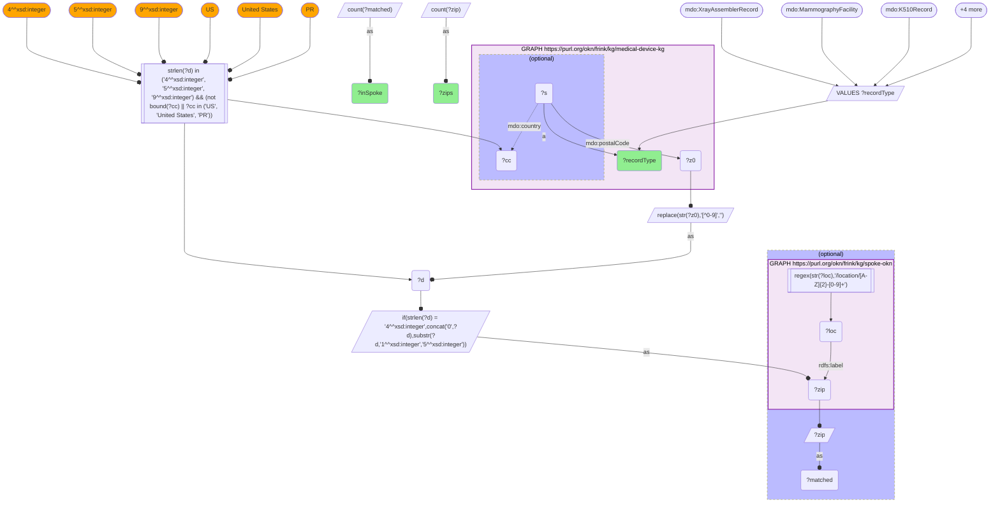

# GEO35-Q2: 19,095 of medical-device-kg's 22,094 US ZIPs resolve to a SPOKE location

- **Date:** 2026-11-03
- **Model:** claude-opus-5-5
- **SPARQL endpoint:** https://apps.okn.us/federation/sparql
- **Generated by:** mcp-okn v0.3.0 (build f9c4776)
- **Contents:** 2 queries · 2 query diagrams

## Knowledge graphs used

- `medical-device-kg` — <https://purl.org/okn/frink/kg/medical-device-kg>
- `spoke-okn` — <https://purl.org/okn/frink/kg/spoke-okn>

## Conversation

👤 **User**

Same crosswalk, coverage angle: how many distinct US ZIP codes in medical-device-kg resolve to a SPOKE location node?

---

🧠 **Assistant**

**19,095 of 22,094 (86.4%).**

**By the kind of record that carries the ZIP (Query 2):**

| medical-device-kg record type | Distinct US ZIP5 | Resolved in SPOKE |
|---|---|---|
| X-ray assembler report (`XrayAssemblerRecord`) | 20,746 | 17,915 (86.4%) |
| 510(k) applicant (`K510Record`) | 6,821 | 6,547 (96.0%) |
| MQSA mammography facility (`MammographyFacility`) | 6,028 | 6,020 (99.9%) |
| FDA establishment registration (`RegistrationListingRecord`) | 4,455 | 4,453 (99.96%) |
| Recalling firm (`RecallRecord`) | 1,654 | 1,652 (99.9%) |
| PMA applicant (`PMARecord`) | 578 | 533 (92.2%) |
| Humanitarian device exemption (`HumanitarianDeviceExemption`) | 71 | 67 (94.4%) |
| **All records (Query 1, the catalogued crosswalk)** | **22,094** | **19,095 (86.4%)** |

**Where the shortfall sits.** Almost all of the 2,999 unresolved ZIPs come from the X-ray assembler reports. Every other record type resolves at 92% or better, and the facility, registration and recall sets almost completely. The assembler reports are the largest source, and the only one with neither a country field nor a geocoded address, so mistyped, retired or non-residential ZIPs plausibly survive into it. Query 2 shows where the gap is, not its cause.

**How "US ZIP" is defined here.** All of medical-device-kg's addresses now sit on one predicate, `mdo:postalCode`, and many belong to foreign firms. A ZIP counts only if the record's `mdo:country` is absent, "US", "United States" or "PR", *and* the code has 4, 5 or 9 digits after stripping non-digits. A 4-digit code is left-padded, since leading zeros are dropped in New England ZIPs. Without the filter, a Chinese postcode such as `361100` would truncate to the US-looking `36110`.

**Note on the union.** The record types add up to 40,353, far above the 22,094 union. They overlap heavily: a ZIP with a registered establishment usually also has 510(k) filings or an X-ray installation.

## SPARQL queries executed

#### Query 1

_2026-11-04T06:01:18+00:00 · `medical-device-kg`, `spoke-okn`_

```sparql
PREFIX mdo: <https://bmedesign.org/medical-device-kg/ns/>
PREFIX rdfs: <http://www.w3.org/2000/01/rdf-schema#>
SELECT (COUNT(DISTINCT ?zip) AS ?medicalDeviceZips) (COUNT(DISTINCT ?matched) AS ?resolvedInSpoke) WHERE {
  { SELECT DISTINCT ?zip WHERE {
      GRAPH <https://purl.org/okn/frink/kg/medical-device-kg> {
        ?s mdo:postalCode ?z0 OPTIONAL { ?s mdo:country ?cc } }
      BIND(REPLACE(STR(?z0),"[^0-9]","") AS ?d)
      FILTER(STRLEN(?d) IN (4, 5, 9) && (!BOUND(?cc) || ?cc IN ("US", "United States", "PR")))
      BIND(IF(STRLEN(?d)=4, CONCAT("0",?d), SUBSTR(?d,1,5)) AS ?zip) } }
  OPTIONAL {
    GRAPH <https://purl.org/okn/frink/kg/spoke-okn> {
      ?loc rdfs:label ?zip .
      FILTER(REGEX(STR(?loc),'/location/[A-Z]{2}-[0-9]+'))
    }
    BIND(?zip AS ?matched)
  }
}
```



_1 row(s)_

| medicalDeviceZips | resolvedInSpoke |
| --- | --- |
| 22094 | 19095 |

#### Query 2

_2026-11-04T06:01:18+00:00 · `medical-device-kg`, `spoke-okn`_

```sparql
PREFIX mdo: <https://bmedesign.org/medical-device-kg/ns/>
PREFIX rdfs: <http://www.w3.org/2000/01/rdf-schema#>
SELECT ?recordType (COUNT(DISTINCT ?zip) AS ?zips) (COUNT(DISTINCT ?matched) AS ?inSpoke) WHERE {
  { SELECT DISTINCT ?recordType ?zip WHERE {
      VALUES ?recordType { mdo:XrayAssemblerRecord mdo:MammographyFacility mdo:K510Record mdo:PMARecord
                           mdo:RecallRecord mdo:RegistrationListingRecord mdo:HumanitarianDeviceExemption }
      GRAPH <https://purl.org/okn/frink/kg/medical-device-kg> {
        ?s a ?recordType ; mdo:postalCode ?z0 OPTIONAL { ?s mdo:country ?cc } }
      BIND(REPLACE(STR(?z0),"[^0-9]","") AS ?d)
      FILTER(STRLEN(?d) IN (4, 5, 9) && (!BOUND(?cc) || ?cc IN ("US", "United States", "PR")))
      BIND(IF(STRLEN(?d)=4, CONCAT("0",?d), SUBSTR(?d,1,5)) AS ?zip) } }
  OPTIONAL {
    GRAPH <https://purl.org/okn/frink/kg/spoke-okn> {
      ?loc rdfs:label ?zip .
      FILTER(REGEX(STR(?loc),'/location/[A-Z]{2}-[0-9]+'))
    }
    BIND(?zip AS ?matched)
  }
} GROUP BY ?recordType ORDER BY DESC(?zips)
```



_7 row(s) — showing first 5_

| recordType | zips | inSpoke |
| --- | --- | --- |
| https://bmedesign.org/medical-device-kg/ns/XrayAssemblerRecord | 20746 | 17915 |
| https://bmedesign.org/medical-device-kg/ns/K510Record | 6821 | 6547 |
| https://bmedesign.org/medical-device-kg/ns/MammographyFacility | 6028 | 6020 |
| https://bmedesign.org/medical-device-kg/ns/RegistrationListingRecord | 4455 | 4453 |
| https://bmedesign.org/medical-device-kg/ns/RecallRecord | 1654 | 1652 |
