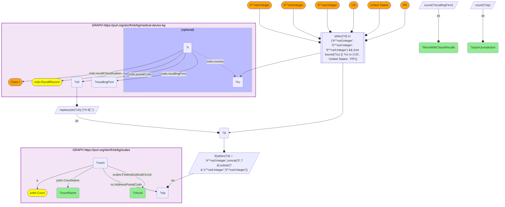

# GEO36-Q1: Which federal district courts have jurisdiction over the firms behind Class I device recalls

- **Date:** 2026-11-03
- **Model:** claude-opus-5-5
- **SPARQL endpoint:** https://apps.okn.us/federation/sparql
- **Generated by:** mcp-okn v0.3.0 (build f9c4776)
- **Contents:** 1 query · 1 query diagram

## Knowledge graphs used

- `medical-device-kg` — <https://purl.org/okn/frink/kg/medical-device-kg>
- `scales` — <https://purl.org/okn/frink/kg/scales>

## Conversation

👤 **User**

Crosswalk: medical-device-kg × scales on ZIP5. medical-device-kg carries FDA device recalls (`mdo:RecallRecord`) with the recalling firm's name, postal code, country and classification. SCALES carries US federal district courts, and its `niem-core:AddressPostalCode` is not a street address at all — it enumerates every ZIP inside a court's **jurisdiction territory**, which makes SCALES a ZIP → court resolver.

Research question: which federal district court has jurisdiction over the ZIP of a device firm named in an FDA recall — specifically the Class I (most serious) recalls?

---

🧠 **Assistant**

Resolving every US Class I recalling-firm address to its federal district court, and counting distinct firms per court (top 15):

| Federal district court | Circuit | Firms with Class I recalls | ZIPs in jurisdiction matched |
|---|---|---|---|
| District Court, C.D. California | Ninth | 55 | 29 |
| District Court, D. Massachusetts | First | 43 | 28 |
| District Court, D. Minnesota | Eighth | 40 | 20 |
| District Court, N.D. California | Ninth | 36 | 21 |
| District Court, D. New Jersey | Third | 28 | 19 |
| District Court, N.D. Illinois | Seventh | 23 | 13 |
| District Court, S.D. California | Ninth | 21 | 7 |
| District Court, E.D. Pennsylvania | Third | 20 | 12 |
| District Court, S.D. Florida | Eleventh | 16 | 10 |
| District Court, D. Colorado | Tenth | 16 | 10 |
| District Court, S.D. Indiana | Seventh | 15 | 10 |
| District Court, M.D. Florida | Eleventh | 12 | 10 |
| District Court, W.D. Washington | Ninth | 10 | 5 |
| District Court, D. Utah | Tenth | 10 | 8 |
| District Court, N.D. Texas | Fifth | 9 | 6 |

**Why this answers the question.** The ranking reproduces the map of US medical-device manufacturing, through a *judicial* lens neither graph offers alone:

- **California:** its three districts in the list (central, northern, southern) together account for 112 firms.
- **D. Massachusetts** (43) covers the Boston device corridor.
- **D. Minnesota** (40) covers the Twin Cities device cluster.

The FDA data knows the firm and the recall severity but nothing about jurisdiction. SCALES knows the jurisdiction but nothing about who manufactures there.

**What it is for.** Product-liability and enforcement research needs the forum, and the forum is a function of geography that the FDA release does not state. This join makes "which court would hear litigation over this recall?" a query rather than a manual lookup.

**Caveats.**

1. A recalling firm's *address* ZIP is not necessarily where an injury occurred or where suit would be filed. It identifies the firm's forum, not the case's.
2. SCALES ZIP territories are court-level jurisdiction sets, so one ZIP can appear under more than one court entry. Counts are per court, not a partition of firms.
3. Firm names come through as filed, so distinct-firm counts are string-distinct, not entity-resolved.
4. Recalls whose `mdo:country` names another country are excluded, as are postcodes that are not 4-, 5- or 9-digit US ZIPs.

## SPARQL queries executed

#### Query 1

_2026-11-04T06:01:19+00:00 · `medical-device-kg`, `scales`_

```sparql
PREFIX mdo: <https://bmedesign.org/medical-device-kg/ns/>
PREFIX jxdm: <http://release.niem.gov/niem/domains/jxdm/7.2/#>
PREFIX nc: <http://release.niem.gov/niem/niem-core/5.0/#>
PREFIX scales: <http://schemas.scales-okn.org/rdf/scales#>
SELECT ?courtName ?circuit (COUNT(DISTINCT ?recallingFirm) AS ?firmsWithClassIRecalls)
       (COUNT(DISTINCT ?zip) AS ?zipsInJurisdiction) WHERE {
  GRAPH <https://purl.org/okn/frink/kg/medical-device-kg> {
    ?r a mdo:RecallRecord ; mdo:recallingFirm ?recallingFirm ;
       mdo:postalCode ?z0 ; mdo:recallClassification "Class I" .
    OPTIONAL { ?r mdo:country ?cc }
  }
  BIND(REPLACE(STR(?z0),"[^0-9]","") AS ?d)
  FILTER(STRLEN(?d) IN (4, 5, 9) && (!BOUND(?cc) || ?cc IN ("US", "United States", "PR")))
  BIND(IF(STRLEN(?d)=4, CONCAT("0",?d), SUBSTR(?d,1,5)) AS ?zip)
  GRAPH <https://purl.org/okn/frink/kg/scales> {
    ?court a jxdm:Court ; nc:AddressPostalCode ?zip ;
           jxdm:CourtName ?courtName ; scales:FederalJudicialCircuit ?circuit .
  }
} GROUP BY ?courtName ?circuit ORDER BY DESC(?firmsWithClassIRecalls) LIMIT 15
```



_15 row(s) — showing first 5_

| courtName | circuit | firmsWithClassIRecalls | zipsInJurisdiction |
| --- | --- | --- | --- |
| District Court, C.D. California | Ninth | 55 | 29 |
| District Court, D. Massachusetts | First | 43 | 28 |
| District Court, D. Minnesota | Eighth | 40 | 20 |
| District Court, N.D. California | Ninth | 36 | 21 |
| District Court, D. New Jersey | Third | 28 | 19 |
