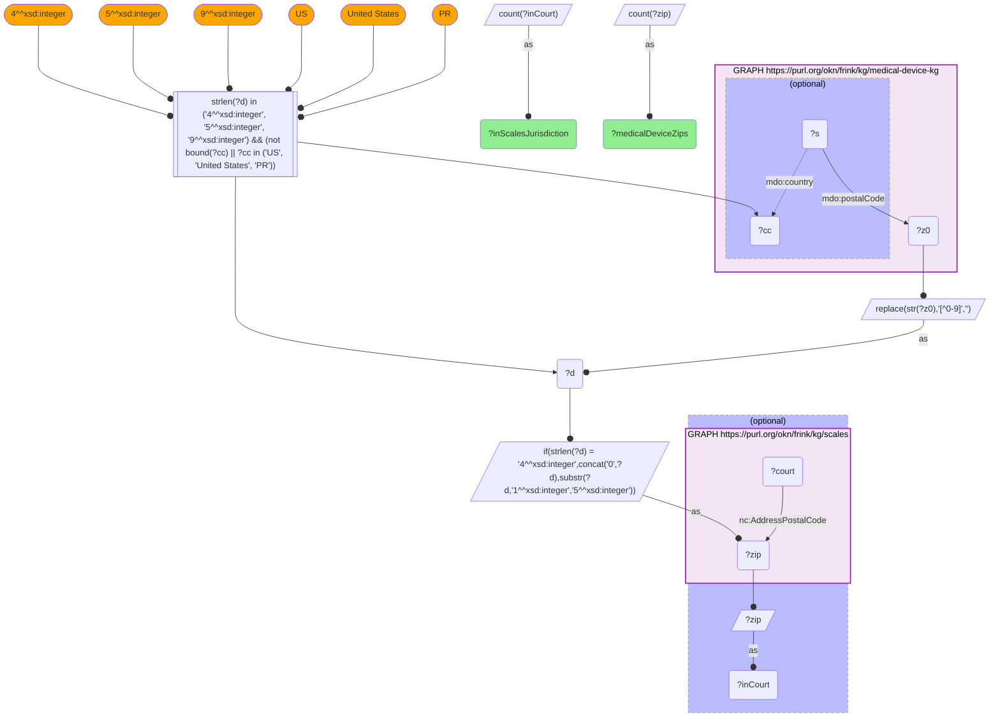

# GEO36-Q2: 18,654 of medical-device-kg's US ZIPs fall inside a SCALES court jurisdiction

- **Date:** 2026-11-03
- **Model:** claude-opus-5-5
- **SPARQL endpoint:** https://apps.okn.us/federation/sparql
- **Generated by:** mcp-okn v0.3.0 (build f9c4776)
- **Contents:** 1 query · 1 query diagram

## Knowledge graphs used

- `medical-device-kg` — <https://purl.org/okn/frink/kg/medical-device-kg>
- `scales` — <https://purl.org/okn/frink/kg/scales>

## Conversation

👤 **User**

Same crosswalk, coverage angle: how many medical-device-kg ZIPs fall inside a SCALES federal-district-court jurisdiction territory?

---

🧠 **Assistant**

**18,654 of medical-device-kg's 22,094 US ZIP5 codes (84.4%).**

This is close to the SPOKE coverage of the same ZIP set (GEO35-Q2), and the near-agreement is a useful cross-check. Two independent US ZIP registries, one built for geocoding and one for court jurisdictions, recognise roughly the same share of medical-device-kg's postcodes. So the remaining shortfall of 3,440 ZIPs is mostly a property of the FDA address data, not of either partner graph.

**Why the coverage is high for a *jurisdictional* set.** SCALES enumerates every ZIP inside a court's territory, so a device firm or facility with a real US address almost always resolves to a court. The ZIPs that do not resolve are most plausibly mistyped, retired or non-geographic codes.

**How "US ZIP" is defined here.** A medical-device-kg ZIP counts only if the record's `mdo:country` is absent, "US", "United States" or "PR", and the code has 4, 5 or 9 digits after stripping non-digits. Foreign firms' postcodes are therefore excluded before the comparison.

**Use it as a resolver, not a co-location.** Unlike the SPOKE join (where a shared ZIP means "the same place"), a SCALES match means "this ZIP lies within this court's territory". The right reading is *forum lookup*, which is exactly what makes the Class I recall analysis in GEO36-Q1 possible.

## SPARQL queries executed

#### Query 1

_2026-11-04T06:01:19+00:00 · `medical-device-kg`, `scales`_

```sparql
PREFIX mdo: <https://bmedesign.org/medical-device-kg/ns/>
PREFIX nc: <http://release.niem.gov/niem/niem-core/5.0/#>
SELECT (COUNT(DISTINCT ?zip) AS ?medicalDeviceZips) (COUNT(DISTINCT ?inCourt) AS ?inScalesJurisdiction) WHERE {
  { SELECT DISTINCT ?zip WHERE {
      GRAPH <https://purl.org/okn/frink/kg/medical-device-kg> {
        ?s mdo:postalCode ?z0 OPTIONAL { ?s mdo:country ?cc } }
      BIND(REPLACE(STR(?z0),"[^0-9]","") AS ?d)
      FILTER(STRLEN(?d) IN (4, 5, 9) && (!BOUND(?cc) || ?cc IN ("US", "United States", "PR")))
      BIND(IF(STRLEN(?d)=4, CONCAT("0",?d), SUBSTR(?d,1,5)) AS ?zip) } }
  OPTIONAL {
    GRAPH <https://purl.org/okn/frink/kg/scales> { ?court nc:AddressPostalCode ?zip }
    BIND(?zip AS ?inCourt)
  }
}
```



_1 row(s)_

| medicalDeviceZips | inScalesJurisdiction |
| --- | --- |
| 22094 | 18654 |
