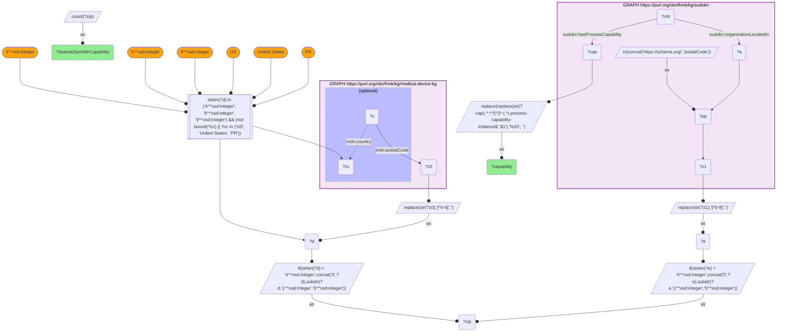

# GEO37-Q1: What manufacturing capability sits in the ZIPs that also host FDA-regulated device sites

- **Date:** 2026-11-03
- **Model:** claude-opus-5-5
- **SPARQL endpoint:** https://apps.okn.us/federation/sparql
- **Generated by:** mcp-okn v0.3.0 (build f9c4776)
- **Contents:** 1 query · 1 query diagram

## Knowledge graphs used

- `medical-device-kg` — <https://purl.org/okn/frink/kg/medical-device-kg>
- `sudokn` — <https://purl.org/okn/frink/kg/sudokn>

## Conversation

👤 **User**

Crosswalk: medical-device-kg × sudokn on ZIP5. SUDOKN profiles 31,636 US manufacturers with their process and material capabilities; medical-device-kg carries FDA establishments, assembler sites, applicants and recalling firms with addresses. Neither knows the other exists.

Research question: in the ZIPs where SUDOKN records manufacturing capability, what is on file — i.e. where does the supply-chain graph meet the device-regulation graph?

---

🧠 **Assistant**

Intersecting the two ZIP sets and ranking SUDOKN's **process capabilities** by how many shared ZIPs offer them (top 15):

| SUDOKN process capability | Shared ZIPs offering it |
|---|---|
| Fabricating | 6,386 |
| CNC Machining | 6,295 |
| Joining | 6,177 |
| Machining | 5,147 |
| Injection Molding | 4,117 |
| Powder Coating | 3,392 |
| Milling | 3,215 |
| Laser Cutting | 3,088 |
| Surface Finishing | 3,020 |
| Turning | 2,752 |
| Grinding | 2,736 |
| Painting | 2,716 |
| Coating | 2,716 |
| Heat Treating | 2,640 |
| Extruding | 2,630 |

**Why this answers the question.** The capability profile that co-locates with FDA-regulated device activity matches the medical-device contract-manufacturing stack:

- **CNC machining:** surgical instruments, orthopaedic implants.
- **Injection molding:** disposables and housings.
- **Laser cutting:** stents, cannulae.
- **Surface finishing and coating:** implant biocompatibility.
- **Heat treating:** instrument hardening.

It is also, though, the general job-shop profile of US manufacturing, so it shows what capacity is available near device activity, not what the device industry uses.

The practical use is sourcing and resilience analysis. Given an FDA establishment or a recalled device's firm ZIP, this join names the manufacturing capacity available in the same postcode. That is useful for asking who *could* supply or second-source a component locally, a question the FDA data cannot answer and SUDOKN cannot pose.

**Caveats.**

1. A shared ZIP means co-location at postcode grain, not a supplier relationship. Nothing here asserts that a SUDOKN manufacturer supplies a device firm.
2. Capability counts are ZIP counts, not firm counts, so a dense ZIP contributes once.
3. SUDOKN's coverage is uneven by state, so this ranking reflects both real capability distribution and SUDOKN's own sampling.
4. medical-device-kg ZIPs are US-only: records whose `mdo:country` names another country, and postcodes that are not 4-, 5- or 9-digit, are dropped.

**Query-shape note.** Both sides must be reduced to a normalized `?zip` string inside their own `DISTINCT` sub-SELECT before joining. Carrying a second variable through the join, or probing one graph with a computed literal, makes the planner exceed the endpoint's memory limit. SUDOKN also stores the HTTPS `schema.org` form, so its postalCode predicate is bound with `BIND(IRI(CONCAT('https://schema.org/','postalCode')))` rather than written as a bracketed IRI.

## SPARQL queries executed

#### Query 1

_2026-11-04T06:01:20+00:00 · `medical-device-kg`, `sudokn`_

```sparql
PREFIX mdo: <https://bmedesign.org/medical-device-kg/ns/>
PREFIX sudokn: <http://asu.edu/semantics/SUDOKN/>
PREFIX rdfs: <http://www.w3.org/2000/01/rdf-schema#>
SELECT ?capability (COUNT(DISTINCT ?zip) AS ?sharedZipsWithCapability) WHERE {
  { SELECT DISTINCT ?zip WHERE {
      GRAPH <https://purl.org/okn/frink/kg/medical-device-kg> {
        ?s mdo:postalCode ?z0 OPTIONAL { ?s mdo:country ?cc } }
      BIND(REPLACE(STR(?z0),"[^0-9]","") AS ?d)
      FILTER(STRLEN(?d) IN (4, 5, 9) && (!BOUND(?cc) || ?cc IN ("US", "United States", "PR")))
      BIND(IF(STRLEN(?d)=4, CONCAT("0",?d), SUBSTR(?d,1,5)) AS ?zip) } }
  { SELECT DISTINCT ?zip ?capability WHERE {
      GRAPH <https://purl.org/okn/frink/kg/sudokn> {
        BIND(IRI(CONCAT('https://schema.org/','postalCode')) AS ?pp)
        ?a ?pp ?z1 .
        ?mfr sudokn:organizationLocatedIn ?a ; sudokn:hasProcessCapability ?cap . }
      BIND(REPLACE(STR(?z1),"[^0-9]","") AS ?e)
      BIND(IF(STRLEN(?e)=4, CONCAT("0",?e), SUBSTR(?e,1,5)) AS ?zip)
      BIND(REPLACE(REPLACE(STR(?cap),'^.*?[^/]*-(.*)-process-capability-instance$','$1'),'%20',' ') AS ?capability) } }
} GROUP BY ?capability ORDER BY DESC(?sharedZipsWithCapability) LIMIT 15
```



_15 row(s) — showing first 5_

| capability | sharedZipsWithCapability |
| --- | --- |
| Fabricating | 6386 |
| CNC Machining | 6295 |
| Joining | 6177 |
| Machining | 5147 |
| Injection Molding | 4117 |
