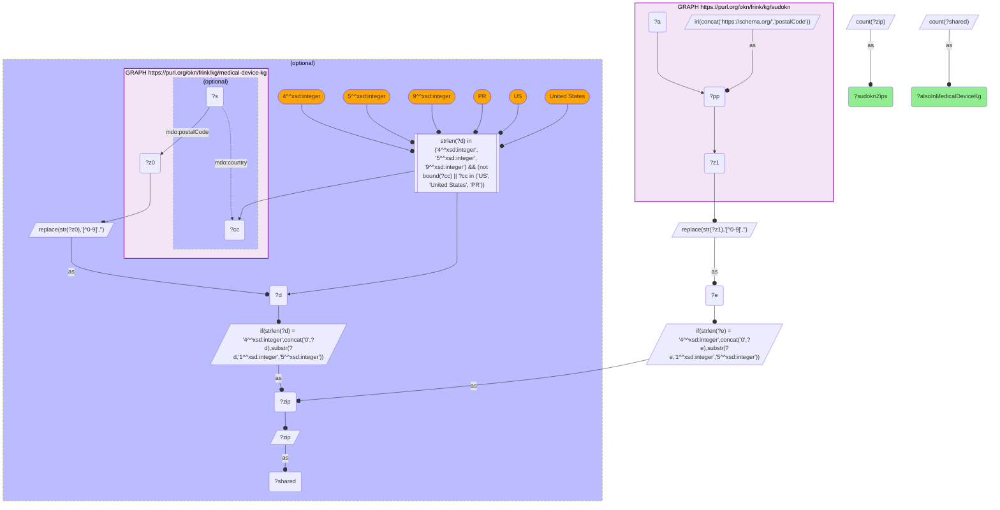

# GEO37-Q2: 10,697 of SUDOKN's 16,010 manufacturer ZIPs also carry a medical-device-kg address

- **Date:** 2026-11-03
- **Model:** claude-opus-5-5
- **SPARQL endpoint:** https://apps.okn.us/federation/sparql
- **Generated by:** mcp-okn v0.3.0 (build f9c4776)
- **Contents:** 1 query · 1 query diagram

## Knowledge graphs used

- `sudokn` — <https://purl.org/okn/frink/kg/sudokn>
- `medical-device-kg` — <https://purl.org/okn/frink/kg/medical-device-kg>

## Conversation

👤 **User**

Same crosswalk, coverage angle: how many SUDOKN manufacturer ZIPs also carry a medical-device-kg establishment, assembler site or recall address?

---

🧠 **Assistant**

**10,697 of SUDOKN's 16,010 manufacturer ZIPs (66.8%).**

| Side | ZIPs | Also in medical-device-kg | Share |
|---|---|---|---|
| SUDOKN manufacturer addresses | 16,010 | 10,697 | 66.8% |

**What it means.** Two thirds of the US manufacturing base SUDOKN profiles sits in a postcode that also hosts FDA-regulated device activity: an X-ray installation, a mammography facility, a registered establishment, a 510(k)/PMA applicant or a recalling firm. medical-device-kg's addresses are dominated by clinical installations, which follow *population*. SUDOKN's follow *industry*. Two thirds is therefore high overlap for two graphs built for unrelated purposes.

**Practical consequence.** For supply-chain questions start from the SUDOKN side: two in three of its manufacturer ZIPs have a device-regulatory neighbour to join to. Read from the device side, the overlap is much thinner (medical-device-kg's own US ZIP total is in GEO35-Q2). For facility- or recall-driven questions, expect many ZIPs with no SUDOKN capability data, and treat that absence as SUDOKN coverage rather than an absence of manufacturing.

medical-device-kg ZIPs are US-only here: records whose `mdo:country` names another country, and postcodes that are not 4-, 5- or 9-digit, are excluded.

## SPARQL queries executed

#### Query 1

_2026-11-04T06:01:20+00:00 · `sudokn`, `medical-device-kg`_

```sparql
PREFIX mdo: <https://bmedesign.org/medical-device-kg/ns/>
SELECT (COUNT(DISTINCT ?zip) AS ?sudoknZips) (COUNT(DISTINCT ?shared) AS ?alsoInMedicalDeviceKg) WHERE {
  { SELECT DISTINCT ?zip WHERE {
      GRAPH <https://purl.org/okn/frink/kg/sudokn> {
        BIND(IRI(CONCAT('https://schema.org/','postalCode')) AS ?pp)
        ?a ?pp ?z1 . }
      BIND(REPLACE(STR(?z1),"[^0-9]","") AS ?e)
      BIND(IF(STRLEN(?e)=4, CONCAT("0",?e), SUBSTR(?e,1,5)) AS ?zip) } }
  OPTIONAL {
    { SELECT DISTINCT ?zip WHERE {
        GRAPH <https://purl.org/okn/frink/kg/medical-device-kg> {
          ?s mdo:postalCode ?z0 OPTIONAL { ?s mdo:country ?cc } }
        BIND(REPLACE(STR(?z0),"[^0-9]","") AS ?d)
        FILTER(STRLEN(?d) IN (4, 5, 9) && (!BOUND(?cc) || ?cc IN ("US", "United States", "PR")))
        BIND(IF(STRLEN(?d)=4, CONCAT("0",?d), SUBSTR(?d,1,5)) AS ?zip) } }
    BIND(?zip AS ?shared)
  }
}
```



_1 row(s)_

| sudoknZips | alsoInMedicalDeviceKg |
| --- | --- |
| 16010 | 10697 |
