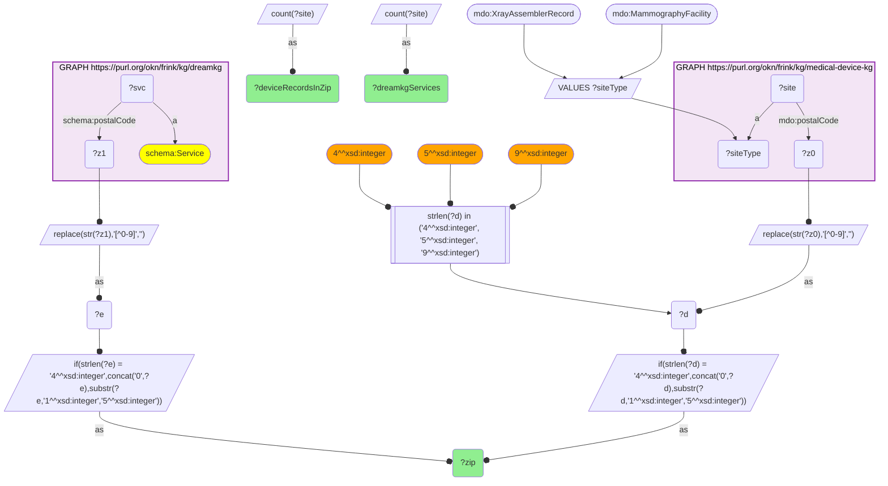
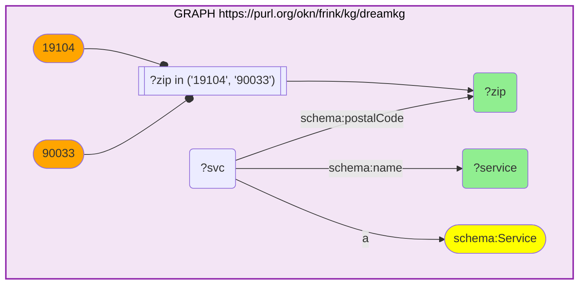

# GEO39-Q1: Los Angeles and Philadelphia social services and the device infrastructure in the same ZIP

- **Date:** 2026-11-03
- **Model:** claude-opus-5-5
- **SPARQL endpoint:** https://apps.okn.us/federation/sparql
- **Generated by:** mcp-okn v0.3.0 (build f9c4776)
- **Contents:** 2 queries · 2 query diagrams

## Knowledge graphs used

- `dreamkg` — <https://purl.org/okn/frink/kg/dreamkg>
- `medical-device-kg` — <https://purl.org/okn/frink/kg/medical-device-kg>

## Conversation

👤 **User**

Crosswalk: medical-device-kg × dreamkg on ZIP5. DreamKG catalogues metro-scoped social services (Los Angeles County, Philadelphia) with the ZIP each is delivered in; medical-device-kg carries FDA device records with addresses. dreamkg stores the HTTP `schema.org` form, so a bracketed IRI works on that side.

Research question: in the neighbourhoods DreamKG serves, what FDA-regulated device infrastructure is present — a device-access read on a social-service catchment?

---

🧠 **Assistant**

Ranking the ZIPs DreamKG serves by the number of FDA X-ray installation and mammography-facility records in the same postcode:

| ZIP | DreamKG services in ZIP | Device records in ZIP |
| --- | --- | --- |
| 19104 | 22 | 316 |
| 90033 | 18 | 252 |
| 19107 | 18 | 212 |
| 90048 | 3 | 185 |
| 90027 | 11 | 157 |
| 90404 | 1 | 132 |
| 90505 | 2 | 116 |
| 90806 | 5 | 114 |
| 90211 | 2 | 108 |
| 19111 | 2 | 107 |
| 93534 | 9 | 107 |
| 90024 | 2 | 97 |
| 91105 | 7 | 91 |
| 19140 | 4 | 86 |
| 19114 | 2 | 79 |

**Why this answers the question.** Two postcodes stand out, one in each metro, and both are academic medical districts:

- **19104** (University City in Philadelphia, home to Penn and CHOP): 316 device records and 22 DreamKG services.
- **90033** in Los Angeles (USC's health-sciences campus): 252 device records and 18 services.

Philadelphia's 19107 follows with 212. That co-occurrence is the answer in miniature: the same few postcodes concentrate both the safety-net services and the regulated diagnostic equipment, while most ZIPs DreamKG serves carry far less. By the fourteenth row the count is already down to 86.

**What the services in those two ZIPs are** (the first six by name in each; the full lists are in Query 2):

| ZIP | DreamKG service (provider) |
|---|---|
| 19104 | Addiction Services (University of Pennsylvania Perelman School of Medicine) |
| 19104 | Adolescent Medicine (Children's Hospital of Philadelphia) |
| 19104 | Adolescent Treatment Programming Willpower, Options, Resources and Direction - W.O.R.D (The Consortium, Inc.) |
| 19104 | Adult Behavioral Health Services (Family Practice & Counseling Network) |
| 19104 | Annex West Health Clinic (Family Practice & Counseling Network FPCN) |
| 19104 | Autism Integrated Care Program (Children's Hospital of Philadelphia) |
| 90033 | Adult Outpatient Services (Enki Health Services, Inc.) |
| 90033 | Behavioral Health (White Memorial Community Health Center (WMCHC)) |
| 90033 | Caught in the Crossfire (Soledad Enrichment Action (SEA)) |
| 90033 | Family Preservation & Domestic Violence (Jovenes) |
| 90033 | Family Reconnection (Jovenes) |
| 90033 | Family Source Center - Children & Youth Services (El Centro de Ayuda) |

The 90033 list also includes the USC Norris Comprehensive Cancer Center and Hospital, a direct user of the imaging equipment counted here.

The pairing is visible only across the two graphs. DreamKG knows an addiction service or an adolescent-medicine clinic operates at 19104 but nothing about imaging equipment. medical-device-kg registers 316 X-ray and mammography records there but cannot say what social or clinical services those machines sit beside.

**Caveats.**

1. DreamKG is metro-scoped, so this crosswalk is small by construction.
2. The device count is *records* (X-ray assembler reports plus MQSA mammography facilities), not distinct machines or sites; a single hospital campus generates many assembler entries.
3. medical-device-kg also stores 510(k) applicants, registered establishments and recalling firms on the same `mdo:postalCode`. They are left out here because they record where companies are, not where equipment is installed.
4. Same-ZIP is not access: a service user in 19104 does not thereby use the equipment registered there.

## SPARQL queries executed

#### Query 1

_2026-11-04T06:01:22+00:00 · `dreamkg`, `medical-device-kg`_

```sparql
PREFIX mdo: <https://bmedesign.org/medical-device-kg/ns/>
PREFIX schema: <http://schema.org/>
SELECT ?zip (COUNT(DISTINCT ?svc) AS ?dreamkgServices) ?deviceRecordsInZip WHERE {
  { SELECT DISTINCT ?zip ?svc WHERE {
      GRAPH <https://purl.org/okn/frink/kg/dreamkg> { ?svc a schema:Service ; schema:postalCode ?z1 . }
      BIND(REPLACE(STR(?z1),"[^0-9]","") AS ?e)
      BIND(IF(STRLEN(?e)=4, CONCAT("0",?e), SUBSTR(?e,1,5)) AS ?zip) } }
  { SELECT ?zip (COUNT(DISTINCT ?site) AS ?deviceRecordsInZip) WHERE {
      VALUES ?siteType { mdo:XrayAssemblerRecord mdo:MammographyFacility }
      GRAPH <https://purl.org/okn/frink/kg/medical-device-kg> { ?site a ?siteType ; mdo:postalCode ?z0 . }
      BIND(REPLACE(STR(?z0),"[^0-9]","") AS ?d)
      FILTER(STRLEN(?d) IN (4, 5, 9))
      BIND(IF(STRLEN(?d)=4, CONCAT("0",?d), SUBSTR(?d,1,5)) AS ?zip) } GROUP BY ?zip }
} GROUP BY ?zip ?deviceRecordsInZip ORDER BY DESC(?deviceRecordsInZip) ?zip LIMIT 15
```



_15 row(s) — showing first 3_

| zip | dreamkgServices | deviceRecordsInZip |
| --- | --- | --- |
| 19104 | 22 | 316 |
| 90033 | 18 | 252 |
| 19107 | 18 | 212 |

#### Query 2

_2026-11-04T06:01:22+00:00 · `dreamkg`_

```sparql
PREFIX schema: <http://schema.org/>
SELECT ?zip ?service WHERE {
  GRAPH <https://purl.org/okn/frink/kg/dreamkg> {
    ?svc a schema:Service ; schema:postalCode ?zip ; schema:name ?service .
    FILTER(?zip IN ("19104","90033"))
  }
} ORDER BY ?zip ?service
```



_40 row(s) — showing first 5_

| zip | service |
| --- | --- |
| 19104 | Addiction Services (University of Pennsylvania Perelman School of Medicine) |
| 19104 | Adolescent Medicine (Children's Hospital of Philadelphia) |
| 19104 | Adolescent Treatment Programming Willpower, Options, Resources and Direction - W.O.R.D (The Consortium, Inc.) |
| 19104 | Adult Behavioral Health Services (Family Practice & Counseling Network) |
| 19104 | Annex West Health Clinic (Family Practice & Counseling Network FPCN) |
