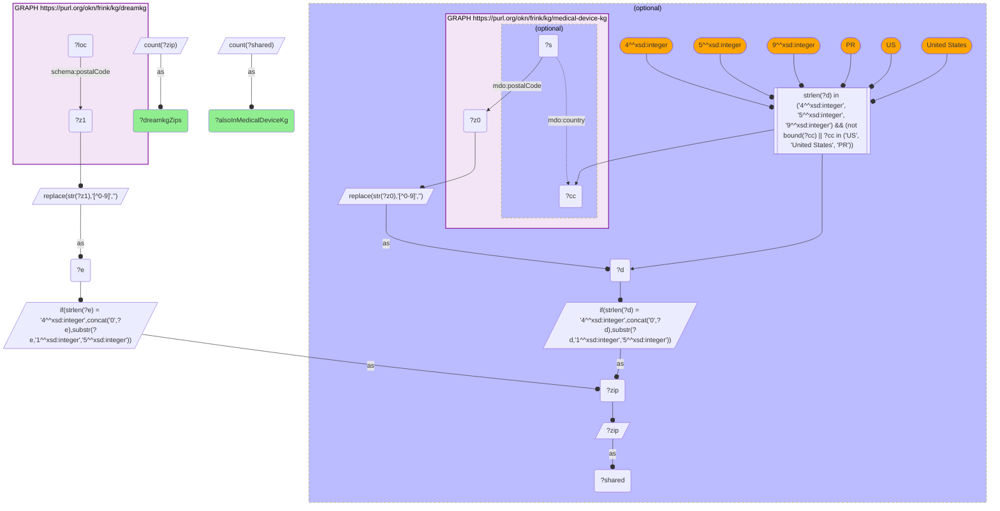

# GEO39-Q2: 232 of DreamKG's 235 service ZIPs also carry a medical-device-kg address

- **Date:** 2026-11-03
- **Model:** claude-opus-5-5
- **SPARQL endpoint:** https://apps.okn.us/federation/sparql
- **Generated by:** mcp-okn v0.3.0 (build f9c4776)
- **Contents:** 1 query · 1 query diagram

## Knowledge graphs used

- `dreamkg` — <https://purl.org/okn/frink/kg/dreamkg>
- `medical-device-kg` — <https://purl.org/okn/frink/kg/medical-device-kg>

## Conversation

👤 **User**

Same crosswalk, coverage angle: how many DreamKG social-service ZIPs also carry a medical-device-kg address?

---

🧠 **Assistant**

**232 of DreamKG's 235 ZIPs (98.7%).** Three postcodes have no medical-device-kg record at all.

The number is small in absolute terms, and that is a property of DreamKG, not of the join. DreamKG is metro-scoped (Los Angeles County and Philadelphia), so 235 ZIPs is its entire footprint. What the crosswalk says is that **the FDA's device geography covers almost all of it**: in 232 of 235 neighbourhoods where DreamKG catalogues a social service, the same postcode has a device record of some kind, whether an X-ray installation, a mammography facility, a registered establishment, a 510(k)/PMA applicant or a recalling firm.

| Side | ZIPs | Shared |
|---|---|---|
| DreamKG service locations | 235 | 232 (98.7%) |

**How to use a 232-row crosswalk.** For enumeration and ranking rather than modelling. With a few hundred ZIPs across two cities you can list every one and inspect it, which is what makes the neighbourhood comparison in GEO39-Q1 tractable.

**The three unmatched ZIPs** are the interesting residue: a DreamKG service catchment with no FDA device presence at all. In metros this dense that is worth a second look; most likely it is a PO-box or administrative ZIP rather than a real service desert.

medical-device-kg ZIPs are US-only here: records whose `mdo:country` names another country, and postcodes that are not 4-, 5- or 9-digit, are excluded.

## SPARQL queries executed

#### Query 1

_2026-11-04T06:01:22+00:00 · `dreamkg`, `medical-device-kg`_

```sparql
PREFIX mdo: <https://bmedesign.org/medical-device-kg/ns/>
PREFIX schema: <http://schema.org/>
SELECT (COUNT(DISTINCT ?zip) AS ?dreamkgZips) (COUNT(DISTINCT ?shared) AS ?alsoInMedicalDeviceKg) WHERE {
  { SELECT DISTINCT ?zip WHERE {
      GRAPH <https://purl.org/okn/frink/kg/dreamkg> { ?loc schema:postalCode ?z1 }
      BIND(REPLACE(STR(?z1),"[^0-9]","") AS ?e)
      BIND(IF(STRLEN(?e)=4, CONCAT("0",?e), SUBSTR(?e,1,5)) AS ?zip) } }
  OPTIONAL {
    { SELECT DISTINCT ?zip WHERE {
        GRAPH <https://purl.org/okn/frink/kg/medical-device-kg> {
          ?s mdo:postalCode ?z0 OPTIONAL { ?s mdo:country ?cc } }
        BIND(REPLACE(STR(?z0),"[^0-9]","") AS ?d)
        FILTER(STRLEN(?d) IN (4, 5, 9) && (!BOUND(?cc) || ?cc IN ("US", "United States", "PR")))
        BIND(IF(STRLEN(?d)=4, CONCAT("0",?d), SUBSTR(?d,1,5)) AS ?zip) } }
    BIND(?zip AS ?shared)
  }
}
```



_1 row(s)_

| dreamkgZips | alsoInMedicalDeviceKg |
| --- | --- |
| 235 | 232 |
