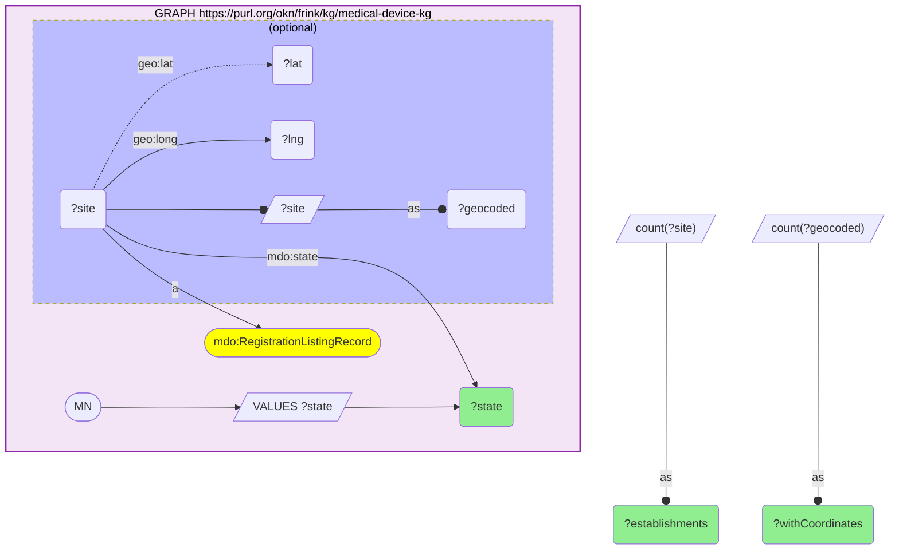
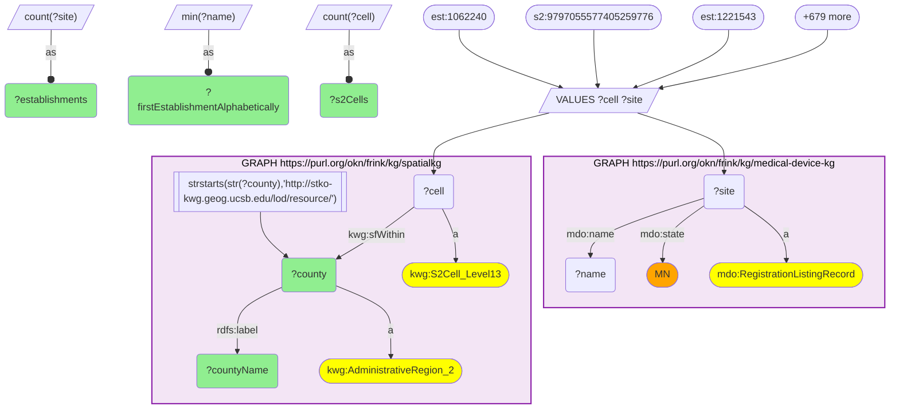
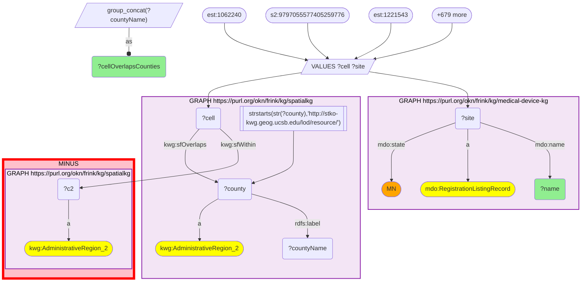

# GEO43-Q1: Minnesota's 341 geocoded FDA device establishments on computed S2 cells: Hennepin 156, Ramsey 54, and 15 on county-line cells

- **Date:** 2026-11-04
- **Model:** claude-opus-5-5
- **SPARQL endpoint:** https://apps.okn.us/federation/sparql
- **Generated by:** mcp-okn v0.3.0 (build bd8dd05)
- **Contents:** 3 queries · 3 query diagrams

## Knowledge graphs used

- `medical-device-kg` — <https://purl.org/okn/frink/kg/medical-device-kg>
- `spatialkg` — <https://purl.org/okn/frink/kg/spatialkg>

## Conversation

👤 **User**

medical-device-kg geocodes two kinds of site with the US Census Geocoder: FDA-registered device establishments (`mdo:RegistrationListingRecord`) and MQSA mammography facilities (`mdo:MammographyFacility`), as `geo:lat` / `geo:long`. It stores no county and no S2 cell. spatialkg is the federation's S2 Level-13 grid (`kwg:S2Cell_Level13`), linked up to counties and states; OKN has no point-in-polygon. **Crosswalk on a computed S2_L13 cell:** in which Minnesota counties do the state's FDA-registered device establishments sit? Compute each geocoded establishment's S2 Level-13 cell from its coordinates (the `mcp-okn` s2_bridge, `point_to_s2_iri`), inject the (site, cell) pairs, and roll them up through spatialkg to the county. Say what happens to an establishment whose cell crosses a county line.

---

🧠 **Assistant**

**326 of Minnesota's 341 geocoded FDA-registered device establishments resolve to a single county. The other 15 sit on S2 cells that straddle a county line.**

medical-device-kg lists 382 Minnesota establishment registrations, and 341 of them carry coordinates (query 1). Neither graph stores a key the other has, so the key was computed. The `mcp-okn` s2_bridge (`point_to_s2_iri`) turned each establishment's `geo:lat` / `geo:long` into its Google S2 Level-13 cell. The 341 (site, cell) pairs then went into the next two queries as a `VALUES` block.

**County roll-up (query 2).** The query joins each injected cell to spatialkg's `kwg:S2Cell_Level13` and follows `kwg:sfWithin` up to the county:

| County | Establishments | S2 cells |
|---|---|---|
| Hennepin | 156 | 100 |
| Ramsey | 54 | 33 |
| Dakota | 27 | 20 |
| Anoka | 20 | 16 |
| Olmsted | 10 | 7 |
| Carver | 8 | 8 |
| Washington | 7 | 7 |
| Wright | 7 | 7 |
| Scott | 6 | 5 |
| Sherburne | 5 | 4 |

Those 10 counties hold 300 of the 326. The other 22 counties have four with 2 establishments and eighteen with 1. Hennepin and Ramsey, the Twin Cities core, account for 210 of the 326 (64%). Olmsted (Rochester) is the only county outside the metro with more than eight.

**The 15 that query 2 cannot place (query 3).** An S2 Level-13 cell is roughly a kilometre across. In spatialkg a cell that crosses a county line is `sfWithin` only the state; it is linked to each county it touches by `kwg:sfOverlaps`. All 15 missing establishments are on such cells, and each cell overlaps exactly two counties.
- 13 of the 15 cells touch Hennepin, Ramsey or Anoka. They include St. Jude Medical, Synovis Life Technologies and Hill-Rom Manufacturing.
- The other two straddle Scott/Le Sueur (Electromed) and Scott/Dakota (R & D Batteries).
- 326 + 15 = 341, so every geocoded establishment reaches spatialkg at the county level or across a county line.

**How to use this crosswalk.** `sfWithin` gives an unambiguous county for 95.6% of these sites (326 of 341). For the rest, either:
- assign both overlapped counties and say so, or
- go back to the point and use a county polygon outside OKN.

A county is where the registered establishment is geocoded, not necessarily where every product is made. Once a site has a cell it can also meet any other S2-keyed graph (fiokg facilities, sawgraph samples, ufokn features) in the same cell.

## SPARQL queries executed

#### Query 1

_2026-11-04T09:05:36+00:00 · `medical-device-kg`_

```sparql
PREFIX mdo: <https://bmedesign.org/medical-device-kg/ns/>
PREFIX geo: <http://www.w3.org/2003/01/geo/wgs84_pos#>
PREFIX kwg: <http://stko-kwg.geog.ucsb.edu/lod/ontology/>
PREFIX rdfs: <http://www.w3.org/2000/01/rdf-schema#>
PREFIX est: <https://bmedesign.org/medical-device-kg/id/establishment/>
PREFIX mqsa: <https://bmedesign.org/medical-device-kg/id/mammography-facility/>
PREFIX s2: <http://stko-kwg.geog.ucsb.edu/lod/resource/s2.level13.>
SELECT ?state (COUNT(DISTINCT ?site) AS ?establishments) (COUNT(DISTINCT ?geocoded) AS ?withCoordinates) WHERE {
  GRAPH <https://purl.org/okn/frink/kg/medical-device-kg> {
    VALUES ?state { "MN" }
    ?site a mdo:RegistrationListingRecord ; mdo:state ?state .
    OPTIONAL { ?site geo:lat ?lat ; geo:long ?lng . BIND(?site AS ?geocoded) }
  }
} GROUP BY ?state
```



_1 row(s)_

| state | establishments | withCoordinates |
| --- | --- | --- |
| MN | 382 | 341 |

#### Query 2

_2026-11-04T09:05:37+00:00 · `medical-device-kg`, `spatialkg`_

```sparql
PREFIX mdo: <https://bmedesign.org/medical-device-kg/ns/>
PREFIX geo: <http://www.w3.org/2003/01/geo/wgs84_pos#>
PREFIX kwg: <http://stko-kwg.geog.ucsb.edu/lod/ontology/>
PREFIX rdfs: <http://www.w3.org/2000/01/rdf-schema#>
PREFIX est: <https://bmedesign.org/medical-device-kg/id/establishment/>
PREFIX mqsa: <https://bmedesign.org/medical-device-kg/id/mammography-facility/>
PREFIX s2: <http://stko-kwg.geog.ucsb.edu/lod/resource/s2.level13.>
SELECT ?county ?countyName (COUNT(DISTINCT ?site) AS ?establishments) (COUNT(DISTINCT ?cell) AS ?s2Cells) (MIN(?name) AS ?firstEstablishmentAlphabetically) WHERE {
  VALUES (?site ?cell) {
    (est:1062240 s2:9797055577405259776)
    (est:1221543 s2:5959188490938744832)
    (est:1649390 s2:9797056848715579392)
    (est:1932994 s2:9797040115522994176)
    (est:2086350 s2:9797056848715579392)
    (est:2111760 s2:9797459785367420928)
    (est:2113281 s2:9797055371246829568)
    (est:2118418 s2:5959058851645882368)
    (est:2122594 s2:9796879140148740096)
    (est:2122870 s2:9797047949543342080)
    (est:2124215 s2:5959151829097906176)
    (est:2124545 s2:5959177049145868288)
    (est:2125050 s2:5959162137019416576)
    (est:2125337 s2:9796516163872620544)
    (est:2125608 s2:9797055371246829568)
    (est:2126376 s2:5959156536382062592)
    (est:2126387 s2:5959571086625472512)
    (est:2126666 s2:9797047915183603712)
    (est:2127132 s2:5959164370402410496)
    (est:2127862 s2:9797067534594211840)
    (est:2131610 s2:5959187597585547264)
    (est:2132111 s2:9797083924189413376)
    (est:2132242 s2:5959061944022335488)
    (est:2132280 s2:5965104791209115648)
    (est:2132517 s2:5959061944022335488)
    (est:2132556 s2:9797637871891382272)
    (est:2133409 s2:9797066675600752640)
    (est:2133433 s2:5959133103040495616)
    (est:2133465 s2:5959146640777412608)
    (est:2133542 s2:5959186017037582336)
    (est:2133641 s2:9797988616100642816)
    (est:2133687 s2:5959184470849355776)
    (est:2133778 s2:5959166500706189312)
    (est:2133786 s2:9797403126158852096)
    (est:2133810 s2:5959154406078283776)
    (est:2133840 s2:5959166672504881152)
    (est:2133928 s2:5959221888604438528)
    (est:2133936 s2:5959188490938744832)
    (est:2133982 s2:5959147912087732224)
    (est:2133983 s2:5957790324465074176)
    (est:2134213 s2:9797055165088399360)
    (est:2134244 s2:9797066675600752640)
    (est:2134265 s2:5959185742159675392)
    (est:2134295 s2:5959236594572460032)
    (est:2134470 s2:5959168493571014656)
    (est:2134492 s2:9797067465874735104)
    (est:2134494 s2:5959061944022335488)
    (est:2134626 s2:5959184436489617408)
    (est:2134812 s2:5959186051397320704)
    (est:2134850 s2:5959151863457644544)
    (est:2134852 s2:9797143229097836544)
    (est:2135147 s2:5959166397626974208)
    (est:2135156 s2:9797536922980057088)
    (est:2135338 s2:9796266162416254976)
    (est:2135339 s2:5959062390698934272)
    (est:2135348 s2:5959153787602993152)
    (est:2135401 s2:9796508398571749376)
    (est:2135464 s2:5959166775584096256)
    (est:2150060 s2:5959188319140052992)
    (est:2150138 s2:5959493536695975936)
    (est:2182204 s2:9797043998173429760)
    (est:2182207 s2:5959159079002701824)
    (est:2182208 s2:5959148393124069376)
    (est:2182269 s2:9797051248078225408)
    (est:2182345 s2:9797066709960491008)
    (est:2182501 s2:5959156948698923008)
    (est:2182595 s2:5959049368358092800)
    (est:2182681 s2:9797533246488051712)
    (est:2182762 s2:5959209450379149312)
    (est:2182799 s2:5959151004464185344)
    (est:2182825 s2:9797045819239563264)
    (est:2182861 s2:9797052210150899712)
    (est:2182979 s2:9797048190061510656)
    (est:2183022 s2:5959062425058672640)
    (est:2183164 s2:9797665325322338304)
    (est:2183301 s2:9797066847399444480)
    (est:2183319 s2:9797533796243865600)
    (est:2183415 s2:5959175777835548672)
    (est:2183416 s2:9797070867488833536)
    (est:2183425 s2:9797066675600752640)
    (est:2183570 s2:9797533796243865600)
    (est:2183585 s2:5959236594572460032)
    (est:2183613 s2:5959266728063008768)
    (est:2183620 s2:5959155952266510336)
    (est:2183634 s2:9796800318908923904)
    (est:2183646 s2:5959189178133512192)
    (est:2183671 s2:9797404672347078656)
    (est:2183673 s2:5959177014786129920)
    (est:2183732 s2:9796897591328243712)
    (est:2183744 s2:5959147602850086912)
    (est:2183762 s2:9797406081096351744)
    (est:2183785 s2:9797045784879824896)
    (est:2183787 s2:5959188422219268096)
    (est:2183816 s2:5959150454708371456)
    (est:2183828 s2:5959170039759241216)
    (est:2183831 s2:9797536579382673408)
    (est:2183873 s2:9797055165088399360)
    (est:2183890 s2:9797052210150899712)
    (est:2183911 s2:5959188490938744832)
    (est:2183930 s2:5959214363821735936)
    (est:2183946 s2:5959147637209825280)
    (est:2183958 s2:9797404500548386816)
    (est:2183967 s2:5959164817079009280)
    (est:2183982 s2:5959166328907497472)
    (est:2184002 s2:9797023279251193856)
    (est:2184009 s2:5959167737656770560)
    (est:2184059 s2:9797053412741742592)
    (est:2184171 s2:9797067500234473472)
    (est:2321033 s2:5959161106227265536)
    (est:3000184820 s2:9797139105929232384)
    (est:3000203391 s2:5959147602850086912)
    (est:3001374820 s2:9797055543045521408)
    (est:3001576173 s2:5959155265071742976)
    (est:3002647932 s2:9797052656827498496)
    (est:3002789796 s2:5959153650164039680)
    (est:3002900281 s2:5959190071486709760)
    (est:3003335547 s2:5959190140206186496)
    (est:3003428492 s2:5959061531705475072)
    (est:3003433048 s2:5959162789854445568)
    (est:3003477135 s2:9797056779996102656)
    (est:3003477176 s2:5959188422219268096)
    (est:3003504604 s2:5959188490938744832)
    (est:3003661577 s2:5959179626126245888)
    (est:3003697998 s2:5959605858680700928)
    (est:3003755213 s2:5959164748359532544)
    (est:3003857828 s2:5959056309025243136)
    (est:3003932293 s2:5959574660038262784)
    (est:3004007782 s2:5959061875302858752)
    (est:3004016606 s2:5959193507460546560)
    (est:3004028690 s2:5959176808627699712)
    (est:3004126422 s2:5959712202070949888)
    (est:3004181163 s2:9797532318775115776)
    (est:3004181533 s2:5959190174565924864)
    (est:3004183730 s2:5959158185649504256)
    (est:3004305946 s2:9797067534594211840)
    (est:3004612223 s2:5959170245917671424)
    (est:3004742232 s2:5959158220009242624)
    (est:3004743815 s2:9798112998353534976)
    (est:3004961434 s2:5959166431986712576)
    (est:3004961578 s2:5959158185649504256)
    (est:3004962786 s2:5959065139478003712)
    (est:3004962788 s2:5959189178133512192)
    (est:3004982543 s2:5959151588579737600)
    (est:3005232773 s2:5959187597585547264)
    (est:3005334138 s2:5959166397626974208)
    (est:3005402529 s2:5959181412832641024)
    (est:3005521864 s2:9797075849650896896)
    (est:3005675811 s2:5960212754739494912)
    (est:3005687730 s2:5959167703297032192)
    (est:3005699784 s2:5959055415672045568)
    (est:3005743849 s2:5959148977239621632)
    (est:3005783142 s2:5959232024727257088)
    (est:3005857264 s2:9797051282437963776)
    (est:3006572778 s2:5959177049145868288)
    (est:3007113487 s2:5959060054236725248)
    (est:3007137787 s2:9797045303843487744)
    (est:3007225047 s2:5959061944022335488)
    (est:3007225330 s2:5959189178133512192)
    (est:3007277229 s2:9797055302527352832)
    (est:3007319244 s2:5959198352183656448)
    (est:3007709321 s2:5959061944022335488)
    (est:3007788086 s2:5959167840735985664)
    (est:3007795799 s2:5959189178133512192)
    (est:3007795813 s2:9797057707709038592)
    (est:3007841013 s2:5959147705929302016)
    (est:3007886583 s2:5963158793066905600)
    (est:3007939342 s2:5959062425058672640)
    (est:3007972010 s2:5959170039759241216)
    (est:3008216220 s2:5959149011599360000)
    (est:3008363932 s2:5959188387859529728)
    (est:3008414621 s2:5959155471230173184)
    (est:3008431074 s2:5960159840742408192)
    (est:3008485439 s2:9798680380713205760)
    (est:3008485584 s2:5959495357762109440)
    (est:3008493151 s2:5959155883547033600)
    (est:3008501679 s2:5959164817079009280)
    (est:3008592544 s2:5959187597585547264)
    (est:3008627763 s2:5959055415672045568)
    (est:3008770104 s2:5959147774648778752)
    (est:3008872935 s2:9797097461926330368)
    (est:3008988055 s2:5959062115821027328)
    (est:3009046888 s2:9797052278870376448)
    (est:3009139985 s2:5959156433302847488)
    (est:3009144177 s2:9797052588108021760)
    (est:3009230570 s2:5959161106227265536)
    (est:3009254201 s2:9797082859037523968)
    (est:3009351773 s2:5959148599282499584)
    (est:3009519707 s2:5958986009000542208)
    (est:3009758645 s2:5959168218693107712)
    (est:3009766315 s2:5959155265071742976)
    (est:3009893608 s2:9797055543045521408)
    (est:3009941480 s2:5959216631564468224)
    (est:3009970070 s2:5959189178133512192)
    (est:3009998573 s2:9797097427566592000)
    (est:3010009693 s2:5959176774267961344)
    (est:3010068573 s2:9797023313610932224)
    (est:3010083866 s2:5959159834916945920)
    (est:3010199770 s2:9797404397469171712)
    (est:3010236732 s2:5959061359906783232)
    (est:3010237768 s2:9797049461371830272)
    (est:3010520951 s2:9797045097685057536)
    (est:3010521015 s2:5959082044469280768)
    (est:3010610560 s2:9797057364111654912)
    (est:3010610937 s2:5959164885798486016)
    (est:3010692333 s2:9797404397469171712)
    (est:3010800486 s2:5959156089705463808)
    (est:3010894343 s2:5959187357067378688)
    (est:3011024991 s2:5959168218693107712)
    (est:3011027014 s2:5959155952266510336)
    (est:3011276773 s2:5959187803743977472)
    (est:3011400126 s2:5959158769765056512)
    (est:3011567699 s2:5959111834362445824)
    (est:3011589232 s2:5959492643342778368)
    (est:3011604145 s2:5959147774648778752)
    (est:3011788769 s2:5959189075054297088)
    (est:3011937459 s2:5959151863457644544)
    (est:3011945100 s2:5959151863457644544)
    (est:3012114684 s2:9797097427566592000)
    (est:3012118649 s2:5959061944022335488)
    (est:3012179728 s2:5959155402510696448)
    (est:3012191403 s2:9797054477893632000)
    (est:3012191412 s2:9797055165088399360)
    (est:3012276280 s2:5959151863457644544)
    (est:3012664855 s2:9797067465874735104)
    (est:3012696653 s2:5959188353499791360)
    (est:3012974595 s2:5959164507841363968)
    (est:3013288201 s2:9797051248078225408)
    (est:3013368220 s2:5959170211557933056)
    (est:3013479847 s2:9797066813039706112)
    (est:3013508647 s2:9797055508685783040)
    (est:3013646819 s2:5959161518544125952)
    (est:3013695852 s2:9797404397469171712)
    (est:3013758617 s2:9797050973200318464)
    (est:3013847376 s2:5959187597585547264)
    (est:3013943846 s2:5959188353499791360)
    (est:3013951865 s2:9797534105481510912)
    (est:3014003617 s2:9797055302527352832)
    (est:3014016859 s2:9797054271735201792)
    (est:3014146191 s2:5959156742540492800)
    (est:3014403509 s2:5959056102866812928)
    (est:3014498598 s2:5959151863457644544)
    (est:3014596751 s2:9797043826374737920)
    (est:3014653196 s2:9766717027937943552)
    (est:3014653199 s2:9797055336887091200)
    (est:3014687026 s2:9797055508685783040)
    (est:3014827594 s2:9797055336887091200)
    (est:3014829416 s2:5959159216441655296)
    (est:3015045324 s2:5959179385608077312)
    (est:3015124694 s2:5959148977239621632)
    (est:3015194986 s2:9797057157953224704)
    (est:3015200759 s2:5959162308818108416)
    (est:3015228875 s2:5959188353499791360)
    (est:3015339698 s2:5959164507841363968)
    (est:3015544746 s2:5959159079002701824)
    (est:3015651976 s2:5959165057597177856)
    (est:3015860550 s2:9797394433145044992)
    (est:3015975397 s2:5959168287412584448)
    (est:3016002322 s2:9797071314165432320)
    (est:3016050930 s2:5959162343177846784)
    (est:3016257349 s2:5959166431986712576)
    (est:3016438686 s2:9797045303843487744)
    (est:3016555200 s2:9797456899149398016)
    (est:3016734024 s2:5959168768448921600)
    (est:3016774528 s2:9797067465874735104)
    (est:3016842740 s2:9797055508685783040)
    (est:3016842760 s2:5959186154476535808)
    (est:3016846589 s2:5959155196352266240)
    (est:3016986313 s2:5959167737656770560)
    (est:3017056829 s2:5959061188108091392)
    (est:3017230582 s2:9797067465874735104)
    (est:3017357478 s2:5959151622939475968)
    (est:3017462289 s2:5959179385608077312)
    (est:3017496797 s2:9797055508685783040)
    (est:3017565083 s2:9797013864682881024)
    (est:3017660607 s2:9797053515820957696)
    (est:3017708755 s2:5959204468217085952)
    (est:3017978518 s2:5959151622939475968)
    (est:3017995697 s2:9797043998173429760)
    (est:3018050916 s2:9797025340835495936)
    (est:3018383120 s2:9797036542110203904)
    (est:3018783201 s2:9797055336887091200)
    (est:3019131 s2:5959188319140052992)
    (est:3020048546 s2:9797534036762034176)
    (est:3020664622 s2:9767171847794720768)
    (est:3020869111 s2:9797282660916133888)
    (est:3021190802 s2:9797055508685783040)
    (est:3021477808 s2:9797081484647989248)
    (est:3021970868 s2:9797066778679967744)
    (est:3022627847 s2:5959188319140052992)
    (est:3022977243 s2:5959152481932935168)
    (est:3023194188 s2:5959144476113895424)
    (est:3023194190 s2:9797404397469171712)
    (est:3024996452 s2:5959170211557933056)
    (est:3025434453 s2:5959193507460546560)
    (est:3025434462 s2:5959185742159675392)
    (est:3025490805 s2:5959061944022335488)
    (est:3026283936 s2:5959151863457644544)
    (est:3026368553 s2:5959199073738162176)
    (est:3027226463 s2:5959151863457644544)
    (est:3027386225 s2:5959164610920579072)
    (est:3027485564 s2:9797057123593486336)
    (est:3027553518 s2:5959188422219268096)
    (est:3027664504 s2:5959187425786855424)
    (est:3027718340 s2:5959189109414035456)
    (est:3029300753 s2:5959189315572465664)
    (est:3030236028 s2:5959170211557933056)
    (est:3030239420 s2:5959161484184387584)
    (est:3030411493 s2:5959061531705475072)
    (est:3030495169 s2:5959582150461227008)
    (est:3030499299 s2:5959164542201102336)
    (est:3031230150 s2:5959167737656770560)
    (est:3031531314 s2:5959167737656770560)
    (est:3031768596 s2:5959168287412584448)
    (est:3032193274 s2:9797073272670519296)
    (est:3032328006 s2:5959188319140052992)
    (est:3032906574 s2:9797082481080401920)
    (est:3033275035 s2:9797052210150899712)
    (est:3034089185 s2:5959162377537585152)
    (est:3035108304 s2:5959153787602993152)
    (est:3035372913 s2:5959167875095724032)
    (est:3036108847 s2:9797055371246829568)
    (est:3036471728 s2:5959155127632789504)
    (est:3038166862 s2:5959151622939475968)
    (est:3038472985 s2:9797064854534619136)
    (est:3038912617 s2:9797057157953224704)
    (est:3039454510 s2:5959167875095724032)
    (est:3039524238 s2:9797052656827498496)
    (est:3039667438 s2:5959061944022335488)
    (est:3042022819 s2:9797055543045521408)
    (est:3042023384 s2:5959189109414035456)
    (est:3042272797 s2:9797069080782438400)
    (est:3042638647 s2:5959162686775230464)
    (est:3043234899 s2:9797045166404534272)
    (est:3043354173 s2:5959156845619707904)
    (est:3043841530 s2:9797529638715523072)
    (est:3044519982 s2:5959162377537585152)
    (est:3045174673 s2:9797050904480841728)
    (est:3045178474 s2:5959188284780314624)
    (est:3047514291 s2:5959155917906771968)
    (est:3047514296 s2:9797061074963398656)
    (est:3047515274 s2:9797055508685783040)
  }
  GRAPH <https://purl.org/okn/frink/kg/medical-device-kg> { ?site a mdo:RegistrationListingRecord ; mdo:state "MN" ; mdo:name ?name . }
  GRAPH <https://purl.org/okn/frink/kg/spatialkg> {
    ?cell a kwg:S2Cell_Level13 ; kwg:sfWithin ?county .
    ?county a kwg:AdministrativeRegion_2 ; rdfs:label ?countyName .
    FILTER(STRSTARTS(STR(?county), 'http://stko-kwg.geog.ucsb.edu/lod/resource/'))
  }
} GROUP BY ?county ?countyName ORDER BY DESC(?establishments) ?countyName
```



_32 row(s) — showing first 3_

| county | countyName | establishments | s2Cells | firstEstablishmentAlphabetically |
| --- | --- | --- | --- | --- |
| http://stko-kwg.geog.ucsb.edu/lod/resource/administrativeRegion.USA.27053 | Hennepin County, Minnesota | 156 | 100 | Abbott Medical |
| http://stko-kwg.geog.ucsb.edu/lod/resource/administrativeRegion.USA.27123 | Ramsey County, Minnesota | 54 | 33 | Abbott Medical |
| http://stko-kwg.geog.ucsb.edu/lod/resource/administrativeRegion.USA.27037 | Dakota County, Minnesota | 27 | 20 | ABMRC LLC |

#### Query 3

_2026-11-04T09:05:37+00:00 · `medical-device-kg`, `spatialkg`_

```sparql
PREFIX mdo: <https://bmedesign.org/medical-device-kg/ns/>
PREFIX geo: <http://www.w3.org/2003/01/geo/wgs84_pos#>
PREFIX kwg: <http://stko-kwg.geog.ucsb.edu/lod/ontology/>
PREFIX rdfs: <http://www.w3.org/2000/01/rdf-schema#>
PREFIX est: <https://bmedesign.org/medical-device-kg/id/establishment/>
PREFIX mqsa: <https://bmedesign.org/medical-device-kg/id/mammography-facility/>
PREFIX s2: <http://stko-kwg.geog.ucsb.edu/lod/resource/s2.level13.>
SELECT ?name (GROUP_CONCAT(DISTINCT ?countyName; separator=" / ") AS ?cellOverlapsCounties) WHERE {
  VALUES (?site ?cell) {
    (est:1062240 s2:9797055577405259776)
    (est:1221543 s2:5959188490938744832)
    (est:1649390 s2:9797056848715579392)
    (est:1932994 s2:9797040115522994176)
    (est:2086350 s2:9797056848715579392)
    (est:2111760 s2:9797459785367420928)
    (est:2113281 s2:9797055371246829568)
    (est:2118418 s2:5959058851645882368)
    (est:2122594 s2:9796879140148740096)
    (est:2122870 s2:9797047949543342080)
    (est:2124215 s2:5959151829097906176)
    (est:2124545 s2:5959177049145868288)
    (est:2125050 s2:5959162137019416576)
    (est:2125337 s2:9796516163872620544)
    (est:2125608 s2:9797055371246829568)
    (est:2126376 s2:5959156536382062592)
    (est:2126387 s2:5959571086625472512)
    (est:2126666 s2:9797047915183603712)
    (est:2127132 s2:5959164370402410496)
    (est:2127862 s2:9797067534594211840)
    (est:2131610 s2:5959187597585547264)
    (est:2132111 s2:9797083924189413376)
    (est:2132242 s2:5959061944022335488)
    (est:2132280 s2:5965104791209115648)
    (est:2132517 s2:5959061944022335488)
    (est:2132556 s2:9797637871891382272)
    (est:2133409 s2:9797066675600752640)
    (est:2133433 s2:5959133103040495616)
    (est:2133465 s2:5959146640777412608)
    (est:2133542 s2:5959186017037582336)
    (est:2133641 s2:9797988616100642816)
    (est:2133687 s2:5959184470849355776)
    (est:2133778 s2:5959166500706189312)
    (est:2133786 s2:9797403126158852096)
    (est:2133810 s2:5959154406078283776)
    (est:2133840 s2:5959166672504881152)
    (est:2133928 s2:5959221888604438528)
    (est:2133936 s2:5959188490938744832)
    (est:2133982 s2:5959147912087732224)
    (est:2133983 s2:5957790324465074176)
    (est:2134213 s2:9797055165088399360)
    (est:2134244 s2:9797066675600752640)
    (est:2134265 s2:5959185742159675392)
    (est:2134295 s2:5959236594572460032)
    (est:2134470 s2:5959168493571014656)
    (est:2134492 s2:9797067465874735104)
    (est:2134494 s2:5959061944022335488)
    (est:2134626 s2:5959184436489617408)
    (est:2134812 s2:5959186051397320704)
    (est:2134850 s2:5959151863457644544)
    (est:2134852 s2:9797143229097836544)
    (est:2135147 s2:5959166397626974208)
    (est:2135156 s2:9797536922980057088)
    (est:2135338 s2:9796266162416254976)
    (est:2135339 s2:5959062390698934272)
    (est:2135348 s2:5959153787602993152)
    (est:2135401 s2:9796508398571749376)
    (est:2135464 s2:5959166775584096256)
    (est:2150060 s2:5959188319140052992)
    (est:2150138 s2:5959493536695975936)
    (est:2182204 s2:9797043998173429760)
    (est:2182207 s2:5959159079002701824)
    (est:2182208 s2:5959148393124069376)
    (est:2182269 s2:9797051248078225408)
    (est:2182345 s2:9797066709960491008)
    (est:2182501 s2:5959156948698923008)
    (est:2182595 s2:5959049368358092800)
    (est:2182681 s2:9797533246488051712)
    (est:2182762 s2:5959209450379149312)
    (est:2182799 s2:5959151004464185344)
    (est:2182825 s2:9797045819239563264)
    (est:2182861 s2:9797052210150899712)
    (est:2182979 s2:9797048190061510656)
    (est:2183022 s2:5959062425058672640)
    (est:2183164 s2:9797665325322338304)
    (est:2183301 s2:9797066847399444480)
    (est:2183319 s2:9797533796243865600)
    (est:2183415 s2:5959175777835548672)
    (est:2183416 s2:9797070867488833536)
    (est:2183425 s2:9797066675600752640)
    (est:2183570 s2:9797533796243865600)
    (est:2183585 s2:5959236594572460032)
    (est:2183613 s2:5959266728063008768)
    (est:2183620 s2:5959155952266510336)
    (est:2183634 s2:9796800318908923904)
    (est:2183646 s2:5959189178133512192)
    (est:2183671 s2:9797404672347078656)
    (est:2183673 s2:5959177014786129920)
    (est:2183732 s2:9796897591328243712)
    (est:2183744 s2:5959147602850086912)
    (est:2183762 s2:9797406081096351744)
    (est:2183785 s2:9797045784879824896)
    (est:2183787 s2:5959188422219268096)
    (est:2183816 s2:5959150454708371456)
    (est:2183828 s2:5959170039759241216)
    (est:2183831 s2:9797536579382673408)
    (est:2183873 s2:9797055165088399360)
    (est:2183890 s2:9797052210150899712)
    (est:2183911 s2:5959188490938744832)
    (est:2183930 s2:5959214363821735936)
    (est:2183946 s2:5959147637209825280)
    (est:2183958 s2:9797404500548386816)
    (est:2183967 s2:5959164817079009280)
    (est:2183982 s2:5959166328907497472)
    (est:2184002 s2:9797023279251193856)
    (est:2184009 s2:5959167737656770560)
    (est:2184059 s2:9797053412741742592)
    (est:2184171 s2:9797067500234473472)
    (est:2321033 s2:5959161106227265536)
    (est:3000184820 s2:9797139105929232384)
    (est:3000203391 s2:5959147602850086912)
    (est:3001374820 s2:9797055543045521408)
    (est:3001576173 s2:5959155265071742976)
    (est:3002647932 s2:9797052656827498496)
    (est:3002789796 s2:5959153650164039680)
    (est:3002900281 s2:5959190071486709760)
    (est:3003335547 s2:5959190140206186496)
    (est:3003428492 s2:5959061531705475072)
    (est:3003433048 s2:5959162789854445568)
    (est:3003477135 s2:9797056779996102656)
    (est:3003477176 s2:5959188422219268096)
    (est:3003504604 s2:5959188490938744832)
    (est:3003661577 s2:5959179626126245888)
    (est:3003697998 s2:5959605858680700928)
    (est:3003755213 s2:5959164748359532544)
    (est:3003857828 s2:5959056309025243136)
    (est:3003932293 s2:5959574660038262784)
    (est:3004007782 s2:5959061875302858752)
    (est:3004016606 s2:5959193507460546560)
    (est:3004028690 s2:5959176808627699712)
    (est:3004126422 s2:5959712202070949888)
    (est:3004181163 s2:9797532318775115776)
    (est:3004181533 s2:5959190174565924864)
    (est:3004183730 s2:5959158185649504256)
    (est:3004305946 s2:9797067534594211840)
    (est:3004612223 s2:5959170245917671424)
    (est:3004742232 s2:5959158220009242624)
    (est:3004743815 s2:9798112998353534976)
    (est:3004961434 s2:5959166431986712576)
    (est:3004961578 s2:5959158185649504256)
    (est:3004962786 s2:5959065139478003712)
    (est:3004962788 s2:5959189178133512192)
    (est:3004982543 s2:5959151588579737600)
    (est:3005232773 s2:5959187597585547264)
    (est:3005334138 s2:5959166397626974208)
    (est:3005402529 s2:5959181412832641024)
    (est:3005521864 s2:9797075849650896896)
    (est:3005675811 s2:5960212754739494912)
    (est:3005687730 s2:5959167703297032192)
    (est:3005699784 s2:5959055415672045568)
    (est:3005743849 s2:5959148977239621632)
    (est:3005783142 s2:5959232024727257088)
    (est:3005857264 s2:9797051282437963776)
    (est:3006572778 s2:5959177049145868288)
    (est:3007113487 s2:5959060054236725248)
    (est:3007137787 s2:9797045303843487744)
    (est:3007225047 s2:5959061944022335488)
    (est:3007225330 s2:5959189178133512192)
    (est:3007277229 s2:9797055302527352832)
    (est:3007319244 s2:5959198352183656448)
    (est:3007709321 s2:5959061944022335488)
    (est:3007788086 s2:5959167840735985664)
    (est:3007795799 s2:5959189178133512192)
    (est:3007795813 s2:9797057707709038592)
    (est:3007841013 s2:5959147705929302016)
    (est:3007886583 s2:5963158793066905600)
    (est:3007939342 s2:5959062425058672640)
    (est:3007972010 s2:5959170039759241216)
    (est:3008216220 s2:5959149011599360000)
    (est:3008363932 s2:5959188387859529728)
    (est:3008414621 s2:5959155471230173184)
    (est:3008431074 s2:5960159840742408192)
    (est:3008485439 s2:9798680380713205760)
    (est:3008485584 s2:5959495357762109440)
    (est:3008493151 s2:5959155883547033600)
    (est:3008501679 s2:5959164817079009280)
    (est:3008592544 s2:5959187597585547264)
    (est:3008627763 s2:5959055415672045568)
    (est:3008770104 s2:5959147774648778752)
    (est:3008872935 s2:9797097461926330368)
    (est:3008988055 s2:5959062115821027328)
    (est:3009046888 s2:9797052278870376448)
    (est:3009139985 s2:5959156433302847488)
    (est:3009144177 s2:9797052588108021760)
    (est:3009230570 s2:5959161106227265536)
    (est:3009254201 s2:9797082859037523968)
    (est:3009351773 s2:5959148599282499584)
    (est:3009519707 s2:5958986009000542208)
    (est:3009758645 s2:5959168218693107712)
    (est:3009766315 s2:5959155265071742976)
    (est:3009893608 s2:9797055543045521408)
    (est:3009941480 s2:5959216631564468224)
    (est:3009970070 s2:5959189178133512192)
    (est:3009998573 s2:9797097427566592000)
    (est:3010009693 s2:5959176774267961344)
    (est:3010068573 s2:9797023313610932224)
    (est:3010083866 s2:5959159834916945920)
    (est:3010199770 s2:9797404397469171712)
    (est:3010236732 s2:5959061359906783232)
    (est:3010237768 s2:9797049461371830272)
    (est:3010520951 s2:9797045097685057536)
    (est:3010521015 s2:5959082044469280768)
    (est:3010610560 s2:9797057364111654912)
    (est:3010610937 s2:5959164885798486016)
    (est:3010692333 s2:9797404397469171712)
    (est:3010800486 s2:5959156089705463808)
    (est:3010894343 s2:5959187357067378688)
    (est:3011024991 s2:5959168218693107712)
    (est:3011027014 s2:5959155952266510336)
    (est:3011276773 s2:5959187803743977472)
    (est:3011400126 s2:5959158769765056512)
    (est:3011567699 s2:5959111834362445824)
    (est:3011589232 s2:5959492643342778368)
    (est:3011604145 s2:5959147774648778752)
    (est:3011788769 s2:5959189075054297088)
    (est:3011937459 s2:5959151863457644544)
    (est:3011945100 s2:5959151863457644544)
    (est:3012114684 s2:9797097427566592000)
    (est:3012118649 s2:5959061944022335488)
    (est:3012179728 s2:5959155402510696448)
    (est:3012191403 s2:9797054477893632000)
    (est:3012191412 s2:9797055165088399360)
    (est:3012276280 s2:5959151863457644544)
    (est:3012664855 s2:9797067465874735104)
    (est:3012696653 s2:5959188353499791360)
    (est:3012974595 s2:5959164507841363968)
    (est:3013288201 s2:9797051248078225408)
    (est:3013368220 s2:5959170211557933056)
    (est:3013479847 s2:9797066813039706112)
    (est:3013508647 s2:9797055508685783040)
    (est:3013646819 s2:5959161518544125952)
    (est:3013695852 s2:9797404397469171712)
    (est:3013758617 s2:9797050973200318464)
    (est:3013847376 s2:5959187597585547264)
    (est:3013943846 s2:5959188353499791360)
    (est:3013951865 s2:9797534105481510912)
    (est:3014003617 s2:9797055302527352832)
    (est:3014016859 s2:9797054271735201792)
    (est:3014146191 s2:5959156742540492800)
    (est:3014403509 s2:5959056102866812928)
    (est:3014498598 s2:5959151863457644544)
    (est:3014596751 s2:9797043826374737920)
    (est:3014653196 s2:9766717027937943552)
    (est:3014653199 s2:9797055336887091200)
    (est:3014687026 s2:9797055508685783040)
    (est:3014827594 s2:9797055336887091200)
    (est:3014829416 s2:5959159216441655296)
    (est:3015045324 s2:5959179385608077312)
    (est:3015124694 s2:5959148977239621632)
    (est:3015194986 s2:9797057157953224704)
    (est:3015200759 s2:5959162308818108416)
    (est:3015228875 s2:5959188353499791360)
    (est:3015339698 s2:5959164507841363968)
    (est:3015544746 s2:5959159079002701824)
    (est:3015651976 s2:5959165057597177856)
    (est:3015860550 s2:9797394433145044992)
    (est:3015975397 s2:5959168287412584448)
    (est:3016002322 s2:9797071314165432320)
    (est:3016050930 s2:5959162343177846784)
    (est:3016257349 s2:5959166431986712576)
    (est:3016438686 s2:9797045303843487744)
    (est:3016555200 s2:9797456899149398016)
    (est:3016734024 s2:5959168768448921600)
    (est:3016774528 s2:9797067465874735104)
    (est:3016842740 s2:9797055508685783040)
    (est:3016842760 s2:5959186154476535808)
    (est:3016846589 s2:5959155196352266240)
    (est:3016986313 s2:5959167737656770560)
    (est:3017056829 s2:5959061188108091392)
    (est:3017230582 s2:9797067465874735104)
    (est:3017357478 s2:5959151622939475968)
    (est:3017462289 s2:5959179385608077312)
    (est:3017496797 s2:9797055508685783040)
    (est:3017565083 s2:9797013864682881024)
    (est:3017660607 s2:9797053515820957696)
    (est:3017708755 s2:5959204468217085952)
    (est:3017978518 s2:5959151622939475968)
    (est:3017995697 s2:9797043998173429760)
    (est:3018050916 s2:9797025340835495936)
    (est:3018383120 s2:9797036542110203904)
    (est:3018783201 s2:9797055336887091200)
    (est:3019131 s2:5959188319140052992)
    (est:3020048546 s2:9797534036762034176)
    (est:3020664622 s2:9767171847794720768)
    (est:3020869111 s2:9797282660916133888)
    (est:3021190802 s2:9797055508685783040)
    (est:3021477808 s2:9797081484647989248)
    (est:3021970868 s2:9797066778679967744)
    (est:3022627847 s2:5959188319140052992)
    (est:3022977243 s2:5959152481932935168)
    (est:3023194188 s2:5959144476113895424)
    (est:3023194190 s2:9797404397469171712)
    (est:3024996452 s2:5959170211557933056)
    (est:3025434453 s2:5959193507460546560)
    (est:3025434462 s2:5959185742159675392)
    (est:3025490805 s2:5959061944022335488)
    (est:3026283936 s2:5959151863457644544)
    (est:3026368553 s2:5959199073738162176)
    (est:3027226463 s2:5959151863457644544)
    (est:3027386225 s2:5959164610920579072)
    (est:3027485564 s2:9797057123593486336)
    (est:3027553518 s2:5959188422219268096)
    (est:3027664504 s2:5959187425786855424)
    (est:3027718340 s2:5959189109414035456)
    (est:3029300753 s2:5959189315572465664)
    (est:3030236028 s2:5959170211557933056)
    (est:3030239420 s2:5959161484184387584)
    (est:3030411493 s2:5959061531705475072)
    (est:3030495169 s2:5959582150461227008)
    (est:3030499299 s2:5959164542201102336)
    (est:3031230150 s2:5959167737656770560)
    (est:3031531314 s2:5959167737656770560)
    (est:3031768596 s2:5959168287412584448)
    (est:3032193274 s2:9797073272670519296)
    (est:3032328006 s2:5959188319140052992)
    (est:3032906574 s2:9797082481080401920)
    (est:3033275035 s2:9797052210150899712)
    (est:3034089185 s2:5959162377537585152)
    (est:3035108304 s2:5959153787602993152)
    (est:3035372913 s2:5959167875095724032)
    (est:3036108847 s2:9797055371246829568)
    (est:3036471728 s2:5959155127632789504)
    (est:3038166862 s2:5959151622939475968)
    (est:3038472985 s2:9797064854534619136)
    (est:3038912617 s2:9797057157953224704)
    (est:3039454510 s2:5959167875095724032)
    (est:3039524238 s2:9797052656827498496)
    (est:3039667438 s2:5959061944022335488)
    (est:3042022819 s2:9797055543045521408)
    (est:3042023384 s2:5959189109414035456)
    (est:3042272797 s2:9797069080782438400)
    (est:3042638647 s2:5959162686775230464)
    (est:3043234899 s2:9797045166404534272)
    (est:3043354173 s2:5959156845619707904)
    (est:3043841530 s2:9797529638715523072)
    (est:3044519982 s2:5959162377537585152)
    (est:3045174673 s2:9797050904480841728)
    (est:3045178474 s2:5959188284780314624)
    (est:3047514291 s2:5959155917906771968)
    (est:3047514296 s2:9797061074963398656)
    (est:3047515274 s2:9797055508685783040)
  }
  GRAPH <https://purl.org/okn/frink/kg/medical-device-kg> { ?site a mdo:RegistrationListingRecord ; mdo:state "MN" ; mdo:name ?name . }
  GRAPH <https://purl.org/okn/frink/kg/spatialkg> {
    ?cell kwg:sfOverlaps ?county .
    ?county a kwg:AdministrativeRegion_2 ; rdfs:label ?countyName .
    FILTER(STRSTARTS(STR(?county), 'http://stko-kwg.geog.ucsb.edu/lod/resource/'))
  }
  MINUS { GRAPH <https://purl.org/okn/frink/kg/spatialkg> { ?cell kwg:sfWithin ?c2 . ?c2 a kwg:AdministrativeRegion_2 . } }
} GROUP BY ?name ORDER BY ?name
```



_15 row(s) — showing first 5_

| name | cellOverlapsCounties |
| --- | --- |
| ABLENET, INC. | Hennepin County, Minnesota / Ramsey County, Minnesota |
| ADVANCED MOLDING TECHNOLOGIES | Ramsey County, Minnesota / Anoka County, Minnesota |
| ARC PRECISION | Anoka County, Minnesota / Isanti County, Minnesota |
| CARDIO FLOW, INC. | Ramsey County, Minnesota / Anoka County, Minnesota |
| ELECTROMED, INC. | Scott County, Minnesota / Le Sueur County, Minnesota |
