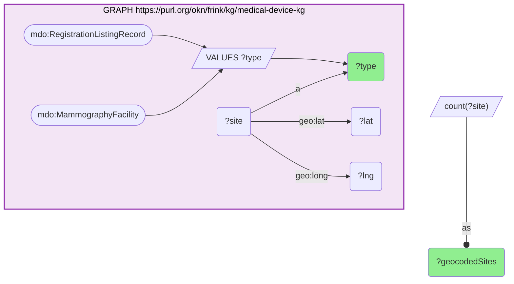
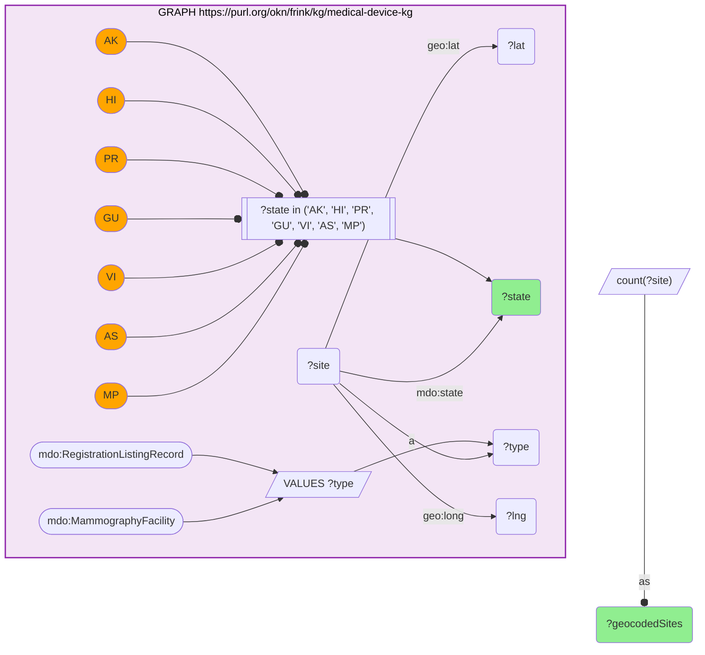
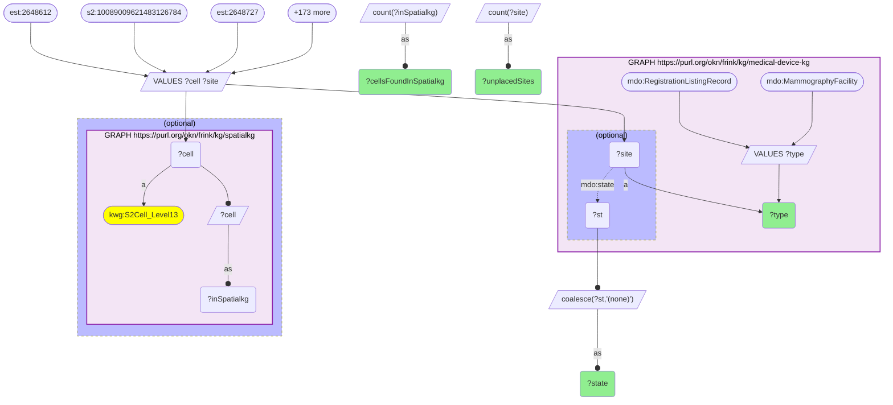

# GEO43-Q2: 16,977 of 17,065 geocoded medical-device sites land on a spatialkg S2 cell; the 88 misses are in Puerto Rico, Alaska and Guam

- **Date:** 2026-11-04
- **Model:** claude-opus-5-5
- **SPARQL endpoint:** https://apps.okn.us/federation/sparql
- **Generated by:** mcp-okn v0.3.0 (build bd8dd05)
- **Contents:** 3 queries · 3 query diagrams

## Knowledge graphs used

- `medical-device-kg` — <https://purl.org/okn/frink/kg/medical-device-kg>
- `spatialkg` — <https://purl.org/okn/frink/kg/spatialkg>

## Conversation

👤 **User**

medical-device-kg geocodes two kinds of site with the US Census Geocoder: FDA-registered device establishments (`mdo:RegistrationListingRecord`) and MQSA mammography facilities (`mdo:MammographyFacility`), as `geo:lat` / `geo:long`. It stores no county and no S2 cell. spatialkg is the federation's S2 Level-13 grid (`kwg:S2Cell_Level13`), linked up to counties and states; OKN has no point-in-polygon. **Crosswalk on a computed S2_L13 cell:** how many geocoded medical-device-kg sites resolve to a spatialkg S2 Level-13 cell, by site type, and which sites fall outside the grid, and why?

---

🧠 **Assistant**

**16,977 of medical-device-kg's 17,065 geocoded sites (99.5%) land on a spatialkg S2 Level-13 cell. All 88 misses are in Puerto Rico, Alaska and Guam.**

**What is geocoded (query 1).** 9,246 FDA-registered establishments and 7,819 MQSA mammography facilities carry `geo:lat` / `geo:long`, 17,065 sites in all.

**How placement was measured.** The `mcp-okn` s2_bridge computed a Level-13 cell for every point and checked each cell against spatialkg's `kwg:S2Cell_Level13` in batches. Only 88 sites came back with a cell spatialkg does not have. A `VALUES` block of every computed cell is too large to log, so this transcript re-queries the 88 misses instead.

**The misses (query 3).** The 88 (site, cell) pairs, joined back to medical-device-kg for type and state:

| State | Site type | Unplaced | Cells found in spatialkg |
|---|---|---|---|
| PR | Mammography facility | 50 | 0 |
| AK | Mammography facility | 29 | 0 |
| PR | Registered establishment | 7 | 0 |
| GU | Mammography facility | 2 | 0 |

None of the 88 computed cells exists in spatialkg, so these are true misses, not lookup failures.

**Why (query 2).** The geocoded sites outside the 48 contiguous states break down as follows:
- **Puerto Rico, 57:** all unplaced (50 + 7).
- **Hawaii, 36:** all placed; no HI site is among the misses.
- **Alaska, 29:** all unplaced.
- **Guam, 2:** both unplaced.

So spatialkg's S2 grid places every Hawaii site in this set and none of the Puerto Rico, Alaska or Guam sites. The losses are about geography, not data quality.

**By type.**
- **Registered establishments:** 9,239 of 9,246 placed (99.9%); the 7 losses are all in Puerto Rico.
- **Mammography facilities:** 7,738 of 7,819 placed (99.0%), because 81 MQSA sites are in PR, AK or GU.

**Reading the number.** 17,065 − 88 = 16,977 is the crosswalk's verified count. The complementary positive check (the 16,977 cells that *are* present) was run by the bridge rather than logged here. For a scoped question, inject that scope's (site, cell) pairs and the join is a single federated query, as in GEO43-Q1.

## SPARQL queries executed

#### Query 1

_2026-11-04T09:05:38+00:00 · `medical-device-kg`_

```sparql
PREFIX mdo: <https://bmedesign.org/medical-device-kg/ns/>
PREFIX geo: <http://www.w3.org/2003/01/geo/wgs84_pos#>
PREFIX kwg: <http://stko-kwg.geog.ucsb.edu/lod/ontology/>
PREFIX rdfs: <http://www.w3.org/2000/01/rdf-schema#>
PREFIX est: <https://bmedesign.org/medical-device-kg/id/establishment/>
PREFIX mqsa: <https://bmedesign.org/medical-device-kg/id/mammography-facility/>
PREFIX s2: <http://stko-kwg.geog.ucsb.edu/lod/resource/s2.level13.>
SELECT ?type (COUNT(DISTINCT ?site) AS ?geocodedSites) WHERE {
  GRAPH <https://purl.org/okn/frink/kg/medical-device-kg> {
    VALUES ?type { mdo:RegistrationListingRecord mdo:MammographyFacility }
    ?site a ?type ; geo:lat ?lat ; geo:long ?lng .
  }
} GROUP BY ?type
```



_2 row(s)_

| type | geocodedSites |
| --- | --- |
| https://bmedesign.org/medical-device-kg/ns/MammographyFacility | 7819 |
| https://bmedesign.org/medical-device-kg/ns/RegistrationListingRecord | 9246 |

#### Query 2

_2026-11-04T09:05:39+00:00 · `medical-device-kg`_

```sparql
PREFIX mdo: <https://bmedesign.org/medical-device-kg/ns/>
PREFIX geo: <http://www.w3.org/2003/01/geo/wgs84_pos#>
PREFIX kwg: <http://stko-kwg.geog.ucsb.edu/lod/ontology/>
PREFIX rdfs: <http://www.w3.org/2000/01/rdf-schema#>
PREFIX est: <https://bmedesign.org/medical-device-kg/id/establishment/>
PREFIX mqsa: <https://bmedesign.org/medical-device-kg/id/mammography-facility/>
PREFIX s2: <http://stko-kwg.geog.ucsb.edu/lod/resource/s2.level13.>
SELECT ?state (COUNT(DISTINCT ?site) AS ?geocodedSites) WHERE {
  GRAPH <https://purl.org/okn/frink/kg/medical-device-kg> {
    VALUES ?type { mdo:RegistrationListingRecord mdo:MammographyFacility }
    ?site a ?type ; geo:lat ?lat ; geo:long ?lng ; mdo:state ?state .
    FILTER(?state IN ("AK", "HI", "PR", "GU", "VI", "AS", "MP"))
  }
} GROUP BY ?state ORDER BY DESC(?geocodedSites)
```



_4 row(s) — showing first 3_

| state | geocodedSites |
| --- | --- |
| PR | 57 |
| HI | 36 |
| AK | 29 |

#### Query 3

_2026-11-04T09:05:40+00:00 · `medical-device-kg`, `spatialkg`_

```sparql
PREFIX mdo: <https://bmedesign.org/medical-device-kg/ns/>
PREFIX geo: <http://www.w3.org/2003/01/geo/wgs84_pos#>
PREFIX kwg: <http://stko-kwg.geog.ucsb.edu/lod/ontology/>
PREFIX rdfs: <http://www.w3.org/2000/01/rdf-schema#>
PREFIX est: <https://bmedesign.org/medical-device-kg/id/establishment/>
PREFIX mqsa: <https://bmedesign.org/medical-device-kg/id/mammography-facility/>
PREFIX s2: <http://stko-kwg.geog.ucsb.edu/lod/resource/s2.level13.>
SELECT ?state ?type (COUNT(DISTINCT ?site) AS ?unplacedSites) (COUNT(DISTINCT ?inSpatialkg) AS ?cellsFoundInSpatialkg) WHERE {
  VALUES (?site ?cell) {
    (est:2648612 s2:10089009621483126784)
    (est:2648727 s2:10089356379962736640)
    (est:2648729 s2:10088929872530374656)
    (est:2648744 s2:10089024602329055232)
    (est:3005737652 s2:10088942138956972032)
    (est:3011489684 s2:10088880325787648000)
    (est:3031294923 s2:10089029962448240640)
    (<https://bmedesign.org/medical-device-kg/id/mammography-facility/aid_system_llc_00924> s2:10089020101203329024)
    (<https://bmedesign.org/medical-device-kg/id/mammography-facility/alaska_imaging_99654> s2:6253495008863715328)
    (<https://bmedesign.org/medical-device-kg/id/mammography-facility/alaska_native_medical_center_99508> s2:6253414229118812160)
    (<https://bmedesign.org/medical-device-kg/id/mammography-facility/anchorage_native_primary_care_clinic_99508> s2:6253414229118812160)
    (<https://bmedesign.org/medical-device-kg/id/mammography-facility/ashford_presbyterian_community_hospital_00907> s2:10089029928088502272)
    (<https://bmedesign.org/medical-device-kg/id/mammography-facility/barranquitas_ultrasound_and_mammography_center_00794> s2:10088968149278916608)
    (<https://bmedesign.org/medical-device-kg/id/mammography-facility/bartlett_regional_hospital_99801> s2:6053084206970437632)
    (<https://bmedesign.org/medical-device-kg/id/mammography-facility/breast_cancer_detection_center_of_alaska_99701> s2:5850838595048308736)
    (<https://bmedesign.org/medical-device-kg/id/mammography-facility/bristol_bay_area_health_corporation_99576> s2:6262041031710081024)
    (<https://bmedesign.org/medical-device-kg/id/mammography-facility/caribbean_radiology_00738> s2:10089355761487446016)
    (<https://bmedesign.org/medical-device-kg/id/mammography-facility/cdt_grupo_medico_san_pablo_inc_00961> s2:10089024293091409920)
    (<https://bmedesign.org/medical-device-kg/id/mammography-facility/central_peninsula_hospital_99669> s2:6252794929194467328)
    (<https://bmedesign.org/medical-device-kg/id/mammography-facility/centro_de_servicios_primarios_de_salud_de_patillas_00723> s2:10088998592007110656)
    (<https://bmedesign.org/medical-device-kg/id/mammography-facility/centro_imagenes_manati_yvf_llc_00674> s2:10088934236217147392)
    (<https://bmedesign.org/medical-device-kg/id/mammography-facility/centro_radiologico_00717> s2:10096179261929947136)
    (<https://bmedesign.org/medical-device-kg/id/mammography-facility/centro_radiologico_clinica_yaguez_inc_00680> s2:10088823700938817536)
    (<https://bmedesign.org/medical-device-kg/id/mammography-facility/centro_radiologico_rolon_00627> s2:10088881528378490880)
    (<https://bmedesign.org/medical-device-kg/id/mammography-facility/centro_radiologico_santa_isabel_00757> s2:10096170809434308608)
    (<https://bmedesign.org/medical-device-kg/id/mammography-facility/centro_radiologico_y_sonografico_de_aguada_00602> s2:10088807311343616000)
    (<https://bmedesign.org/medical-device-kg/id/mammography-facility/chief_andrew_isaac_health_center_99701> s2:5850838595048308736)
    (<https://bmedesign.org/medical-device-kg/id/mammography-facility/clag_mamo_hato_rey_00936> s2:10089022746903183360)
    (<https://bmedesign.org/medical-device-kg/id/mammography-facility/concordia_imaging_center_00717> s2:10096179261929947136)
    (<https://bmedesign.org/medical-device-kg/id/mammography-facility/corporacion_ortiz_negron_centro_rad_sonog_digital_de_corozal_00783> s2:10088976361256386560)
    (<https://bmedesign.org/medical-device-kg/id/mammography-facility/dr_irma_colon_psc_radiologist_00969> s2:10089023915134287872)
    (<https://bmedesign.org/medical-device-kg/id/mammography-facility/dr_jose_a_nassar_associates_00792> s2:10089373628551397376)
    (<https://bmedesign.org/medical-device-kg/id/mammography-facility/el_senorial_centro_de_imagenes_00926> s2:10089022025348677632)
    (<https://bmedesign.org/medical-device-kg/id/mammography-facility/elmendorf_air_force_base_673d_medical_group_99506> s2:6253410999303405568)
    (<https://bmedesign.org/medical-device-kg/id/mammography-facility/fairbanks_memorial_hospital_99701> s2:5850838595048308736)
    (<https://bmedesign.org/medical-device-kg/id/mammography-facility/fajardo_imaging_inc_00738> s2:10089355727127707648)
    (<https://bmedesign.org/medical-device-kg/id/mammography-facility/galeria_radiologica_digital_llc_00961> s2:10089024293091409920)
    (<https://bmedesign.org/medical-device-kg/id/mammography-facility/guam_radiology_consultants_96913> s2:7430790349796147200)
    (<https://bmedesign.org/medical-device-kg/id/mammography-facility/guaynabo_radiology_llc_00969> s2:10089023949494026240)
    (<https://bmedesign.org/medical-device-kg/id/mammography-facility/health_image_diagnostics_senos_puerto_rico_00927> s2:10089022162787631104)
    (<https://bmedesign.org/medical-device-kg/id/mammography-facility/hospital_auxilio_mutuo_00919> s2:10089022609464229888)
    (<https://bmedesign.org/medical-device-kg/id/mammography-facility/hospital_de_la_concepcion_san_german_pueblo_00683> s2:10096308385826734080)
    (<https://bmedesign.org/medical-device-kg/id/mammography-facility/hospital_metropolitano_dr_susoni_inc_00614> s2:10088880291427909632)
    (<https://bmedesign.org/medical-device-kg/id/mammography-facility/hospital_ryder_memorial_00792> s2:10089373662911135744)
    (<https://bmedesign.org/medical-device-kg/id/mammography-facility/hospital_san_francisco_centro_de_imagenes_00923> s2:10089019929404637184)
    (<https://bmedesign.org/medical-device-kg/id/mammography-facility/hpm_foundation_inc_centro_de_imagenes_00915> s2:10089022678183706624)
    (<https://bmedesign.org/medical-device-kg/id/mammography-facility/humacao_x_ray_imaging_center_00791> s2:10089373628551397376)
    (<https://bmedesign.org/medical-device-kg/id/mammography-facility/imaging_associates_99508> s2:6253414847594102784)
    (<https://bmedesign.org/medical-device-kg/id/mammography-facility/imaging_associates_99577> s2:6253506966052667392)
    (<https://bmedesign.org/medical-device-kg/id/mammography-facility/imaging_associates_99645> s2:6253495970936389632)
    (<https://bmedesign.org/medical-device-kg/id/mammography-facility/insight_radiology_puerto_rico_luquillo_00773> s2:10089357788712009728)
    (<https://bmedesign.org/medical-device-kg/id/mammography-facility/jesus_a_romero_perez_dba_adv_rad_ctrs_mayaguez_pr_00680> s2:10088823804018032640)
    (<https://bmedesign.org/medical-device-kg/id/mammography-facility/jesus_a_romero_perez_dba_advanced_radiology_center_00623> s2:10096311340764233728)
    (<https://bmedesign.org/medical-device-kg/id/mammography-facility/juana_diaz_medical_imaging_center_00795> s2:10096176684949569536)
    (<https://bmedesign.org/medical-device-kg/id/mammography-facility/levittown_imaging_center_inc_00949> s2:10089025804919898112)
    (<https://bmedesign.org/medical-device-kg/id/mammography-facility/maniilaq_health_center_99752> s2:5822335542804611072)
    (<https://bmedesign.org/medical-device-kg/id/mammography-facility/mat_su_regional_medical_center_99645> s2:6253495524259790848)
    (<https://bmedesign.org/medical-device-kg/id/mammography-facility/mdx_imaging_center_96913> s2:7430790349796147200)
    (<https://bmedesign.org/medical-device-kg/id/mammography-facility/medcentro_00716> s2:10096179708606545920)
    (<https://bmedesign.org/medical-device-kg/id/mammography-facility/medical_x_ray_center_00698> s2:10096281241633423360)
    (<https://bmedesign.org/medical-device-kg/id/mammography-facility/medical_x_ray_center_00716> s2:10096179158850732032)
    (<https://bmedesign.org/medical-device-kg/id/mammography-facility/mediko_imaging_humacao_00791> s2:10089373662911135744)
    (<https://bmedesign.org/medical-device-kg/id/mammography-facility/mediko_imaging_inc_caguas_00726> s2:10089008109654638592)
    (<https://bmedesign.org/medical-device-kg/id/mammography-facility/migrant_health_center_western_region_inc_00680> s2:10088822189110329344)
    (<https://bmedesign.org/medical-device-kg/id/mammography-facility/northern_lights_imaging_99508> s2:6253414847594102784)
    (<https://bmedesign.org/medical-device-kg/id/mammography-facility/pamc_breast_procedure_center_99508> s2:6253414126039597056)
    (<https://bmedesign.org/medical-device-kg/id/mammography-facility/parana_imaging_center_llc_00610> s2:10088819990087073792)
    (<https://bmedesign.org/medical-device-kg/id/mammography-facility/peacehealth_ketchikan_medical_center_99901> s2:6056257088290553856)
    (<https://bmedesign.org/medical-device-kg/id/mammography-facility/pepino_health_group_inc_00685> s2:10088845485012942848)
    (<https://bmedesign.org/medical-device-kg/id/mammography-facility/petersburg_medical_center_99833> s2:6054530683236253696)
    (<https://bmedesign.org/medical-device-kg/id/mammography-facility/providence_health_services_washington_dba_prov_ki_med_ctr_99615> s2:6263033993789177856)
    (<https://bmedesign.org/medical-device-kg/id/mammography-facility/providence_imaging_center_99508> s2:6253414126039597056)
    (<https://bmedesign.org/medical-device-kg/id/mammography-facility/providence_seward_medical_care_center_99664> s2:6253138560937885696)
    (<https://bmedesign.org/medical-device-kg/id/mammography-facility/radioimagenes_diagnosticas_breast_center_00680> s2:10088822051671375872)
    (<https://bmedesign.org/medical-device-kg/id/mammography-facility/radiologia_riaza_00923> s2:10089019998124113920)
    (<https://bmedesign.org/medical-device-kg/id/mammography-facility/salud_integral_en_la_montana_barranquitas_00794> s2:10088968527236038656)
    (<https://bmedesign.org/medical-device-kg/id/mammography-facility/salud_integral_en_la_montana_comerio_00782> s2:10088986703537635328)
    (<https://bmedesign.org/medical-device-kg/id/mammography-facility/samuel_simmonds_memorial_hospital_99723> s2:5819451111488094208)
    (<https://bmedesign.org/medical-device-kg/id/mammography-facility/san_francisco_imaging_00921> s2:10089022231507107840)
    (<https://bmedesign.org/medical-device-kg/id/mammography-facility/san_german_x_ray_and_body_imaging_center_00683> s2:10096308385826734080)
    (<https://bmedesign.org/medical-device-kg/id/mammography-facility/searhc_elmc_juneau_99801> s2:6053084241330176000)
    (<https://bmedesign.org/medical-device-kg/id/mammography-facility/searhc_hhc_haines_99827> s2:6052872482262614016)
    (<https://bmedesign.org/medical-device-kg/id/mammography-facility/searhc_wrangell_medical_center_99929> s2:6055313776033398784)
    (<https://bmedesign.org/medical-device-kg/id/mammography-facility/south_peninsula_hospital_99603> s2:6251333231564554240)
    (<https://bmedesign.org/medical-device-kg/id/mammography-facility/toa_alta_x_ray_and_ultrasound_00953> s2:10088931040761479168)
    (<https://bmedesign.org/medical-device-kg/id/mammography-facility/valley_native_primary_care_center_99654> s2:6253492225724907520)
    (<https://bmedesign.org/medical-device-kg/id/mammography-facility/vega_alta_radiology_00692> s2:10088931521797816320)
    (<https://bmedesign.org/medical-device-kg/id/mammography-facility/yukon_kuskokwim_delta_regional_hospital_99559> s2:6278111493661655040)
  }
  GRAPH <https://purl.org/okn/frink/kg/medical-device-kg> {
    VALUES ?type { mdo:RegistrationListingRecord mdo:MammographyFacility }
    ?site a ?type . OPTIONAL { ?site mdo:state ?st } }
  BIND(COALESCE(?st, "(none)") AS ?state)
  OPTIONAL { GRAPH <https://purl.org/okn/frink/kg/spatialkg> { ?cell a kwg:S2Cell_Level13 . BIND(?cell AS ?inSpatialkg) } }
} GROUP BY ?state ?type ORDER BY DESC(?unplacedSites) ?state
```



_4 row(s)_

| state | type | unplacedSites | cellsFoundInSpatialkg |
| --- | --- | --- | --- |
| PR | https://bmedesign.org/medical-device-kg/ns/MammographyFacility | 50 | 0 |
| AK | https://bmedesign.org/medical-device-kg/ns/MammographyFacility | 29 | 0 |
| PR | https://bmedesign.org/medical-device-kg/ns/RegistrationListingRecord | 7 | 0 |
| GU | https://bmedesign.org/medical-device-kg/ns/MammographyFacility | 2 | 0 |
