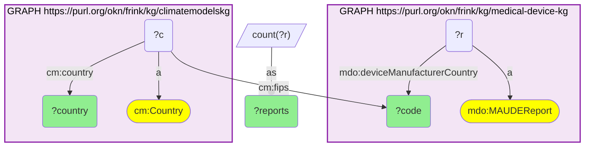

# GEO44-Q1: MAUDE reports by manufacturing country, joined on FIPS 10-4 to climatemodelskg's literature-mined hazards: China flood- and storm-heavy, Japan storm-led

- **Date:** 2026-11-04
- **Model:** claude-opus-5-5
- **SPARQL endpoint:** https://apps.okn.us/federation/sparql
- **Generated by:** mcp-okn v0.3.0 (build bd8dd05)
- **Contents:** 2 queries · 2 query diagrams

## Knowledge graphs used

- `medical-device-kg` — <https://purl.org/okn/frink/kg/medical-device-kg>
- `climatemodelskg` — <https://purl.org/okn/frink/kg/climatemodelskg>

## Conversation

👤 **User**

medical-device-kg's FDA MAUDE adverse-event reports (`mdo:MAUDEReport`) record the device manufacturer's country (`mdo:deviceManufacturerCountry`) and the reporter's country (`mdo:reporterCountry`) as two-letter codes; establishment addresses carry `mdo:country`. climatemodelskg holds 252 GeoNames countries (`cm:Country`) with their FIPS 10-4 (`cm:fips`), ISO 3166-1 alpha-2 (`cm:iso`) and names, linked to literature-mined natural hazards (`cm:AFFECTED_REGION`) and weather events (`cm:IMPACTED_REGION`). **Crosswalk on country code:** which countries manufacture the devices behind the most MAUDE reports, and for the top ten outside the US, how much flood, drought, heat, fire and storm literature does climatemodelskg link to that country?

---

🧠 **Assistant**

**Crosswalk on country code (FIPS 10-4).** MAUDE writes the manufacturer's country as a FIPS 10-4 code, and climatemodelskg stores the same code on each GeoNames country as `cm:fips`. The join is an exact literal match on that column. Do not join on `cm:iso`: SZ, GM and CH mean Switzerland, Germany and China in FIPS, but Eswatini, Gambia and Switzerland in ISO (GEO44-Q2).

**Where the devices behind MAUDE reports are made.** The United States leads with 16,726,756 reports. The top non-US manufacturing countries are:
- Sweden 1,406,429
- Switzerland 1,031,495
- Germany 536,487
- Japan 414,933
- China 326,812
- United Kingdom 326,405
- Mexico 262,474
- Ireland 235,570
- Costa Rica 175,169
- Singapore 160,151

Israel is next, at 157,868.

**climatemodelskg's hazard literature for those ten.** Each cell is the number of distinct hazard and weather-event terms linked to the country (`AFFECTED_REGION` / `IMPACTED_REGION`) whose name mentions the hazard:

| Country | MAUDE reports | flood | drought | heat | fire | storm / cyclone |
|---|---:|---:|---:|---:|---:|---:|
| Sweden | 1,406,429 | 3 | 4 | 4 | 7 | 4 |
| Switzerland | 1,031,495 | 10 | 2 | 11 | 1 | 2 |
| Germany | 536,487 | 30 | 21 | 12 | 3 | 9 |
| Japan | 414,933 | 12 | 5 | 17 | 2 | 32 |
| China | 326,812 | 40 | 29 | 28 | 8 | 33 |
| United Kingdom | 326,405 | 34 | 16 | 22 | 3 | 22 |
| Mexico | 262,474 | 8 | 11 | 7 | 5 | 14 |
| Ireland | 235,570 | 11 | 5 | 4 | 0 | 5 |
| Costa Rica | 175,169 | 0 | 2 | 0 | 0 | 0 |
| Singapore | 160,151 | 1 | 1 | 1 | 1 | 0 |

- **China** has the densest hazard record of any top source: 40 flood, 33 storm/cyclone, 29 drought and 28 heat terms.
- **The United Kingdom and Germany** are flood-led (34 and 30).
- **Japan** is storm-led (32).
- **Switzerland's** short record is split between heat (11) and flood (10).
- **Sweden,** the largest non-US source by reports, has a small record led by fire (7).
- **Costa Rica and Singapore** have almost nothing: 2 drought terms, and 1 term in four of the five families.

**Caveats.**
- These counts measure how much climate literature, as mined into climatemodelskg, discusses a hazard for the country. They are not physical exposure, and they say nothing about any particular manufacturing site.
- Near-synonyms count separately: 'flood', 'floods' and 'flash floods' are three terms.
- Country is the coarsest grain. US sites can be placed at county grain through the computed S2 crosswalk (MD1, GEO43).
- Reports are grouped by the manufacturer country as MAUDE records it.

## SPARQL queries executed

#### Query 1

_2026-11-04T12:14:35+00:00 · `medical-device-kg`, `climatemodelskg`_

```sparql
PREFIX mdo: <https://bmedesign.org/medical-device-kg/ns/>
PREFIX cm: <https://climatepub4kg.github.io/ontology#>
SELECT ?code ?country ?reports WHERE {
  { SELECT ?code (COUNT(?r) AS ?reports) WHERE {
      GRAPH <https://purl.org/okn/frink/kg/medical-device-kg> { ?r a mdo:MAUDEReport ; mdo:deviceManufacturerCountry ?code }
  } GROUP BY ?code }
  GRAPH <https://purl.org/okn/frink/kg/climatemodelskg> { ?c a cm:Country ; cm:fips ?code ; cm:country ?country }
} ORDER BY DESC(?reports) LIMIT 12
```



_12 row(s) — showing first 3_

| code | country | reports |
| --- | --- | --- |
| US | United States | 16726756 |
| SW | Sweden | 1406429 |
| SZ | Switzerland | 1031495 |

#### Query 2

_2026-11-04T12:14:36+00:00 · `medical-device-kg`, `climatemodelskg`_

```sparql
PREFIX mdo: <https://bmedesign.org/medical-device-kg/ns/>
PREFIX cm: <https://climatepub4kg.github.io/ontology#>
SELECT ?code ?country ?reports
       (COUNT(DISTINCT ?flood) AS ?floodTerms) (COUNT(DISTINCT ?drought) AS ?droughtTerms)
       (COUNT(DISTINCT ?heat) AS ?heatTerms) (COUNT(DISTINCT ?fire) AS ?fireTerms)
       (COUNT(DISTINCT ?storm) AS ?stormTerms) WHERE {
  { SELECT ?code (COUNT(?r) AS ?reports) WHERE {
      GRAPH <https://purl.org/okn/frink/kg/medical-device-kg> { ?r a mdo:MAUDEReport ; mdo:deviceManufacturerCountry ?code }
  } GROUP BY ?code ORDER BY DESC(?reports) LIMIT 11 }
  FILTER(?code != "US")
  GRAPH <https://purl.org/okn/frink/kg/climatemodelskg> {
    ?c a cm:Country ; cm:fips ?code ; cm:country ?country .
    OPTIONAL {
      ?h cm:AFFECTED_REGION|cm:IMPACTED_REGION ?c ; cm:name ?hn .
      BIND(LCASE(?hn) AS ?n)
      BIND(IF(REGEX(?n, "flood"), ?h, ?u) AS ?flood)
      BIND(IF(REGEX(?n, "drought"), ?h, ?u) AS ?drought)
      BIND(IF(REGEX(?n, "heat"), ?h, ?u) AS ?heat)
      BIND(IF(REGEX(?n, "fire"), ?h, ?u) AS ?fire)
      BIND(IF(REGEX(?n, "storm|cyclone|typhoon|hurricane"), ?h, ?u) AS ?storm)
    }
  }
} GROUP BY ?code ?country ?reports ORDER BY DESC(?reports)
```



```mermaid
graph TD
classDef projected fill:lightgreen;
classDef literal fill:orange;
classDef iri fill:yellow;
  q1v18("?c")
  q1v8("?code"):::projected 
  q1v7("?country"):::projected 
  q1v25("?drought")
  q1v4("?droughtTerms"):::projected 
  q1v23("?fire")
  q1v2("?fireTerms"):::projected 
  q1v26("?flood")
  q1v5("?floodTerms"):::projected 
  q1v21("?h")
  q1v24("?heat")
  q1v3("?heatTerms"):::projected 
  q1v27("?hn")
  q1v20("?n")
  q1v17("?r")
  q1v6("?reports"):::projected 
  q1v19("?storm")
  q1v1("?stormTerms"):::projected 
  q1v22("?u")
  q1f0[["?code != 'US'"]]
  q1f0 --> q1v8
  subgraph q1graph0["GRAPH https://purl.org/okn/frink/kg/medical-device-kg"]
    style q1graph0 fill:#f3e5f5,stroke:#8e24aa,stroke-width:2px,color:#000;
    q1graph0c2(["mdo:MAUDEReport"]):::iri 
    q1v17 --"a"--> q1graph0c2
    q1v17 --"mdo:deviceManufacturerCountry"--> q1v8
  end
  q1bind0[/"count(?r)"/]
  q1bind0 --as--o q1v6
  subgraph q1graph1["GRAPH https://purl.org/okn/frink/kg/climatemodelskg"]
    style q1graph1 fill:#f3e5f5,stroke:#8e24aa,stroke-width:2px,color:#000;
    q1graph1c2(["cm:Country"]):::iri 
    q1v18 --"a"--> q1graph1c2
    q1v18 --"cm:country"--> q1v7
    q1v18 --"cm:fips"--> q1v8
    subgraph q1optionalgraph10["(optional)"]
    style q1optionalgraph10 fill:#bbf,stroke-dasharray: 5 5,color:#000;
      q1v21 -."cm:AFFECTED_REGION|cm:IMPACTED_REGION".-> q1v18
      q1v21 --"cm:name"--> q1v27
      q1graph1bind1[/"lcase(?hn)"/]
      q1v27 --o q1graph1bind1
      q1graph1bind1 --as--o q1v20
      q1graph1bind2[/"if(regex(?n,'flood'),?h,?u)"/]
      q1v20 --o q1graph1bind2
      q1v21 --o q1graph1bind2
      q1v22 --o q1graph1bind2
      q1graph1bind2 --as--o q1v26
      q1graph1bind3[/"if(regex(?n,'drought'),?h,?u)"/]
      q1v20 --o q1graph1bind3
      q1v21 --o q1graph1bind3
      q1v22 --o q1graph1bind3
      q1graph1bind3 --as--o q1v25
      q1graph1bind4[/"if(regex(?n,'heat'),?h,?u)"/]
      q1v20 --o q1graph1bind4
      q1v21 --o q1graph1bind4
      q1v22 --o q1graph1bind4
      q1graph1bind4 --as--o q1v24
      q1graph1bind5[/"if(regex(?n,'fire'),?h,?u)"/]
      q1v20 --o q1graph1bind5
      q1v21 --o q1graph1bind5
      q1v22 --o q1graph1bind5
      q1graph1bind5 --as--o q1v23
      q1graph1bind6[/"if(regex(?n,'storm|cyclone|typhoon|hurricane'),?h,?u)"/]
      q1v20 --o q1graph1bind6
      q1v21 --o q1graph1bind6
      q1v22 --o q1graph1bind6
      q1graph1bind6 --as--o q1v19
    end
  end
  q1bind7[/"count(?r)"/]
  q1bind7 --as--o q1v5
  q1bind8[/"count(?heat)"/]
  q1bind8 --as--o q1v3
  q1bind9[/"count(?fire)"/]
  q1bind9 --as--o q1v2
  q1bind10[/"count(?storm)"/]
  q1bind10 --as--o q1v1
```

_10 row(s) — showing first 5_

| code | country | reports | floodTerms | droughtTerms | heatTerms | fireTerms | stormTerms |
| --- | --- | --- | --- | --- | --- | --- | --- |
| SW | Sweden | 1406429 | 3 | 4 | 4 | 7 | 4 |
| SZ | Switzerland | 1031495 | 10 | 2 | 11 | 1 | 2 |
| GM | Germany | 536487 | 30 | 21 | 12 | 3 | 9 |
| JA | Japan | 414933 | 12 | 5 | 17 | 2 | 32 |
| CH | China | 326812 | 40 | 29 | 28 | 8 | 33 |
