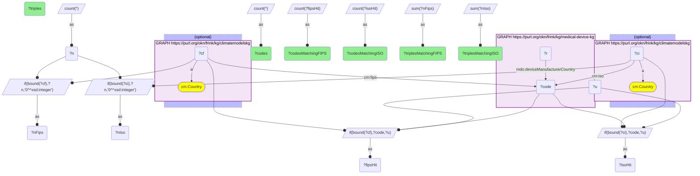
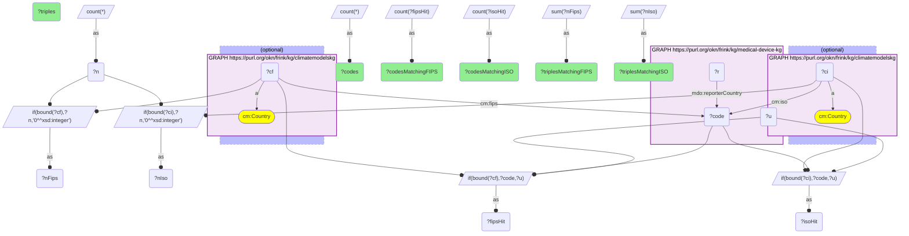
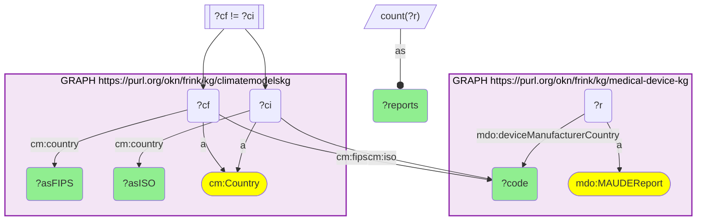
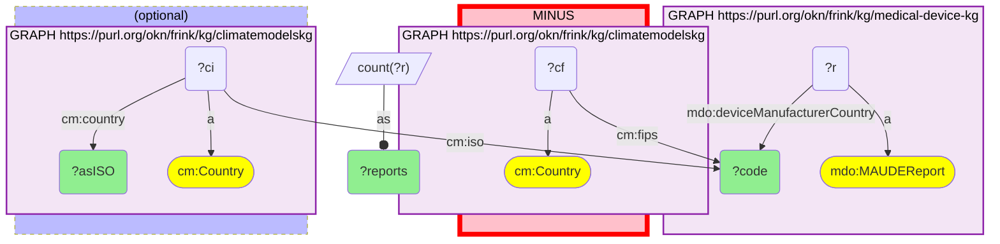
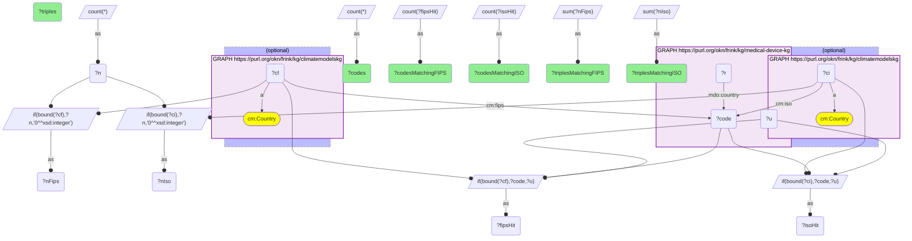
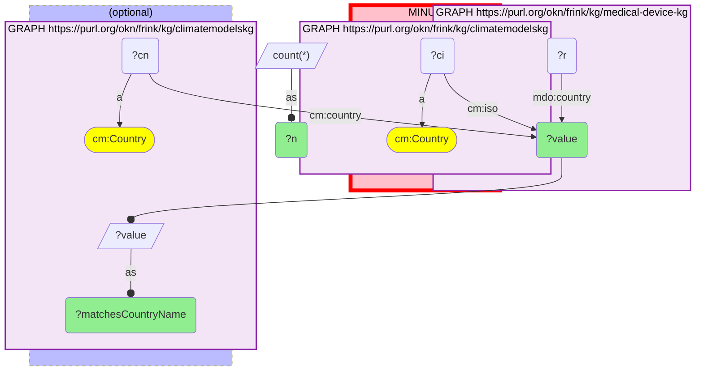

# GEO44-Q2: MAUDE country codes are FIPS 10-4 (99.85% match), not ISO: read as ISO, Switzerland becomes Eswatini and China becomes Switzerland

- **Date:** 2026-11-04
- **Model:** claude-opus-5-5
- **SPARQL endpoint:** https://apps.okn.us/federation/sparql
- **Generated by:** mcp-okn v0.3.0 (build bd8dd05)
- **Contents:** 6 queries · 6 query diagrams

## Knowledge graphs used

- `medical-device-kg` — <https://purl.org/okn/frink/kg/medical-device-kg>
- `climatemodelskg` — <https://purl.org/okn/frink/kg/climatemodelskg>

## Conversation

👤 **User**

medical-device-kg's FDA MAUDE adverse-event reports (`mdo:MAUDEReport`) record the device manufacturer's country (`mdo:deviceManufacturerCountry`) and the reporter's country (`mdo:reporterCountry`) as two-letter codes; establishment addresses carry `mdo:country`. climatemodelskg holds 252 GeoNames countries (`cm:Country`) with their FIPS 10-4 (`cm:fips`), ISO 3166-1 alpha-2 (`cm:iso`) and names, linked to literature-mined natural hazards (`cm:AFFECTED_REGION`) and weather events (`cm:IMPACTED_REGION`). **Crosswalk on country code:** which code system does MAUDE use, FIPS 10-4 or ISO 3166-1? How many codes and records match each climatemodelskg column, which codes name a different country in each system, are there codes from the other system mixed in, and what do the establishment addresses use?

---

🧠 **Assistant**

**MAUDE uses FIPS 10-4, not ISO 3166-1.** Matched against climatemodelskg's two code columns:

| MAUDE field | codes | records | match `cm:fips` | match `cm:iso` |
|---|---:|---:|---|---|
| `mdo:deviceManufacturerCountry` | 157 | 22,637,863 | 145 codes, 22,603,809 records (99.85%) | 116 codes, 20,071,410 records (88.7%) |
| `mdo:reporterCountry` | 303 | 23,846,605 | 235 codes, 23,651,988 records (99.18%) | 201 codes, 21,512,910 records (90.2%) |

**Reading the codes as ISO moves reports to the wrong country.** Many codes are valid in both systems but name different countries. The largest collisions, by manufacturer-country reports, as FIPS / as ISO:

| Code | Reports | As FIPS | As ISO |
|---|---:|---|---|
| SZ | 1,031,495 | Switzerland | Eswatini |
| GM | 536,487 | Germany | Gambia |
| CH | 326,812 | China | Switzerland |
| CS | 175,169 | Costa Rica | Serbia and Montenegro |
| SN | 160,151 | Singapore | Senegal |
| IS | 157,868 | Israel | Iceland |
| SE | 105,319 | Seychelles | Sweden |
| AS | 54,800 | Australia | American Samoa |
| AU | 30,407 | Austria | Australia |
| SG | 14,036 | Senegal | Singapore |
| DO | 8,601 | Dominica | Dominican Republic |
| CN | 2,195 | Comoros | China |

An ISO join would show Swiss-made devices as from Eswatini and Chinese-made ones as Swiss.

**Some ISO codes are mixed in.** Twelve manufacturer codes have no FIPS reading. Apart from 'UN' (3 reports), each is an ISO code for a plausible manufacturing country:
- PR 17,948 (Puerto Rico)
- DE 12,589 (Germany)
- IE 3,001 (Ireland)
- IL 275 (Israel)
- DK 120 (Denmark)
- CR 69 (Costa Rica)
- JP 33 (Japan)

So a small minority of MAUDE rows is ISO-coded. That makes the collision codes whose FIPS reading is implausible for a device maker ambiguous: SE 105,319 (Seychelles), SG 14,036 (Senegal) and CN 2,195 (Comoros) are probably ISO Sweden, Singapore and China. The code alone cannot settle it.

**Establishment addresses are the other way round.** `mdo:country` has 164 distinct values over 243,317 records. 121 match `cm:iso` (202,862 records), against 85 matching `cm:fips` (192,293 records). Its main leftovers are spelled-out names:
- 'United States' 36,364
- 'Germany' 483
- 'United Kingdom' 394
- 'Switzerland' 318
- 'Sweden' 303
- 'China' 288

These match climatemodelskg's `cm:country` name exactly. 'Netherlands' (345) does not.

**Recipe:**
- MAUDE fields: join on `cm:fips`.
- `mdo:country`: join on `cm:iso`, falling back to `cm:country` for spelled-out names.

## SPARQL queries executed

#### Query 1

_2026-11-04T12:14:36+00:00 · `medical-device-kg`, `climatemodelskg`_

```sparql
PREFIX mdo: <https://bmedesign.org/medical-device-kg/ns/>
PREFIX cm: <https://climatepub4kg.github.io/ontology#>
SELECT (COUNT(DISTINCT ?code) AS ?codes) (SUM(?n) AS ?triples)
       (COUNT(DISTINCT ?fipsHit) AS ?codesMatchingFIPS) (SUM(?nFips) AS ?triplesMatchingFIPS)
       (COUNT(DISTINCT ?isoHit) AS ?codesMatchingISO) (SUM(?nIso) AS ?triplesMatchingISO) WHERE {
  { SELECT ?code (COUNT(*) AS ?n) WHERE { GRAPH <https://purl.org/okn/frink/kg/medical-device-kg> { ?r mdo:deviceManufacturerCountry ?code } } GROUP BY ?code }
  OPTIONAL { GRAPH <https://purl.org/okn/frink/kg/climatemodelskg> { ?cf a cm:Country ; cm:fips ?code } }
  OPTIONAL { GRAPH <https://purl.org/okn/frink/kg/climatemodelskg> { ?ci a cm:Country ; cm:iso ?code } }
  BIND(IF(BOUND(?cf), ?code, ?u) AS ?fipsHit) BIND(IF(BOUND(?cf), ?n, 0) AS ?nFips)
  BIND(IF(BOUND(?ci), ?code, ?u) AS ?isoHit) BIND(IF(BOUND(?ci), ?n, 0) AS ?nIso)
}
```



_1 row(s)_

| codes | triples | codesMatchingFIPS | triplesMatchingFIPS | codesMatchingISO | triplesMatchingISO |
| --- | --- | --- | --- | --- | --- |
| 157 | 22637863 | 145 | 22603809 | 116 | 20071410 |

#### Query 2

_2026-11-04T12:14:37+00:00 · `medical-device-kg`, `climatemodelskg`_

```sparql
PREFIX mdo: <https://bmedesign.org/medical-device-kg/ns/>
PREFIX cm: <https://climatepub4kg.github.io/ontology#>
SELECT (COUNT(DISTINCT ?code) AS ?codes) (SUM(?n) AS ?triples)
       (COUNT(DISTINCT ?fipsHit) AS ?codesMatchingFIPS) (SUM(?nFips) AS ?triplesMatchingFIPS)
       (COUNT(DISTINCT ?isoHit) AS ?codesMatchingISO) (SUM(?nIso) AS ?triplesMatchingISO) WHERE {
  { SELECT ?code (COUNT(*) AS ?n) WHERE { GRAPH <https://purl.org/okn/frink/kg/medical-device-kg> { ?r mdo:reporterCountry ?code } } GROUP BY ?code }
  OPTIONAL { GRAPH <https://purl.org/okn/frink/kg/climatemodelskg> { ?cf a cm:Country ; cm:fips ?code } }
  OPTIONAL { GRAPH <https://purl.org/okn/frink/kg/climatemodelskg> { ?ci a cm:Country ; cm:iso ?code } }
  BIND(IF(BOUND(?cf), ?code, ?u) AS ?fipsHit) BIND(IF(BOUND(?cf), ?n, 0) AS ?nFips)
  BIND(IF(BOUND(?ci), ?code, ?u) AS ?isoHit) BIND(IF(BOUND(?ci), ?n, 0) AS ?nIso)
}
```



_1 row(s)_

| codes | triples | codesMatchingFIPS | triplesMatchingFIPS | codesMatchingISO | triplesMatchingISO |
| --- | --- | --- | --- | --- | --- |
| 303 | 23846605 | 235 | 23651988 | 201 | 21512910 |

#### Query 3

_2026-11-04T12:14:38+00:00 · `medical-device-kg`, `climatemodelskg`_

```sparql
PREFIX mdo: <https://bmedesign.org/medical-device-kg/ns/>
PREFIX cm: <https://climatepub4kg.github.io/ontology#>
SELECT ?code ?reports ?asFIPS ?asISO WHERE {
  { SELECT ?code (COUNT(?r) AS ?reports) WHERE {
      GRAPH <https://purl.org/okn/frink/kg/medical-device-kg> { ?r a mdo:MAUDEReport ; mdo:deviceManufacturerCountry ?code }
  } GROUP BY ?code }
  GRAPH <https://purl.org/okn/frink/kg/climatemodelskg> {
    ?cf a cm:Country ; cm:fips ?code ; cm:country ?asFIPS .
    ?ci a cm:Country ; cm:iso ?code ; cm:country ?asISO .
  }
  FILTER(?cf != ?ci)
} ORDER BY DESC(?reports) LIMIT 12
```



_12 row(s) — showing first 3_

| code | reports | asFIPS | asISO |
| --- | --- | --- | --- |
| SZ | 1031495 | Switzerland | Eswatini |
| GM | 536487 | Germany | Gambia |
| CH | 326812 | China | Switzerland |

#### Query 4

_2026-11-04T12:14:38+00:00 · `medical-device-kg`, `climatemodelskg`_

```sparql
PREFIX mdo: <https://bmedesign.org/medical-device-kg/ns/>
PREFIX cm: <https://climatepub4kg.github.io/ontology#>
SELECT ?code ?reports ?asISO WHERE {
  { SELECT ?code (COUNT(?r) AS ?reports) WHERE {
      GRAPH <https://purl.org/okn/frink/kg/medical-device-kg> { ?r a mdo:MAUDEReport ; mdo:deviceManufacturerCountry ?code }
  } GROUP BY ?code }
  MINUS { GRAPH <https://purl.org/okn/frink/kg/climatemodelskg> { ?cf a cm:Country ; cm:fips ?code } }
  OPTIONAL { GRAPH <https://purl.org/okn/frink/kg/climatemodelskg> { ?ci a cm:Country ; cm:iso ?code ; cm:country ?asISO } }
} ORDER BY DESC(?reports) LIMIT 12
```



_12 row(s) — showing first 3_

| code | reports | asISO |
| --- | --- | --- |
| PR | 17948 | Puerto Rico |
| DE | 12589 | Germany |
| IE | 3001 | Ireland |

#### Query 5

_2026-11-04T12:14:39+00:00 · `medical-device-kg`, `climatemodelskg`_

```sparql
PREFIX mdo: <https://bmedesign.org/medical-device-kg/ns/>
PREFIX cm: <https://climatepub4kg.github.io/ontology#>
SELECT (COUNT(DISTINCT ?code) AS ?codes) (SUM(?n) AS ?triples)
       (COUNT(DISTINCT ?fipsHit) AS ?codesMatchingFIPS) (SUM(?nFips) AS ?triplesMatchingFIPS)
       (COUNT(DISTINCT ?isoHit) AS ?codesMatchingISO) (SUM(?nIso) AS ?triplesMatchingISO) WHERE {
  { SELECT ?code (COUNT(*) AS ?n) WHERE { GRAPH <https://purl.org/okn/frink/kg/medical-device-kg> { ?r mdo:country ?code } } GROUP BY ?code }
  OPTIONAL { GRAPH <https://purl.org/okn/frink/kg/climatemodelskg> { ?cf a cm:Country ; cm:fips ?code } }
  OPTIONAL { GRAPH <https://purl.org/okn/frink/kg/climatemodelskg> { ?ci a cm:Country ; cm:iso ?code } }
  BIND(IF(BOUND(?cf), ?code, ?u) AS ?fipsHit) BIND(IF(BOUND(?cf), ?n, 0) AS ?nFips)
  BIND(IF(BOUND(?ci), ?code, ?u) AS ?isoHit) BIND(IF(BOUND(?ci), ?n, 0) AS ?nIso)
}
```



_1 row(s)_

| codes | triples | codesMatchingFIPS | triplesMatchingFIPS | codesMatchingISO | triplesMatchingISO |
| --- | --- | --- | --- | --- | --- |
| 164 | 243317 | 85 | 192293 | 121 | 202862 |

#### Query 6

_2026-11-04T12:14:39+00:00 · `medical-device-kg`, `climatemodelskg`_

```sparql
PREFIX mdo: <https://bmedesign.org/medical-device-kg/ns/>
PREFIX cm: <https://climatepub4kg.github.io/ontology#>
SELECT ?value ?n ?matchesCountryName WHERE {
  { SELECT ?value (COUNT(*) AS ?n) WHERE { GRAPH <https://purl.org/okn/frink/kg/medical-device-kg> { ?r mdo:country ?value } } GROUP BY ?value }
  MINUS { GRAPH <https://purl.org/okn/frink/kg/climatemodelskg> { ?ci a cm:Country ; cm:iso ?value } }
  OPTIONAL { GRAPH <https://purl.org/okn/frink/kg/climatemodelskg> { ?cn a cm:Country ; cm:country ?value . BIND(?value AS ?matchesCountryName) } }
} ORDER BY DESC(?n) LIMIT 12
```



_12 row(s) — showing first 5_

| value | n | matchesCountryName |
| --- | --- | --- |
| United States | 36364 | United States |
| Germany | 483 | Germany |
| United Kingdom | 394 | United Kingdom |
| Netherlands | 345 |  |
| Switzerland | 318 | Switzerland |
