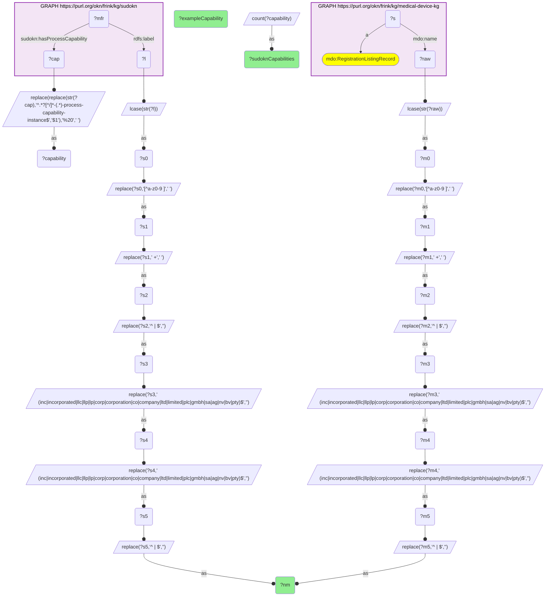

# I06-Q1: FDA-registered device establishments matched to SUDOKN manufacturers, with their capabilities

- **Date:** 2026-11-03
- **Model:** claude-opus-5-5
- **SPARQL endpoint:** https://apps.okn.us/federation/sparql
- **Generated by:** mcp-okn v0.3.0 (build f9c4776)
- **Contents:** 1 query · 1 query diagram

## Knowledge graphs used

- `medical-device-kg` — <https://purl.org/okn/frink/kg/medical-device-kg>
- `sudokn` — <https://purl.org/okn/frink/kg/sudokn>

## Conversation

👤 **User**

Crosswalk: medical-device-kg × sudokn on company name. medical-device-kg's own company key is the FDA establishment identifier (`mdo:feiNumber`), which no other federation KG carries; SUDOKN mints company IRIs from the firm's web domain, which the FDA does not publish. The name is the only surface the two share. medical-device-kg's NAICS codes share only one code with SUDOKN, so the industry route does not connect them either.

Research question: which FDA-registered medical-device establishments are also profiled as US manufacturers in SUDOKN, and what capability does SUDOKN add to a firm the FDA knows only as a registration record?

---

🧠 **Assistant**

Matched firms, ranked by how many distinct process capabilities SUDOKN profiles for them:

| Matched firm (normalized name) | SUDOKN process capabilities | Example |
|---|---|---|
| viant medical | 52 | Additive Manufacturing |
| avalign technologies | 43 | Additive Manufacturing |
| mes | 36 | Additive Manufacturing |
| vita needle | 35 | Abrasive Machining |
| leonhardt manufacturing | 34 | Additive Manufacturing |
| andersen industries | 31 | Bending |
| peridot | 30 | Additive Manufacturing |
| rockford specialties | 29 | Bending |
| norman noble | 28 | Abrasive Machining |
| means engineering | 27 | Boring |
| primo medical group | 27 | Adhesive Bonding |
| ims | 26 | Anodizing |
| d r products | 26 | Additive Manufacturing |
| cirtec medical | 26 | Adhesive Bonding |
| autocam medical | 25 | Additive Manufacturing |

**Why this answers the question.** The matched firms are not incidental. Several are well-known medical-device contract manufacturers: **Viant Medical**, **Avalign Technologies**, **Cirtec Medical**, **Autocam Medical**, **Norman Noble**, **Primo Medical Group** and **Vita Needle**. The FDA knows each of them only as an establishment registration record with an address and an FEI number. SUDOKN supplies 25–52 specific process capabilities apiece, such as additive manufacturing, abrasive machining, adhesive bonding, anodizing, bending and boring.

That is exactly the payload a supply-chain question needs and the FDA release cannot provide: given a device establishment, *what can this firm actually make, and by what process?*

**Read the short names with care.** "mes" and "ims" are the normalization's weak point. Two- and three-letter names survive suffix-stripping and are far more likely to be coincidental collisions than "avalign technologies" is. This is the generic-name failure mode the crosswalk's caveat names. For a claim about a specific firm, require the ZIP confirmation in I06-Q2.

**On the normalization.** The FDA side is the establishment name (`mdo:name`) on each `mdo:RegistrationListingRecord`. Both sides are lowercased, non-alphanumerics replaced with spaces, collapsed and trimmed. A trailing corporate suffix is then stripped twice, so "x co inc" → "x".

**Why name, not an identifier.** medical-device-kg's own company key is the FDA establishment identifier (`mdo:feiNumber`), which SUDOKN does not carry. SUDOKN mints company IRIs from the firm's web domain, which the FDA does not publish. So the name is the surface the two graphs share.

## SPARQL queries executed

#### Query 1

_2026-11-04T06:01:23+00:00 · `medical-device-kg`, `sudokn`_

```sparql
PREFIX mdo: <https://bmedesign.org/medical-device-kg/ns/>
PREFIX sudokn: <http://asu.edu/semantics/SUDOKN/>
PREFIX rdfs: <http://www.w3.org/2000/01/rdf-schema#>
SELECT ?nm (COUNT(DISTINCT ?capability) AS ?sudoknCapabilities) (SAMPLE(?capability) AS ?exampleCapability) WHERE {
  { SELECT DISTINCT ?nm WHERE {
      GRAPH <https://purl.org/okn/frink/kg/medical-device-kg> { ?s a mdo:RegistrationListingRecord ; mdo:name ?raw }
      BIND(LCASE(STR(?raw)) AS ?m0)
      BIND(REPLACE(?m0, "[^a-z0-9 ]", " ") AS ?m1)
      BIND(REPLACE(?m1, " +", " ") AS ?m2)
      BIND(REPLACE(?m2, "^ | $", "") AS ?m3)
      BIND(REPLACE(?m3, " (inc|incorporated|llc|llp|lp|corp|corporation|co|company|ltd|limited|plc|gmbh|sa|ag|nv|bv|pty)$", "") AS ?m4)
      BIND(REPLACE(?m4, " (inc|incorporated|llc|llp|lp|corp|corporation|co|company|ltd|limited|plc|gmbh|sa|ag|nv|bv|pty)$", "") AS ?m5)
      BIND(REPLACE(?m5, "^ | $", "") AS ?nm) } }
  { SELECT DISTINCT ?nm ?capability WHERE {
      GRAPH <https://purl.org/okn/frink/kg/sudokn> {
        ?mfr rdfs:label ?l ; sudokn:hasProcessCapability ?cap . }
      BIND(REPLACE(REPLACE(STR(?cap),'^.*?[^/]*-(.*)-process-capability-instance$','$1'),'%20',' ') AS ?capability)
      BIND(LCASE(STR(?l)) AS ?s0)
      BIND(REPLACE(?s0, "[^a-z0-9 ]", " ") AS ?s1)
      BIND(REPLACE(?s1, " +", " ") AS ?s2)
      BIND(REPLACE(?s2, "^ | $", "") AS ?s3)
      BIND(REPLACE(?s3, " (inc|incorporated|llc|llp|lp|corp|corporation|co|company|ltd|limited|plc|gmbh|sa|ag|nv|bv|pty)$", "") AS ?s4)
      BIND(REPLACE(?s4, " (inc|incorporated|llc|llp|lp|corp|corporation|co|company|ltd|limited|plc|gmbh|sa|ag|nv|bv|pty)$", "") AS ?s5)
      BIND(REPLACE(?s5, "^ | $", "") AS ?nm) } }
} GROUP BY ?nm ORDER BY DESC(?sudoknCapabilities) LIMIT 15
```



_15 row(s) — showing first 5_

| nm | sudoknCapabilities | exampleCapability |
| --- | --- | --- |
| viant medical | 52 | Additive Manufacturing |
| avalign technologies | 43 | Additive Manufacturing |
| mes | 36 | Additive Manufacturing |
| vita needle | 35 | Abrasive Machining |
| leonhardt manufacturing | 34 | Additive Manufacturing |
